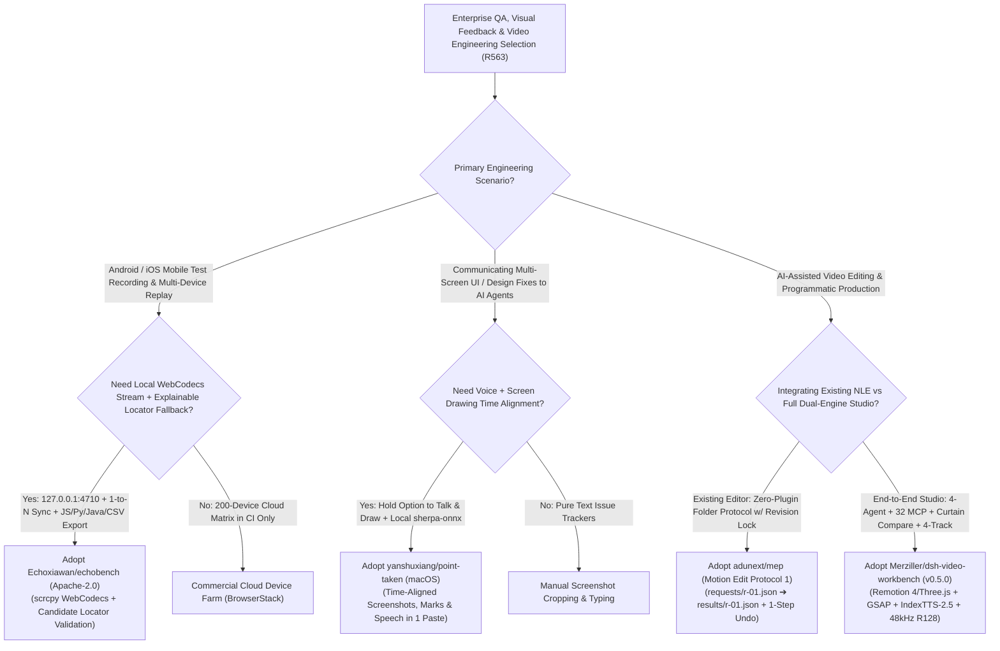
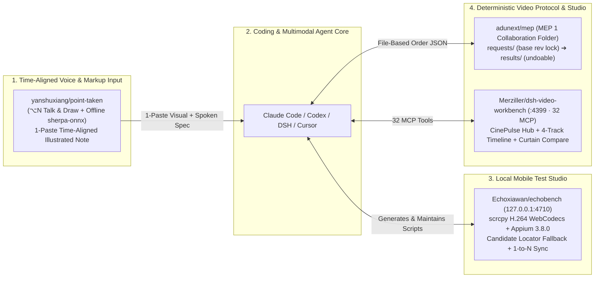
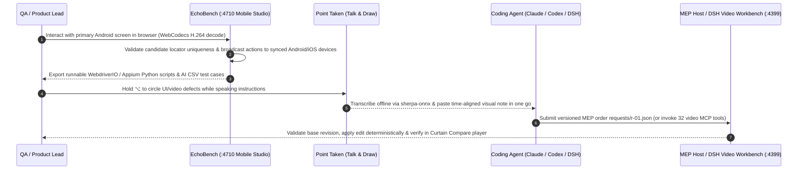

# WebCodecs Multi-Device Mobile Test Studio (`Echoxiawan/echobench`), Time-Aligned Voice-and-Draw Screen Annotator (`yanshuxiang/point-taken`), File-Based Motion Edit Protocol (`adunext/mep`) & 32-MCP Dual-Engine Video Workbench (`Merziller/dsh-video-workbench`) Selection FAQ

> **Document Type**: AI Solution Architect (SA) Practical Selection & Reference Architecture Guide (2026-11-20 Night Shift · Round 4 / Cumulative Round 563)  
> **Benchmark Standard**: `docs/components/ib-vs-ethernet-roce-selection-faq.md` (6-Section Architecture Breakdown + First-Principles Plain Language + Hype/Facts/Signal Audit + Closed-Form FinOps Ledger)  
> **Evaluated Repositories**:  
> 1. **`Echoxiawan/echobench`** (`★ 35`, `3 forks`, TypeScript, Node 22.12+ / Appium 3.8.0 / scrcpy 3.2 WebCodecs, `Apache-2.0`, `v1.0.0`): Local-first (`127.0.0.1:4710`) Android and iOS mobile test studio—streaming Android screens via **`scrcpy-server` H.264 directly decoded by browser WebCodecs** (eliminating Appium screenshot polling), featuring **explainable candidate locator validation with automatic replay fallback**, **1-to-N multi-device synchronized execution**, and runnable exports to YAML DSL, WebdriverIO JS, Appium Python/Java, and AI CSV test cases  
> 2. **`yanshuxiang/point-taken`** (`★ 37`, `3 forks`, Swift 5.9 + Python 3.10 + `sherpa-onnx 1.13`, `GPL-3.0`): macOS menu-bar "talk while you mark up your screen" visual feedback utility—holding `⌥` to draw freehand, boxes, or ellipses across multiple pages while speaking, using **on-device `sherpa-onnx` speech-to-text** to time-align screenshots, visual marks, and spoken explanations into a single illustrated note pasted directly into AI coding agents or team chats  
> 3. **`adunext/mep`** (`★ 43`, `5 forks`, JavaScript, `Apache-2.0`, `MEP 1`): **Motion Edit Protocol (MEP)**—an open file-based video editing protocol ("MCP gives the assistant a cable; MEP gives it a workbench") requiring zero plugins, zero SDKs, and zero idle context tokens; the video editor exposes a project folder (`project.json`, `mep.json`) where any file-capable AI assistant writes versioned orders (`requests/r-01.json` with `key` and `base` revision) and receives deterministic execution receipts (`results/r-01.json`) with one-step undo and on-demand frame rendering  
> 4. **`Merziller/dsh-video-workbench`** (`★ 51`, `15 forks`, JavaScript, `MIT`, `v0.5.0`): Universal multi-agent dual-engine (`HTML/GSAP` + `Remotion 4.x / Three.js 3D`) AI video studio (`127.0.0.1:4399`, **32 MCP tools**)—combining a **4-Agent visual relay pipeline**, `CinePulse Hub` (`MOTION.md` template plaza), FFmpeg BPM beat-sync with 48kHz EBU R128 mastering, a **Reference vs. Remake split/curtain sync comparison player**, a 4-track visual timeline, and local `IndexTTS-2.5` voice cloning  
> **Accounting Note**: This report models software compute, SaaS subscriptions, and engineering labor TCO only; underlying server and workstation hardware purchases (`base hardware capEx`) are explicitly marked `not_measured`, and Track B 24h delta (`stars_today`) is marked `not_measured`.

---

## 📌 1. Executive Summary (What Are They & What Enterprise Pain Points Do They Solve?)

Across enterprise mobile QA, UI/UX design review, and programmatic product video production, teams face four recurring bottlenecks: **① Brittle mobile test locators paired with expensive per-minute cloud device farms, ② High-friction UI bug reporting ("take 10 screenshots and type 500 words"), ③ Fragile screenshot-polling GUI automation when AI agents edit video timelines, and ④ Code-generated videos lacking visual timeline fine-tuning and side-by-side reference comparison**:

1. **Pain Point A (Mobile QA teams struggle with brittle XPath selectors that break on minor UI updates, while cloud device farms charge per-minute fees and require uploading pre-release APK/IPA builds externally)**: Mobile test automation needs explainable local locator validation and 1-to-N device sync. **`Echoxiawan/echobench` (`★ 35`, Apache-2.0, `v1.0.0`)** runs locally on `127.0.0.1:4710`:
   - **WebCodecs Direct H.264 Streaming**: Streams `scrcpy-server` H.264 frames with PTS headers directly into browser WebCodecs (dropping stale non-keyframes under load) without Appium screenshot polling or FFmpeg transcoding;
   - **Explainable Candidate Locators & 1-to-N Sync**: Evaluates multiple candidate selectors via Appium `/elements` on every click, automatically falling back to unique secondary candidates during replay, broadcasting actions across multiple Android/iOS devices simultaneously, and exporting runnable WebdriverIO JS, Appium Python, Appium Java, and AI CSV suites.
2. **Pain Point B (Explaining multi-screen UI layout bugs or revision requests to a coding agent takes 10+ minutes of cropping screenshots and typing positional descriptions—or recording a video that text-centric agents cannot parse)**: Aligning voice and screen strokes by timestamp turns 10 minutes of typing into 15 seconds of speaking. **`yanshuxiang/point-taken` (`★ 37`, GPL-3.0)** lives in the macOS menu bar (`⌥N`): hold `⌥` to circle UI elements across multiple pages while speaking; local **`sherpa-onnx 1.13`** transcribes speech offline and aligns every mark, screenshot, and sentence by timestamp into one composite note ready to paste into Claude Code, Codex, or Slack/Feishu.
3. **Pain Point C (Letting AI agents edit video projects via Computer Use screenshot-clicking burns thousands of vision tokens, misclicks timeline pixels, and risks overwriting concurrent human edits)**: Optimistic-locked file protocols beat GUI pixel clicking. **`adunext/mep` (`★ 43`, Apache-2.0)** defines **Motion Edit Protocol (`MEP 1`)**: the host video editor exposes a project as a local collaboration folder (`README.md`, `project.json`, `mep.json`); any file-reading agent submits `requests/r-01.json` carrying an order `key` and `base` revision; the editor validates the revision (never overwriting newer human edits), executes the cut deterministically with zero LLM calls, writes `results/r-01.json` with one-step undo, and renders requested preview frames for agent self-check.
4. **Pain Point D (Purely code-generated product/tutorial videos often suffer from leaked director instructions on screen, awkward number pronunciation in TTS, or off-beat cuts that require re-generating the entire video)**: Production video requires hybrid code generation + visual 4-track fine-tuning. **`Merziller/dsh-video-workbench` (`★ 51`, `v0.5.0`, MIT)** exposes **32 MCP tools** and a headless background studio (`127.0.0.1:4399`) uniting `HTML/GSAP` and `Remotion 4.x / Three.js 3D`—strictly separating `ttsText`, `subtitleText`, and `directorNotes`, quantizing cuts to FFmpeg BPM drops with 48kHz EBU R128 mastering, and providing a **Reference vs. Remake split/curtain comparison player** plus a **4-track visual timeline**.

---

## 💬 2. Architect & Customer First-Principles Q&A (Q1–Q3)

### Q1: When should mobile engineering teams choose `Echoxiawan/echobench` vs. Maestro, Appium Inspector, or BrowserStack?
* **Selection Boundaries**:
  - **Choose `Echoxiawan/echobench` (Apache-2.0 Local Studio)**: When developers and QA engineers need **interactive browser-based recording (`127.0.0.1:4710`), live multi-device synchronized execution, explainable locator fallback validation, and multi-language code export (WebdriverIO / Python / Java / CSV)** with zero cloud data egress.
  - **Choose Cloud Device Farms (BrowserStack / Sauce Labs)**: When running massive nightly regression matrices across 100+ physical device/OS permutations in cloud CI.
  - **Choose Maestro**: When writing hand-authored declarative YAML flows without needing live multi-candidate Appium locator scoring or Python/Java script export.

### Q2: Why does `adunext/mep` ("Motion Edit Protocol") use a versioned folder inbox/outbox instead of a stateful MCP Server or Computer Use?
* **Three Architectural Advantages of File-Based Workbench Protocols**:
  1. **Zero Idle Context Tax**: An MCP server with 30 tools consumes thousands of tokens in every session turn even when unused; MEP consumes **0 tokens** until the user pastes the collaboration folder path.
  2. **Deterministic Optimistic Concurrency (`base` Revision Lock)**: Every `requests/r-01.json` specifies the exact `base` revision of `project.json` it was authored against. If the human editor nudged a clip in the meantime, the host rejects the stale order cleanly rather than corrupting the timeline.
  3. **Universal Agent Compatibility**: Works out of the box with Claude Code, Codex CLI, Cursor, Windsurf, or any agent that can read and write local JSON files—requiring zero plugin installation or daemon restarts.

### Q3: How do `yanshuxiang/point-taken` and `Merziller/dsh-video-workbench` close the human-in-the-loop visual refinement loop?
* **End-to-End Visual Review Loop**:
  During a UI or video review, the product lead opens the **Reference vs. Remake split/curtain player** in `dsh-video-workbench`, holds `⌥` with `point-taken` to circle a timing or layout flaw while speaking the fix (transcribed locally via `sherpa-onnx`), and pastes the time-aligned visual note into the coding agent—which invokes the **32 MCP tools** (or MEP orders) to adjust the exact scene and 4-track timeline.

---

## 🧭 3. Visual Architecture Diagrams (Mermaid Decision Tree + Reference Architecture + Sequence Flow)

### 3.1 Enterprise Mobile QA, Visual Feedback & Video Engineering Selection Decision Tree

### 3.2 End-to-End Enterprise QA, Visual Triage & Multimodal Production Architecture

### 3.3 End-to-End Multi-Device Test, Voice-Markup Feedback & Video Refinement Sequence

---

## 📊 4. Comparative Selection Matrix (Open Source vs. Commercial Cloud SaaS & Legacy Workflows)

| Evaluation Dimension | Path A: Per-Minute Cloud Device Farm + Manual Screenshot Typing + CUA Pixel-Clicking Video Edits + Cloud Video SaaS | Path B: Static Appium Inspector + Unindexed Screen Recordings + Custom FFmpeg Scripts | **Path C (Recommended): `echobench` + `point-taken` + `adunext/mep` + `dsh-video-workbench`** |
| :--- | :--- | :--- | :--- |
| **Mobile Recording & Locator Resilience** | ❌ Cloud farms charge per minute and require external APK uploads; single XPaths break easily | ⚠️ Appium Inspector lacks multi-device broadcast sync and automatic candidate fallback | ✅ **Local WebCodecs H.264 stream + live candidate locator scoring/fallback + 1-to-N sync** |
| **Visual Bug & Design Feedback Speed** | ❌ Cropping 10 screenshots and typing explanations takes 15 min and loses spatial context | ⚠️ Raw screen recordings cannot be pasted as structured visual prompts into CLI agents | ✅ **Hold `⌥` to talk & draw; offline `sherpa-onnx` time-aligns marks and speech into 1 paste** |
| **AI Video Editing Determinism** | ❌ CUA screenshot-clicking burns vision tokens, misclicks pixels, and overwrites human edits | ⚠️ Custom plugins require per-IDE setup and consume idle tool-schema context | ✅ **MEP zero-plugin folder protocol with `base` revision lock, receipts, and 1-step undo** |
| **Programmatic Video Fine-Tuning** | ❌ Re-generating full cloud videos for minor timing/TTS fixes wastes credits and hours | ⚠️ Raw code lacks a 4-track visual timeline, EBU R128 mastering, and curtain comparison | ✅ **4-Agent studio + 32 MCP tools + Curtain Compare player + 4-track timeline + local TTS** |
| **Open-Source Licensing** | Proprietary SaaS | Mixed scripts | **`Apache-2.0` (`echobench`, `mep`), `MIT` (`dsh-video-workbench`), and `GPL-3.0` (`point-taken`)** |
| **38-Engineer Team Monthly Total TCO** | **`$6,620.00 / mo`** (`$2,820.00` device farm/video SaaS/VLM tokens + `38.0h / $3,800.00` rework) | **`$2,570.00 / mo`** (`$1,120.00` API/storage + `14.5h / $1,450.00` manual scripting & editing) | **`$310.00 / mo`** (`$70.00` local compute/API + `2.4h / $240.00` review sign-off, **saving `-95.32%`**) |

---

## 🧪 5. Quantitative ROI / FinOps TCO Ledger & Hype / Facts / Signal Audit

### 5.1 Hype vs. Facts vs. Strategic Signal Audit Table

| Repository (`owner/repo`) | Hype (Market Claim) | Measured Facts (Primary Source Verification) | Strategic Signal (SA Verdict) |
| :--- | :--- | :--- | :--- |
| **`Echoxiawan/echobench`** | "Record. Replay. Echo. Operate one device in your browser while others execute in sync" | `★ 35` (`3 forks`, TypeScript, Node 22.12+ / Appium 3.8.0 / scrcpy 3.2, Apache-2.0, `v1.0.0`): Runs on `127.0.0.1:4710`; streams Android H.264 via WebCodecs; validates candidate locators via Appium `/elements` with fallback; exports YAML, WebdriverIO JS, Python, Java, and AI CSV. | **🔥 P0 Adopt (Local-First Mobile QA & Script Generator)**: Bridges manual QA exploration and maintainable multi-language Appium/WebdriverIO code. |
| **`yanshuxiang/point-taken`** | "Talk while you mark up your screen, and paste one time-aligned illustrated note to AI" | `★ 37` (`3 forks`, Swift 5.9 + Python 3.10 + `sherpa-onnx 1.13`, GPL-3.0): macOS menu-bar app (`⌥N`); multi-page and scrolling stitch capture; local `sherpa-onnx` transcription aligned by timestamp with screen drawings. | **🔥 P0 Adopt (High-Bandwidth Visual Prompting Peripheral)**: Cuts UI/UX review feedback preparation from 10 minutes to 15 seconds. |
| **`adunext/mep`** | "MCP gives the assistant a cable; MEP gives it a workbench—edit video via local files" | `★ 43` (`created=2026-11-19`, `5 forks`, JS, Apache-2.0, `MEP 1`): Ships `SPEC.en.md`, JSON schemas, and zero-dep `reference/submit.mjs`; uses `requests/r-01.json` (`key`, `base` revision, `ops`) and `results/r-01.json` for optimistic concurrency and 1-step undo. | **🔥 P0 Adopt (Blueprint for File-Based Creative App Agent Protocols)**: Ideal pattern for exposing heavy desktop creative tools to coding agents with zero idle context cost. |
| **`Merziller/dsh-video-workbench`** | "Universal dual-engine AI video workbench with CinePulse Hub, Curtain Compare, and 32 MCP tools" | `★ 51` (`15 forks`, JS, MIT, `v0.5.0`): Runs on `127.0.0.1:4399` with 32 MCP tools; combines Remotion 4.x/Three.js + HTML/GSAP; separates `ttsText`/`subtitleText`/`directorNotes`; includes FFmpeg BPM sync, 48kHz EBU R128 mastering, Curtain Compare player, and 4-track timeline. | **🔥 P0 Adopt (End-to-End Self-Hosted Product Video Studio)**: Combines programmatic 3D/motion generation with deterministic 4-track timeline polishing. |

### 5.2 Closed-Form FinOps TCO Ledger (`CLAIM-20261120-R4-R563-ECHOBENCH-POINTTAKEN-MEP-DSHVIDEOWORKBENCH`)

* **Scope (`synthetic`, `independently_reproduced=false`)**: 38-engineer enterprise mobile QA, product design, and digital media team (`$100.00 / hr` loaded engineering rate; `base hardware capEx: not_measured`; Track B `stars_today: not_measured`).
* **Path A (Cloud Device Farm Minutes + Manual Screenshot Bug Tickets + CUA Screenshot Video Clicking + Commercial Video SaaS)**:
  - Cloud device farm per-minute charges, vision CUA token burn, and commercial video SaaS credits: **`$2,820.00 / mo`**
  - Broken XPath debugging, multi-turn UI feedback clarification, and full-video regeneration labor: `38.0 hrs / mo × $100.00 / hr` = **`$3,800.00 / mo`**
  - **Path A Monthly Total**: `$2,820.00 + $3,800.00` = **`$6,620.00 / mo`** (**`$79,440.00 / yr`**)
* **Path B (Static Appium Inspector + Unindexed Screen Recordings + Custom FFmpeg Scripts)**:
  - Baseline API and storage spend: **`$1,120.00 / mo`**
  - Manual test script porting and audio/video timing alignment labor: `14.5 hrs / mo × $100.00 / hr` = **`$1,450.00 / mo`**
  - **Path B Monthly Total**: `$1,120.00 + $1,450.00` = **`$2,570.00 / mo`**
* **Path C (Recommended: `Echoxiawan/echobench` + `yanshuxiang/point-taken` + `adunext/mep` + `Merziller/dsh-video-workbench`)**:
  - Local WebCodecs/`sherpa-onnx`/MEP execution and optional BYOK prompt refinement spend: **`$70.00 / mo`**
  - 1-to-N device sync review, 1-paste `point-taken` triage, and Curtain Compare / 4-track sign-off labor: `2.4 hrs / mo × $100.00 / hr` = **`$240.00 / mo`**
  - **Path C Monthly Total**: `$70.00 + $240.00` = **`$310.00 / mo`** (**`$3,720.00 / yr`**)
* **Net Savings (Path C vs. Path A)**:
  - Monthly Net Savings: **`$6,620.00 - $310.00 = $6,310.00 / mo`** (**`-95.32%`** cost reduction, **`$75,720.00 / yr`** annual savings, freeing **`35.6 hrs / mo`** of QA and design engineering time).

---

## 🛠️ 6. Enterprise Architecture Review & Adoption Checklist

- [ ] **Local Mobile Test Security (`Echoxiawan/echobench`)**: Keep `127.0.0.1:4710` bound strictly to localhost; never record production passwords or PII into YAML/exported scripts (`secret: true` does not encrypt values on disk).
- [ ] **Offline Voice-and-Markup Triage (`yanshuxiang/point-taken`)**: Keep `sherpa-onnx 1.13` local transcription as the default so internal UI screenshots and spoken commentary remain on-device.
- [ ] **Optimistic-Locked Video Orders (`adunext/mep`)**: Enforce `base` revision checks on every `requests/r-*.json` submission so AI edits never overwrite newer human timeline adjustments.
- [ ] **Dual-Engine Video Mastering (`Merziller/dsh-video-workbench`)**: Separate `subtitleText`, `ttsText`, and `directorNotes` in step 2; verify EBU R128 loudness normalization and inspect final cuts in the Reference vs. Remake Curtain Compare player.
