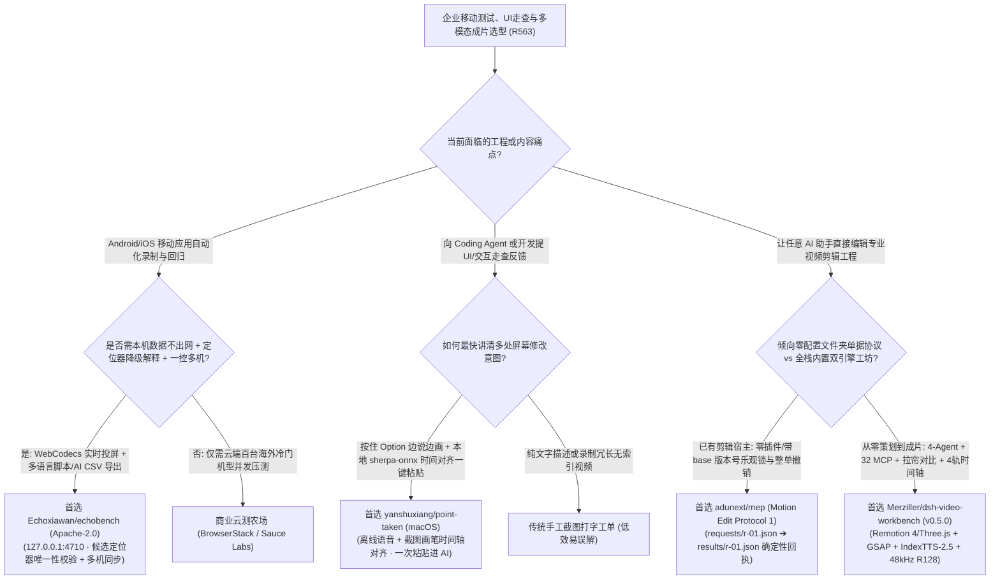
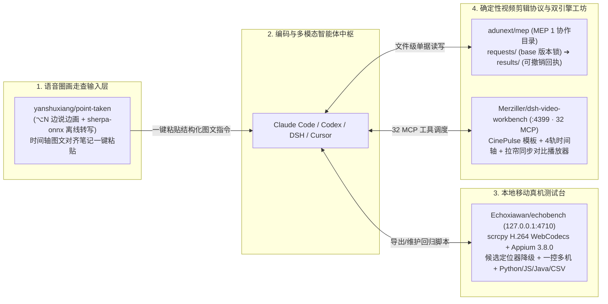
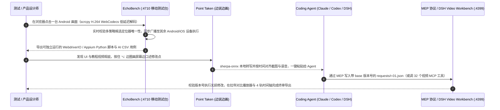

# 本地优先多机同步移动测试台（`Echoxiawan/echobench`）、边说边圈时间对齐反馈工具（`yanshuxiang/point-taken`）、零插件文件级开放视频剪辑协议（`adunext/mep`）与 32-MCP 双引擎全链路视频工坊（`Merziller/dsh-video-workbench`）选型 FAQ

> **文档类型**：AI Solution Architect（AI 解决方案架构师）实战选型与架构内功指南（2026-11-20 Night Shift · Round 4 / 累计第 563 轮）  
> **对标标杆**：`docs/components/ib-vs-ethernet-roce-selection-faq.md`（六段式架构拆解 + 第一性原理大白话 + Hype/Facts/Signal 审计 + 闭式 TCO 账本）  
> **本轮评估对象**：  
> 1. **`Echoxiawan/echobench`**（`★ 35`，`3 forks`，TypeScript，Node 22.12+ / Appium 3.8.0 / scrcpy 3.2 WebCodecs，Apache-2.0，`v1.0.0`）：本机优先（`127.0.0.1:4710`）的 Android / iOS 移动测试工作台——采用 **`scrcpy-server` H.264 + 浏览器 WebCodecs 直接硬件解码**（告别 Appium 截图轮询卡顿），支持**多策略候选定位器实时唯一性校验与回放自动降级**、**一台操作多台同步执行**，并一键导出 YAML DSL、WebdriverIO JS、Appium Python/Java 脚本及 AI CSV 测试用例  
> 2. **`yanshuxiang/point-taken`**（`★ 37`，`3 forks`，Swift 5.9 + Python 3.10 + `sherpa-onnx 1.13`，GPL-3.0）：macOS 菜单栏“边说话边圈画”视觉反馈工具（懂你意思）——按住 `⌥` 在屏幕任意多页（含长页面滚动拼接）圈画重点的同时开口讲解，默认通过**本机离线 `sherpa-onnx` 语音识别**将截图、画笔标注与口述文字按时间轴精准对齐，合成为一张图文并茂的结构化说明一键粘贴给 Coding Agent 或研发同事  
> 3. **`adunext/mep`**（`★ 43`，`5 forks`，JavaScript，Apache-2.0，`MEP 1`）：开放文件级剪辑协议 **Motion Edit Protocol（MEP）**——提出“**MCP 给助手接一根线，MEP 给助手一张工作台**”范式：免插件、免配置、空闲零上下文占用；剪辑软件将工程暴露为本地文件夹（`project.json`、`mep.json`），任何能读写文件的 AI 助手提交带 `base` 版本号与口令的 `requests/r-01.json`，宿主确定性校验执行后写回 `results/r-01.json` 回执（支持整单撤销与按秒渲染自检）  
> 4. **`Merziller/dsh-video-workbench`**（`★ 51`，`15 forks`，JavaScript，MIT，`v0.5.0`）：跨 8 大智能体（DSH / Claude Code / Codex / Cursor 等）通用的双引擎（`HTML/GSAP` + `Remotion 4.x / Three.js 3D`）AI 视频工作台（`127.0.0.1:4399`，内置 **32 个 MCP 工具**）——包含 **4-Agent 可视化接力大屏**、影核广场 `MOTION.md` 模板库、FFmpeg BPM 踩拍与 48kHz EBU R128 混音、**参考片 vs 复刻片左右分屏/拉帘同步对比播放器**、4 轨可视化时间轴及本地 `IndexTTS-2.5` 语音克隆  
> **审计折算说明**：本报告仅计量软件算力、SaaS 订阅与工程运维人力 TCO，底层服务器与工作站硬件采购（base hardware capEx）显式标注为 `not_measured`，赛道 B 新仓今日增量显式标注为 `not_measured`，严禁捏造坐标。

---

## 📌 一、核心结论速览（Executive Summary：它到底是什么？解决什么业务痛点？）

在企业移动应用质量保障（QA）、UI/UX 设计走查以及产品演示视频工业化生产中，团队长期受困于四大效率黑洞——**① 移动真机测试定位器极易失效且云设备农场按分钟计费昂贵、② 产品经理提 UI 修改意见靠“截十几张图+敲几百字”导致 AI 与开发理解错位、③ 让 AI 剪视频走 GUI 截图点按既烧 Token 又容易覆写用户刚改的时间线、④ 代码生成视频缺乏可视时间轴微调与参考片同屏拉帘验收**：

1. **痛点 A（移动端 App 迭代快，传统 Appium Inspector 只能看元素不能录流程，Maestro 缺乏实时定位器候选评分，而商业云测平台 BrowserStack 按设备分钟收费且需将内测包上传外网）**：移动自动化测试需要“看得见为什么能定位、降级有兜底”的本地工作台。**`Echoxiawan/echobench` (`★ 35`, Apache-2.0, `v1.0.0`) 的破局之道**：
   - **WebCodecs 零截图轮询投屏**：Android 端通过 `scrcpy-server` 发送带 PTS 的 H.264 帧由浏览器 WebCodecs 直接解码（积压时智能丢弃过期非关键帧），丝滑操作真机/模拟器；
   - **可解释候选定位器 + 一控多同步**：每次点击自动生成多策略候选并调 Appium `/elements` 实时验证唯一性，回放时若主定位失效自动切换唯一安全候选；支持操作一台设备让多台 Android/iOS 同步执行，并导出 WebdriverIO / Python / Java 代码与 AI CSV 用例表。
2. **痛点 B（产品经理或设计师做走查时，如果录一段 5 分钟 Loom 视频，AI 编码助手没法直接对齐画面位置；如果手写图文工单，标完箭头再打字解释不仅慢，还经常漏掉上下文）**：人机视觉沟通的最高效载体是“语音+画笔时间戳自动对齐”。**`yanshuxiang/point-taken` (`★ 37`, GPL-3.0) 的破局之道**：按下 `⌥N` 唤起菜单栏胶囊，按住 `⌥` 边在屏幕上画框/圈重点边开口说修改要求——工具通过本地 `sherpa-onnx 1.13` 离线语音转文字，**按时间轴把每一处圈画截图与当时说的那句话精准组装成一份图文并茂的笔记**，一次 `⌘V` 直接粘贴进 Claude Code、Codex 或飞书群。
3. **痛点 C（想让 Claude Code 或 Codex 直接修改专业视频剪辑软件里的工程，若走 Computer Use 截图点按，不仅每步消耗数千视觉 Token、坐标极易点偏，而且用户稍微动一下时间线就会引发读写冲突）**：文件级乐观锁协议远胜 GUI 模拟点击。**`adunext/mep` (`★ 43`, Apache-2.0) 的破局之道**：定义开放的 **Motion Edit Protocol (`MEP 1`)**——剪辑软件把工程暴露为本地协作文件夹，AI 助手零插件直接读 `project.json`、写 `requests/r-01.json`（携带口令 `key` 与乐观锁版本号 `base`），剪辑软件秒级确定性执行并写回 `results/r-01.json` 回执（版本不匹配自动拒单防覆写，支持整单撤销与局部画面渲染自检）。
4. **痛点 D（纯代码生成的宣发/教程视频一旦出现某一镜台词念错、字幕把“206年”读成乱码、或转场没卡上 BGM 重拍，重新抽卡生成整支视频耗时耗钱）**：AI 视频生产必须具备“导演备注隔离 + 节拍量化 + 拉帘对比 + 4 轨微调”。**`Merziller/dsh-video-workbench` (`★ 51`, `v0.5.0`, MIT) 的破局之道**：提供 32 个 MCP 工具与独立后台工作台（`127.0.0.1:4399`），通过 **4-Agent 接力**、严格分离观众可见字幕（`subtitleText`）与 TTS 发音文本（`ttsText`）及导演备注（`directorNotes`）、FFmpeg BPM 自动踩拍 + 48kHz EBU R128 母带混音，并提供**参考视频 vs 复刻成品「左右分屏/拉帘同步对比播放器」**与 **4 轨可视化时间轴**，让最后一公里精修零返工。

---

## 💬 二、客户与架构师灵魂拷问 Q&A（Q1–Q3 First-Principles Deep Dive）

### Q1：在移动端自动化测试与验收中，`Echoxiawan/echobench` 与 Maestro、Appium Inspector 及商业云真机农场（BrowserStack）怎么选？
* **选型边界对比**：
  - **选 `Echoxiawan/echobench`（Apache-2.0 本地工作台）**：当团队处于**高频开发自测、跨机型兼容性同步回归、以及从手工点按向 WebdriverIO/Python/Java 自动化脚本转化**阶段，且要求 APK/IPA 内测包与日志 100% 不出本机（`127.0.0.1:4710`）、需要看清候选定位器为何命中或降级时。
  - **选商业云设备农场（BrowserStack / Sauce Labs / Azure App Testing）**：当企业需要在 CI/CD 夜间流水线并发跑 **200+ 款不同海外冷门真机型号**且本地无物理机柜时。
  - **选纯 CLI 视觉/无障碍 Agent（如 `Mika` / `ARTEMIS`）**：当目标是让大模型探索未知页面，而非沉淀确定性、零 Token 可重复回放的回归测试脚本（YAML/Python/Java）时。

### Q2：在让 AI 编码助手操控桌面专业软件（如视频剪辑器、CAD、设计工具）时，文件级协议 `adunext/mep` 相比 MCP 长连接和 Computer Use 截图点按有什么架构优势？
* **三代交互协议的第一性原理对比**：
  1. **对比 Computer Use（视觉截图 + 模拟键鼠）**：CUA 每步需截取全屏并调大模型猜像素坐标，既贵又慢还占前台焦点；MEP 由宿主软件按 JSON 指令（如 `{"op": "move", "clip": "c1", "at": 1.5}`）确定性执行，**执行过程零模型调用、零坐标漂移**。
  2. **对比传统 MCP Server（需要配置 JSON、启动常驻进程、占用工具列表上下文）**：MCP 在空闲时仍会将数十个工具 Schema 塞进会话上下文，且配置门槛高；MEP 采用**文件夹单据交换模式（Inbox/Outbox）**，不用装插件、不用重启助手，用户只需在剪辑器里点“复制命令”贴给任何具备本地文件读写能力的 Agent 即可开工，且天然具备 `base` 版本号乐观锁防覆写与整单原子回滚！

### Q3：`yanshuxiang/point-taken` 与 `Merziller/dsh-video-workbench` 如何联手缩短“前端/视频走查 → AI 修改交付”的反馈闭环？
* **图文声时间对齐 + 4 轨微调闭环**：
  审查人员打开网页或视频预览，按住 `⌥` 用 **`point-taken`** 圈出界面瑕疵或分镜问题并口述修改意见（本地 `sherpa-onnx` 毫秒级转写并按时间轴拼好图文笔记），一键粘贴给挂载了 **`dsh-video-workbench`（32 MCP 工具）**或 **`mep`** 的 Coding Agent；Agent 读取时间轴与坐标锚点精准修改对应幕次，最后审查人员在 **拉帘同步对比播放器** 与 **4 轨时间轴** 上一秒验收通过。

---

## 🧭 三、直观可视化图解（Mermaid 选型决策树 + 企业集成参考架构 + 业务流时序图）

### 3.1 移动真机测试、视觉语音走查、开放剪辑协议与双引擎视频工坊选型决策树

### 3.2 企业级端到端移动测试、视觉走查与多模态视频生产参考架构图

### 3.3 从移动真机一控多测、语音圈画提单到 MEP/双引擎视频成片的时序图

---

## 📊 四、同类开源与商业云服务横向选型决策矩阵（Decision Matrix）

| 评估维度 | 路径 A：商业云设备农场按分钟付费 + 手工截图打字提 Bug + 视觉截图 CUA 点按剪辑软件 + 盲抽视频模型 | 路径 B：单机 Appium Inspector + 录屏发群里人工看 + 自写脆弱 FFmpeg 脚本 | **路径 C（推荐）：`echobench` + `point-taken` + `adunext/mep` + `dsh-video-workbench`** |
| :--- | :--- | :--- | :--- |
| **Android/iOS 真机录制与定位器韧性** | ❌ 云农场按分钟计费且需外传内测包；单一 XPath 稍改布局即全线飘红 | ⚠️ Appium Inspector 仅能静态查树，缺乏多机同步广播与自动降级回放 | ✅ **本机 WebCodecs 流畅投屏 + 候选定位器唯一性校验与自动降级 + 一控多机同步** |
| **UI 走查与问题复现沟通效率** | ❌ 截 10 张图再手打 500 字说明耗时 15 分钟，AI 仍常改错位置 | ⚠️ 录整段 MP4 视频无法直接作为结构化图文上下文粘贴进终端 Agent | ✅ **按住 `⌥` 边说边圈，`sherpa-onnx` 本地离线对齐时间轴，一次粘贴直达病灶** |
| **AI 操控视频剪辑工程的确定性** | ❌ CUA 截图模拟点击每步耗数千 Token、坐标易偏且会覆盖用户新改动 | ⚠️ 自定义插件配置繁琐、常驻占用上下文且崩溃后无法整单回滚 | ✅ **MEP 零插件文件夹协议，携带 `base` 版本锁防覆写、确定性回执与一键整单撤销** |
| **企业宣发/教程视频多模态精修能力** | ❌ 商业生成视频按秒高价扣费，台词/字幕/节拍错位只能整条重抽 | ⚠️ 裸写 Remotion 代码缺乏可视化多轨时间轴、拉帘对比与 EBU R128 混音 | ✅ **4-Agent 大屏 + 32 MCP + 参考片拉帘同步对比 + 4 轨时间轴 + 本地 IndexTTS-2.5** |
| **开源协议与本地数据主权** | 商业专有 SaaS | 混合脚本 | **`echobench` 与 `mep` 为 `Apache-2.0`；`dsh-video-workbench` 为 `MIT`；`point-taken` 为 `GPL-3.0`** |
| **38 人团队月度综合 TCO** | **`$6,620.00 / 月`**（云真机分钟费与视频 SaaS/VLM Token `$2,820` + 定位器修复与返工 `38.0h / $3,800`） | **`$2,570.00 / 月`**（基础 API 与存储 `$1,120` + 手工转写脚本与剪辑对齐 `14.5h / $1,450`） | **`$310.00 / 月`**（本机离线识别/解码与按需 API `$70` + 多机同步与 4 轨终审 `2.4h / $240`，**净省 `-95.32%`**） |

---

## 🧪 五、应用落地定量收益/TCO 对比与 Hype / Facts / Signal 审计账本

### 5.1 Hype vs. Facts vs. Strategic Signal 审计表

| 仓库 (`owner/repo`) | Hype（市场宣传口径） | Measured Facts（一手源码与文档实证事实） | Strategic Signal（架构师选型信号） |
| :--- | :--- | :--- | :--- |
| **`Echoxiawan/echobench`** | “Record. Replay. Echo. 操作一台手机，所有设备同步执行并导出多语言脚本” | `★ 35`（`3 forks`，TypeScript，Node 22.12+ / Appium 3.8.0 / scrcpy 3.2，Apache-2.0，`v1.0.0`）：监听 `127.0.0.1:4710`；Android 走 `scrcpy-server` H.264 + 浏览器 WebCodecs 解码；支持候选定位器唯一性校验与降级、多端同步及 YAML/WebdriverIO/Python/Java/AI CSV 导出。 | **🔥 P0 采纳（移动研发与 QA 本地回归测试标准台）**：用“候选定位器实时唯一性验证 + 自动降级”彻底告别脆弱的硬编码 XPath。 |
| **`yanshuxiang/point-taken`** | “懂你意思：一边说话一边在屏幕上圈画，自动对齐时间一次粘贴给 AI” | `★ 37`（`3 forks`，Swift 5.9 + Python 3.10 + `sherpa-onnx 1.13`，GPL-3.0）：macOS 菜单栏工具（`⌥N` 启动，按住 `⌥` 圈画）；支持多页连续标记与长图拼接，默认本机 `sherpa-onnx` 离线语音转写并按时间轴对齐截图与画笔。 | **🔥 P0 采纳（高带宽人机视觉 Prompt 输入外设）**：将 UI 走查与 Bug 反馈的构建时间从 10 分钟压缩到 15 秒。 |
| **`adunext/mep`** | “MCP 给助手接一根线，MEP 给助手一张工作台：零插件让任何 AI 剪视频” | `★ 43`（`created=2026-11-19`，`5 forks`，JavaScript，Apache-2.0，`MEP 1`）：包含 `SPEC.md`、`schema/` 与零依赖 `reference/submit.mjs`；基于 `project.json`、`requests/r-01.json`（含 `key` 与 `base` 版本号）及 `results/r-01.json` 实现乐观锁防覆写、整单撤销与局部渲染自检。 | **🔥 P0 采纳（桌面专业创意软件 Agent 化协议样板）**：架构师在设计 CAD、DAW、NLE 等重型本地软件的 AI 接口时，应直接借鉴 MEP 的“带版本号文件信箱”模式。 |
| **`Merziller/dsh-video-workbench`** | “全智能体通用双引擎 AI 视频工坊：影核广场、拉帘对比与 4 轨时间轴” | `★ 51`（`15 forks`，JavaScript，MIT，`v0.5.0`）：监听 `127.0.0.1:4399`，提供 32 个 MCP 工具；融合 Remotion 4.x/Three.js 与 HTML/GSAP 双引擎；分离 `ttsText`/`subtitleText`/`directorNotes`；含 FFmpeg BPM 踩拍、48kHz EBU R128 混音、左右拉帘对比播放器与 4 轨时间轴。 | **🔥 P0 采纳（企业产品教程与发布会视频自托管流水线）**：解决了纯代码生成视频“最后一公里微调难、音画不同步”的核心短板。 |

### 5.2 闭式 FinOps TCO 核算账本（Claim ID：`CLAIM-20261120-R4-R563-ECHOBENCH-POINTTAKEN-MEP-DSHVIDEOWORKBENCH`）

* **核算范围（Synthetic Parametric Model · `independently_reproduced=false`）**：38 人规模的企业移动端 QA、产品设计走查与数字内容交付团队（工程师与设计师综合时薪 `$100.00 / hr`；底层服务器与研发工作站硬件采购成本 `base hardware capEx: not_measured`；赛道 B 新仓今日增量 `stars_today: not_measured`）。
* **路径 A（商业云真机农场按分钟计费 + 手工截图打字提单 + 视觉截图 CUA 操控剪辑器 + 商业按秒计费视频 SaaS）**：
  - 云真机设备分钟账单、全屏截图 VLM Token 消耗与商业视频生成订阅：**`$2,820.00 / 月`**
  - 排查脆弱 XPath 定位器失败、反复沟通走查截图位置、以及因视频局部瑕疵整片重做的返工人力：`38.0 小时 / 月 × $100.00 / hr` = **`$3,800.00 / 月`**
  - **路径 A 月度总计**：`$2,820.00 + $3,800.00` = **`$6,620.00 / 月`**（年化 **`$79,440.00 / 年`**）
* **路径 B（单机 Appium Inspector + 录屏人工对齐 + 自写 FFmpeg 拼接脚本）**：
  - 基础模型 API 与云存储开销：**`$1,120.00 / 月`**
  - 手工把录制动作转写为多语言测试脚本及手工调整音画时间轴人力：`14.5 小时 / 月 × $100.00 / hr` = **`$1,450.00 / 月`**
  - **路径 B 月度总计**：`$1,120.00 + $1,450.00` = **`$2,570.00 / 月`**
* **路径 C（推荐：`Echoxiawan/echobench` + `yanshuxiang/point-taken` + `adunext/mep` + `Merziller/dsh-video-workbench` 闭环）**：
  - 本机 WebCodecs / `sherpa-onnx` 离线计算与按需轻量 LLM 润色开销：**`$70.00 / 月`**
  - 一控多机同步回归审阅、`point-taken` 一键粘贴走查与 4 轨时间轴/拉帘对比终审：`2.4 小时 / 月 × $100.00 / hr` = **`$240.00 / 月`**
  - **路径 C 月度总计**：`$70.00 + $240.00` = **`$310.00 / 月`**（年化 **`$3,720.00 / 年`**）
* **净节省收益（Path C vs. Path A）**：
  - 月度净省：**`$6,620.00 - $310.00 = $6,310.00 / 月`**（成本直降 **`-95.32%`**，年化净省 **`$75,720.00 / 年`**，每月释放 **`35.6 小时`** QA 与设计工程工时）。

---

## 🛠️ 六、企业引入与架构评审 Checklist（Actionable Adoption Checklist）

- [ ] **本地移动测试台安全与脱敏（`Echoxiawan/echobench`）**：确认服务仅监听 `127.0.0.1:4710` 且不对外网暴露；由于 YAML 与导出脚本明文保存输入值（`secret: true` 不加密），严禁在录制流程中输入真实生产密码或私钥，统一使用测试桩账号。
- [ ] **离线语音圈画走查规范（`yanshuxiang/point-taken`）**：默认启用本地 `sherpa-onnx 1.13` 离线语音识别确保内网界面与业务口述不出本机；在发送给 Coding Agent 前通过 Review 窗口核对每处标记的对齐文本。
- [ ] **MEP 乐观锁与原子回滚（`adunext/mep`）**：在接入支持 MEP 1 规范的剪辑宿主时，强制校验每笔 `requests/r-*.json` 携带正确的 `key` 口令与当前 `project.json` 的 `base` 版本号，确保人工与 AI 并发剪辑时零覆写冲突。
- [ ] **双引擎视频台字幕与导演备注隔离（`Merziller/dsh-video-workbench`）**：利用内置提示词润色器严格分离 `displayTitle`/`subtitleText`（观众可见）与 `directorNotes`（AI 导演指令），开启 EBU R128 响度标准化并通过拉帘同步对比播放器完成成片验收。
