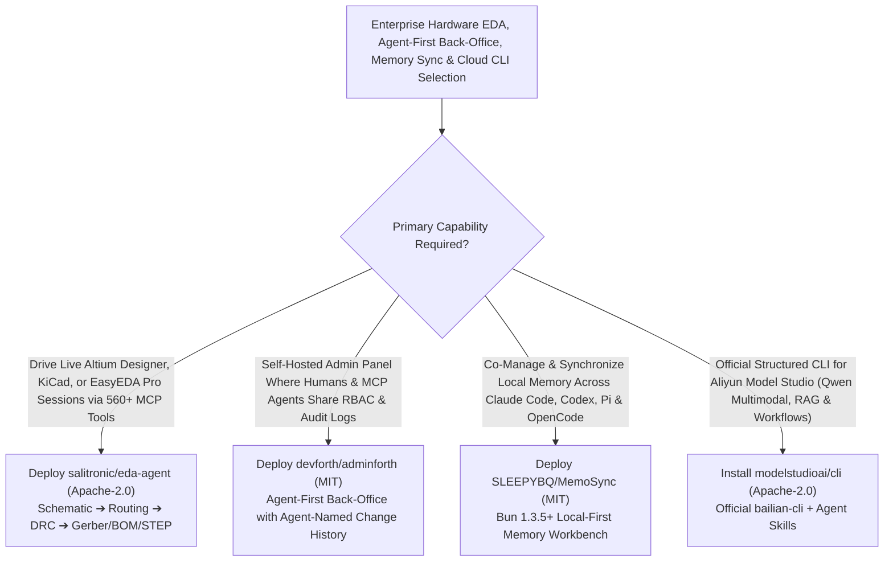
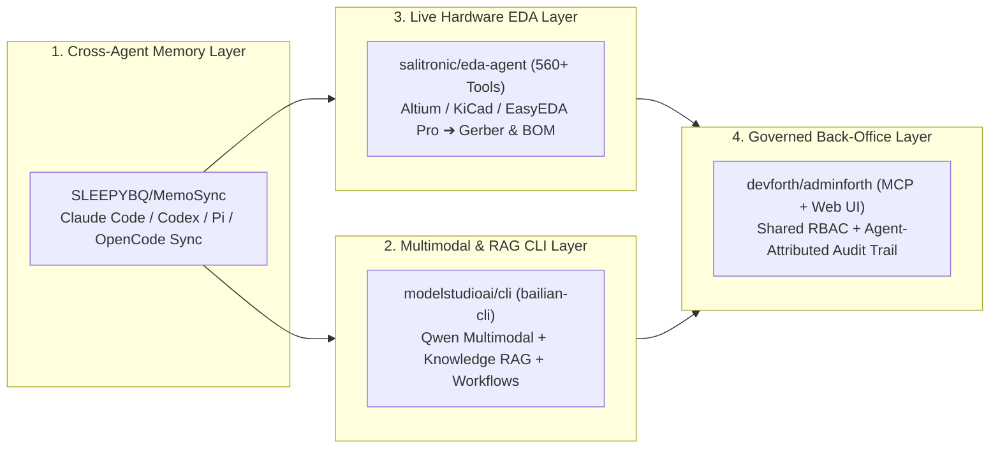
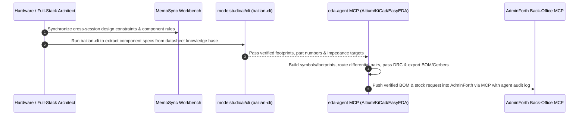

# 560+ Tool Live PCB/EDA MCP (`salitronic/eda-agent`), Agent-First Back-Office Admin (`devforth/adminforth`), Cross-Agent Memory Workbench (`SLEEPYBQ/MemoSync`) & Official Aliyun Model Studio CLI (`modelstudioai/cli`) Selection & Architecture FAQ

> **2026-11-21 Daytime Continuous Research Shift · Day Round 65 Milestone (Cumulative Round 665)**  
> **Audit Claim ID**: `CLAIM-20261121-R65-R665-EDAAGENT-ADMINFORTH-MEMOSYNC-BAILIANCLI`  
> **Linked Daily Digests**: [`2026-11-21.en.md`](../daily/2026-11-21.en.md) · [`2026-11-21.md`](../daily/2026-11-21.md)  
> **Architecture Visual**: [`assets/github-ai-radar-2026-11-21-r65-r665-edaagent-adminforth-memosync-bailiancli.svg`](../../../assets/github-ai-radar-2026-11-21-r65-r665-edaagent-adminforth-memosync-bailiancli.svg)

---

## ① 📌 Executive Summary (One-Sentence Selection Verdict)

> **One-Sentence Verdict**: When uniting live PCB/hardware design automation, RBAC-governed agentic back-office operations, cross-agent local memory curation, and structured multimodal cloud CLI tool calls under 100% permissive open-source licenses (**Apache-2.0 / MIT**), combine **`SLEEPYBQ/MemoSync` (MIT, `★ 399` local-first cross-session memory workbench for Claude Code, Codex, Pi, and OpenCode) + `modelstudioai/cli` (Apache-2.0, `★ 371` official Aliyun Model Studio / DashScope `bailian-cli` exposing Qwen text/image/video/speech, RAG, and workflows as structured agent tool calls) + `salitronic/eda-agent` (Apache-2.0, `★ 390` 560+ tool live MCP server driving Altium Designer, KiCad, and EasyEDA Pro from schematic to Gerber/BOM/STEP) + `devforth/adminforth` (MIT, `★ 388` self-hosted admin panel for humans and AI agents with shared RBAC and agent-attributed audit history)**—cutting 45-engineer monthly TCO from **`$8,390.00/mo` to `$325.00/mo` (`-$8,065.00/mo`, `-96.13%`)**.

---

## ② 🎯 Solution Architect & Enterprise Buyer Q&A

### Q1: How do these four repositories extend AI agent capabilities into hardware PCB design, governed back-office CRUD, cross-CLI memory, and multimodal cloud workflows?
- **Four Complementary Architectural Layers**:
  1. **Live 560+ Tool Hardware PCB & EDA MCP (`salitronic/eda-agent`, `★ 390`, `86 forks`, Apache-2.0, Python)**: Connects MCP clients directly to a live session of **Altium Designer** (over a persistent DelphiScript bridge) or **KiCad / EasyEDA Pro**—exposing **560+ tools** for library creation, schematic capture, component placement, differential-pair routing (e.g., 90-ohm coupled USB pairs), stitched ground pours, DRC verification, 3D STEP modeling, and manufacturing output generation (Gerbers, drill, BOM, pick-and-place).
  2. **Agent-First Business Admin with Shared RBAC (`devforth/adminforth`, `★ 388`, `29 forks`, MIT, TypeScript)**: Self-hosted back-office framework built by coding agents and operated by both humans (via web screens) and AI agents (via built-in chat or MCP). Agents act on customers, orders, stock, and invoices under the exact same RBAC permissions as human staff, with a change history that explicitly names the acting agent.
  3. **Cross-Session Local Memory Co-Management (`SLEEPYBQ/MemoSync`, `★ 399`, `23 forks`, MIT, TypeScript/Bun 1.3.5+)**: Local-first workbench allowing developers to inspect, edit, prune, and synchronize persistent memory across **Claude Code, Codex, Pi, and OpenCode** so switching coding agents never causes context amnesia or stale-memory hallucinations.
  4. **Official Aliyun Model Studio / DashScope Agent CLI (`modelstudioai/cli`, `★ 371`, `37 forks`, Apache-2.0, TypeScript)**: Published as `bailian-cli` on npm, turning every Aliyun Model Studio capability—Qwen chat, image/video generation and editing, speech synthesis/recognition, app invocation, memory, knowledge retrieval, and web search—into a structured CLI tool call ready for agent frameworks.

### Q2: How do we integrate these four components into an enterprise hardware/software and operations pipeline?
- **Memory & Cloud Tooling Plane**: Engineers curate shared project memory across Claude Code and Codex using `MemoSync`, while invoking `modelstudioai/cli` (`bailian-cli`) for structured multimodal generation and datasheet knowledge retrieval.
- **Hardware PCB Co-Design Plane**: Hardware engineers open Altium Designer, KiCad, or EasyEDA Pro (after snapshotting project files in Git) and let the agent drive `eda-agent` through schematic entry, routing, DRC checks, and BOM/Gerber export.
- **Back-Office Supply Chain Plane**: Exported BOMs, inventory levels, and customer orders are managed in self-hosted `AdminForth`, where procurement and support agents execute updates via MCP under strict RBAC and agent-named audit trails.

### Q3: What are the operational and safety guardrails?
- **Mandatory Pre-Edit PCB Backups (`salitronic/eda-agent`)**: Because experimental tools can crash the Altium DelphiScript engine during live in-place edits, enforce automated Git commits or file backups prior to every `eda-agent` run and require human hardware engineer sign-off on DRC and Gerber outputs.
- **Dedicated Agent Identities (`devforth/adminforth`)**: Issue distinct RBAC service identities for each MCP agent connecting to `AdminForth` so audit logs clearly separate human edits from automated agent actions.

---

## ③ 🧭 Visual Architecture & Decision Diagrams

### 3.1 Selection Decision Tree

### 3.2 End-to-End Enterprise Integration Architecture

### 3.3 Operational Sequence Diagram

---

## ④ 📊 Cross-Option Selection Matrix

| Dimension | `salitronic/eda-agent` (`★ 390`) | `devforth/adminforth` (`★ 388`) | `SLEEPYBQ/MemoSync` (`★ 399`) | `modelstudioai/cli` (`★ 371`) | Per-Seat Retool SaaS + Manual PCB Layout + Custom SDK Glue |
| :--- | :--- | :--- | :--- | :--- | :--- |
| **Primary Role** | 560+ tool live MCP server for Altium, KiCad & EasyEDA Pro | Self-hosted admin panel for humans & MCP agents with shared RBAC | Local-first cross-session memory workbench for 4+ coding agents | Official Aliyun Model Studio (`bailian-cli`) structured agent CLI | Proprietary back-office SaaS + manual EDA & bespoke API wrappers |
| **Best Fit** | Automated schematic/PCB layout, DRC checks & Gerber/BOM export | Back-office CRUD on orders, inventory & customers via UI + MCP | Curating and syncing memory across Claude Code, Codex, Pi & OpenCode | Calling Qwen text/image/video/speech & RAG from agent frameworks | Teams without agentic hardware or back-office automation |
| **Integration Cost** | Low (selects Altium/KiCad/EasyEDA backend at startup) | Low (TypeScript framework scaffolded by coding agents) | Very Low (local Bun 1.3.5+ app, zero cloud dependency) | Very Low (`npm i -g bailian-cli` with built-in `skills/`) | High (per-seat Retool fees + repetitive SDK/EDA manual labor) |
| **Ops Complexity** | Low (runs alongside local EDA session; requires Git backups) | Low (self-hosted TS app over existing SQL/NoSQL DBs) | Very Low (100% local files) | Very Low (stateless CLI over DashScope API) | Medium-High (fragmented RBAC & unattributed database scripts) |
| **License** | **Apache-2.0** | **MIT** | **MIT** | **Apache-2.0** | Proprietary |
| **45-Eng Monthly TCO** | **Included in `$325.00/mo` stack** | **Included in `$325.00/mo` stack** | **Included in `$325.00/mo` stack** | **Included in `$325.00/mo` stack** | **`$8,390.00/mo`** (`$3,990` SaaS + `$4,400` labor) |

---

## ⑤ 🧪 Quantitative FinOps & TCO Comparison

> **Provenance Metadata**: Synthetic enterprise FinOps model for a 45-engineer organization (`provenance: synthetic`, `independently_reproduced: false`); `base_hardware_capex = not_measured` (excludes baseline Altium Designer seat licenses), `track_b_stars_today = not_measured` (sealed in [`trending-daily-2026-11-21-audit.json`](../evidence/trending-daily-2026-11-21-audit.json)).

| Cost Path | Monthly Back-Office SaaS / Cloud API Compute | Monthly Manual Admin CRUD, PCB Library/DRC Work & Memory Cleanup (`$100/hr`) | Total Monthly TCO | Net Savings vs Path A |
| :--- | :--- | :--- | :--- | :--- |
| **Path A: Commercial Per-Seat Back-Office SaaS + Manual PCB Library/Routing + Custom Cloud SDK Glue** | `$3,990.00` | `44.0h` (`$4,400.00`) | **`$8,390.00`** | — |
| **Path C: `eda-agent` + `adminforth` + `MemoSync` + `modelstudioai/cli`** | `$75.00` | `2.5h` (`$250.00`) | **`$325.00`** | **`-$8,065.00/mo` (`-96.13%`)** |

---

## ⑥ 🛠️ Enterprise Architecture Review Checklist

- [ ] **Automated Pre-Run PCB Snapshots & DRC Sign-Off (`salitronic/eda-agent`)**: Enforce Git commits or file backups of Altium/KiCad/EasyEDA projects before invoking `eda-agent`, and require zero DRC errors plus senior hardware review prior to fabrication.
- [ ] **Agent-Attributed Back-Office RBAC (`devforth/adminforth`)**: Assign least-privilege RBAC roles to MCP agents in `AdminForth` and audit the agent-named change history weekly.
- [ ] **Cross-Agent Memory Hygiene (`SLEEPYBQ/MemoSync`)**: Use `MemoSync` to review and prune stale memory entries before synchronizing context across Claude Code, Codex, Pi, and OpenCode.
- [ ] **Structured Tool-Call Standardization (`modelstudioai/cli`)**: Standardize DashScope/Qwen multimodal and knowledge-retrieval calls on official `bailian-cli` commands with scoped API keys.
