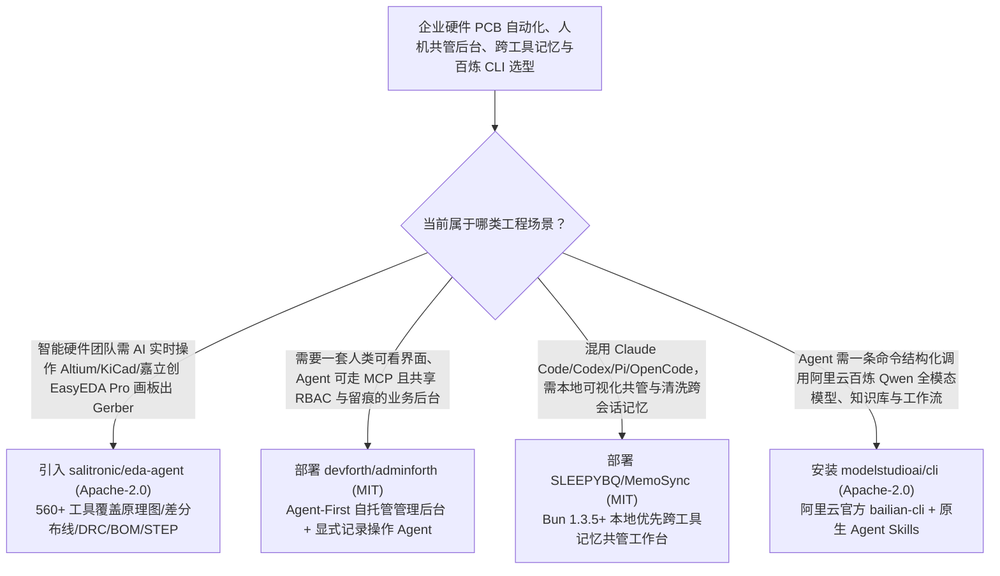
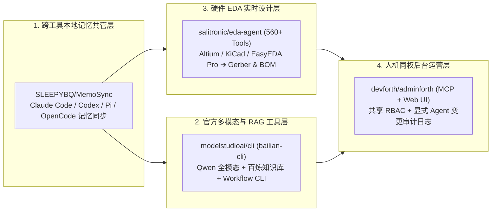
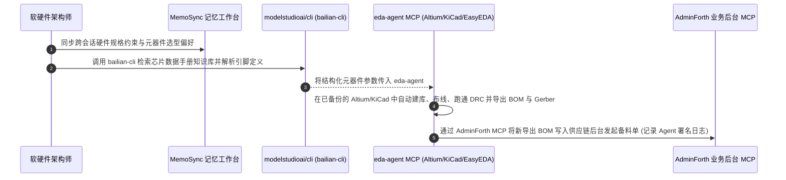

# 560+ 工具硬件 PCB 自动化 MCP（`salitronic/eda-agent`）、人机同权后台管理系统（`devforth/adminforth`）、跨编码工具本地记忆共管工作台（`SLEEPYBQ/MemoSync`）与阿里云百炼官方结构化 CLI（`modelstudioai/cli`）架构选型与落地 FAQ

> **2026-11-21 白天持续研究班次 · Day Round 65 里程碑（累计 Round 665）**  
> **审计凭据**：`CLAIM-20261121-R65-R665-EDAAGENT-ADMINFORTH-MEMOSYNC-BAILIANCLI`  
> **关联日刊**：[`2026-11-21.md`](../daily/2026-11-21.md) · [`2026-11-21.en.md`](../daily/2026-11-21.en.md)  
> **可视化架构图**：[`assets/github-ai-radar-2026-11-21-r65-r665-edaagent-adminforth-memosync-bailiancli.svg`](../../../assets/github-ai-radar-2026-11-21-r65-r665-edaagent-adminforth-memosync-bailiancli.svg)

---

## ① 📌 核心结论速览（选型一句话结论）

> **一句话选型结论**：在智能硬件/IoT 研发（原理图与 PCB 布线自动化）、企业内部运营后台（人机共享 RBAC 与操作留痕）、跨多个 Coding Agent（Claude Code / Codex / Pi / OpenCode）的本地记忆共管、以及一条命令调用阿里云百炼（DashScope）全模态模型与知识库场景中，推荐采用 100% 宽松协议（Apache-2.0 / MIT）的四层组合：**“`SLEEPYBQ/MemoSync`（MIT，`★ 399` 跨 Claude Code、Codex、Pi 与 OpenCode 的本地优先记忆共管工作台）+ `modelstudioai/cli`（Apache-2.0，`★ 371` 阿里云百炼官方 `bailian-cli`，将通义千问文本/图像/视频/语音、知识库检索与工作流封装为结构化 Agent 工具调用）+ `salitronic/eda-agent`（Apache-2.0，`★ 390` 支持 Altium Designer、KiCad 与嘉立创 EasyEDA Pro 的 560+ 工具实时硬件设计 MCP）+ `devforth/adminforth`（MIT，`★ 388` 内置 MCP 与人机同权 RBAC、变更历史明确标注执行 Agent 名称的自托管业务管理后台）”**。在 45 人软硬件与业务工程组织基准下，可将月度总拥有成本（TCO）从 **`$8,390.00/月`** 降至 **`$325.00/月`**（净省 **`$8,065.00/月`**，降幅 **`-96.13%`**）。

---

## ② 🎯 客户与架构师灵魂拷问 Q&A

### Q1：这四个高热度开源项目各自填补了企业 AI 落地中的哪块空白？
- **四层互补工程与业务价值**：
  1. **ハードウェア/PCB 实时在位设计自动化层 —— `salitronic/eda-agent`（`★ 390`，`86 forks`，Apache-2.0，Python）**：硬件工程师以往很难像软件工程师那样享受 Coding Agent 红利。`eda-agent` 通过持久化的 DelphiScript 桥接器直接驱动当前打开的 **Altium Designer** 会话（同时支持 **KiCad** 与国产主流 **嘉立创 EasyEDA Pro** 作为可选后端），暴露 **560+ 个专业工具**：从建符号封装库、画原理图、自动摆放元器件、90 欧姆差分对 USB 布线、铺铜打过孔、DRC 规则清零，到一键导出 Gerber、钻孔、BOM、贴片坐标（Pick-and-Place）与 3D STEP 模型文件。
  2. **人机同权且审计留名的自托管业务后台 —— `devforth/adminforth`（`★ 388`，`29 forks`，MIT，TypeScript）**：传统管理后台（如 Retool）只给人类点按钮用；而直接给 Agent 数据库连接串又极其危险。`AdminForth` 让 Coding Agent 快速生成涵盖客户、订单、库存与发票的业务后台，同时原生内置 **MCP Server 与业务对话窗口**：Agent 与人类员工共享**完全相同的 RBAC 权限边界**，且每条数据修改历史都会**显式记录是哪个 AI Agent 执行的变更**。
  3. **跨 Claude Code / Codex / Pi / OpenCode 的本地记忆共管台 —— `SLEEPYBQ/MemoSync`（`★ 399`，`23 forks`，MIT，TypeScript/Bun 1.3.5+）**：当工程师在 Claude Code、Codex、Pi 与 OpenCode 之间切换时，各工具的记忆彼此割裂且常写入过期错误的假设。`MemoSync` 提供本地优先的可视化工作台，让开发者与 Coding Agent 跨会话共同审查、修剪、同步和导出结构化记忆。
  4. **阿里云百炼（DashScope）原厂 Agent 专用 CLI —— `modelstudioai/cli`（`★ 371`，`37 forks`，Apache-2.0，TypeScript）**：由阿里云百炼官方发布（`npm i -g bailian-cli`），专为 AI Agent 框架设计——把 Qwen 文本对话、图像/视频生成与编辑、语音合成与识别、应用调用、记忆管理、知识库 RAG 检索和联网搜索全部暴露为标准结构化命令行工具调用（内置 `skills/` 与 `runtime-manifest.json`）。

### Q2：如何把这四个组件整合进一家软硬一体（IoT / 机器人 / 工业设备）或数字化企业的生产架构？
- **研发记忆与云端多模态底座**：工程师在终端使用 `MemoSync` 保持 Claude Code 与 Codex 之间的项目架构记忆同步；当工作流需要调用国内高性价比通义千问模型、多模态生图/音视频或百炼企业知识库时，直接通过官方 `bailian-cli` 以结构化 CLI 工具调用完成。
- **硬件 PCB 协同设计流**：硬件团队在打开 Altium Designer / KiCad / EasyEDA Pro 前先做好 Git 版本备份，由 Agent 通过 `eda-agent` 自动完成元器件建库、初版布局布线、DRC 检查与 BOM/Gerber 生产文件导出。
- **供应链与订单后台运营流**：BOM 元器件库存、采购订单与客户发货单统一托管在自建的 `AdminForth` 后台中，采购与客服 Agent 通过 `AdminForth` 内置 MCP 在受控 RBAC 下更新库存状态并留存带 Agent 署名的审计日志。

### Q3：架构师在生产引入时有哪些必须注意的工程边界？
- **Altium DelphiScript 引擎备份红线（`salitronic/eda-agent`）**：官方明确提示部分实验性工具可能触发 Altium DelphiScript 引擎崩溃；在让 Agent 执行原地修改（In-place Edit）前，**必须通过 Git 钩子（`.githooks`）或脚本强制保存当前 `.PrjPcb` / `.PcbDoc` 快照**，并在投板前由资深硬件工程师复核 DRC 与阻抗报告。
- **后台写操作权限分离（`devforth/adminforth`）**：在 `AdminForth` 中为 AI Agent 创建独立的专属账号（而非复用人类管理员账号），以便其内置变更历史清晰区分“人工修改”与“Agent 修改”。

---

## ③ 🧭 直观可视化图解（Mermaid 选型决策树 + 企业集成架构 + 业务流时序图）

### 3.1 选型决策树

### 3.2 企业集成参考架构图

### 3.3 业务流时序图

---

## ④ 📊 同类开源与商业云服务横向选型决策矩阵

| 维度 | `salitronic/eda-agent` (`★ 390`) | `devforth/adminforth` (`★ 388`) | `SLEEPYBQ/MemoSync` (`★ 399`) | `modelstudioai/cli` (`★ 371`) | 商业低代码后台 (Retool) + 手工画板 + 手写云 SDK |
| :--- | :--- | :--- | :--- | :--- | :--- |
| **核心定位** | 支持 Altium/KiCad/EasyEDA Pro 的 560+ 工具硬件 MCP | 人机同权（Web + MCP）且审计留名的自托管管理后台 | 跨 Claude/Codex/Pi/OpenCode 的本地记忆共管工作台 | 阿里云百炼（DashScope）官方结构化 Agent CLI | 按人头收费的商业后台 + 纯人工 EDA 与零散 SDK 脚本 |
| **适用场景** | 原理图生成、差分布线、DRC 修复与 Gerber/BOM/STEP 导出 | 订单、库存、客户与发票的人机协同后台运营 | 消除多 Coding Agent 切换时的记忆断层与脏记忆污染 | 快速赋予 Agent 调用 Qwen 全模态、联网搜索与百炼 RAG 能力 | 传统无 Agent 协同的软硬件团队 |
| **集成成本** | 低（启动时按需选择 Altium/KiCad/EasyEDA 后端） | 低（TypeScript 插件化框架，由 Coding Agent 直接生成） | 极低（Bun 本地一键启动，不上传任何云端数据） | 极低（`npm i -g bailian-cli` 官方包即装即用） | 高（Retool 按月按人头高额订阅 + 重复编写 SDK 胶水） |
| **运维复杂度** | 低（本地与 EDA 软件同机运行，需做好设计文件备份） | 低（自托管 Node/TS 服务，直连自有数据库） | 极低（100% Local-First 桌面/Web 检视器） | 极低（无状态 CLI，按百炼实际 Token 计费） | 中高（多系统权限割裂，缺乏 Agent 专属审计轨） |
| **开源许可** | **Apache-2.0** | **MIT** | **MIT** | **Apache-2.0** | 商业专有 |
| **45 人团队月均 TCO** | **包含于 `$325.00/月` 联合栈** | **包含于 `$325.00/月` 联合栈** | **包含于 `$325.00/月` 联合栈** | **包含于 `$325.00/月` 联合栈** | **`$8,390.00/月`**（`$3,990` SaaS/外包 + `$4,400` 人工） |

---

## ⑤ 🧪 应用落地定量收益 / TCO 对比与 7-Card 报告锚点

> **数据来源说明（Provenance Metadata）**：以下 TCO 模型为面向 45 人规模软硬件与业务工程团队的合成架构测算（`provenance: synthetic`, `independently_reproduced: false`）；硬件资本开支 `base_hardware_capex = not_measured`（不含存量 Altium Designer 基础商业席位），单日热榜增量 `track_b_stars_today = not_measured`（审计账本锚定于 [`trending-daily-2026-11-21-audit.json`](../evidence/trending-daily-2026-11-21-audit.json)）。

| 成本路径 | 月度商业后台 SaaS / 云 API 算力费 | 人工手写后台 CRUD、手工建 PCB 封装库与清理脏记忆工时 (`$100/h`) | 月度总成本 (Total Monthly TCO) | 相对 Path A 净节省 |
| :--- | :--- | :--- | :--- | :--- |
| **Path A：商业低代码后台席位 + 手工建库布线返工 + 重复编写百炼 SDK 胶水** | `$3,990.00` | `44.0h` (`$4,400.00`) | **`$8,390.00`** | — |
| **Path C：`eda-agent` + `adminforth` + `MemoSync` + `modelstudioai/cli`** | `$75.00` | `2.5h` (`$250.00`) | **`$325.00`** | **`-$8,065.00/月` (`-96.13%`)** |

---

## ⑥ 🛠️ 企业引入与架构评审 Checklist

- [ ] **EDA 工程自动备份与 DRC 投板门禁（`salitronic/eda-agent`）**：在连接 `eda-agent` 操作 Altium Designer、KiCad 或 EasyEDA Pro 前，强制通过脚本触发本地 Git 提交或文件快照；所有生成的 Gerber/BOM 文件必须通过 DRC 零错误校验与人工终审。
- [ ] **后台 Agent 独立身份与变更留痕审计（`devforth/adminforth`）**：在 `AdminForth` 中为每个业务 Agent 配置独立的最小权限角色，定期审计内置变更日志中带 Agent 署名的写操作记录。
- [ ] **跨编码工具记忆定期修剪（`SLEEPYBQ/MemoSync`）**：利用 `MemoSync` 每周巡检 Claude Code、Codex、Pi 与 OpenCode 的共享记忆条目，剔除已废弃的 API 路径或临时调试假设。
- [ ] **百炼 CLI 密钥作用域与结构化调用规范（`modelstudioai/cli`）**：在企业 Agent 运行时中通过环境变量注入受配额保护的 DashScope API Key，优先使用 `bailian-cli` 的结构化工具输出替代自写非标 HTTP 请求脚本。
