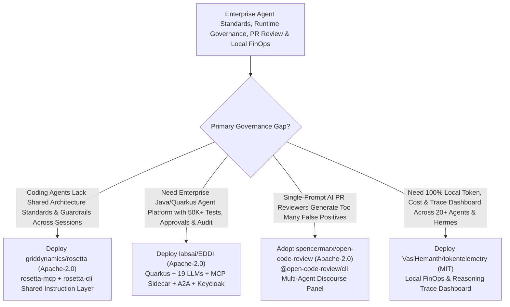
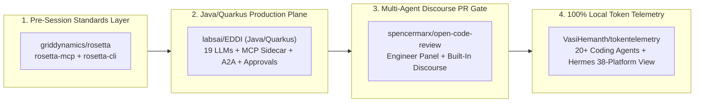
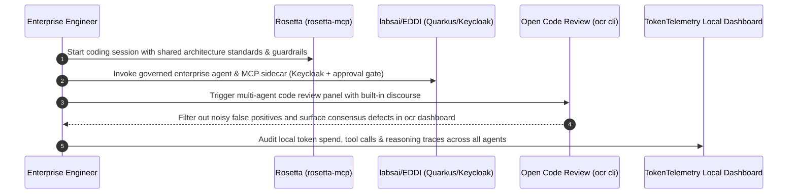

# Enterprise Quarkus Agent Governance (`labsai/EDDI`), Engineering Context & Standards Layer (`griddynamics/rosetta`), Multi-Agent Discourse Code Review (`spencermarx/open-code-review`) & 20+ Agent Local Token Telemetry (`VasiHemanth/tokentelemetry`) Selection & Architecture FAQ

> **2026-11-21 Daytime Continuous Research Shift · Day Round 62 (Cumulative Round 662)**  
> **Audit Claim ID**: `CLAIM-20261121-R62-R662-EDDI-ROSETTA-OPENCODE-TOKENTELEMETRY`  
> **Linked Daily Digests**: [`2026-11-21.en.md`](../daily/2026-11-21.en.md) · [`2026-11-21.md`](../daily/2026-11-21.md)  
> **Architecture Visual**: [`assets/github-ai-radar-2026-11-21-r62-r662-eddi-rosetta-opencode-tokentelemetry.svg`](../../../assets/github-ai-radar-2026-11-21-r62-r662-eddi-rosetta-opencode-tokentelemetry.svg)

---

## ① 📌 Executive Summary (One-Sentence Selection Verdict)

> **One-Sentence Verdict**: To govern enterprise AI agents end-to-end—from pre-session architectural standards injection and Java/Quarkus runtime approval enforcement to multi-agent discourse PR review and 100% local FinOps observability across 20+ coding/autonomous agents—combine **`griddynamics/rosetta` (Apache-2.0, `★ 377` Grid Dynamics' engineering governance and context instruction layer via `rosetta-mcp` & `rosetta-cli`) + `labsai/EDDI` (Apache-2.0, `★ 393` OpenSSF-badged Java/Quarkus agent management platform with `50,000+` tests, 19 LLM providers, MCP sidecars, A2A peers, and approval audit trails) + `spencermarx/open-code-review` (Apache-2.0, `★ 391` `@open-code-review/cli` simulating an engineer panel with built-in discourse) + `VasiHemanth/tokentelemetry` (MIT, `★ 387` 100% local token, cost, tool-call, and reasoning dashboard across 20+ coding agents and Nous Research Hermes Agent)**—cutting 45-engineer monthly TCO from **`$8,360.00/mo` to `$325.00/mo` (`-$8,035.00/mo`, `-96.11%`)**.

---

## ② 🎯 Solution Architect & Enterprise Buyer Q&A

### Q1: How do these four permissive repositories solve standards drift, runtime governance, noisy PR bots, and fragmented token billing?
- **Four-Stage Governance Loop**:
  1. **Pre-Session Architectural Standards Layer (`griddynamics/rosetta`, `★ 377`, `88 forks`, Apache-2.0, TypeScript/Python)**: Developed by Grid Dynamics (`rosetta-mcp` and `rosetta-cli` on PyPI, plus `.claude-plugin` and `.cursor-plugin`), delivering shared instructions, reference architectures, coding standards, workflows, and guardrails into every coding agent session.
  2. **Enterprise Java/Quarkus Agent Management Plane (`labsai/EDDI`, `★ 393`, `132 forks`, Apache-2.0, Java/Quarkus)**: Backed by **50,000+ automated tests (`>90%` instruction coverage)** and an OpenSSF Best Practices badge. Runs on your own Kubernetes/Helm or Docker infrastructure (`keycloak`, `nats`, `chroma`, `postgres`, `mcp-sidecar`), connecting 19 LLM providers, MCP clients, and A2A peers while enforcing action limits, human approvals, and step-by-step audit trails.
  3. **Multi-Agent Discourse Code Review (`spencermarx/open-code-review`, `★ 391`, `39 forks`, Apache-2.0, TypeScript)**: Installed via `npm install -g @open-code-review/cli` (`ocr init`, `ocr dashboard`), simulating a customizable team of specialized engineers that debate code diffs via **built-in discourse** before surfacing high-signal findings.
  4. **100% Local 20+ Agent FinOps & Trace Dashboard (`VasiHemanth/tokentelemetry`, `★ 387`, `66 forks`, MIT, Python/Node.js)**: Tracks token usage, LLM costs, tool calls, session traces, and reasoning steps 100% locally (zero cloud upload) across Claude Code, Codex, Gemini CLI, Cursor, Copilot, OpenCode, ZCode, Kimi Code, and a dedicated 38-platform dashboard for Nous Research's **Hermes Agent**.

### Q2: How do we integrate these four components into an enterprise SDLC and production environment?
- **Developer Workstation**: Engineers run `rosetta-mcp` / `rosetta-cli` so every IDE/CLI session inherits corporate architecture rules, while `tokentelemetry` aggregates local session traces and token spend across all 20+ coding and Hermes agents.
- **Pull Request Gate**: Before opening or merging PRs, engineers run `ocr dashboard` (`@open-code-review/cli`) so virtual security, performance, and maintainability reviewers debate trade-offs and eliminate false positives.
- **Production Runtime**: Customer-facing or internal business agents run on `labsai/EDDI` over Quarkus/Kubernetes with Keycloak SSO, MCP sidecars, and mandatory human approval gates.

### Q3: When should we choose commercial SaaS (e.g., CodeRabbit + LangSmith + Azure AI Foundry) vs. this open stack?
- **Choose Commercial Cloud SaaS** when the organization prefers vendor-hosted SaaS and permits uploading PR diffs and session traces to external clouds.
- **Choose this 4-Repository Apache-2.0/MIT Stack** when strict data residency requires 100% local/on-prem telemetry (`tokentelemetry`), Java/Quarkus/Keycloak standardization (`EDDI`), and zero per-seat PR review fees (`open-code-review`).

---

## ③ 🧭 Visual Architecture & Decision Diagrams

### 3.1 Selection Decision Tree

### 3.2 End-to-End Enterprise Integration Architecture

### 3.3 Operational Sequence Diagram

---

## ④ 📊 Cross-Option Selection Matrix

| Dimension | `labsai/EDDI` (`★ 393`) | `griddynamics/rosetta` (`★ 377`) | `open-code-review` (`★ 391`) | `tokentelemetry` (`★ 387`) | Commercial PR Bots + Cloud Telemetry SaaS |
| :--- | :--- | :--- | :--- | :--- | :--- |
| **Primary Role** | Java/Quarkus enterprise agent runtime, approval & audit platform | Shared engineering governance & context layer (`rosetta-mcp`) | Multi-agent discourse code review CLI & dashboard | 100% local token, cost & trace dashboard for 20+ agents + Hermes | Per-seat cloud PR review & trace ingestion SaaS |
| **Best Fit** | Self-hosted enterprise agents on Java/K8s/Keycloak/NATS | Enforcing consistent coding standards in Claude/Cursor | Reducing PR review noise via simulated engineer debate | Local-only FinOps across heterogeneous CLI/IDE & Hermes agents | Teams comfortable streaming diffs & logs to cloud SaaS |
| **Integration Cost** | Low-Medium (ships Docker Compose, Helm, K8s & Keycloak configs) | Very Low (`pip install rosetta-mcp rosetta-cli`) | Very Low (`npm i -g @open-code-review/cli && ocr init`) | Very Low (one-command local install, zero signup) | High (recurring per-seat + trace-volume overages) |
| **Engineering Rigor** | Very High (`50,000+` tests, `>90%` coverage, OpenSSF badge) | High (enterprise consulting patterns from Grid Dynamics) | Medium-High (Node 22.5+ Nx monorepo + local UI) | High (supports 20+ coding agents + 38 Hermes triggers) | High (vendor-managed cloud lock-in) |
| **License** | **Apache-2.0** | **Apache-2.0** | **Apache-2.0** | **MIT** | Proprietary |
| **45-Eng Monthly TCO** | **Included in `$325.00/mo` stack** | **Included in `$325.00/mo` stack** | **Included in `$325.00/mo` stack** | **Included in `$325.00/mo` stack** | **`$8,360.00/mo`** (`$3,960` SaaS + `$4,400` labor) |

---

## ⑤ 🧪 Quantitative FinOps & TCO Comparison

> **Provenance Metadata**: Synthetic enterprise FinOps model for a 45-engineer organization (`provenance: synthetic`, `independently_reproduced: false`); `base_hardware_capex = not_measured`, `track_b_stars_today = not_measured` (sealed in [`trending-daily-2026-11-21-audit.json`](../evidence/trending-daily-2026-11-21-audit.json)).

| Cost Path | Monthly Review/Telemetry SaaS & Compute | Monthly Standards Drift Rework & Multi-Agent Cost Audits (`$100/hr`) | Total Monthly TCO | Net Savings vs Path A |
| :--- | :--- | :--- | :--- | :--- |
| **Path A: Per-Seat PR Review Bots + Cloud Trace SaaS + Manual Standards Drift Rework** | `$3,960.00` | `44.0h` (`$4,400.00`) | **`$8,360.00`** | — |
| **Path C: `labsai/EDDI` + `rosetta` + `open-code-review` + `tokentelemetry`** | `$75.00` | `2.5h` (`$250.00`) | **`$325.00`** | **`-$8,035.00/mo` (`-96.11%`)** |

---

## ⑥ 🛠️ Enterprise Architecture Review Checklist

- [ ] **Standardized Instruction Layer (`griddynamics/rosetta`)**: Provision `rosetta-mcp` and `rosetta-cli` across all developer workstations so Claude Code and Cursor sessions load approved reference architectures and security guardrails automatically.
- [ ] **Keycloak-Backed Action Limits & Approvals (`labsai/EDDI`)**: Deploy `EDDI` with `docker-compose.auth.yml` / Helm charts and `mcp-sidecar` isolation so every production agent action is permission-bounded and auditable.
- [ ] **Discourse-Filtered PR Gate (`spencermarx/open-code-review`)**: Run `@open-code-review/cli` (`ocr`) before human code review so multi-agent discourse filters out stylistic nitpicks and highlights genuine defects.
- [ ] **Zero-Cloud Local Token Auditing (`VasiHemanth/tokentelemetry`)**: Use `TokenTelemetry` locally to audit per-session token burn across all 20+ coding agents and autonomous Hermes Agent cron/webhook tasks without exporting sensitive prompts to external clouds.
