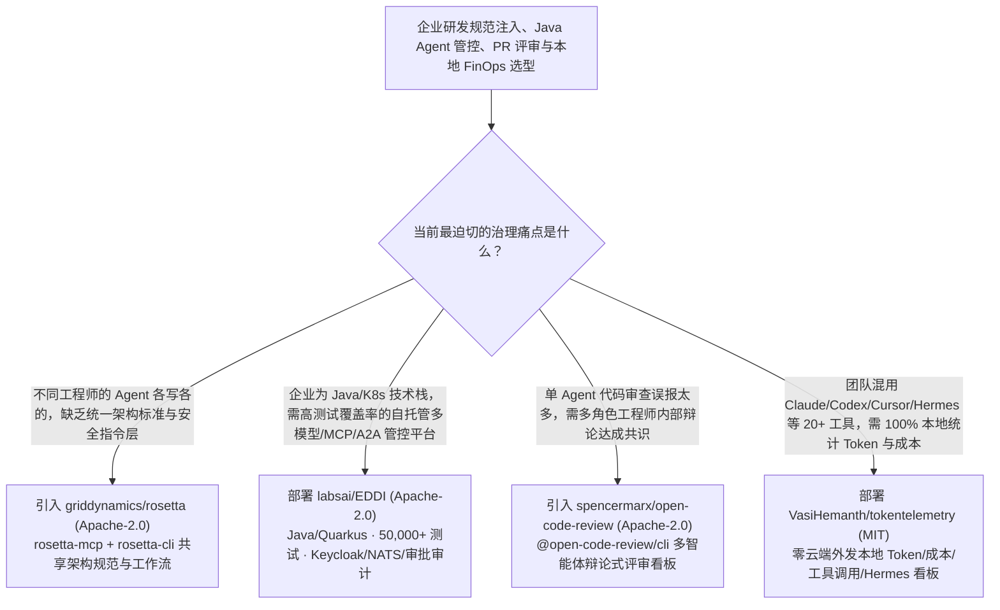
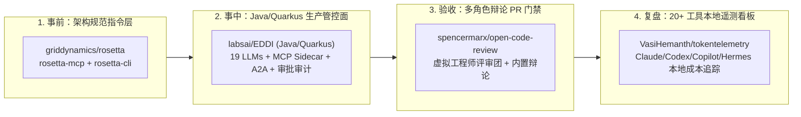
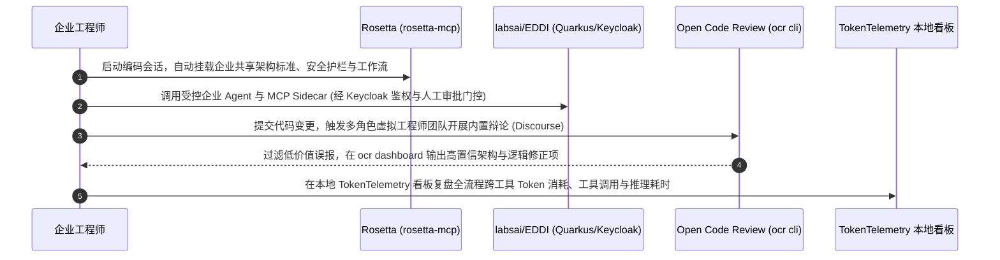

# 企业级 Quarkus 智能体治理平台（`labsai/EDDI`）、工程规范与架构上下文指令层（`griddynamics/rosetta`）、多智能体辩论式代码评审（`spencermarx/open-code-review`）与 20+ 工具本地 Token 遥测看板（`VasiHemanth/tokentelemetry`）架构选型与落地 FAQ

> **2026-11-21 白天持续研究班次 · Day Round 62（累计 Round 662）**  
> **审计凭据**：`CLAIM-20261121-R62-R662-EDDI-ROSETTA-OPENCODE-TOKENTELEMETRY`  
> **关联日刊**：[`2026-11-21.md`](../daily/2026-11-21.md) · [`2026-11-21.en.md`](../daily/2026-11-21.en.md)  
> **可视化架构图**：[`assets/github-ai-radar-2026-11-21-r62-r662-eddi-rosetta-opencode-tokentelemetry.svg`](../../../assets/github-ai-radar-2026-11-21-r62-r662-eddi-rosetta-opencode-tokentelemetry.svg)

---

## ① 📌 核心结论速览（选型一句话结论）

> **一句话选型结论**：当大型企业研发中心需要在 Java/Kubernetes 生产栈上统一管控 AI Agent 权限与审批、向所有工程师的 Coding Agent 会话强制注入统一的架构规范、用多角色辩论消除 AI 代码审查误报、并在 100% 本地环境实时监控 20+ 种编码与自主 Agent 的 Token 账单时，推荐采用全宽松协议（Apache-2.0 / MIT）的四层研发治理闭环：**“`griddynamics/rosetta`（Apache-2.0，`★ 377` Grid Dynamics 出品的工程治理与架构上下文指令层 `rosetta-mcp` / `rosetta-cli`）+ `labsai/EDDI`（Apache-2.0，`★ 393` 拥有 50,000+ 单元测试、>90% 覆盖率与 OpenSSF 认证的 Java/Quarkus 企业级多模型/MCP/A2A 管控平台）+ `spencermarx/open-code-review`（Apache-2.0，`★ 391` 模拟多角色工程师团队辩论达成共识的 `@open-code-review/cli`）+ `VasiHemanth/tokentelemetry`（MIT，`★ 387` 覆盖 Claude Code、Codex、Copilot、Cursor 与 Hermes Agent 的 100% 本地 Token/推理步骤/成本看板）”**。在 45 人研发组织基准下，可将月度总拥有成本（TCO）从 **`$8,360.00/月`** 降至 **`$325.00/月`**（净省 **`$8,035.00/月`**，降幅 **`-96.11%`**）。

---

## ② 🎯 客户与架构师灵魂拷问 Q&A

### Q1：企业全面推广 AI 辅助编程与自主 Agent 后，最常遭遇的“规范漂移、权限失控、PR 噪音轰炸、多工具账单失明”四大顽疾，如何靠这四个开源项目一次性根治？
- **四层对症下药**：
  1. **事前：统一工程规范与架构上下文注入层 —— `griddynamics/rosetta`（`★ 377`，`88 forks`，Apache-2.0，TypeScript/Python）**：由欧美头部数字化工程咨询商 Grid Dynamics 开源。通过 PyPI 上的 `rosetta-mcp` 与 `rosetta-cli`（以及 `.claude-plugin`、`.cursor-plugin`），把企业共享的编码规范、微服务参考架构、安全护栏与工作流自动注入每一次 Coding Agent 会话，防止 45 个工程师写出 45 种架构风格。
  2. **事中：Java/Quarkus 云原生 Agent 运行时与审批总线 —— `labsai/EDDI`（`★ 393`，`132 forks`，Apache-2.0，Java/Quarkus）**：许多银行、保险与大型政企后端是清一色 Java/Kubernetes 栈，难以维护零散的 Python 实验脚本。`EDDI` 历经多年演进，拥有 **50,000+ 自动化测试（指令覆盖率 >90%）** 与 OpenSSF 安全最佳实践徽章，原生支持 19 家 LLM 提供商、MCP Sidecar（`docker-compose.mcp-sidecar.yml`）、A2A 对等通信、Keycloak 鉴权、NATS 消息总线、动作边界限制、人工审批与每步审计记录。
  3. **验收：多角色工程师辩论式 PR 审查层 —— `spencermarx/open-code-review`（`★ 391`，`39 forks`，Apache-2.0，TypeScript）**：传统单 Prompt 的 AI PR Reviewer 往往产生大量吹毛求疵的误报。`open-code-review`（`npm i -g @open-code-review/cli`，`ocr init && ocr dashboard`）模拟一支可定制的虚拟工程师评审团（安全、性能、可维护性角色），通过**内置多 Agent 辩论机制（Built-in Discourse）**先在内部交叉质询，只将达成高置信共识的真正缺陷输出到看板。
  4. **复盘：覆盖 20+ 编码工具与 Hermes 的 100% 本地遥测层 —— `VasiHemanth/tokentelemetry`（`★ 387`，`66 forks`，MIT，Python/Node.js）**：当团队混用 Claude Code、Codex、Gemini CLI、Cursor、Copilot、OpenCode、ZCode、Kimi 以及 Nous Research 的 **Hermes Agent（覆盖 38 个消息与定时平台）** 时，日志分散在各处。`TokenTelemetry` 在 100% 本地（零云端上传、免注册）统一追踪所有工具的 Token 消耗、美元成本、工具调用与推理步骤。

### Q2：如何把这四个组件嵌入企业现有的 CI/CD 与 Kubernetes 生产环境？
- **开发者 IDE 侧**：全员安装 `rosetta-cli` / `rosetta-mcp` 加载企业架构宪章，并在本地后台运行 `tokentelemetry` 汇总日常各类 CLI/IDE Agent 的 Token 消耗与慢会话链路。
- **PR 代码门禁侧**：在 Git 提交或 PR 阶段运行 `@open-code-review/cli`（`ocr`），通过多角色工程师辩论过滤掉低价值样式吐槽，精准拦截架构违规与逻辑漏洞。
- **生产业务 Agent 侧**：将需要连接企业内部数据库的业务 Agent 部署在 `labsai/EDDI`（Helm / Kubernetes + Keycloak + NATS）集群上，强制执行动作白名单、人工审批与全量审计。

### Q3：这套全开源方案与采购 CodeRabbit + LangSmith Enterprise + 商业 Agent 平台相比如何抉择？
- **选商业 SaaS 组合的场景**：小型初创团队，允许源码 Diff 与会话 Prompt 全量上传至第三方公有云 SaaS。
- **选本轮四层 Apache-2.0/MIT 开源栈的场景**：
  1. 严禁源码 Diff、内部架构文档与会话推理日志出境（`tokentelemetry` 100% 本地运行 + `open-code-review` 本地/内网执行）；
  2. 企业平台团队主力技术栈为 **Java / Quarkus / Keycloak / Kubernetes**（`labsai/EDDI` 可直接融入现有运维体系）。

---

## ③ 🧭 直观可视化图解（Mermaid 选型决策树 + 企业集成架构 + 业务流时序图）

### 3.1 选型决策树

### 3.2 企业集成参考架构图

### 3.3 业务流时序图

---

## ④ 📊 同类开源与商业云服务横向选型决策矩阵

| 维度 | `labsai/EDDI` (`★ 393`) | `griddynamics/rosetta` (`★ 377`) | `open-code-review` (`★ 391`) | `tokentelemetry` (`★ 387`) | 商业云审查 + 云遥测 SaaS (CodeRabbit + LangSmith) |
| :--- | :--- | :--- | :--- | :--- | :--- |
| **核心定位** | Java/Quarkus 企业级 AI Agent 运行、限权、审批与审计平台 | 面向 Coding Agent 的共享工程治理与架构上下文指令层 | 内置多角色辩论机制的可定制多智能体代码审查工具 | 支持 20+ 编程工具与 Hermes 的 100% 本地 Token/成本看板 | 按席位与上报 Trace 计费的公有云 SaaS |
| **适用场景** | 银行/政企 Java & K8s 环境统一管理 19 家模型、MCP 与 A2A | 跨团队统一 Claude/Cursor 的架构规范、工作流与红线 | 降低 AI 代码审查误报率、模拟资深工程师交叉评审 | 本地统计 Claude Code/Codex/Copilot/Hermes 成本与推理链路 | 允许代码与会话日志出境的小型团队 |
| **集成成本** | 中低（自带 Keycloak/NATS/Chroma/K8s/Helm 完整编排） | 极低（`pip install rosetta-mcp rosetta-cli`） | 极低（`npm i -g @open-code-review/cli && ocr init`） | 极低（一键脚本启动，自动解析本地 20+ 工具会话日志） | 高（多套按人头美元年费订阅） |
| **工程成熟度** | 极高（**50,000+ 测试，>90% 覆盖率，OpenSSF 认证**） | 高（Grid Dynamics 企业级咨询实践提炼） | 中高（Node >=22.5 + Nx 模块化架构 + 本地看板） | 高（覆盖 20+ 编码 Agent 与 Hermes 38 平台） | 高（商业托管，但数据驻留第三方云） |
| **开源许可** | **Apache-2.0** | **Apache-2.0** | **Apache-2.0** | **MIT** | 商业专有 |
| **45 人团队月均 TCO** | **包含于 `$325.00/月` 联合栈** | **包含于 `$325.00/月` 联合栈** | **包含于 `$325.00/月` 联合栈** | **包含于 `$325.00/月` 联合栈** | **`$8,360.00/月`**（`$3,960` SaaS + `$4,400` 人工） |

---

## ⑤ 🧪 应用落地定量收益 / TCO 对比与 7-Card 报告锚点

> **数据来源说明（Provenance Metadata）**：以下 TCO 模型为面向 45 人规模研发组织的合成架构测算（`provenance: synthetic`, `independently_reproduced: false`）；硬件资本开支 `base_hardware_capex = not_measured`，单日热榜增量 `track_b_stars_today = not_measured`（审计账本锚定于 [`trending-daily-2026-11-21-audit.json`](../evidence/trending-daily-2026-11-21-audit.json)）。

| 成本路径 | 月度审查/遥测 SaaS 与容器算力费 | 人工排查架构规范漂移、过滤审查误报与核对多工具账单 (`$100/h`) | 月度总成本 (Total Monthly TCO) | 相对 Path A 净节省 |
| :--- | :--- | :--- | :--- | :--- |
| **Path A：按席位采购商业 PR 审查机器人 + 云端 Trace SaaS + 人工修正规范漂移** | `$3,960.00` | `44.0h` (`$4,400.00`) | **`$8,360.00`** | — |
| **Path C：`labsai/EDDI` + `rosetta` + `open-code-review` + `tokentelemetry`** | `$75.00` | `2.5h` (`$250.00`) | **`$325.00`** | **`-$8,035.00/月` (`-96.11%`)** |

---

## ⑥ 🛠️ 企业引入与架构评审 Checklist

- [ ] **全局架构指令层强制挂载（`griddynamics/rosetta`）**：在团队开发机模板中预装 `rosetta-mcp` 与 `rosetta-cli`，确保所有 Claude Code 与 Cursor 会话自动继承最新企业安全与架构标准。
- [ ] **生产 Agent 动作限权与 Keycloak 审计（`labsai/EDDI`）**：利用 `EDDI` 的 `docker-compose.auth.yml` / Helm Charts 启用 Keycloak 身份绑定与 MCP Sidecar 隔离，对写库与外部 API 调用开启强制人工审批记录。
- [ ] **PR 多角色辩论收敛门禁（`spencermarx/open-code-review`）**：在代码合并前运行 `ocr` 模拟安全、性能与架构角色开展内置辩论（Discourse），仅阻塞经过多轮质询仍成立的高危缺陷。
- [ ] **20+ 工具与 Hermes 本地 FinOps 巡检（`VasiHemanth/tokentelemetry`）**：每周通过本地 `TokenTelemetry` 看板审计各编码工具与后台 Hermes Agent（含 Cron/Webhook/IM 渠道）的异常 Token 暴涨会话。
