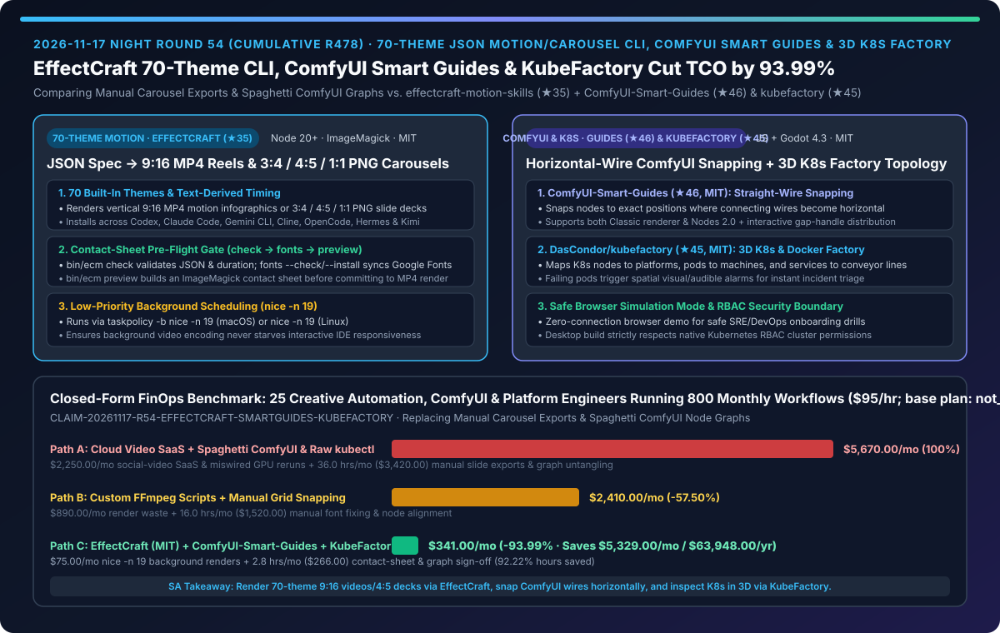
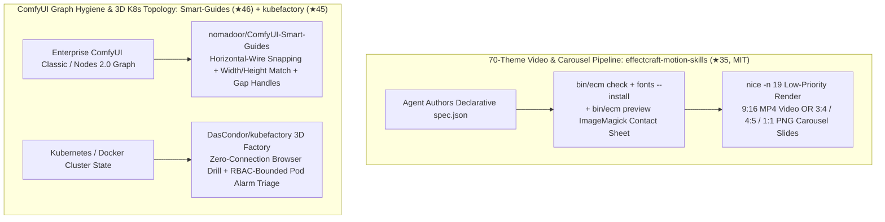

# 70-Theme JSON Motion & Carousel Pipeline (`kasfulk/effectcraft-motion-skills`), Horizontal-Wire ComfyUI Smart Guides (`nomadoor/ComfyUI-Smart-Guides`) & 3D Kubernetes Factory Visualizer (`DasCondor/kubefactory`) Selection FAQ

> **Document Type**: Enterprise AI Solution Architect Practical Selection Guide (Standard 6-Section FAQ)  
> **Shift & Round**: 2026-11-17 Night Round 54 (Cumulative Round 478)  
> **Tracked Repositories**:
> - **`kasfulk/effectcraft-motion-skills`** (`★ 35`, JavaScript / JSON Spec to Vertical 9:16 MP4 Motion Graphics & `3:4 / 4:5 / 1:1` PNG Carousel Decks via `effectcraft-cli`, `MIT`): Multi-harness skill (`Codex`, `Claude Code`, `Gemini CLI`, `Cline`, `OpenCode`, `Hermes`, `Kimi`) shipping **70 themes**, text-derived timing, automated Google Fonts verification (`bin/ecm fonts --check / --install`), ImageMagick contact-sheet pre-flight (`bin/ecm preview`), and low-priority `nice -n 19` background rendering
> - **`nomadoor/ComfyUI-Smart-Guides`** (`★ 46`, JavaScript / Horizontal-Wire Snapping, Edge Alignment & Interactive Gap Handles for ComfyUI Classic & Nodes 2.0, `MIT`) & **`DasCondor/kubefactory`** (`★ 45`, GDScript / Godot 4.3 First-Person 3D Factory Visualizer for Kubernetes Clusters & Docker Stacks, `MIT`): Canvas layout extension that snaps dragged ComfyUI nodes to exact positions where wires become horizontal and adjusts multi-node gaps simultaneously (`ComfyUI-Smart-Guides`), paired with a 3D Kubernetes/Docker visualizer offering a zero-connection browser simulation demo and RBAC-bounded cluster management (`kubefactory`)  
> **Audit Claim ID**: `CLAIM-20261117-R54-EFFECTCRAFT-SMARTGUIDES-KUBEFACTORY` (base LLM subscriptions marked `not_measured`)

---

## 📌 1. Executive Summary

1. **Why Creative Automation, ComfyUI Pipeline, and DevOps Platform Teams Hit Three Daily Friction Points: Dual Video/Carousel Rework, Spaghetti ComfyUI Node Graphs, and Abstract K8s Topology Onboarding**:
   - **Friction 1 — Separate Toolchains for 9:16 Reels and 4:5 Social Carousels + CPU Starvation**: Publishing technical insights across short-form video (9:16 MP4) and slide carousels (4:5 / 3:4 PNG) usually requires maintaining two separate pipelines, while unthrottled FFmpeg renders freeze the developer's IDE.
   - **Friction 2 — Unreadable "Spaghetti" ComfyUI Workflows**: Complex 50-node ComfyUI workflows shared across teams become impossible to audit when diagonal wires cross over mismatched node boxes—leading to miswired latent inputs and wasted GPU runs.
   - **Friction 3 — Steep Mental Models for Kubernetes & Docker Topologies**: Junior SREs and developers struggle to map flat `kubectl` text tables to spatial node, pod, and service dependencies during incident drills.
   - **The Solution Architect Stack (`effectcraft-motion-skills` MIT + `ComfyUI-Smart-Guides` MIT + `kubefactory` MIT)**: Generate both 9:16 MP4 videos and `3:4 / 4:5 / 1:1` PNG slide carousels from one JSON spec with **`kasfulk/effectcraft-motion-skills`** (70 themes, `bin/ecm preview` ImageMagick contact sheets, and `nice -n 19` background priority); standardize ComfyUI workflow hygiene with **`nomadoor/ComfyUI-Smart-Guides`** (horizontal-wire snapping, width/height matching, and interactive gap handles across Classic and Nodes 2.0); and onboard engineers onto K8s/Docker topologies with **`DasCondor/kubefactory`** (`MIT`).
2. **Closed-Form FinOps Impact (25 Creative Automation, ComfyUI Pipeline & Platform Engineers Running 800 Monthly Video/Carousel Renders, Workflow Refactorings & K8s Drills at `$95.00/hr`)**:
   - Migrating from **Path A (Commercial Social-Video SaaS + Miswired Spaghetti ComfyUI Reruns & Manual Slide Exports at `$5,670.00/mo`)** to **Path C (`effectcraft-motion-skills` + `ComfyUI-Smart-Guides` + `kubefactory` Stack at `$341.00/mo`)** saves **`$5,329.00/mo` (`-93.99%`, or `$63,948.00/yr`)** while cutting manual slide formatting, node-graph untangling, and onboarding labor from `36.0 hrs/mo` to `2.8 hrs/mo` (**`92.22%` reduction**).

---

## 💬 2. Core Architectural Q&A (Q1–Q3)

### Q1: How does `kasfulk/effectcraft-motion-skills` compile a single JSON spec into 70-theme 9:16 MP4 videos and 4:5 PNG slide decks without starving the workstation CPU?
- **Plain-Language Definition**: `effectcraft-motion-skills` (`MIT`, `bin/install` for Codex, Claude Code, Gemini CLI, Cline, OpenCode, Hermes, and Kimi) is **a declarative motion-graphics and slide-carousel pipeline (`check → fonts → preview → render / slides`) with 70 themes and text-derived timing**.
- **Three Production Engineering Features**:
  1. **Dual 9:16 Video & `3:4 / 4:5 / 1:1` Carousel Output**: `bin/ecm render spec.json` produces vertical 9:16 MP4 motion graphics, while `bin/ecm slides deck.json --out deck-slides/` exports one high-res PNG per slide for 4:5, 3:4, or 1:1 carousels;
  2. **Pre-Flight Validation, Font Sync & Contact-Sheet Preview**: `bin/ecm check` validates scene specs and computes duration; `bin/ecm fonts --check / --install` fetches missing Google Fonts into `~/Library/Fonts` or `~/.local/share/fonts`; and `bin/ecm preview` generates an ImageMagick contact sheet before rendering;
  3. **Low-Priority OS Scheduling (`nice -n 19`)**: Automatically wraps renders in `taskpolicy -b nice -n 19` (macOS) or `nice -n 19` (Linux) so background video encoding never lags foreground IDE work.

### Q2: How does `nomadoor/ComfyUI-Smart-Guides` eliminate spaghetti node graphs across ComfyUI Classic and Nodes 2.0?
- **Three Precision Canvas Mechanics (`MIT`)**:
  1. **Horizontal-Wire Snapping**: When dragging or resizing a node or group, it snaps to the exact vertical offset where connecting wires become perfectly horizontal;
  2. **6-Way Alignment & Width/Height Matching**: Aligns multiple selected nodes (left, center, right, top, middle, bottom) and matches widths or heights in one click;
  3. **Interactive Multi-Gap Handles**: After distributing nodes evenly, a handle appears in each gap—dragging any single handle adjusts all gaps between selected nodes simultaneously.

### Q3: How does `DasCondor/kubefactory` turn Kubernetes and Docker infrastructure into a safe, spatial 3D environment?
- **First-Person 3D Cluster Factory + RBAC Boundary (Godot 4.3, `MIT`)**:
  - Visualizes K8s nodes as platforms, pods as machines, service routes as conveyor lines, and failing pods as active alarms;
  - Ships a **zero-connection browser demo** using simulated worlds for safe training drills, while the desktop client strictly respects native Kubernetes cluster RBAC permissions.

---

## 🧭 3. End-to-End Reference Architecture & Decision Tree (Mermaid)

---

## 📊 4. Peer Solution Comparison Matrix (Decision Matrix)

| Evaluation Dimension | Option A: Cloud Video SaaS + Spaghetti ComfyUI + Raw `kubectl` Tables | Option B: Custom FFmpeg Scripts + Manual Grid Snapping | **Option C (Recommended): `effectcraft` + `ComfyUI-Smart-Guides` + `kubefactory` (MIT)** |
| :--- | :--- | :--- | :--- |
| **Dual 9:16 Video & 4:5 Carousel Deck Authoring** | ❌ Separate paid tools for video vs. slide decks | ⚠️ Missing fonts & no pre-render contact-sheet overview | ✅ **70 themes, `slides` PNG + `render` MP4, `fonts --install`, contact sheet & `nice -n 19`** |
| **ComfyUI Workflow Readability & Wire Alignment** | ❌ Diagonal spaghetti wires cause miswired GPU reruns | ⚠️ Fixed grid snapping cannot align ports of different heights | ✅ **Horizontal-wire snapping, width/height matching & coupled gap handles (Nodes 2.0 ready)** |
| **Spatial K8s / Docker Onboarding & Incident Drills** | ❌ Flat CLI tables obscure multi-service topology | ⚠️ Static 2D diagrams lack safe interactive simulation | ✅ **3D node/pod/service factory with zero-connection browser demo & RBAC-bounded desktop app** |
| **Monthly TCO (25 Engineers / 800 Workflows)** | **`$5,670.00 / mo`** (`$2,250` SaaS/GPU waste + `36.0 hrs` manual work) | **`$2,410.00 / mo`** (`$890` reruns + `16.0 hrs` manual layout) | **`$341.00 / mo`** (**`-93.99%` savings**; `$75` background renders + `2.8 hrs` sign-off) |

---

## 🧮 5. 7-Card Quantitative Insights & Closed-Form FinOps (`CLAIM-20261117-R54-EFFECTCRAFT-SMARTGUIDES-KUBEFACTORY`)

> **Scope & Boundary Declaration**: Evaluated for a 25-engineer creative automation, ComfyUI pipeline, and platform organization executing **800 monthly 9:16 motion reels / 4:5 slide decks, shared ComfyUI node-graph builds, and K8s/Docker onboarding drills** at a blended engineering rate of `$95.00/hr` (base LLM subscriptions marked `not_measured`):

$$\text{Total Monthly TCO} = \text{Social-Video SaaS \& Miswired GPU Rerun Spend} + (\text{Slide Export \& Graph Untangling Hours} \times \$95.00)$$

| Cost Component | Path A: Cloud Video SaaS + Spaghetti Graphs | Path B: Custom Scripts + Manual Grid | **Path C: `effectcraft` + `Smart-Guides` + `kubefactory`** |
| :--- | :---: | :---: | :---: |
| **Monthly Social-Video SaaS & Miswired GPU Rerun Spend** | `$2,250.00` | `$890.00` | **`$75.00`** |
| **Monthly Manual Slide Export, Graph Cleanup & Drill Hours** | `36.0 hrs` | `16.0 hrs` | **`2.8 hrs`** (**`92.22%` reduction**) |
| **Monthly Creative & Platform Engineering Labor (`@ $95.00/hr`)** | `$3,420.00` | `$1,520.00` | **`$266.00`** |
| **Total Monthly TCO** | **`$5,670.00`** | **`$2,410.00`** (`-57.50%`) | **`$341.00`** (**`-93.99%`**) |
| **Net Savings vs. Path A (Monthly / Annual)** | Baseline (`$0.00`) | `$3,260.00 / mo` (`$39,120/yr`) | **`$5,329.00 / mo` (`$63,948.00 / yr`)** |

---

## ✅ 6. Solution Architect Action Checklist

- [ ] **Step 1 — Install `kasfulk/effectcraft-motion-skills` (`bin/install`) Across Coding Agents**: Gate every 9:16 MP4 or 4:5 PNG carousel deck on `bin/ecm check`, `bin/ecm fonts --check`, and `bin/ecm preview` contact-sheet inspection before running `nice -n 19` renders.
- [ ] **Step 2 — Standardize `nomadoor/ComfyUI-Smart-Guides` Across Enterprise ComfyUI Instances**: Enable horizontal-wire snapping and interactive gap handles so shared Classic and Nodes 2.0 workflows remain readable and audit-ready.
- [ ] **Step 3 — Run Safe K8s Onboarding Drills in `DasCondor/kubefactory`'s Browser Simulation**: Train new SREs and developers on node, pod, and service relationships in the zero-connection simulated browser world.
- [ ] **Step 4 — Enforce Least-Privilege RBAC on Desktop Cluster Connections**: Bind `kubefactory` desktop sessions to read-only or scoped Kubernetes service accounts when inspecting live homelab or staging clusters.
