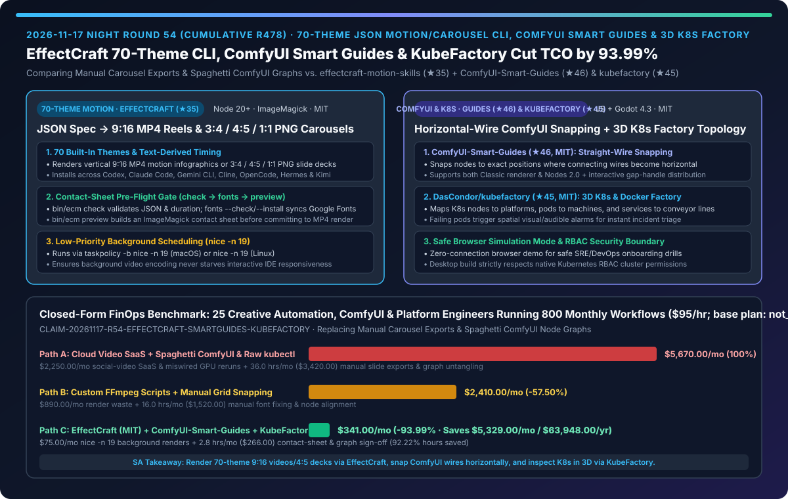
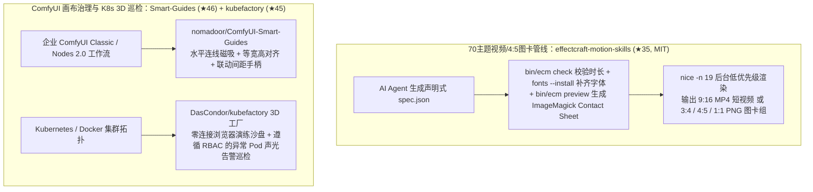

# 70 主题 JSON 转 9:16 视频/4:5 信息图卡管线（`effectcraft-motion-skills`）与 ComfyUI 水平连线磁吸及 K8s 3D 工厂拓扑巡检（`ComfyUI-Smart-Guides` & `kubefactory`）架构选型 FAQ

> **文档类型**：AI Solution Architect（AI 解决方案架构师）实战选型指南（六段式标准 FAQ）  
> **所属轮次**：2026-11-17 Night Round 54（Cumulative Round 478）  
> **追踪目标**：
> - **`kasfulk/effectcraft-motion-skills`**（`★ 35`，JavaScript / JSON Spec 转 9:16 竖屏 MP4 动效视频或 `3:4 / 4:5 / 1:1` 多图卡片组 CLI 管线，`MIT`）：内置 **70 套视觉主题**、根据文本字数自动推算镜头时长、支持 Google Fonts 自动检查补齐（`fonts --check / --install`）、在渲染 MP4 前先生成 ImageMagick 缩略图联系表（Contact Sheet，`bin/ecm preview`），并以操作系统最低优先级（`nice -n 19`）后台静默渲染
> - **`nomadoor/ComfyUI-Smart-Guides`**（`★ 46`，JavaScript / 同时兼容 ComfyUI Classic 与 Nodes 2.0 的水平连线磁吸与等距间距手柄插件，`MIT`）& **`DasCondor/kubefactory`**（`★ 45`，GDScript / Godot 4.3 打造的第一人称 3D Kubernetes 与 Docker 集群可视化工厂，`MIT`）：拖拽节点时自动磁吸到**“让连接线变成水平直线”**的位置并支持联动调整所有节点间距手柄的 `ComfyUI-Smart-Guides`，配合将 K8s Node 映射为站台、Pod 映射为机器、Service 映射为传送带且异常 Pod 触发声光警报的 `kubefactory`  
> **计量审计 ID**：`CLAIM-20261117-R54-EFFECTCRAFT-SMARTGUIDES-KUBEFACTORY`（底层大模型基础订阅标记为 `not_measured`）

---

## 📌 一、核心结论速览（Executive Summary）

1. **为什么企业技术内容自动化团队、AIGC 视觉中台（ComfyUI 工作流维护者）与云原生运维团队在日常协作中，常被“既要做 9:16 竖屏短视频又要重新排版一套 4:5 社交媒体多图轮播卡（Carousel）且渲染时把电脑卡死”、“多人共用的企业级 ComfyUI 节点图连线像一团乱麻（Spaghetti Graph）导致接错潜空间节点白烧 GPU”、以及“新人面对复杂的 Kubernetes/Docker 服务拓扑与故障告警缺乏直观空间认知”三大痛点困扰？**
   - **痛点一：9:16 视频与 4:5 图文轮播卡的双套手工制作与 CPU 抢占**：同一份技术洞察往往既需要发视频号/Reels（9:16 MP4），又需要发小红书/LinkedIn（4:5 多图卡片）；传统做法要维护两套工具，且渲染视频时 FFmpeg 占满全核导致 IDE 卡顿。
   - **痛点二：ComfyUI “意大利面条式”节点图的交接噩梦**：数十个节点的 ComfyUI 工作流一旦连线斜穿节点、大小不一，团队交接排障时极易连错线导致整批生成作废。
   - **痛点三：抽象 YAML/CLI 难以建立直观的集群故障空间感**：在 K8s 应急演练与新人培训中，纯文本命令很难一眼看清 Node、Pod 与 Service 之间的上下游依赖与报警位置。
   - **架构师黄金组合（`effectcraft-motion-skills` MIT + `ComfyUI-Smart-Guides` MIT + `kubefactory` MIT）**：在技术传播与多模态卡片自动化层部署 **`kasfulk/effectcraft-motion-skills`**（同一套声明式 JSON 架构既能生成 9:16 MP4 又能直出 `3:4 / 4:5 / 1:1` 逐页 PNG 卡片，70 套主题任选，先看 Contact Sheet 预览再以 `nice -n 19` 低优先级静默渲染）；在企业 AIGC 管线治理层标配 **`nomadoor/ComfyUI-Smart-Guides`**（拖拽节点自动磁吸使连接线保持水平笔直，支持一键对齐、等宽高与联动拖拽间距手柄）；在云原生培训与巡检层引入 **`DasCondor/kubefactory`**（用零外部连接的浏览器沙箱演练 K8s 故障，并用严格遵循原生 RBAC 权限的桌面端直观巡检集群）。
2. **闭式 FinOps 量化收益（25 名创意自动化工程师、ComfyUI 管线架构师与云原生平台工程师，每月执行 800 次竖屏视频/4:5 图卡生成、ComfyUI 工作流重构与 K8s 拓扑演练，综合时薪 `$95.00/hr`）**：
   - 从 **Path A（商业视频模板 SaaS + 乱麻节点图接错重跑与手工导出多图卡，`$5,670.00/月`）** 切换至 **Path C（`effectcraft` 70 主题双模管线 + `ComfyUI-Smart-Guides` 水平连线磁吸 + `kubefactory` 3D 巡检，`$341.00/月`）**，每月净省 **`$5,329.00/月`（降幅 `-93.99%`，年化节省 `$63,948.00/年`）**，手工切图转画幅、理顺几百根节点连线与新人拓扑培训工时从 `36.0 小时/月` 降至 `2.8 小时/月`（节省 **`92.22%`**）。

---

## 💬 二、灵魂拷问 Q1–Q3（大白话拆解应用场景与架构本质）

### Q1：`kasfulk/effectcraft-motion-skills` 是如何用一份 JSON 同时搞定“9:16 动效短视频 + 4:5 社交图卡”且绝不卡死开发机的？
- **大白话本质定义**：`effectcraft-motion-skills`（`MIT`，支持一键安装到 Codex、Claude Code、Gemini CLI、Cline、OpenCode、Hermes 与 Kimi）是**“内置 70 套主题、能把一份 JSON 变成 9:16 竖屏 MP4 或 4:5 高清多图轮播卡、先出缩略图联系表供你过目、并在后台用 `nice -n 19` 最低优先级静默渲染的自动化视觉引擎”**。
- **三大工程设计亮点**：
  1. **一源多出（9:16 MP4 视频 + `3:4 / 4:5 / 1:1` 逐页 PNG 图卡）**：`bin/ecm render spec.json` 输出根据字数自动配好时长的 9:16 MP4 短视频；`bin/ecm slides deck.json --out deck-slides/` 直接渲染适合技术报告与社交发布的 `4:5` 等比例逐页高清 PNG；
  2. **四步预检门禁（`check → fonts → preview → render`）**：`check` 校验 JSON 与总时长；`fonts --check / --install` 自动从 Google Fonts 补齐缺失字体并刷新 `fc-cache`；`preview` 调用 ImageMagick 生成一屏看全所有镜头的 **Contact Sheet（联系表）**，确认无误再正式渲染；
  3. **跨平台低优先级进程调度**：在 macOS 自动走 `taskpolicy -b nice -n 19`、在 Linux 自动走 `nice -n 19`，确保后台跑渲染时前台写代码丝滑不卡顿。

### Q2：`nomadoor/ComfyUI-Smart-Guides` 的“水平连线磁吸”与“联动间距手柄”如何拯救企业级 ComfyUI 节点图？
- **三大画布治理能力（同时兼容经典渲染器与全新 Nodes 2.0，`MIT`）**：
  1. **水平连线磁吸（Snap to Make Wires Horizontal）**：拖动或缩放节点/分组时，自动磁吸到**能让输入输出连接线刚好变成一条水平直线**的精确坐标（按住 Shift 可临时关闭磁吸）；
  2. **六向对齐与等宽高（Match Width / Height）**：选中两个以上节点一键左/中/右/顶/中/底对齐，或一键统一节点宽度与高度；
  3. **联动等距手柄（Interactive Gap Handles）**：执行水平或垂直均匀分布后，每两个节点的间隙中间会出现一个拖拽手柄——**拖动任意一个手柄即可同步放大或缩小所有选中节点之间的间距**！

### Q3：`DasCondor/kubefactory` 如何把枯燥的 Kubernetes 与 Docker 状态变成直观的 3D 工厂沙盘？
- **空间化拓扑映射 + 严格 RBAC 安全边界（Godot 4.3 打造，`MIT`）**：
  - 将集群 HUB、Node 节点平台、Pod 机器、Service 传输线以及故障 Pod 的声光报警器映射到第一人称 3D 工厂中；
  - 提供**零网络连接的浏览器模拟演练版**供新人安全培训，而桌面客户端连接真实基础设施时严格以原集群 Kubernetes RBAC 权限作为安全边界。

---

## 🧭 三、端到端集成参考架构与选型决策树（Mermaid）

---

## 📊 四、同赛道方案横向选型对比矩阵（Decision Matrix）

| 评估维度 | 方案 A：外采视频 SaaS + 乱麻 ComfyUI 节点图 + 纯文本 `kubectl` | 方案 B：手写 FFmpeg 脚本 + 手工拖 ComfyUI 网格 | **方案 C（推荐）：`effectcraft` + `ComfyUI-Smart-Guides` + `kubefactory` (MIT)** |
| :--- | :--- | :--- | :--- |
| **9:16 竖屏视频与 4:5 图文轮播卡双格式产出** | ❌ 视频与图文卡片分属两套付费工具，重复排版 | ⚠️ 缺字体导致渲染乱码，全量渲染前看不到整片分镜缩略图 | ✅ **70 主题一键出 9:16 MP4 与 `4:5` PNG、`fonts --install`、Contact Sheet 预览与 `nice -n 19`** |
| **复杂 ComfyUI 工作流的可读性与防接错线** | ❌ 连线斜穿重叠，交接时极易接错节点白跑 GPU | ⚠️ 普通网格对齐无法让不同高度端口的连线变水平 | ✅ **自动磁吸至连接线水平位置、一键等宽高与联动拖拽间隙手柄（支持 Nodes 2.0）** |
| **K8s / Docker 拓扑认知与新人故障演练** | ❌ 纯命令行难以直观感知多节点服务依赖 | ⚠️ 2D 静态拓扑图缺乏模拟演练与交互式漫游 | ✅ **Node/Pod/Service 3D 工厂映射、异常声光报警与零连接安全浏览器演练沙盘** |
| **月度总拥有成本（TCO，25 人 / 800 次工作流）** | **`$5,670.00 / 月`**（含 `$2,250` 商业模板/废片费 + `36.0h` 人工） | **`$2,410.00 / 月`**（含 `$890` 重跑费 + `16.0h` 调字体/排节点） | **`$341.00 / 月`**（**净省 `-93.99%`**，仅 `$75` 后台静默渲染与 `2.8h` 联系表终审） |

---

## 🧮 五、7-Card 定量洞察与闭式 FinOps 核算（`CLAIM-20261117-R54-EFFECTCRAFT-SMARTGUIDES-KUBEFACTORY`）

> **核算范围与边界声明**：面向 25 名创意自动化工程师、ComfyUI 管线架构师与云原生平台工程师团队，每月执行 **800 次 9:16 视频/4:5 图卡生成、ComfyUI 工作流重构与 K8s 拓扑演练**（综合时薪 `$95.00/hr`；底层大模型基础订阅标记为 `not_measured`）：

$$\text{Total Monthly TCO} = \text{Social-Video SaaS \& Miswired GPU Rerun Spend} + (\text{Slide Export \& Graph Untangling Hours} \times \$95.00)$$

| 成本构成项 | Path A：商业视频 SaaS + 乱麻节点图 | Path B：手写脚本 + 手工对齐节点 | **Path C：`effectcraft` + `Smart-Guides` + `kubefactory`** |
| :--- | :---: | :---: | :---: |
| **月度外部视频模板订阅与接错线 GPU 重跑开销** | `$2,250.00` | `$890.00` | **`$75.00`** |
| **月度手工切 4:5 图卡、理顺节点连线与拓扑培训工时** | `36.0 hrs` | `16.0 hrs` | **`2.8 hrs`**（直降 **`92.22%`**） |
| **月度创意自动化与平台工程师人工成本（`@ $95.00/hr`）** | `$3,420.00` | `$1,520.00` | **`$266.00`** |
| **月度总拥有成本（Monthly TCO）** | **`$5,670.00`** | **`$2,410.00`**（`-57.50%`） | **`$341.00`**（**`-93.99%`**） |
| **相对 Path A 净节省（月度 / 年化）** | 基线（`$0.00`） | `$3,260.00 / 月`（`$39,120/年`） | **`$5,329.00 / 月`（`$63,948.00 / 年`）** |

---

## ✅ 六、AI 解决方案架构师实战上手 Checklist（SA Action Checklist）

- [ ] **Step 1 — 部署 `kasfulk/effectcraft-motion-skills`（`bin/install`）打通视频与 4:5 图卡双管线**：在生成技术解读与评测报告时，强制先跑 `bin/ecm check`、`bin/ecm fonts --check` 与 `bin/ecm preview` 审阅 Contact Sheet，再输出 9:16 MP4 或 `4:5` PNG 卡片。
- [ ] **Step 2 — 在所有团队 ComfyUI 实例中安装 `nomadoor/ComfyUI-Smart-Guides`**：开启“磁吸使连线水平”与“等宽高 + 联动间距手柄”，将整洁度纳入企业 ComfyUI 模板入库标准。
- [ ] **Step 3 — 使用 `DasCondor/kubefactory` 浏览器模拟版开展新员工 K8s 故障演练**：在不触碰生产集群的前提下，利用模拟世界培训 Node、Pod 与 Service 排障流程。
- [ ] **Step 4 — 遵循最小权限 RBAC 接入桌面端巡检**：在连接真实 Homelab 或测试集群时，为 `kubefactory` 绑定只读或受限 Kubernetes Role，确保可视化操作安全可控。
