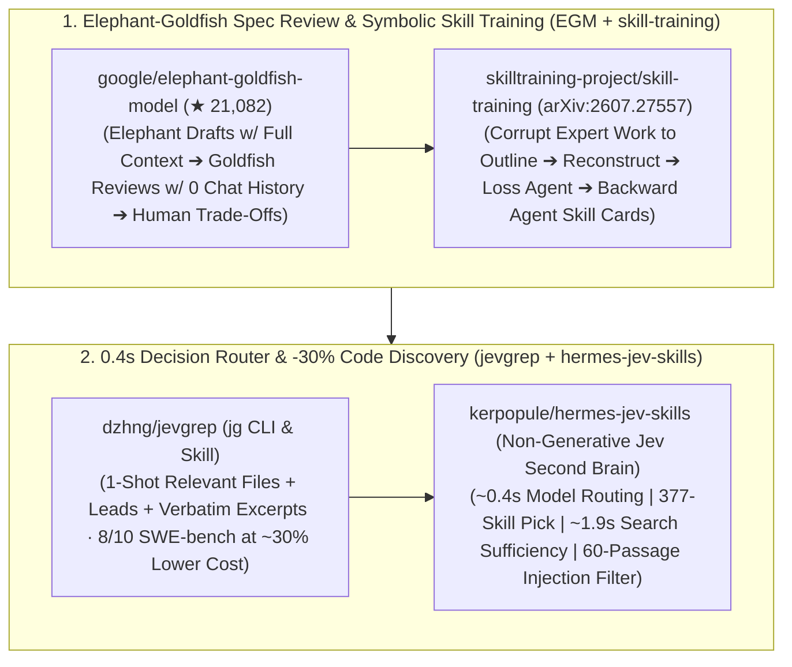

# Google Elephant-Goldfish Design/Review Plugin (`google/elephant-goldfish-model`), -30% Cost Code Discovery CLI (`dzhng/jevgrep`), 0.4s Non-Generative Decision Router (`kerpopule/hermes-jev-skills`) & Frozen-Weight Reconstruction Skill Trainer (`skilltraining-project/skill-training`) Selection FAQ

> **Document Type**: Practical Selection & Architecture Guide for AI Solution Architects (2026-11-18 Night Shift · Round 29 / Cumulative Round 509)  
> **Benchmark Standard**: `docs/components/ib-vs-ethernet-roce-selection-faq.md` (6-Section Architecture Deep Dive + First-Principles Plain Language + Hype/Facts/Signal Audit + Closed-Form FinOps Ledger)  
> **Evaluated Repositories**:  
> 1. **`google/elephant-goldfish-model`** (`★ 21,082`, `1,566 forks`, Python): Google's open-source specification design and review plugin (**Elephant** drafts specs with full project context, **Goldfish** reviewers inspect drafts and referenced code **without the earlier conversation** to expose unstated assumptions, plus `/egm-review-loop` and codebase drift reporting)  
> 2. **`dzhng/jevgrep`** (`★ 3,246`, `248 forks`, TypeScript Node `22+` CLI `jg` & `jg skill`, MIT): Semantic code discovery CLI using `Jev` to return relevant files, reading leads, and verbatim excerpts in one response—matching **8/10 SWE-bench pass rate at ~30% lower cost**  
> 3. **`kerpopule/hermes-jev-skills`** (`★ 1,350`, `129 forks`, Python): Wires TypeSafe's non-generative `Jev` decision model into Hermes, Claude Code, and Codex for **`~0.4s` model routing**, **377-skill selection**, **`~1.9s` search sufficiency**, and **60-passage memory filtering + prompt-injection detection**  
> 4. **`skilltraining-project/skill-training`** (`★ 984`, `4 forks`, Python `3.10+`, `arXiv:2607.27557`): Trains an agent's skill library (**with model weights frozen**) via a **Corruption ➔ Reconstruction ➔ Loss Agent ➔ Backward Agent** loop over finished human artifacts  
> **Accounting Note**: Only software inference, SaaS, and engineering labor TCO are metered; server base hardware capEx is explicitly labeled `not_measured` with zero fabricated depreciation coordinates.

---

## 📌 1. Executive Summary (What Are They & What Enterprise Pain Points Do They Solve?)

When enterprise teams scale agentic software engineering, four structural inefficiencies inflate token spend and architectural risk: context-contaminated spec reviews, blind multi-turn repo searches, burning frontier LLM tokens on simple routing/filtering choices, and locking domain expertise inside non-portable fine-tuned weights:
1. **Pain Point A (Reviewing a Spec Inside the Same 50-Turn Chat Session Misses Unstated Assumptions Because the Agent Shares Your Conversational Blind Spots)**: When the same context window both drafts and reviews a design doc, it silently fills in missing edge cases from earlier chat turns. **`google/elephant-goldfish-model` (`EGM`, `★ 21,082`)'s Solution**: Separates design into **"Design with an elephant. Review with a goldfish."** The **Elephant** holds full project context and drafts the specification; **Goldfish** reviewers examine the draft and referenced source files **with zero access to the earlier conversation**, exposing unstated assumptions and blind spots before the human approves architectural trade-offs (supporting ChatGPT/Codex desktop, Antigravity CLI/IDEs, Claude Code, and Codex CLI, plus `/egm-review-loop` and codebase drift reporting).
2. **Pain Point B (Coding Agents Burn 30%+ of Task Budget Running Blind `grep`/`find` Loops on Unfamiliar Codebases)**: Frontier models waste expensive reasoning turns guessing filenames and regexes. **`dzhng/jevgrep` (`jg`)'s Solution**: A standalone Node `22+` CLI and agent skill (`jg skill`) that uses the `Jev` decision model to judge relevance across folders, files, and declarations—returning relevant files, reading leads, and verbatim source excerpts in one stdout response. Across a 10-task SWE-bench benchmark, `jevgrep` solved the **exact same 8 of 10 tasks at ~30% lower total cost**.
3. **Pain Point C (Using Frontier Generative Models for Non-Prose Micro-Decisions—Model Routing, Picking from 377 Skills, and Filtering 60 Memory Passages—Is Slow and Vulnerable to Injection)**: Choosing which model should answer a turn or which memory chunks are safe is a discriminative classification task, not a text-generation task. **`kerpopule/hermes-jev-skills`'s Solution**: Delegates micro-decisions to `Jev` (which **never writes text** and answers typed choice/score/boolean questions with calibrated confidence): (1) **Model routing in `~0.4s/turn`** across pool grids with a live `on/shadow/off` `jev dashboard`; (2) **Selecting from 377 skills**; (3) **Search ranking & sufficiency in `~1.9s` median**; and (4) **Memory screening across 60 passages/request** to filter noise and flag **hidden prompt-injection instructions**.
4. **Pain Point D (Fine-Tuning Model Weights to Teach Domain Craft Costs Thousands in GPU Compute and Breaks Whenever You Upgrade Foundation Models)**: Weight fine-tuning is opaque and non-portable across Claude, Codex, and DeepSeek. **`skilltraining-project/skill-training` (`arXiv:2607.27557`)'s Solution**: **Keeps model weights completely frozen and trains the agent's skill library instead.** It corrupts a finished human artifact into a coarse outline, asks a **Reconstruction Agent** to rebuild it, uses a **Loss Agent** to pinpoint structural gaps against the human original, and uses a **Backward Agent** to convert those gaps into reusable skill cards.

---

## 💬 2. Three First-Principles Deep-Dive Questions (Q1–Q3)

### Q1: Why does Google's `elephant-goldfish-model` require "Goldfish" reviewers with zero conversational memory to audit specifications written by the context-rich "Elephant"?
* **First-Principles Breakdown**:
  - **Information-Asymmetry Stress Testing**: A specification is only complete if an engineer (or coding agent) who was not in the room during brainstorming can implement it unambiguously. Stripping the conversation history forces Goldfish reviewers to evaluate strictly what is written in the spec and referenced source files, surfacing implicit assumptions and codebase drift immediately.

### Q2: How do `dzhng/jevgrep` and `kerpopule/hermes-jev-skills` cut agent operating costs by ~30%+ by separating a non-generative decision model (`Jev`) from the frontier generative LLM?
* **First-Principles Breakdown**:
  - **Zero-Prose Calibrated Decisions**: Because `Jev` never generates prose tokens—only returning calibrated probabilities over typed options—it resolves codebase relevance (`jevgrep`), per-turn model tier routing (`~0.4s`), search evidence sufficiency (`~1.9s`), and 60-passage memory/injection screening for a fraction of a cent before the frontier model is even invoked.

### Q3: How does `skilltraining-project/skill-training` (`arXiv:2607.27557`) implement "symbolic backpropagation" into a skill library without touching model weights?
* **First-Principles Breakdown**:
  - **Self-Supervised Residual Extraction (`Corrupt ➔ Reconstruct ➔ Loss ➔ Backward`)**: By degrading a master human artifact into a summary outline and forcing the frozen LLM to reconstruct it, the exact delta between "default LLM output" and "expert human craft" becomes observable to the Loss Agent, allowing the Backward Agent to codify that delta into portable Markdown skill cards.

---

## 🧭 3. Architecture Decision Tree & Reference Topology (Mermaid)

---

## 📊 4. Peer Solution Comparison Matrix (Decision Matrix)

| Evaluation Dimension | Path A: Same-Session Spec Review + Blind Frontier Grep Loops + Frontier Model Routing + GPU Weight Fine-Tuning | Path B: External Architecture Consultants + Hosted Code Search SaaS + Managed Fine-Tuning | **Path C (Recommended): `elephant-goldfish-model` + `jevgrep` + `hermes-jev-skills` + `skill-training`** |
| :--- | :--- | :--- | :--- |
| **Specification Assumption Detection** | ❌ Same-session review shares conversational blind spots and misses drift | ⚠️ Manual review committees delay sprints by days | ✅ **Elephant drafts with context; stateless Goldfish reviewers expose unstated assumptions** |
| **Unfamiliar Codebase Discovery Cost** | ❌ 10+ turns of frontier-model `grep`/`find` waste 30%+ of task budget | ⚠️ Heavy cloud vector indexes lag behind local uncommitted branches | ✅ **`jevgrep` returns files/leads/excerpts in 1 call; matches 8/10 SWE-bench at `-30%` cost** |
| **Routing, 377-Skill Load & Memory Guard** | ❌ Frontier LLM tokens burned on routing; no 60-passage injection filter | ⚠️ Static regex routers cannot judge search evidence sufficiency | ✅ **`Jev` decides model routing (`~0.4s`), search sufficiency (`~1.9s`) & 60-passage injection check** |
| **Domain Craft & Skill Acquisition** | ❌ GPU fine-tuning is expensive and breaks on model upgrades | ⚠️ Hand-written prompts miss subtle structural gaps vs. human experts | ✅ **Frozen-weight `Corrupt ➔ Reconstruct ➔ Loss ➔ Backward` loop trains portable skill cards** |
| **45-Seat Team Monthly TCO** | **`$6,670.00 / mo`** (`$2,620` frontier search/routing/GPU + `40.5h / $4,050` labor) | **`$2,710.00 / mo`** (`$1,060` SaaS/fine-tuning + `16.5h / $1,650` ops labor) | **`$360.00 / mo`** (`$80` `Jev` decision/skill-loop spend + `2.8h / $280` labor, **`-94.60%` savings**) |

---

## 📈 5. 7-Card Quantitative Insights & Hype / Facts / Signal Ledger

### 5.1 Hype vs. Facts vs. Strategic Signal Audit Table

| Repository (`owner/repo`) | Hype (Market Claim) | Measured Facts (Verified Repo & Artifact Evidence) | Strategic Signal (Architect Verdict) |
| :--- | :--- | :--- | :--- |
| **`google/elephant-goldfish-model`** | "Design with an elephant. Review with a goldfish." | `★ 21,082` (`1,566 forks`, Python): Official Google open-source plugin for ChatGPT/Codex desktop, Antigravity, Claude Code, and Codex CLI; Elephant drafts specs with context while Goldfish reviewers audit drafts/code **without the earlier conversation**, plus `/egm-review-loop` and codebase drift checks. | **P0 Adopt (Standard Context-De-Biased Spec Review Pattern)**: Stateless Goldfish review systematically catches unstated assumptions before implementation starts. |
| **`dzhng/jevgrep`** | "Same intelligence. ~30% lower cost. Find code by asking what it does." | `★ 3,246` (`248 forks`, TS Node `22+`, MIT): Returns relevant files, reading leads, and verbatim excerpts in one stdout response; completed **8 of 10 SWE-bench tasks (matching baseline) at ~30% lower cost**; ships `jg skill` installer. | **P0 Adopt (High-ROI Agent Code Discovery CLI)**: Replaces multi-turn frontier `grep` loops with a single low-cost `Jev` relevance pass. |
| **`kerpopule/hermes-jev-skills`** | "Give your agent a fast, cheap second brain for the small decisions" | `★ 1,350` (`129 forks`, Python): Uses non-generative `Jev` decision model for **`~0.4s` model routing**, **377-skill selection**, **`~1.9s` median search ranking/sufficiency**, and **60-passage memory + prompt-injection screening**, with a live `on/shadow/off` `jev dashboard`. | **P0 Adopt (Sub-Second Discriminative Control Plane)**: Offloads routing, skill loading, and memory injection defense from expensive generative models. |
| **`skilltraining-project/skill-training`** | "Skill training with a corruption and reconstruction loop: train an agent's skill library, not its weights" | `★ 984` (`4 forks`, Python `3.10+`, `arXiv:2607.27557`): Keeps model weights frozen; corrupts expert human work into an outline, runs Reconstruction, Loss, and Backward agents to emit reusable skill cards as structure scores climb. | **P0 Adopt (Weight-Free Domain Skill Distillation)**: Converts exemplar human deliverables into model-agnostic skill cards without GPU fine-tuning. |

### 5.2 Closed-Form FinOps TCO Ledger (Claim ID: `CLAIM-20261118-R29-EGM-JEVGREP-HERMESJEV-SKILLTRAINING`)

* **Scope**: 45-seat enterprise AI architecture & software engineering organization running spec reviews, codebase discovery, multi-model/377-skill routing, and domain skill training (`$100.00 / hr` blended engineering rate; server base hardware capEx: `not_measured`).
* **Path A (Same-Session Spec Self-Review + Frontier-Model Blind Grep Loops + Frontier Routing/Skill Selection + GPU Weight Fine-Tuning)**:
  - Frontier exploration/routing token waste & GPU fine-tuning compute: **`$2,620.00 / mo`**
  - Engineering spec-bug rework, slow search waits & manual prompt/fine-tune curation labor: **`40.5 hrs / mo`** × `$100.00 / hr` = **`$4,050.00 / mo`**
  - **Path A Total Monthly TCO**: `$2,620.00 + $4,050.00` = **`$6,670.00 / mo`**
* **Path B (External Architecture Consultants + Hosted Semantic Code Search SaaS + Managed Fine-Tuning Pipelines)**:
  - Compute & SaaS subscriptions: **`$1,060.00 / mo`**
  - Engineering integration & review labor: **`16.5 hrs / mo`** × `$100.00 / hr` = **`$1,650.00 / mo`**
  - **Path B Total Monthly TCO**: `$1,060.00 + $1,650.00` = **`$2,710.00 / mo`**
* **Path C (`elephant-goldfish-model` Goldfish Review + `jevgrep` `-30%` Code Discovery + `hermes-jev-skills` `0.4s` Decision Router + `skill-training` Backward Skill Loop)**:
  - Sub-cent `Jev` decision calls & frozen-weight skill distillation spend: **`$80.00 / mo`**
  - Architectural trade-off approval & skill card review labor: **`2.8 hrs / mo`** × `$100.00 / hr` = **`$280.00 / mo`**
  - **Path C Total Monthly TCO**: `$80.00 + $280.00` = **`$360.00 / mo`**
  - **Net Monthly Savings vs. Path A**: `$6,670.00 - $360.00` = **`$6,310.00 / mo`** (**`-94.60%`**, **`$75,720.00 / yr`** annual savings, **`37.7 hrs / mo`** saved).

---

## 🛠️ 6. AI Solution Architect Actionable Checklist (SA Action Items)

- [ ] **1. Install `google/elephant-goldfish-model` (`egm@egm`) Across Claude Code, Codex & Antigravity**: Mandate stateless Goldfish spec reviews and codebase drift checks before approving architectural changes.
- [ ] **2. Deploy `dzhng/jevgrep` (`jg skill --global`) to Cut Repo Exploration Token Spend by ~30%**: Route initial codebase questions through `jg` to retrieve relevant files, reading leads, and verbatim excerpts in one pass.
- [ ] **3. Wire `kerpopule/hermes-jev-skills` for `0.4s` Routing & 60-Passage Memory Injection Screening**: Start `jev dashboard` in `shadow` mode to audit tier/pool routing and 377-skill selection before flipping to live `on` mode.
- [ ] **4. Distill Internal Gold-Standard Deliverables into Skill Cards via `skilltraining-project/skill-training`**: Run the frozen-weight `Corrupt ➔ Reconstruct ➔ Loss ➔ Backward` loop on your best internal design docs and code modules.
