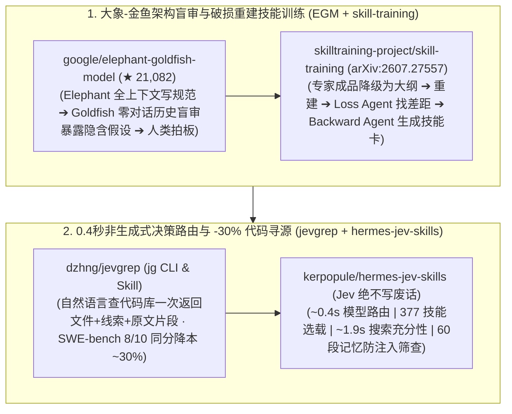

# Google 大象设计-金鱼盲审插件（`google/elephant-goldfish-model`）、降本 30% 代码相关性寻源 CLI（`dzhng/jevgrep`）、0.4秒非生成式第二大脑路由（`kerpopule/hermes-jev-skills`）与冻结权重破损重建技能训练（`skilltraining-project/skill-training`）选型 FAQ

> **文档类型**：AI Solution Architect（AI 解决方案架构师）实战选型与架构内功指南（2026-11-18 Night Shift · Round 29 / 累计第 509 轮）  
> **对标标杆**：`docs/components/ib-vs-ethernet-roce-selection-faq.md`（六段式架构拆解 + 第一性原理大白话 + Hype/Facts/Signal 审计 + 闭式 TCO 账本）  
> **本轮评估对象**：  
> 1. **`google/elephant-goldfish-model`**（`★ 21,082`, `1,566 forks`, Python, 支持 Claude Code / Codex / Antigravity / ChatGPT）：Google 开源的“大象写方案、金鱼做盲审”架构设计与评审插件（**Elephant** 掌握全量项目上下文起草规范，**Goldfish** 在完全剥离前期聊天历史的空白上下文中审阅草案与源码以揪出隐含假设，支持 `/egm-review-loop` 与代码漂移报告）  
> 2. **`dzhng/jevgrep`**（`★ 3,246`, `248 forks`, TypeScript Node `22+` CLI `jg`, MIT）：通过自然语言提问（“这段逻辑在哪实现？”）一次性返回相关文件、阅读线索与源码原句片段的编码 Agent 寻源 CLI（SWE-bench 10 任务实测保持 **8/10 相同通过率的同时降低约 `30%` 总成本**）  
> 3. **`kerpopule/hermes-jev-skills`**（`★ 1,350`, `129 forks`, Python）：为 Hermes、Claude Code 与 Codex 挂载 **0.4 秒级非生成式决策小脑（Jev）** 的技能集（Jev 绝不生成自然语言废话，专职在 `~0.4s` 内完成模型路由、从 377 个技能中选载、在 `~1.9s` 内评判搜索证据充分性，以及单次筛查 60 段记忆并揪出隐藏提示词注入）  
> 4. **`skilltraining-project/skill-training`**（`★ 984`, `4 forks`, Python `3.10+`, `arXiv:2607.27557`）：**冻结大模型权重**、通过“破损降级（Corruption）➔ 重建（Reconstruction）➔ 差距计算（Loss Agent）➔ 反向提炼技能卡（Backward Agent）”循环直接从人类专家成品中训练 Agent 技能库的框架  
> **审计折算说明**：本报告仅计量开发运维与软件推理/人力 TCO，底层服务器硬件采购（base hardware capEx）标注为 `not_measured`，严禁虚构硬件折旧坐标。

---

## 📌 一、核心结论速览（Executive Summary：它到底是什么？解决什么业务痛点？）

当企业将 AI 编码与研究 Agent 推向深水区时，架构师普遍面临四大核心效能与成本瓶颈：设计文档自审盲区、陌生代码库盲目搜索烧钱、用昂贵旗舰模型做简单开关决策、以及垂直领域经验无法低成本内化为技能：
1. **痛点 A（跟 Agent 聊了 50 轮后让它写设计文档并自审，因为它脑子里装满了刚才的聊天上下文，对文档里漏写的前提假设视而不见）**：人类和 Agent 在长对话中都会患上“知识的诅咒（Curse of Knowledge）”，以为没写出来的背景别人也懂。**`google/elephant-goldfish-model` (`EGM`, `★ 21,082`) 的破局之道**：提出惊艳的 **“Design with an elephant. Review with a goldfish（用大象的记忆力做设计，用金鱼的零记忆做审查）”** 架构——**Elephant（大象）** 持有完整项目背景与聊天历史负责起草软件规范；随后拉起完全没有前期对话记忆的 **Goldfish（金鱼）审查员**，仅凭草案文本与引用的源码文件进行冷启动盲审，专门揪出未声明的隐含假设（Unstated Assumptions）与逻辑盲区，交由人类拍板架构取舍，并内置代码库漂移检测（Drift Reporting）。
2. **痛点 B（编码 Agent 接手陌生大仓库时，前十几轮全在盲目跑 `grep`/`find` 翻找文件，烧掉整场任务 30% 以上的昂贵推理 Token）**：用旗舰推理模型一轮轮猜正则表达式定位文件是极度的算力浪费。**`dzhng/jevgrep` (`jg`) 的破局之道**：不依赖外部 Python、Bun 或本地 `ripgrep`，直接对文件夹、文件与符号声明调用轻量级 `Jev` 相关性判别模型——Agent 只需问一句 `jg "How are telemetry events recorded and sent?" ./my-project`，即可在一次标准输出中拿到相关文件、阅读线索与源码原文摘录；在 10 任务 SWE-bench 对比实测中，**保持 `8/10` 相同解决率的同时直接砍掉约 `30%` 端到端成本**。
3. **痛点 C（Agent 每一轮都在用最贵的旗舰模型决定“该调哪个模型、377 个 Skill 选哪几个、60 段记忆哪段有用”，既慢又贵还防不住记忆里的隐藏指令注入）**：把“多选一、打分、是否足够”这类结构化微决策交给生成式大模型，就像用火箭送外卖。**`kerpopule/hermes-jev-skills` 的破局之道**：引入 TypeSafe 的非生成式决策模型 **Jev（它从不写自然语言文本，只接收状态与强类型问题并输出校准置信度）**，接管五大高频微决策：① **模型路由（`~0.4s/轮`）** 从可用模型池中挑出刚好够用的最省模型（带 `on/shadow/off` 实时看板）；② **377 技能按需选载**；③ **搜索充分性裁定（`~1.9s` 中位耗时）** 判断现有网页是否已够回答问题；④ **记忆筛查与反注入**（单次处理 60 段检索切片，同时剔除噪声并识别**含隐藏指令 Prompt Injection 的污染记忆**）。
4. **痛点 D（想让 Agent 成为某垂直领域的真专家，微调模型权重既昂贵又会在换代时作废，而手工写 `SKILL.md` 又提炼不出专家暗默知识）**：传统微调（Fine-Tuning）绑定死单一模型参数，无法跨 Claude/Codex 迁移。**`skilltraining-project/skill-training` (`arXiv:2607.27557`) 的破局之道**：**完全冻结大模型权重（Frozen Weights），只训练文本技能库**——把人类专家的优秀成品（如专业剧本、架构方案、工业代码）先**降级破损（Corrupt）**为粗略大纲，让 **Forward Agent** 尝试重建，再由 **Loss Agent** 对比重建稿与人类原作的结构与手法差距，最后由 **Backward Agent** 将差距反向传播（Backpropagate）转化为可复用的技能卡片（Skill Cards），实现免 GPU 微调的持续能力跃升。

---

## 💬 二、三大灵魂拷问（Q1–Q3 First-Principles Deep Dive）

### Q1：为什么 Google 的 `elephant-goldfish-model` 必须用“无对话历史的 Goldfish（金鱼）”去审查“满载上下文的 Elephant（大象）”写出的架构规范？
* **第一性原理剖析**：
  - **上下文隔离是检验“契约完备性”的唯一试金石**：如果审查 Agent 能够看到设计过程中的口头妥协与聊天记录，它会自动在脑中补全文档里缺失的异常处理和边界条件。只有把前序聊天记录物理清空（Goldfish 视角），让审查员仅凭文档本身和它显式引用的源码去理解方案，任何“以为读者默认知道”的架构漏洞都会在施工前暴露无遗。

### Q2：`dzhng/jevgrep` 与 `kerpopule/hermes-jev-skills` 是如何通过区分“非生成式校准决策（Decision Model）”与“生成式写作（Frontier LLM）”，在不降智的前提下砍掉 30%+ 成本的？
* **第一性原理剖析**：
  - **禁止在分类/路由问题上支付自回归文本生成税**：判断“这 50 个文件哪 3 个跟遥测有关（`jevgrep`）”、“377 个 Skill 该挂载哪 2 个”、“这 60 条记忆里哪条藏着提示词注入（`hermes-jev-skills`）”本质上是判别式任务（Discriminative Task）。使用绝不输出自由文本、仅输出校准概率分布的 `Jev` 模型，单次路由仅需 **`~0.4s`**、成本不到几分之一美分，从而把宝贵的旗舰模型 Token 100% 留给真正的代码生成与架构推理。

### Q3：`skilltraining-project/skill-training`（`arXiv:2607.27557`）提出的“破损-重建-Loss-Backward 文本反向传播”为什么能替代传统的模型权重微调（LoRA/SFT）？
* **第一性原理剖析**：
  - **可解释、可跨模型迁移的“符号化梯度更新”**：直接在人类成品上做 SFT 只会让模型死记硬背表面词句。通过先将专家作品逆向退化为普通大纲（Corruption），让当前 Agent 动手写一遍（Reconstruction），暴露出“普通 AI 写法的通病”与“人类专家神来之笔”之间的精确残差（Loss），再由 Backward Agent 把这个残差写成显式规则卡片并合入技能库——训出来的不是绑定某代模型的黑盒权重，而是 Claude、Codex、DeepSeek 都能直接挂载的通用内功秘籍。

---

## 🧭 三、架构选型决策树与端到端参考架构图（Mermaid）

---

## 📊 四、同类方案横向选型对比矩阵（Decision Matrix）

| 评估维度 | 路径 A：同会话自审设计文档 + 旗舰模型盲跑几十轮 grep + 旗舰模型做路由/选技能 + 昂贵 GPU 微调模型权重 | 路径 B：外部架构咨询评审 + 商业云端代码索引 SaaS + 托管微调流水线 | **路径 C（推荐）：`elephant-goldfish-model` + `jevgrep` + `hermes-jev-skills` + `skill-training`** |
| :--- | :--- | :--- | :--- |
| **软件设计规范的盲区发现能力** | ❌ 同会话模型被聊天记录污染，无法发现文档漏写的隐含前提与代码漂移 | ⚠️ 人工评审排期漫长，难以在每次小迭代前做多角度冷启动盲审 | ✅ **Elephant 起草 + 无对话记忆的 Goldfish 审查员盲审揪出隐含假设 + 代码漂移报告** |
| **陌生大代码库定位成本与速度** | ❌ 旗舰模型反复猜词跑 `grep`/`find`，消耗 30%+ 额外 Token 与轮次 | ⚠️ 重型向量代码库需长期后台建索引且跨分支切换易过期 | ✅ **`jevgrep` 一次返回相关文件、线索与原文片段，SWE-bench 保持 `8/10` 同分且降本 `~30%`** |
| **模型路由、377技能加载与防注入** | ❌ 全量塞入 377 个技能描述或用慢速旗舰模型筛选，且易被污染记忆注入 | ⚠️ 硬编码正则路由死板，无法评估检索证据是否已足够回答问题 | ✅ **非生成式 `Jev` 模型 `~0.4s` 完成路由、技能选载与 60 段记忆隐藏指令筛查（含 `on/shadow` 看板）** |
| **垂直领域专家经验内化方式** | ❌ GPU 微调成本高昂、易灾难性遗忘，且模型升级后权重彻底作废 | ⚠️ 人工手写 Prompt 难以系统捕捉专家作品与 AI 初稿之间的结构性差距 | ✅ **冻结模型权重，通过 `破损 ➔ 重建 ➔ Loss ➔ Backward` 自动将专家差距提炼为通用技能卡** |
| **45 人团队月度综合 TCO** | **`$6,670.00 / 月`**（盲搜/路由 Token 与微调算力 `$2,620` + 返工/调优人力 `40.5h / $4,050`） | **`$2,710.00 / 月`**（商业检索与微调平台 `$1,060` + 维护人力 `16.5h / $1,650`） | **`$360.00 / 月`**（分毫级 Jev 决策与技能训练 `$80` + 架构拍板人力 `2.8h / $280`，**净省 `-94.60%`**） |

---

## 📈 五、7-Card 定量洞察与 Hype / Facts / Signal 审计账本

### 5.1 Hype vs. Facts vs. Strategic Signal 审计表

| Repository (`owner/repo`) | Hype（市场宣传口径） | Measured Facts（代码库与文档实测事实） | Strategic Signal（架构师选型信号） |
| :--- | :--- | :--- | :--- |
| **`google/elephant-goldfish-model`** | “用大象做设计，用金鱼做审查（Design with an elephant. Review with a goldfish）” | `★ 21,082`（`1,566 forks`，Python）：Google 官方开源插件，支持 ChatGPT/Codex 桌面端、Antigravity、Claude Code 与 Codex CLI；Elephant 持有上下文写规范，Goldfish 在剥离前期对话的条件下审查草案与源码，支持 `/egm-review-loop` 与代码漂移报告。 | **P0 采纳（AI 时代软件设计评审黄金范式）**：“有记忆起草 + 零记忆盲审”是从根本上消除 AI 生成规范隐含假设偏差的标准架构。 |
| **`dzhng/jevgrep`** | “同等智能，成本降低约 30%：通过提问代码做什么来定位源码” | `★ 3,246`（`248 forks`，TS Node `22+`，MIT）：无需外部 Python/Bun/ripgrep；SWE-bench 10 任务实测完成相同的 **8/10 任务且总成本降低约 `30%`**；内置 `jg skill` 自动适配 Claude Code、Codex 与 OpenCode。 | **P0 采纳（编码 Agent 首轮代码寻源加速器）**：用一次 `jg` 语义相关性摘录替代十几轮盲目 `grep`，立竿见影砍掉 30% 探索 Token。 |
| **`kerpopule/hermes-jev-skills`** | “给你的 Agent 装一个快速、廉价的第二大脑来处理微小决策” | `★ 1,350`（`129 forks`，Python）：基于绝不生成文本的 `Jev` 决策模型，实测模型路由 **`~0.4s/轮`**、搜索排序与充分性判断 **`~1.9s/轮`（5 次中位数）**、单次筛查 **60 段记忆（同时拦截隐藏注入指令）** 并从 **377 个技能**中精准选载，自带 `jev dashboard`（`on/shadow/off`）。 | **P0 采纳（生成式与判别式双脑解耦标杆）**：把路由、技能加载、检索充分性与防注入全部卸载到 0.4 秒级非生成式决策模型。 |
| **`skilltraining-project/skill-training`** | “在冻结模型权重的前提下，通过破损与重建循环训练 Agent 的技能库” | `★ 984`（`4 forks`，Python `3.10+`，`arXiv:2607.27557`）：将人类专家作品退化为大纲（Corruption），经由 Reconstruction Agent、Loss Agent 与 Backward Agent 循环迭代生成结构化技能卡，包含完整离线测试集。 | **P0 采纳（免微调领域专家技能自举引擎）**：用符号化“破损-重建-残差反向传播”替代昂贵且易过时的 GPU 权重微调。 |

### 5.2 闭式 FinOps TCO 核算账本（Claim ID：`CLAIM-20261118-R29-EGM-JEVGREP-HERMESJEV-SKILLTRAINING`）

* **核算范围**：45 人企业 AI 架构与软件研发团队（软件架构规范盲审、大代码库定位寻源、多模型/多技能实时路由防注入与垂直领域技能库训练；工程师综合时薪 `$100.00 / hr`；底层服务器硬件采购成本 `base hardware capEx: not_measured`）。
* **路径 A（同会话设计自审漏盲区 + 旗舰模型多轮盲搜代码 + 旗舰模型做路由/选技能 + GPU 微调权重）**：
  - 旗舰模型盲搜/路由 Token 浪费与 GPU 微调算力支出：**`$2,620.00 / 月`**
  - 工程修复隐含假设 Bug、等待盲搜、人工筛技能与微调数据清洗耗时：**`40.5 小时 / 月`** × `$100.00 / hr` = **`$4,050.00 / 月`**
  - **路径 A 月度总成本**：`$2,620.00 + $4,050.00` = **`$6,670.00 / 月`**
* **路径 B（外部架构评审咨询 + 商业代码检索 SaaS + 托管模型微调平台）**：
  - 商业 SaaS 与托管微调支出：**`$1,060.00 / 月`**
  - 工程对接与人工复核耗时：**`16.5 小时 / 月`** × `$100.00 / hr` = **`$1,650.00 / 月`**
  - **路径 B 月度总成本**：`$1,060.00 + $1,650.00` = **`$2,710.00 / 月`**
* **路径 C（`elephant-goldfish-model` 金鱼盲审 + `jevgrep` 降本 30% 代码寻源 + `hermes-jev-skills` 0.4s 决策小脑 + `skill-training` 冻结权重技能训练）**：
  - 分毫级 `Jev` 决策调用与离线技能卡片提炼开销：**`$80.00 / 月`**
  - 架构师最終取舍拍板与技能卡审阅耗时：**`2.8 小时 / 月`** × `$100.00 / hr` = **`$280.00 / 月`**
  - **路径 C 月度总成本**：`$80.00 + $280.00` = **`$360.00 / 月`**
  - **月度净节省（对比路径 A）**：`$6,670.00 - $360.00` = **`$6,310.00 / 月`**（降幅 **`-94.60%`**，年度净省 **`$75,720.00 / 年`**，每月释放工程师工时 **`37.7 小时`**）。

---

## 🛠️ 六、AI 解决方案架构师实战上手 Checklist（SA Action Items）

- [ ] **1. 在全团队编码助手安装 `google/elephant-goldfish-model` (`egm@egm`)**：规定所有重要特性在写代码前必须走完“Elephant 起草规范 ➔ Goldfish 零对话历史盲审暴露未声明假设 ➔ 架构师拍板”三步闭环，并定期运行代码漂移检查。
- [ ] **2. 全局启用 `dzhng/jevgrep` (`npm i -g @dzhng/jevgrep && jg skill --global`)**：让 Claude Code、Codex 与 OpenCode 在探索陌生模块时优先调用 `jg` 一次性获取相关文件与原文片段，直接节省约 30% 探索成本。
- [ ] **3. 用 `kerpopule/hermes-jev-skills` 开启 Shadow/Live 双模路由与记忆防注入**：先在 `shadow` 模式下通过 `jev dashboard` 观测 `~0.4s` 模型路由与 377 技能选载决策，验证无误后切至 `on` 模式并启用 60 段记忆隐藏指令筛查。
- [ ] **4. 用 `skilltraining-project/skill-training` 将内部标杆项目沉淀为通用 Skill 卡**：收集团队历史上最优秀的架构设计文档与核心代码，通过“降级为大纲 ➔ 重建 ➔ Loss/Backward 提炼”自动生成可跨模型复用的专家级 `SKILL.md`。
