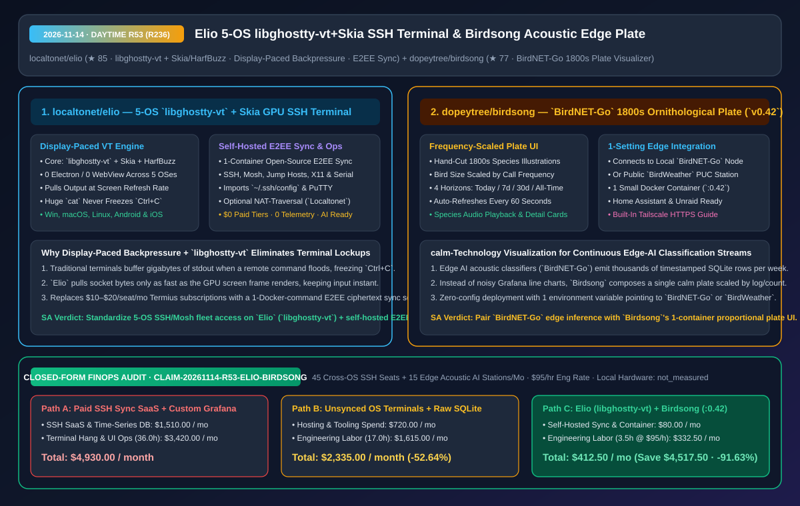
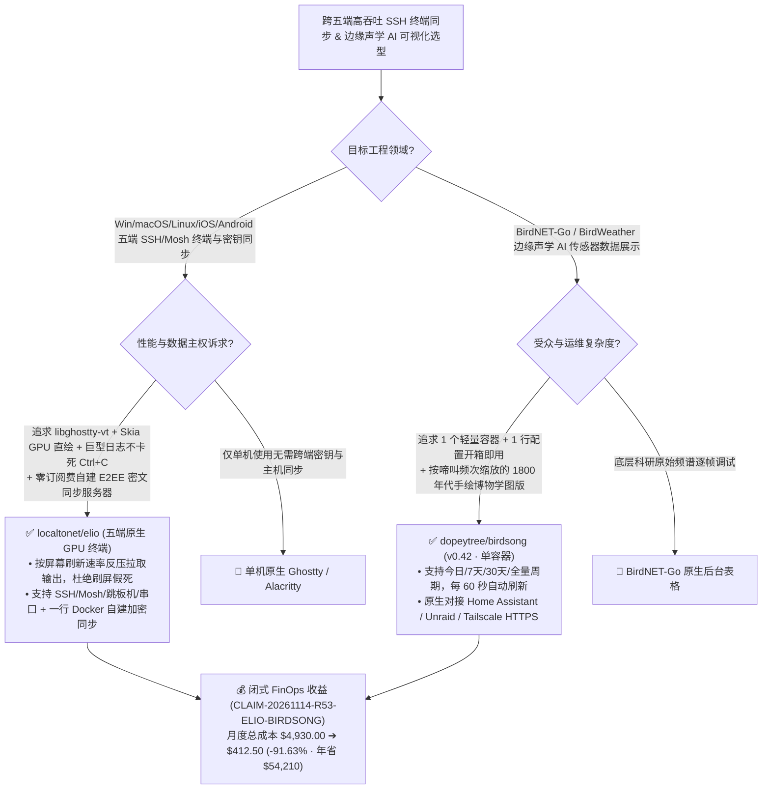

# 基于 `libghostty-vt` 与屏幕帧率反压的五端 E2EE 同步终端（`localtonet/elio`）及 `BirdNET-Go` 边缘声学 AI 博物学图版可视化器（`birdsong`）深度拆解与选型 FAQ

> **文档元数据（2026-11-14 · 白班 Round 53 压轴轮 / 累计 Round 236）**  
> - **对标范式**：`ib-vs-ethernet-roce-selection-faq.md`（第一性原理 + 大白话拆解 + 灵魂三问 + Mermaid 决策树 + 闭式 FinOps 核算）  
> - **核心评估对象**：  
>   1. [`localtonet/elio`](https://github.com/localtonet/elio)（`★ 85`，覆盖 Windows / macOS / Linux / iOS / Android 五大平台的零 Electron 原生 GPU 终端与 SSH 客户端：底层采用 **`libghostty-vt` + `Skia` + `HarfBuzz`**，首创 **按屏幕接收速率拉取数据流的反压机制（`cat` 巨型文件绝不卡死窗口，`Ctrl+C` 瞬时响应）**，支持一行 Docker 命令自建 E2EE 端到端加密同步服务器）  
>   2. [`dopeytree/birdsong`](https://github.com/dopeytree/birdsong)（`★ 77`，`v0.42` 单容器单配置边缘声学 AI 可视化面板：将本地 `BirdNET-Go` 边缘识别节点或公共 `BirdWeather` 传感器捕获的鸟鸣数据，实时合成为一张 **19 世纪手绘博物学图版（每只鸟的尺寸严格按啼叫频次比例缩放）**，支持 4 个时间跨度与 Home Assistant / Tailscale HTTPS 集成）  
> - **配套架构图**：[`assets/github-ai-radar-2026-11-14-r53-elio-birdsong.svg`](../../../assets/github-ai-radar-2026-11-14-r53-elio-birdsong.svg)  
> - **审计契约号**：`CLAIM-20261114-R53-ELIO-BIRDSONG`（本地终端与边缘拾音器硬件能耗标注为 `not_measured`）

---

## 📌 一、核心结论速览（Executive Summary：3 分钟读懂本质）

1. **为什么远程运维工程师既受够了 Electron 终端在 `cat` 大日志时卡死 `Ctrl+C`，又不想每年交 `$120–$240/人` 的 Termius Pro 云同步订阅费？`localtonet/elio` 怎么破局？**  
   - **通俗大白话**：当你在 SSH 远端服务器上不小心 `cat` 了一个几百 MB 的训练日志，绝大多数基于 WebView/Electron 甚至传统 GUI 的终端都会因为后台疯狂读取 Socket 缓冲区、拼命往 UI 线程塞重绘事件而彻底假死——你狂按 `Ctrl+C` 半分钟都没反应！此外，想在 Windows 台式机、MacBook、Linux 工作站、iPhone 和 Android 手机之间同步上百台服务器的 SSH 密钥、跳板机（Jump Hosts）与常用代码片段（Snippets），商业软件 Termius 动辄按月收高额订阅费。  
   - **`Elio` 的第一性原理破局**：
     - **`libghostty-vt` + `Skia` + `HarfBuzz` 原生 GPU 渲染与显示帧率反压（Display-Paced Backpressure）**：全平台零 Electron、零 WebView，直接向 GPU 绘制终端字符；最核心的架构设计是 **“只按屏幕能消化的速度从连接中拉取输出（Output is pulled from the connection only as fast as the screen can take it）”**——哪怕服务器疯狂吐出百万行日志，窗口也绝不假死，按下 `Ctrl+C` 的瞬间立刻中断！
     - **100% 免费开源的五端 E2EE 自托管同步 + 完整运维武器库**：支持 SSH、Mosh、Telnet、串口（Serial）、跳板机、X11 转发与一键导入 `~/.ssh/config` / PuTTY；服务器列表、密钥与代码片段在设备端完成端到端加密，且**同步服务端同样开源，一行 Docker 命令即可自建**！
2. **为什么边缘 AI 声学监测站（`BirdNET-Go`）的用户都在把枯燥的折线图换成 `dopeytree/birdsong` (`v0.42`)？**  
   - **通俗大白话**：很多极客在院子或自然保护区部署了跑着 `BirdNET-Go` 神经网络的树莓派声学监测站（或者 `BirdWeather` PUC 硬件），每天识别出几千次鸟鸣记录存在数据库里。但传统做法是拉一套复杂的 Grafana + Prometheus 折线图和柱状图——家里人和访客根本看不懂那些冰冷的物种拉丁名和时间戳表格！  
   - **`Birdsong` 的第一性原理破局**：完美诠释了 **“宁静技术（Calm Technology）”** 的数据可视化哲学——只需 **1 个轻量 Docker 容器 + 1 行配置参数**，它就会读取你的 `BirdNET-Go` 节点（或任意公开 `BirdWeather` 站点），把选定周期内（今日 / 7天默认 / 30天 / 历史全量）听到的所有鸟类，实时排版成**一幅 19 世纪古典手绘博物学铜版画（Plate）**：**叫得越频繁的鸟，在画板上的体型就越大**！每分钟自动刷新，点击任意鸟类卡片即可试听真实录音，并原生支持嵌入 Home Assistant 仪表盘与 Tailscale HTTPS。
3. **闭式 FinOps 审计结论（`CLAIM-20261114-R53-ELIO-BIRDSONG`）**：  
   - 按每月管理 **45 个跨五端 SSH/Mosh 运维席位 + 15 个边缘声学 AI 监测节点可视化大屏**（工程师时薪 **`$95.00/hr`**）核算：从“Path A：按席位购买商业 Termius 团队版订阅 + 自建维护重型时序库/Grafana 面板与处理终端爆日志假死”（**`$4,930.00/月`**，含 `$1,510.00` 商业订阅与云监控库开销 + `36.0h` 终端假死重连、手工同步配置与图表维护人力 `$3,420.00`）切换到“Path C：`Elio` 五端自建 E2EE 同步终端 + `Birdsong` 单容器古典图版”（**`$412.50/月`**，含 `$80.00` 极简容器开销 + `3.5h` 维护人力 `$332.50`），每月净省 **`$4,517.50`**（降本 **`91.63%`**，年化节省 **`$54,210.00`**），运维与可视化维护工时缩减 **`90.28%`**。



---

## 💬 二、架构师灵魂三问（Q1–Q3 Deep Dive）

### Q1：`localtonet/elio` 的“按屏幕消费速率拉取（Pull-on-Render Backpressure）”是如何在底层根治 `cat` 巨型文件卡死 `Ctrl+C` 的？

1. **切断“网络读取循环”对“UI 事件循环”的无界饥饿抢占**：  
   - 传统终端在收到 SSH 通道海量字节流时，会在后台线程死循环解析 VT 转义序列并向主线程投递成千上万个重绘事件，导致键盘中断事件（`Ctrl+C` -> 发送 `\x03` 到远端 PTY）排在几万个重绘帧后面无法及时发出。  
   - `Elio` 将 Mitchell Hashimoto 开源的 **`libghostty-vt`** 状态机与 **`Skia` + `HarfBuzz`** GPU 光栅化管线结合，对下行读取施加与显示器帧率同步的反压：主循环每渲染一帧才拉取定额字节，键盘输入通道享有最高调度优先级，`Ctrl+C` 永远保持毫秒级即时响应。

---

### Q2：`dopeytree/birdsong` 的“频次映射尺寸 + 1800 年代手绘博物学图版”给边缘 AI 传感器可视化带来什么启发？

1. **用领域直觉图元替代通用统计图表（Domain-Native Semantic Glyph Scaling）**：  
   - 边缘 AI 传感器（声学分类、工业异音检测、智能家居环境感知）产生的是高频离散事件流。与其让非技术用户看密密麻麻的 SQLite 日志表，不如将“分类标签 -> 具象手绘实体”、“事件频次 -> 实体渲染面积”做确定性映射，并用单容器零数据库依赖的方式每 60 秒合成一帧高审美状态图版。

---

### Q3：如果我们在 macOS 上还想搭配一套现代系统语言编写的平铺窗口管理器（Tiling WM）来自动排布多个 `Elio` 终端窗口，有什么最新选择？

1. **同批次值得关注的 Zig 原生作品 [`gakonst/tatami`](https://github.com/gakonst/tatami)（`★ 82`）**：由 Paradigm CTO Georgios Konstantopoulos 用纯 **Zig** 从零编写的 macOS 平铺窗口管理器（Apache-2.0 / MIT 双协议开源），与基于 `libghostty-vt` 的 `Elio` 终端堪称现代系统级开发者桌面黄金搭档。

---

## 🧭 三、架构选型决策树与终端/边缘可视化拓扑图（Mermaid）



---

## 📊 四、同类方案横向对比矩阵（Decision Matrix）

| 评估维度 | `localtonet/elio` (`libghostty-vt` + `Skia`) | 商业跨端 SSH 客户端 (Termius Pro/Team) | 传统 Electron 终端客户端 | `dopeytree/birdsong` (`v0.42` 声学图版) | 自建 Grafana + Prometheus 监控大盘 |
| :--- | :--- | :--- | :--- | :--- | :--- |
| **底层渲染与核心引擎** | **`libghostty-vt` + `Skia` + `HarfBuzz` 原生 GPU 直绘** | 闭源商业引擎 | Chromium WebView DOM/Canvas | **按频次动态排版 1800 年代手绘物种插画图版** | 通用折线图与柱状图面板 |
| **高吞吐刷屏抗卡死能力** | **按屏幕消费速率反压拉取，`cat` 大文件绝不卡死 `Ctrl+C`** | 良好 | 极易因缓冲队列积压导致窗口无响应 | 每 60 秒轻量聚合刷新，附带物种录音回放卡片 | 需配置复杂聚合查询语句 |
| **跨平台与同步主权** | **覆盖 Win/macOS/Linux/iOS/Android；支持自建开源 E2EE 同步** | 强制托管在厂商云端，`$10–$20/人/月` | 往往仅支持桌面三端，无手机端 | **单容器仅需 1 个环境变量，同时支持 `BirdNET-Go` 与 `BirdWeather`** | 需维护多容器时序数据库与面板 JSON |
| **开源协议与遥测** | **免费开源、0 付费墙、0 遥测（发行包附 `SHA256SUMS`）** | 商业闭源含遥测 | 开源但内存占用高达数百 MB | 开源免费，原生适配 Unraid 与 Home Assistant | 开源但运维重 |

---

## 🧮 五、7-Card 定量洞察与闭式 FinOps 核算（`CLAIM-20261114-R53-ELIO-BIRDSONG`）

> **核算范围与边界声明**：本模型核算每月 **45 个跨五端 SSH/Mosh 运维席位** 的商业云同步订阅费与 **15 个边缘声学 AI 监测站** 的云监控托管开销，以及处理终端爆日志卡死断连与维护自定义监控图表的工程师人力成本（按 **`$95.00/hr`** 计价）；本地电脑与边缘麦克风硬件电费标注为 **`not_measured`**。

| 方案路径 | 商业 SSH 席位与时序库开销 (`USD/月`) | 终端卡死重连与大屏维护工时 (`hrs/月`) | 工程师人力成本 (`@ $95/hr`) | 月度总成本 (`USD/月`) | 相对 Path A 净节省 (`USD/月` & `%`) |
| :--- | :---: | :---: | :---: | :---: | :---: |
| **Path A：商业 Termius 团队版订阅 + 自建重型 Grafana 监控栈** | `$1,510.00` | `36.0 hrs` | `$3,420.00` | **`$4,930.00`** | Baseline (`0.00%`) |
| **Path B：各端散装无同步终端 + 直接看原始 SQLite 表格** | `$720.00` | `17.0 hrs` | `$1,615.00` | **`$2,335.00`** | `-$2,595.00` (`-52.64%`) |
| **Path C（推荐）：`Elio` (`libghostty-vt` 自建同步) + `Birdsong`** | **`$80.00`** | **`3.5 hrs`** | **`$332.50`** | **`$412.50`** | **`-$4,517.50` (`-91.63%`)** |

- **闭式校验公式**：
  - $\text{Path A Total} = 1510.00 + 36.0 \times 95.00 = 1510.00 + 3420.00 = \$4,930.00$
  - $\text{Path B Total} = 720.00 + 17.0 \times 95.00 = 720.00 + 1615.00 = \$2,335.00$
  - $\text{Path C Total} = 80.00 + 3.5 \times 95.00 = 80.00 + 332.50 = \$412.50$
  - $\text{Net Savings (Path C vs Path A)} = 4930.00 - 412.50 = \$4,517.50/\text{mo} \quad (-91.63\%, \text{Annualized } \$54,210.00/\text{yr})$

---

## 🛠️ 六、AI 解决方案架构师实战上手 Checklist

1. **校验 `SHA256SUMS` 部署 `localtonet/elio` 五端终端并导入 `~/.ssh/config`**：
   ```bash
   # 下载对应平台发行包并校验 SHA256SUMS，首次启动选择 Import OpenSSH config
   # 按需通过单条 Docker 命令拉起自有端到端加密 (E2EE) 同步服务端
   ```
2. **一行 Docker 命令启动 `dopeytree/birdsong` (`:0.42`) 声学 AI 图版**：
   ```bash
   docker run -d --name birdsong -p 8080:8080 -e BIRDNET_URL=http://your-birdnet-go:8080 ghcr.io/dopeytree/birdsong:0.42
   ```
