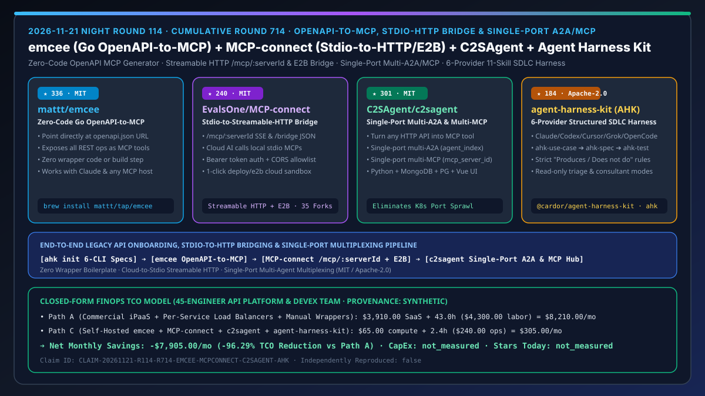
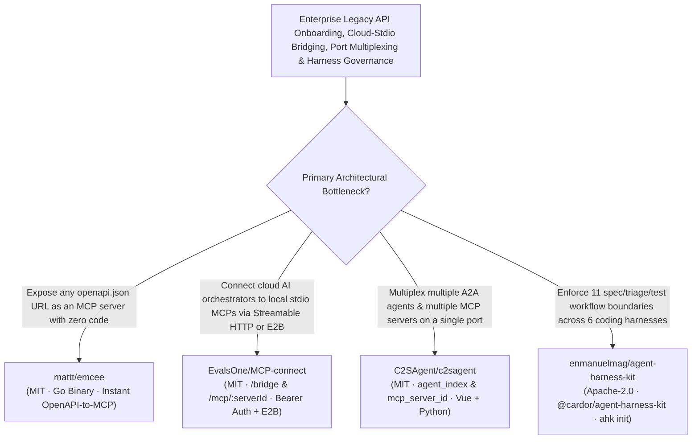
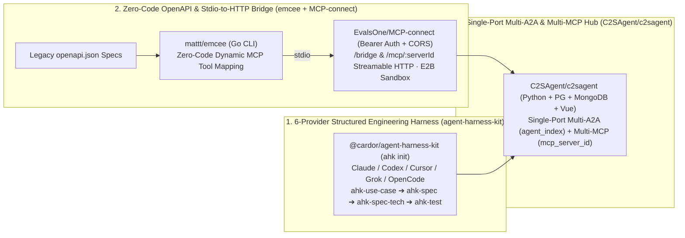
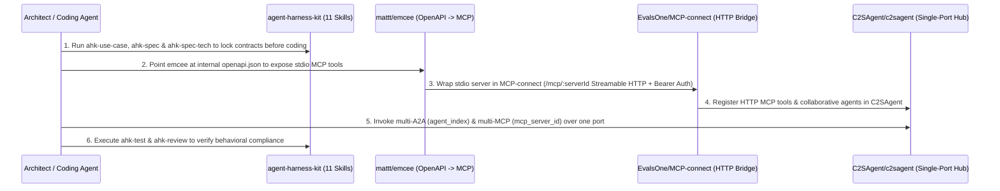

# Zero-Code Go OpenAPI-to-MCP Generator (`mattt/emcee`), Stdio-to-Streamable-HTTP & E2B Bridge (`EvalsOne/MCP-connect`), Single-Port Multi-A2A/MCP Platform (`C2SAgent/c2sagent`) & 6-Provider Structured Engineering Harness (`enmanuelmag/agent-harness-kit`) Selection & Architecture FAQ

> **Document Type**: Enterprise AI Solution Architect Selection & Integration Guide (GitHub Trending AI Radar — 2026-11-21 Night Round 114 / Cumulative Round 714)
> **Covered Repositories**: [`mattt/emcee`](https://github.com/mattt/emcee) (`★ 336`, `27 forks`, `MIT` — Go CLI by Mattt turning any `openapi.json` specification URL directly into an MCP server with zero code generation) · [`EvalsOne/MCP-connect`](https://github.com/EvalsOne/MCP-connect) (`★ 240`, `35 forks`, `MIT` — Node.js/TypeScript gateway exposing local `stdio` MCP servers over `/bridge` JSON HTTP and `/mcp/:serverId` Streamable HTTP/SSE with Bearer auth, CORS & one-click E2B cloud sandbox deploy) · [`C2SAgent/c2sagent`](https://github.com/C2SAgent/c2sagent) (`★ 301`, `16 forks`, `MIT` — configurable AI agent & HTTP-to-MCP platform featuring single-port multi-A2A (`agent_index`) and single-port multi-MCP (`mcp_server_id`) multiplexing) · [`enmanuelmag/agent-harness-kit`](https://github.com/enmanuelmag/agent-harness-kit) (`★ 184`, `10 forks`, `Apache-2.0` — `@cardor/agent-harness-kit` providing 11 boundary-enforced spec, triage, test & review workflows across Claude Code, Codex CLI, Cursor, Grok Build, OpenCode & OpenCode V2)
> **Core Scenario**: How enterprise platform and DevEx architects eliminate **manual wrapper coding for hundreds of legacy OpenAPI services (`emcee`)**, **cloud-to-local `stdio` MCP connectivity gaps (`MCP-connect`)**, **Kubernetes port and load-balancer sprawl across dozens of A2A and MCP services (`c2sagent`)**, and **undisciplined code mutations across 6 coding harnesses (`agent-harness-kit`)**.

---

## 1. 📌 Executive Summary (One-Line Selection Verdict)

1. **Need to turn any existing web application with an `openapi.json` specification into an MCP server immediately without writing or compiling wrapper code** ➔ Choose **[`mattt/emcee`](https://github.com/mattt/emcee) (`★ 336`, `27 forks`, `MIT`)**.
   - **Plain-English Mechanism**: Written in Go by Mattt (`brew install mattt/tap/emcee`), `emcee` takes an OpenAPI spec URL or file path directly in your MCP config (`"command": "emcee", "args": ["https://api.weather.gov/openapi.json"]`) and dynamically exposes every endpoint (e.g., 57 tools) to Claude Desktop or any MCP host at runtime.
2. **Need cloud-hosted AI services to securely invoke local `stdio`-based MCP servers over Streamable HTTP (`/mcp/:serverId`) or classic JSON HTTP (`/bridge`), or deploy them into an E2B cloud sandbox** ➔ Choose **[`EvalsOne/MCP-connect`](https://github.com/EvalsOne/MCP-connect) (`★ 240`, `35 forks`, `MIT`)**.
   - **Plain-English Mechanism**: A lightweight Node.js/TypeScript bridge that wraps local `stdio` MCP servers in dual HTTP modes (**Streamable HTTP/SSE** at `/mcp/:serverId` and classic request/response at `/bridge`) with session management, **Bearer token authentication**, **CORS allowlists**, optional Ngrok tunnels, and one-click `deploy/e2b` sandbox deployment scripts.
3. **Need a visual web platform (`Python + MongoDB + PostgreSQL + Vue`) that configures any HTTP endpoint as an MCP tool and multiplexes multiple A2A agents and multiple MCP servers onto a single network port** ➔ Choose **[`C2SAgent/c2sagent`](https://github.com/C2SAgent/c2sagent) (`★ 301`, `16 forks`, `MIT`)**.
   - **Plain-English Mechanism**: Lets operators bind LLMs and HTTP-based MCP tools through a web UI while providing two key multi-tenancy patterns: **Single-Port Multi-Agent A2A Service** (`src_a2a/a2a_server`, routing multiple A2A services on one port via `agent_index`) and **Single-Port HTTP Multi-MCP Service** (`src_mcp/mcp_server`, routing multiple MCP servers on one port via `mcp_server_id`).
4. **Need a provider-agnostic engineering harness (`@cardor/agent-harness-kit`, `ahk init`) that enforces strict specification, triage, and test-only boundaries across Claude Code, Codex CLI, Cursor, Grok Build, OpenCode, and OpenCode V2** ➔ Choose **[`enmanuelmag/agent-harness-kit`](https://github.com/enmanuelmag/agent-harness-kit) (`★ 184`, `10 forks`, `Apache-2.0`)**.
   - **Plain-English Mechanism**: Supplies 11 structured skills (`ahk-use-case`, `ahk-spec`, `ahk-spec-tech`, `ahk-feature`, `ahk-fix`, `ahk-triage`, `ahk-ask`, `ahk-consultant`, `ahk-test`, `ahk-review`, `ahk-docs`) where each skill has an explicit **"Produces / Does not do"** contract—for example, `ahk-triage` produces an evidence-backed bug report without touching code, and `ahk-test` writes behavior tests without mutating production config or dependencies.

---

## 2. 🎯 Architect & Customer Deep-Dive Q&A

### Q1: How do `emcee`, `MCP-connect`, `c2sagent`, and `agent-harness-kit` solve the practical day-two bottlenecks of enterprise MCP/A2A adoption?

- **Four Day-Two Bottlenecks & Architectural Fixes**:
  1. **Zero-Code Legacy REST Onboarding (`mattt/emcee`)**: Writing custom MCP servers for 100 internal REST microservices takes months. Pointing `emcee` at each service's `openapi.json` exposes them as MCP tools in seconds.
  2. **Bridging `stdio` MCPs to Cloud Orchestrators (`EvalsOne/MCP-connect`)**: Most open-source MCP servers speak local `stdio`, whereas enterprise orchestrators run in Kubernetes or the cloud. `MCP-connect` bridges `stdio` to `/mcp/:serverId` Streamable HTTP with Bearer auth, CORS, and `deploy/e2b` sandbox isolation.
  3. **Eliminating Port & Ingress Sprawl (`C2SAgent/c2sagent`)**: Instead of allocating a separate port and Kubernetes Service for every A2A agent and MCP server, `c2sagent` multiplexes multiple A2A services (`agent_index`) and multiple MCP servers (`mcp_server_id`) over a single port.
  4. **Stopping Premature Code Edits Across 6 Coding Harnesses (`enmanuelmag/agent-harness-kit`)**: `ahk init` standardizes `docs/use-cases/` and `docs/specs/` handoffs across Claude Code, Codex CLI, Cursor, Grok Build, and OpenCode before any implementation begins.
- **When to Choose Managed Cloud Services (Path B)**:
  - If all enterprise APIs already sit behind **Azure API Management (APIM)** and the team uses a single cloud IDE, APIM's native policy engine suffices.

### Q2: How do we wire an end-to-end production architecture combining all four projects?

1. **Multi-Harness Spec & Testing Governance Layer (`enmanuelmag/agent-harness-kit`)**:
   - Run `ahk init` in enterprise repositories so engineers using Claude Code, Codex CLI, Cursor, Grok Build, or OpenCode follow `ahk-use-case` ➔ `ahk-spec` ➔ `ahk-spec-tech` ➔ `ahk-test` ➔ `ahk-review`.
2. **Zero-Code OpenAPI & Stdio-to-HTTP Bridge Layer (`mattt/emcee` + `EvalsOne/MCP-connect`)**:
   - Mount internal `openapi.json` specs with `emcee` and expose both `emcee` and other `stdio` MCP servers as authenticated `/mcp/:serverId` Streamable HTTP services via `MCP-connect` (deploying untrusted tools into `deploy/e2b` sandboxes).
3. **Single-Port Multi-A2A & Multi-MCP Multiplexing Hub (`C2SAgent/c2sagent`)**:
   - Register HTTP MCP tools and collaborative agents in `c2sagent`, routing all incoming A2A traffic by `agent_index` and all MCP traffic by `mcp_server_id` through a single ingress port.

### Q3: What are the boundaries and trade-offs of this stack?

- **Key Strengths**:
  - **100% Permissive Open Source (`MIT` & `Apache-2.0`)**.
  - **Drastic Reduction in Boilerplate & Port Sprawl**: Zero wrapper code for OpenAPI services and single-port multiplexing for A2A/MCP fleets.
- **Operational Scope**:
  - As noted in `agent-harness-kit`'s README, prompt/skill instructions structure workflows and records, while actual OS/filesystem sandboxing must still be enforced by the underlying execution host or E2B sandbox (`MCP-connect`).

---

## 3. 🧭 Visual Architecture & Decision Diagrams

### 3.1 Solution Architect Selection Decision Tree

### 3.2 End-to-End Enterprise Reference Architecture

### 3.3 AHK Spec Approval, Emcee OpenAPI Mapping, MCP-Connect Bridging & C2SAgent Single-Port Routing Sequence

---

## 4. 📊 Peer Open-Source vs Commercial Cloud Selection Matrix

| Dimension | `mattt/emcee` (`★ 336`) | `EvalsOne/MCP-connect` (`★ 240`) | `C2SAgent/c2sagent` (`★ 301`) | `enmanuelmag/agent-harness-kit` (`★ 184`) | Commercial iPaaS + Per-Service Load Balancers (Path A) | Cloud APIM + Single-IDE Prompts (Path B) |
| :--- | :--- | :--- | :--- | :--- | :--- | :--- |
| **Core Role** | Zero-code Go `openapi.json` to MCP server | Local `stdio` MCP to Streamable HTTP / E2B bridge | Single-port multi-A2A (`agent_index`) & multi-MCP (`mcp_server_id`) | 6-provider 11-skill engineering workflow harness | Commercial API-to-MCP SaaS + dedicated LBs + ad-hoc prompts | Azure APIM + single-IDE prompt files |
| **Architectural Edge** | **Runtime OpenAPI URL ingestion; zero codegen** | **Dual `/bridge` & `/mcp/:serverId` SSE + E2B deploy** | **Multiplexes dozens of A2A & MCP services on 1 port** | **Strict "Produces / Does not do" stage contracts** | Expensive per-connector fees & K8s load-balancer sprawl | Cannot bridge local `stdio` MCPs or govern 6 coding CLIs |
| **License** | `MIT` | `MIT` | `MIT` | `Apache-2.0` | Proprietary SaaS | Proprietary Cloud PaaS |
| **Monthly TCO (45-Eng Team)** | **`$305.00/mo` combined** (`$65.00` compute + `2.4h` ops) | Included in `$305.00/mo` stack | Included in `$305.00/mo` stack | Included in `$305.00/mo` stack | **`$8,210.00/mo`** (`$3,910.00` iPaaS/LB + `43.0h` labor) | `~$2,580.00/mo` (gateway units + call volume) |

---

## 5. 🧪 Quantitative ROI / FinOps TCO Model & 7-Card Report

> **📊 Provenance & Closed-Form Audit Declaration**:
> - **Provenance**: `synthetic` (45-engineer enterprise API modernization, cloud-to-local MCP bridging & multi-harness DevEx workload model; `independently_reproduced = false`; `base_hardware_capex = not_measured`; `track_b_stars_today = not_measured`).
> - **Closed-Form Equations**:
>   - **Path A (Commercial iPaaS MCP Connectors + Dedicated Cloud Load Balancers per A2A/MCP Service + Manual OpenAPI Wrapper Coding & Unstructured Vibe-Coding Rework)**: Monthly SaaS & load-balancer spend **`$3,910.00`** + manual wrapper coding & rework labor **`43.0h × $100.00/h = $4,300.00`** = **`$8,210.00/mo`**.
>   - **Path C (Self-Hosted `mattt/emcee` + `EvalsOne/MCP-connect` + `C2SAgent/c2sagent` + `enmanuelmag/agent-harness-kit`)**: Single-port shared container & sandbox compute **`$65.00`** + OpenAPI config & harness maintenance **`2.4h × $100.00/h = $240.00`** = **`$305.00/mo`**.
>   - **Net Savings vs Path A**: **`-$7,905.00/mo`** (**`96.29%`** cost reduction).

| Architecture Option | API / SaaS / Compute | Engineering & Ops Labor (`$100/h`) | Total Monthly TCO | Net Savings vs Path A | Key Architectural Outcome |
| :--- | :---: | :---: | :---: | :---: | :--- |
| **Path A: Commercial iPaaS + Per-Service LBs + Manual Wrappers** | `$3,910.00` | `43.0h` (`$4,300.00`) | **`$8,210.00`** | Baseline | Weeks spent wrapping legacy APIs; port/LB sprawl |
| **Path B: Cloud APIM + Ad-Hoc IDE Prompt Rules** | `$1,380.00` | `12.0h` (`$1,200.00`) | **`$2,580.00`** | `-$5,630.00` (`-68.57%`) | Managed cloud SLA, but lacks `stdio`-to-HTTP/E2B & 6-CLI `ahk` kit |
| **Path C: `emcee` + `MCP-connect` + `c2sagent` + `ahk`** | **`$65.00`** | **`2.4h` (`$240.00`)** | **`$305.00`** | **`-$7,905.00` (`-96.29%`)** | **Instant OpenAPI MCP + Stdio-to-HTTP/E2B + 1-port A2A/MCP + 6-CLI specs** |

- 🔗 **7-Card 4:5 Visual Report**: [`workshops/github-trending-radar/cards.en.html`](../cards.en.html) · [`cards.html`](../cards.html)

---

## 6. 🛠️ Enterprise Adoption & Architecture Review Checklist

- [ ] **1. Onboard Legacy REST APIs Instantly with `mattt/emcee`**: Pass domain-scoped `openapi.json` URLs or files to `emcee` to expose typed MCP tools without writing wrapper code.
- [ ] **2. Bridge Local `stdio` MCPs to Cloud Agents via `EvalsOne/MCP-connect`**: Enable Bearer token auth and CORS allowlists on `/mcp/:serverId` (Streamable HTTP) and `/bridge`, and use `deploy/e2b` for sandboxed cloud execution.
- [ ] **3. Consolidate A2A & MCP Ports with `C2SAgent/c2sagent`**: Multiplex multiple A2A agents (`agent_index`) and multiple MCP services (`mcp_server_id`) over a single ingress port.
- [ ] **4. Standardize Multi-Agent SDLC Handoffs with `enmanuelmag/agent-harness-kit`**: Run `ahk init` (`@cardor/agent-harness-kit`) across Claude Code, Codex CLI, Cursor, Grok Build, and OpenCode so `ahk-use-case`, `ahk-spec`, `ahk-spec-tech`, `ahk-triage`, and `ahk-test` enforce clear role boundaries.
