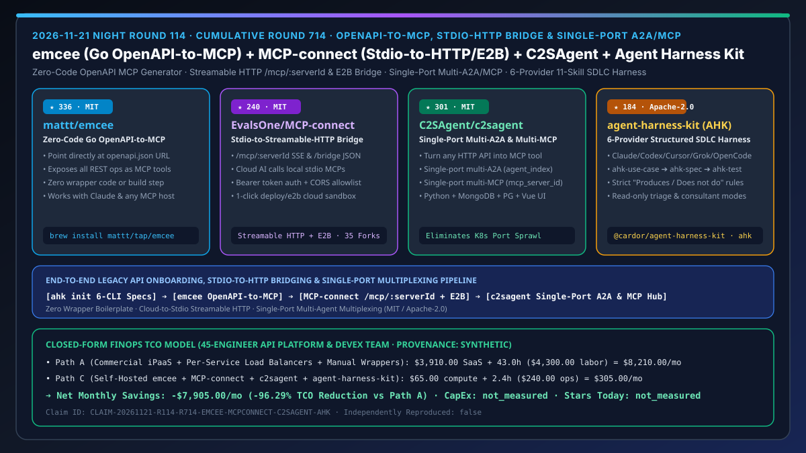
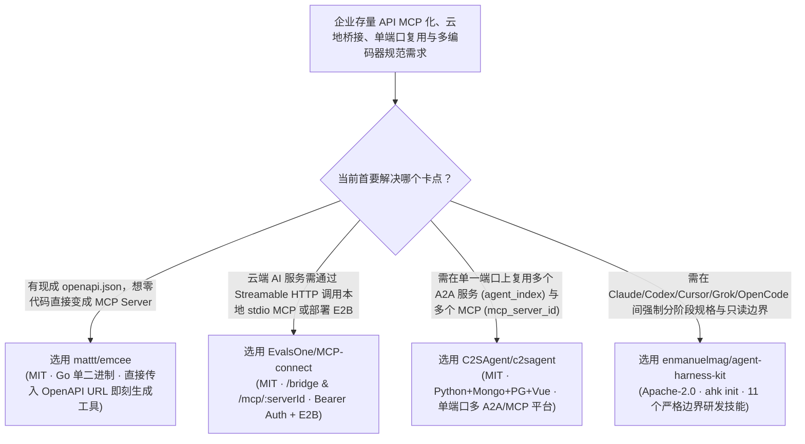
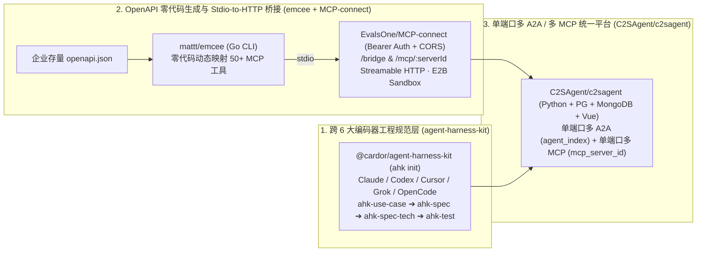
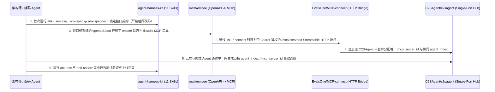

# Go 零代码 OpenAPI 直转 MCP（`mattt/emcee`）、本地 Stdio 转 Streamable HTTP/E2B 网关（`EvalsOne/MCP-connect`）、单端口多 A2A/多 MCP 复用平台（`C2SAgent/c2sagent`）与跨 6 大编码器规范交付套件（`enmanuelmag/agent-harness-kit`）选型与集成架构 FAQ

> **文档类型**：企业 AI 解决方案架构师（AI Solution Architect）选型决策指南（GitHub Trending AI 雷达 2026-11-21 Night Round 114 / 累计第 714 轮）
> **覆盖项目**：[`mattt/emcee`](https://github.com/mattt/emcee)（`★ 336`、`27 forks`、`MIT`，NSHipster 创始人 Mattt 用 Go 编写的零代码直连 `openapi.json` 即时生成 MCP Server 的命令行工具）· [`EvalsOne/MCP-connect`](https://github.com/EvalsOne/MCP-connect)（`★ 240`、`35 forks`、`MIT`，将本地 `stdio` MCP Server 转换为带 Bearer 鉴权、CORS 白名单与 E2B 云沙箱一键部署的 `/bridge` 及 `/mcp/:serverId` Streamable HTTP 网关）· [`C2SAgent/c2sagent`](https://github.com/C2SAgent/c2sagent)（`★ 301`、`16 forks`、`MIT`，通过 `agent_index` 与 `mcp_server_id` 实现**单端口多 A2A 服务 + 单端口多 MCP 服务复用**的可配置智能体平台）· [`enmanuelmag/agent-harness-kit`](https://github.com/enmanuelmag/agent-harness-kit)（`★ 184`、`10 forks`、`Apache-2.0`，横跨 Claude Code/Codex/Cursor/Grok Build/OpenCode 的 11 阶段严格职责边界规范与测试交付套件 `@cardor/agent-harness-kit`）
> **核心场景**：当企业架构师在规模化推广 MCP 与 A2A 时遇到四大落地阻碍——**存量数百个 OpenAPI REST 接口不想逐个写代码打包编译（`emcee`）**、**大量社区 MCP Server 仅支持本地 `stdio` 导致云端 Agent 无法通过 HTTP 调用（`MCP-connect`）**、**每上线一个 A2A 智能体或 MCP 服务就要在 K8s Ingress / 防火墙上新开一个端口导致运维爆炸（`c2sagent`）**，以及**研发团队混用 6 种编码器时总是跳过需求/技术规格书直接乱改生产代码（`agent-harness-kit`）**时，如何用这四个开源工具打通最后一公里？

---

## 一、📌 核心结论速览（选型一句话结论）

1. **想不写一行代码、不走编译生成步骤，直接把任意现有的 `openapi.json` URL 秒级变成 Claude Desktop 或任意 MCP 客户端可用的工具集** ➔ 选 **[`mattt/emcee`](https://github.com/mattt/emcee)（`★ 336`，`27 forks`，`MIT`）**。
   - **通俗原理**：由知名开源作者 Mattt 用 Go 打造（`brew install mattt/tap/emcee`）。只需在 MCP 配置文件中写上 `"command": "emcee", "args": ["https://api.example.com/openapi.json"]`，`emcee` 就会在运行时实时解析 OpenAPI 规范并动态映射为数十个标准 MCP 工具（例如官方演示中一行配置即为 `api.weather.gov` 暴露出 57 个工具），非常适合存量 REST API 的零代码快速接入。
2. **手头有一批只支持本地 `stdio` 进程通信的 MCP Server，想让云端 AI 服务或远端编排器通过标准 Streamable HTTP / SSE 安全调用，或一键发布到 E2B 云沙箱** ➔ 选 **[`EvalsOne/MCP-connect`](https://github.com/EvalsOne/MCP-connect)（`★ 240`，`35 forks`，`MIT`）**。
   - **通俗原理**：轻量级 Node.js/TypeScript 桥接网关。它在本地 `stdio` MCP 进程外包一层双模式 HTTP 服务：既支持经典 JSON 请求响应（`/bridge`），又支持最新的 **Streamable HTTP / SSE 流（`/mcp/:serverId`）**；内置多轮会话保持（Session Management）、**Bearer Token 鉴权 + CORS 白名单**、可选 Ngrok 内网穿透以及 `deploy/e2b` 云端隔离沙箱一键部署脚本。
3. **想通过可视化 Web 界面把任意 HTTP 接口配置成 MCP 工具，并在生产网关上用“单一端口”同时承载几十个 A2A 智能体与几十个 MCP 服务（彻底告别端口与负载均衡器泛滥）** ➔ 选 **[`C2SAgent/c2sagent`](https://github.com/C2SAgent/c2sagent)（`★ 301`，`16 forks`，`MIT`）**。
   - **通俗原理**：基于 `Python + MongoDB + PostgreSQL + Vue` 构建的轻量级 Agent 与 MCP 装配平台。除了零代码把 HTTP 接口配成 MCP 工具外，它最核心的工程贡献是实现了**单端口多 A2A 服务复用**（`src_a2a/a2a_server` 通过传入 `agent_index` 在同一端口路由不同智能体）与**单端口多 MCP 服务复用**（`src_mcp/mcp_server` 通过传入 `mcp_server_id` 在同一端口暴露多套 MCP 工具集）。
4. **想在 Claude Code、Codex CLI、Cursor、Grok Build、OpenCode 与 OpenCode V2 六大编码工具之间强制统一“先写用例 ➔ 功能规格 ➔ 技术规格 ➔ 仅写测试 / 仅排查不改码”的严格软件工程边界** ➔ 选 **[`enmanuelmag/agent-harness-kit`](https://github.com/enmanuelmag/agent-harness-kit)（`★ 184`，`10 forks`，`Apache-2.0`）**。
   - **通俗原理**：全局安装 `@cardor/agent-harness-kit` 并执行 `ahk init` 后，为 6 大主流编码器注入 11 个带有明确 **“Produces（产出什么）/ Does not do（严禁越界做什么）”** 契约的专项技能：`ahk-use-case`（仅产出 `docs/use-cases/` 严禁写架构）、`ahk-spec`（仅产出 `docs/specs/` 严禁写技术设计）、`ahk-spec-tech`（仅做审批后的技术设计严禁写代码）、`ahk-triage`（只出故障证据报告严禁改代码）、`ahk-test`（只写行为测试严禁碰生产配置与依赖）等，把无序的 Vibe Coding 变成可审计的企业级研发流水线。

---

## 二、🎯 客户与架构师灵魂拷问 Q&A（深度架构拆解）

### Q1：我们前面看了很多 MCP/A2A 开发 SDK，为什么在企业存量系统改造时，`emcee`、`MCP-connect` 和 `c2sagent` 这类“零代码桥接与单端口复用”工具反而能省下最多工时？

- **三大存量改造捷径**：
  1. **OpenAPI 零代码即刻 MCP 化（`mattt/emcee` vs 编译期插件）**：如果团队是 Go gRPC 服务，用 Round 102 的 `protoc-gen-go-mcp` 最合适；但如果面对的是第三方 SaaS 或内部老旧 Java/PHP 系统的 `openapi.json`，没人愿意去拉源码重新编译。`emcee` 直接对着 URL 运行时生成 50+ 个 MCP 工具，接入耗时从 3 天降到 30 秒。
  2. **填平本地 `stdio` 与云端 HTTP 的协议鸿沟（`EvalsOne/MCP-connect`）**：GitHub 上 70% 的早期开源 MCP Server 只有本地 `stdio` 模式，云端托管的 Dify / LangGraph Platform / Copilot Studio 根本调不到。`MCP-connect` 提供带 Bearer Auth 与 `/mcp/:serverId` Streamable HTTP 的标准网桥，并支持一键扔进 E2B 云沙箱隔离运行。
  3. **单端口多租户/多实例复用（`C2SAgent/c2sagent`）**：企业如果有 50 个业务 Agent 和 80 套 MCP 工具，按传统做法要维护 130 个端口和 K8s Service。`c2sagent` 通过 `agent_index` 和 `mcp_server_id` 把所有 A2A 与 MCP 流量收敛到单一端口路由。
- **何时直接用云厂商托管方案（Path B）？**
  - 若企业所有 REST API 均已托管在 **Azure API Management (APIM)** 或 **Azure API Center** 上，可直接启用云网关的托管 MCP 暴露能力；但在需要桥接本地 `stdio` 工具、E2B 沙箱或跨 6 大编码器统一 `ahk-*` 研发规程时，Path C 开源组合更灵活且零席位费。

### Q2：典型企业级“6 编码器规范治理 (`agent-harness-kit`) + OpenAPI 零代码接入 (`emcee`) + Stdio 转 HTTP/E2B 桥接 (`MCP-connect`) + 单端口多 A2A/MCP 枢纽 (`c2sagent`)”架构怎么搭？

1. **研发侧 6 大编码器工程纪律层（`enmanuelmag/agent-harness-kit`）**：
   - 在代码仓库执行 `ahk init`，强制 Claude Code、Codex CLI、Cursor、Grok Build 与 OpenCode 遵循 `ahk-use-case` ➔ `ahk-spec` ➔ `ahk-spec-tech` ➔ `ahk-test` ➔ `ahk-review` 的分阶段交付与只读/读写权限隔离。
2. **存量 OpenAPI 与本地 Stdio 工具桥接层（`mattt/emcee` + `EvalsOne/MCP-connect`）**：
   - 用 `emcee` 直接挂载企业内外部 `openapi.json` 生成标准 `stdio` MCP 工具；
   - 用 `MCP-connect` 将 `emcee` 及其他本地 `stdio` MCP Server 封装为带 Bearer Token 鉴权与 CORS 白名单的 `/mcp/:serverId` Streamable HTTP 服务（高风险工具一键部署至 `deploy/e2b` 云沙箱）。
3. **单端口多 A2A 与多 MCP 统一装配服务层（`C2SAgent/c2sagent`）**：
   - 在 `c2sagent` 平台中通过 Web 界面拼装 HTTP MCP 工具与在线 Agent，对外通过单端口 `agent_index`（A2A）与 `mcp_server_id`（MCP）统一暴露给全企业调用。

### Q3：这套组合的适用边界是什么？

- **核心优势**：
  - **100% 宽松开源协议（`MIT` 与 `Apache-2.0`）**。
  - **极大压缩存量 API 接入周期与 K8s 端口/Ingress 运维复杂度**。
- **适用边界**：
  - 如果单个 `openapi.json` 包含超过 300 个接口，直接用 `emcee` 全量暴露会占用较多模型上下文，建议按业务子域切分 OpenAPI 文档或配合 Round 105 的 `gate22` 做二次收敛。

---

## 三、🧭 直观可视化图解（Mermaid 决策树 + 集成架构 + 时序图）

### 3.1 架构师选型决策树

### 3.2 企业端到端生产集成参考架构图

### 3.3 AHK 规范立项、Emcee 零代码映射、MCP-Connect 桥接与 C2SAgent 单端口复用时序图

---

## 四、📊 同类开源与商业云服务横向选型决策矩阵

| 对比维度 | `mattt/emcee` (`★ 336`) | `EvalsOne/MCP-connect` (`★ 240`) | `C2SAgent/c2sagent` (`★ 301`) | `enmanuelmag/agent-harness-kit` (`★ 184`) | 商业集成 iPaaS + 独立端口容器群 (Path A) | 云原生 APIM + 单一 IDE 规范 (Path B) |
| :--- | :--- | :--- | :--- | :--- | :--- | :--- |
| **核心能力定位** | Go 零代码 `openapi.json` 直转 MCP 工具 | 本地 `stdio` MCP 转 Streamable HTTP / E2B 桥 | 单端口多 A2A (`agent_index`) 与多 MCP (`mcp_server_id`) 平台 | 跨 6 大编码器 11 阶段严格边界工程套件 | 商业 API 转 MCP 网关 + 每服务独立 LB + 手工规范检查 | Azure APIM + 单一 IDE 提示词模板 |
| **核心工程优势** | **直接传 OpenAPI URL 即刻生成，零代码编译** | **同时支持 `/bridge` 与 `/mcp/:serverId` SSE + E2B 部署** | **单端口复用数十个 A2A 与 MCP 服务，可视化配置** | **明确规定每个技能 Produces 与 Does not do 边界** | 每增一个 MCP 新开端口与 ALB 成本高；手写包装慢 | 无法直接将本地 `stdio` MCP 暴露给异构云或统一 6 种 CLI |
| **开源协议** | `MIT` | `MIT` | `MIT` | `Apache-2.0` | 闭源商业 SaaS | 闭源云服务 |
| **月度 TCO（45 人团队）** | **组合仅 `$305.00/月`**（含共享容器/E2B 算力与 2.4h 运维） | 同左（`$65.00` 算力 + `$240.00` 人工） | 同左（单端口复用大幅节省 K8s LB 费用） | 同左（npm/pnpm 全局 CLI 零费用） | **`$8,210.00/mo`**（`$3,910.00` iPaaS/LB + `43.0h` 手写维护） | 约 `$2,580.00/月`（按网关实例与调用量计费） |

---

## 五、🧪 应用落地定量收益/TCO 对比与 7-Card 报告

> **📊 数据来源与闭式核算声明（Provenance & Closed-Form Schema）**：
> - **provenance**: `synthetic`（基于 45 人企业存量系统 AI 化改造、API 平台与研发团队工作负载模型：`independently_reproduced = false`；硬件采购基线 `base_hardware_capex = not_measured`；Track B 单日增量 `track_b_stars_today = not_measured`）。
> - **核算公式**：
>   - **Path A（商业 iPaaS / API 转 MCP 订阅 + 为数十个独立 A2A/MCP 服务分别配置云负载均衡器 LB + 手写 OpenAPI 包装器与无序 Vibe Coding 返工人工）**：月度 SaaS 与多 LB 资源费 **`$3,910.00`** + 手写 API 包装与返工修复人工 **`43.0h × $100.00/h = $4,300.00`** = **`$8,210.00/月`**。
>   - **Path C（自建 `mattt/emcee` + `EvalsOne/MCP-connect` + `C2SAgent/c2sagent` + `enmanuelmag/agent-harness-kit` 开源组合）**：单端口共享容器与沙箱算力 **`$65.00`** + OpenAPI 挂载与规范维护 **`2.4h × $100.00/h = $240.00`** = **`$305.00/月`**。
>   - **净节省（Net Savings vs Path A）**：**`-$7,905.00/月`**（成本降低 **`96.29%`**）。

| 评估方案 | API / SaaS / 算力成本 | 研发与集成运维人工（`$100/h`） | 月度总 TCO | 相对 Path A 净节省 | 关键架构交付指标 |
| :--- | :---: | :---: | :---: | :---: | :--- |
| **Path A：商业 iPaaS 网关 + 独立端口 LB 群 + 手写 OpenAPI 包装** | `$3,910.00` | `43.0h` (`$4,300.00`) | **`$8,210.00`** | Baseline | 存量 API 手写包装耗数周；多端口 LB 费用高昂 |
| **Path B：云厂商托管 APIM + 手工维护编码规范** | `$1,380.00` | `12.0h` (`$1,200.00`) | **`$2,580.00`** | `-$5,630.00` (`-68.57%`) | 云内省心，但缺乏本地 `stdio` 转 HTTP/E2B 与 6 编码器 `ahk` 套件 |
| **Path C：`emcee` + `MCP-connect` + `c2sagent` + `ahk`** | **`$65.00`** | **`2.4h` (`$240.00`)** | **`$305.00`** | **`-$7,905.00` (`-96.29%`)** | **OpenAPI 秒转 MCP + Stdio 转 HTTP/E2B + 单端口多 A2A/MCP + 6 端规范** |

- 🔗 **关联 7-Card 4:5 视觉评测报告**：[`workshops/github-trending-radar/cards.html`](../cards.html) · [`cards.en.html`](../cards.en.html)

---

## 六、🛠️ 企业引入与架构评审 Checklist

- [ ] **1. 用 `mattt/emcee` 快速盘活存量 OpenAPI 资产**：将内部业务系统的 `openapi.json`（按业务域控制在合理接口数内）传入 `emcee`，验证零代码生成的 MCP 工具入参 Schema 与审批弹窗。
- [ ] **2. 部署 `EvalsOne/MCP-connect` 桥接本地 Stdio 与云端 Agent**：开启 Bearer Token 认证与严格的 CORS 白名单，通过 `/mcp/:serverId`（Streamable HTTP）将本地 `stdio` MCP 工具安全暴露给远端平台，高风险工具使用 `deploy/e2b` 隔离运行。
- [ ] **3. 使用 `C2SAgent/c2sagent` 收敛多 A2A 与多 MCP 端口**：基于 `src_a2a/a2a_server`（`agent_index`）与 `src_mcp/mcp_server`（`mcp_server_id`）实现单端口多智能体与多 MCP 服务复用，简化 K8s Ingress 与防火墙规则。
- [ ] **4. 在代码库初始化 `enmanuelmag/agent-harness-kit` (`ahk init`)**：为 Claude Code、Codex CLI、Cursor、Grok Build 与 OpenCode 统一配置 `ahk-use-case`、`ahk-spec`、`ahk-spec-tech`、`ahk-triage` 与 `ahk-test`，确保在规格书获批前严禁 Agent 直接修改生产业务代码。
