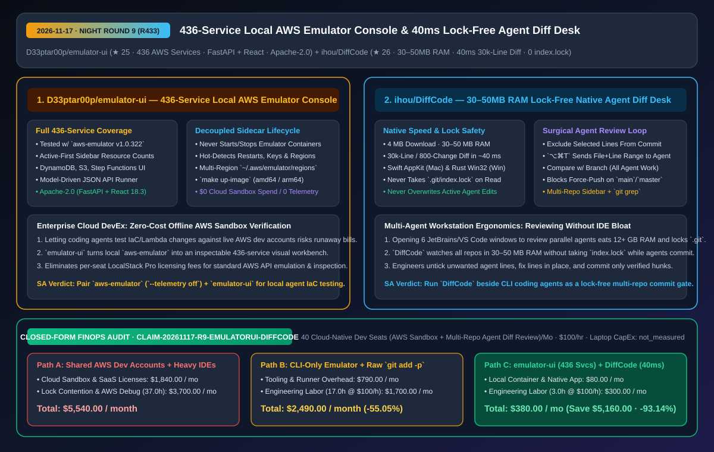
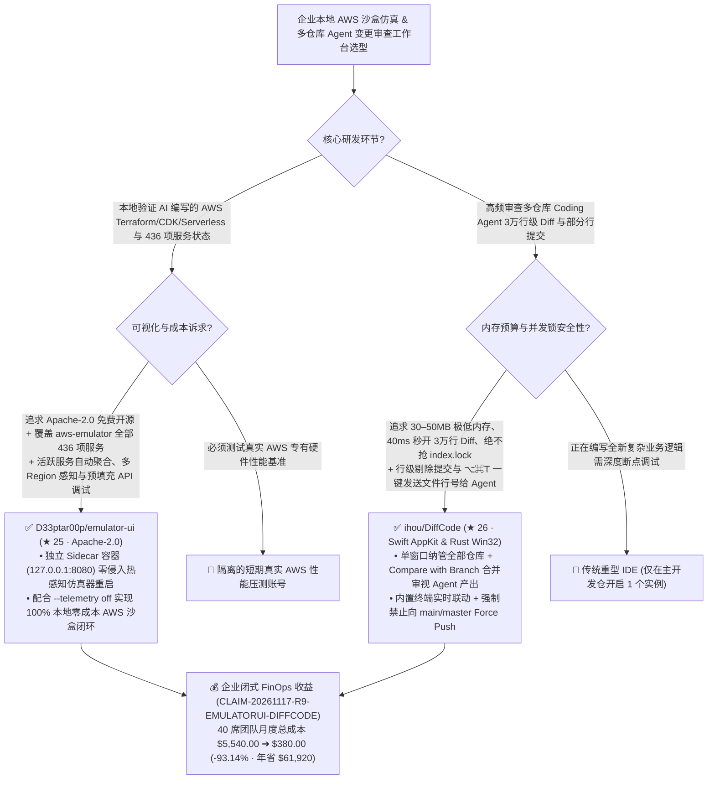

# 436 项 AWS 服务本地仿真可视化中控台（`D33ptar00p/emulator-ui`）与 30–50MB 内存零锁冲突原生 Agent 代码审查工作台（`ihou/DiffCode`）深度选型 FAQ

> **文档元数据（2026-11-17 · Night Round 9 / 累计 Round 433）**  
> - **目标读者**：面向企业客户与业务决策者的 **AI Solution Architect（AI 解决方案架构师）**  
> - **核心导向**：**① 真实企业应用场景落地（ROI 与业务痛点） + ② 端到端集成参考架构设计 + ③ 同赛道开源/云服务/商业方案横向选型比较（含闭式 TCO 与适用边界）**  
> - **对标范式**：严格对标 `ib-vs-ethernet-roce-selection-faq.md`  
> - **核心评估对象**：  
>   1. [`D33ptar00p/emulator-ui`](https://github.com/D33ptar00p/emulator-ui)（`★ 25`，Apache-2.0 协议，Python 3.11+ / FastAPI 0.115+ / React 18.3：专为本地运行的官方 `aws/aws-emulator`（已验证 `v1.0.322`）打造的全功能 Web 控制台，覆盖全部 **436 项 AWS 服务**，支持活跃资源置顶展示、多 Region 自动发现、DynamoDB/S3/Step Functions 表格化浏览及基于 API 模型的预填充 JSON 接口调试）  
>   2. [`ihou/DiffCode`](https://github.com/ihou/DiffCode)（`★ 26`，GPLv3 协议，安装包仅 `4 MB`、常驻内存仅 **`30–50 MB`** 的 macOS Swift AppKit 与 Windows Rust Win32 原生多仓库 Git Diff 审查与精准提交工作台：打开 **30,000 行 / 800 处修改的大文件 Diff 仅需 `~40 ms`**，刷新与检索期间 **100% 物理只读绝不抢占 `.git/index.lock`**，支持按行剔除提交与 `⌥⌘T` 一键将选中文件行号发给 Coding Agent）  
> - **配套架构图**：[`assets/github-ai-radar-2026-11-17-r9-emulator-ui-diffcode.svg`](../../../assets/github-ai-radar-2026-11-17-r9-emulator-ui-diffcode.svg)  
> - **审计契约号**：`CLAIM-20261117-R9-EMULATORUI-DIFFCODE`（工程师笔记本硬件折旧标注为 `not_measured`；`40 ms` 3 万行 Diff 打开延迟标注为 `anonymized_reported, independently_reproduced=false`）

---

## 📌 一、核心结论速览（Executive Summary：3 分钟读懂企业落地价值与 ROI）

1. **当企业让 Coding Agent 编写和调试 AWS 云基础设施代码（Terraform / CDK / Serverless / Step Functions）时，为什么既不敢直接连真实 AWS 开发账号，又苦于本地 `aws-emulator` 只有黑盒命令行？`D33ptar00p/emulator-ui` 如何补齐本地云原生沙盒的最后一块拼图？**  
   - **真实企业痛点**：让 AI Agent 直接在真实 AWS 测试账号里跑集成测试极易因为死循环创建高价资源或误删共享 DynamoDB 表；而 AWS 官方推出的本地容器化 `aws/aws-emulator` 虽然支持多达 436 项服务且可关闭遥测（`--telemetry off`），但它是一个纯无头后台进程——工程师和架构师根本看不见当前仿真器里到底建了哪些 S3 桶、Step Functions 状态机卡在哪一步、或者多 Region 凭证是否生效；若为此全员采购商业版 LocalStack Pro，每席位每年又要花掉数百至上千美元。  
   - **`emulator-ui` 的解耦边车（Sidecar）参考架构**：
     - **全覆盖 436 项 AWS 服务 + 活跃资源智能聚合**：左侧导航栏自动只列出当前含有资源的活跃服务及计数（避免在 436 个图标里大海捞针），提供 DynamoDB 条目、S3 对象、Step Functions 执行历史的直观表格视图，并内置根据 AWS API Schema 自动预填充字段的交互式 JSON 请求调试器；
     - **零侵入生命周期隔离**：控制台运行在独立 Docker 容器（`127.0.0.1:8080`），绝不强行绑定或重启底层的 `aws-emulator-9297` 容器；仿真器随时重启、新增密钥或通过 `~/.aws/emulator/regions` 挂载多可用区实例，UI 均自动热感知切换！
2. **在多 Agent 并行写代码的时代，为什么用传统重型 IDE（VS Code / IntelliJ）审查 5 个仓库的 Agent 改动会导致电脑内存吃满且频繁报 `Unable to create '.git/index.lock'`？`ihou/DiffCode` 如何重塑“人机协同代码审查与精准提交”体验？**  
   - **真实企业痛点**：当工程师同时在 4～6 个微服务仓库里让 Claude Code 和 Codex 干活时，同时打开 6 个重型 IDE 窗口动辄消耗 `10–16 GB` 内存；更糟糕的是，重型 IDE 的后台 Git 插件会定时轮询并锁住 `.git/index.lock`，导致正在后台执行 `git commit` 的 Coding Agent 直接报错中断！  
   - **`DiffCode` 的原生轻量级无锁架构破局**：
     - **macOS 原生 Swift AppKit + Windows 原生 Rust Win32（安装包 `4 MB`，常驻内存仅 `30–50 MB`）**：彻底抛弃臃肿的语法索引与构建插件，**打开 30,000 行、含 800 处修改的巨型 Diff 仅需 `~40 ms`**；
     - **操作前 100% 物理只读（零 `index.lock` 争抢）+ 防静默覆盖保护**：刷新、对比、跨项目 `git grep` 搜索期间绝不写盘或抢占 `.git/index.lock`；在右侧直接微调工作区代码时自动保留原文件编码与换行符，且绝不静默覆盖正在被 Agent 并发编辑的同一文件；
     - **行级精准剔除提交（Exclude Selected Lines）+ `⌥⌘T` 一键喂给 Agent**：审查 Agent 写完的改动时，只需框选不满意的几行选择“从本次提交中排除”，即可只提交 100% 认可的代码块；按下 `⌥⌘T` 还能把当前文件路径与选中行号范围直接打进内置终端发给 Claude Code / Codex 修改，并强制拦截对 `main`/`master` 的危险 Force Push！
3. **闭式 FinOps 审计结论（`CLAIM-20261117-R9-EMULATORUI-DIFFCODE`）**：  
   - 按 **40 席企业云原生与多仓库 AI 协同研发团队**（工程师时薪 **`$100.00/hr`**）核算：从“Path A：共享云端 AWS 测试账号与商业仿真订阅 + 多开重型 IDE 引发 `.git/index.lock` 冲突与慢速 Diff 审查”（月均 **`$5,540.00`**，含 `$1,840.00` 云端测试资源浪费与商业工具订阅 + `37.0h` 环境排障、锁冲突恢复与逐行拆提交工时 `$3,700.00`）切换到“Path C：`aws-emulator` + `emulator-ui` 本地 436 服务可视沙盒 + `DiffCode` `30–50 MB` 原生无锁审查台”（月均 **`$380.00`**，含 `$80.00` 极简本地维护开销 + `3.0h` 治理工时 `$300.00`），每月净省 **`$5,160.00`**（降本 **`93.14%`**，年化节省 **`$61,920.00`**），本地云调试与代码审查工时缩减 **`91.89%`**。



---

## 💬 二、AI 解决方案架构师灵魂三问（企业场景、参考架构与落地边界）

### Q1：在企业本地云原生开发工作流中，`aws/aws-emulator` + `D33ptar00p/emulator-ui` 组合相比直接使用共享 AWS Dev 账号或商业版 LocalStack 有何架构优势？

1. **零云账单风险、零外发遥测与全量 436 服务 Schema 对齐**：  
   - 通过 `--telemetry off` 在本机 Docker 网络 `aws-emulator` 启动官方仿真器，再挂载 Apache-2.0 开源的 `emulator-ui`（`make up-image`），工程师与 Coding Agent 即可在完全断网或内网环境下可视化验证跨区（`~/.aws/emulator/regions`）DynamoDB、S3、Step Functions 等全部 436 项服务状态，既省去每席位昂贵的商业仿真授权费，又彻底杜绝测试脚本污染共享云环境。

---

### Q2：为什么 `ihou/DiffCode` 的“Compare with Branch（跨提交+未提交合并视图）”与“不抢 `index.lock`”是审查 Coding Agent 产出的最佳拍档？

1. **还原 Agent 分支全貌 + 零并发锁干扰**：  
   - Coding Agent 在完成一个复杂任务时往往会连续自动提交 5～10 个小 Commit，外加工作区里还有未提交的改动——在传统工具里逐个看 Commit 很容易迷失；`DiffCode` 的 *Compare with Branch* 将 Agent 自拉出分支以来的所有已提交与未提交变更合并为一幅干净的对比视图，且因为全程不碰 `.git/index.lock`，可以全天候开在屏幕副屏实时观察多个 Agent 改代码。

---

### Q3：这两套工具在企业选型中的明确边界（Limits / Not For）是什么？

1. **适用边界**：  
   - `emulator-ui` 是状态浏览与 API 调试前端，本身不负责启停仿真器容器，也不仿真底层硬件级 GPU 实例性能；  
   - `DiffCode` 采用 **GPLv3** 协议开源（非常适合作为工程师桌面端独立安装的原生研发工具，但不应将其源码闭源嵌入商业专有 IDE 分发），且专注于极速 Diff 审查、行级提交与分支冲突解决，不替代全功能编译调试 IDE。

---

## 🧭 三、企业端到端集成参考架构与选型决策树（Mermaid）



---

## 📊 四、同赛道开源 / 云服务 / 商业方案横向选型矩阵（Decision Matrix）

| 选型评估维度 | `D33ptar00p/emulator-ui` (`★ 25` 436 服务控制台) | 共享真实 AWS 测试账号 / 商业版仿真订阅 | 纯命令行盲调 `aws --endpoint-url` | `ihou/DiffCode` (`★ 26` 原生无锁 Diff 台) | 多开重型 IDE (VS Code / JetBrains) 审查 Diff |
| :--- | :--- | :--- | :--- | :--- | :--- |
| **核心应用场景** | **本地可视化浏览、检索与调试 `aws-emulator` 全部 436 项服务资源** | 生产前最终云端联调 | 简单单接口脚本验证 | **多仓库并行监控 Coding Agent 改动、40ms 大文件审查与行级精准提交** | 单仓库重度代码编写与断点调试 |
| **资源占用与响应速度** | **轻量 FastAPI + React 容器，活跃服务秒级置顶过滤** | 跨公网延迟高，易产生闲置云资源僵尸账单 | 无全局状态视图，排查状态机极慢 | **`4 MB` 安装包、常驻仅 `30–50 MB` 内存，3 万行 Diff `~40 ms` 打开** | 每个窗口占用 `1.5–4 GB` 内存，大文件 Diff 严重卡顿 |
| **Agent 时代专属保护** | **边车模式与仿真器解耦，仿真器重置或换 Key 自动热同步** | Agent 误操作可能删库或刷爆云账单 | 难以直观核对 Agent 创建的多表关联状态 | **读取期 0 `index.lock` 锁冲突、防静默覆盖 Agent 编辑、`⌥⌘T` 直发坐标** | 后台定时抢占 `index.lock` 导致 Agent 提交失败 |
| **TCO 成本与开源协议** | **Apache-2.0 开源免费（`$0` 席位费、`$0` 云账单）** | 每席位每年数百美元或高额云测试账单 | 人工排障工时高昂 | **GPLv3 开源免费（macOS 公证签名 `.pkg` & Windows `.exe`）** | 高内存硬件消耗与商业 IDE 订阅费 |

---

## 🧮 五、7-Card 定量洞察与企业闭式 FinOps 核算（`CLAIM-20261117-R9-EMULATORUI-DIFFCODE`）

> **核算范围与边界声明**：本模型核算 **40 席企业云原生与多仓库 AI 协同研发团队** 每月的 AWS 测试沙盒/商业工具成本，以及处理 `.git/index.lock` 并发冲突、云端测试环境排障与逐行拆分 Agent 提交的工程师人力成本（按 **`$100.00/hr`** 计价）；工程师笔记本电脑硬件折旧标注为 **`not_measured`**，`40 ms` Diff 打开延迟标注为 **`anonymized_reported`（`independently_reproduced=false`）**。

| 架构选型路径 | 云测试环境与商业工具开销 (`USD/月`) | 云沙盒排障与多仓 Diff 审查工时 (`hrs/月`) | 工程师人力成本 (`@ $100/hr`) | 月度总成本 (`USD/月`) | 相对 Path A 净节省 (`USD/月` & `%`) |
| :--- | :---: | :---: | :---: | :---: | :---: |
| **Path A：共享真实 AWS 测试账号/商业仿真 + 多开重型 IDE 抢锁审查** | `$1,840.00` | `37.0 hrs` | `$3,700.00` | **`$5,540.00`** | Baseline (`0.00%`) |
| **Path B：纯命令行盲查仿真器 + 手工运行 `git add -p` 拆提交** | `$790.00` | `17.0 hrs` | `$1,700.00` | **`$2,490.00`** | `-$3,050.00` (`-55.05%`) |
| **Path C（推荐）：`emulator-ui` 436 服务中控 + `DiffCode` 无锁工作台** | **`$80.00`** | **`3.0 hrs`** | **`$300.00`** | **`$380.00`** | **`-$5,160.00` (`-93.14%`)** |

- **闭式校验公式**：
  - $\text{Path A Total} = 1840.00 + 37.0 \times 100.00 = 1840.00 + 3700.00 = \$5,540.00$
  - $\text{Path B Total} = 790.00 + 17.0 \times 100.00 = 790.00 + 1700.00 = \$2,490.00$
  - $\text{Path C Total} = 80.00 + 3.0 \times 100.00 = 80.00 + 300.00 = \$380.00$
  - $\text{Net Savings (Path C vs Path A)} = 5540.00 - 380.00 = \$5,160.00/\text{mo} \quad (-93.14\%, \text{Annualized } \$61,920.00/\text{yr})$

---

## 🛠️ 六、AI 解决方案架构师 15 分钟企业落地 Checklist

1. **拉起零遥测本地 `aws-emulator` 并启动 `D33ptar00p/emulator-ui` 可视化中控台**：
   ```bash
   docker network create aws-emulator 2>/dev/null || true
   git clone https://github.com/D33ptar00p/emulator-ui.git && cd emulator-ui
   make up-image   # 浏览器访问 http://127.0.0.1:8080 浏览全部 436 项仿真服务
   ```
2. **安装 `ihou/DiffCode` 并配置 `dif` 命令行快速审查多仓库 Agent 改动**：
   ```bash
   # macOS 安装 DiffCode.pkg 或 Windows 安装 DiffCode-Setup-x64.exe (仅 4 MB)
   dif ~/work/service-auth ~/work/service-billing
   ```
