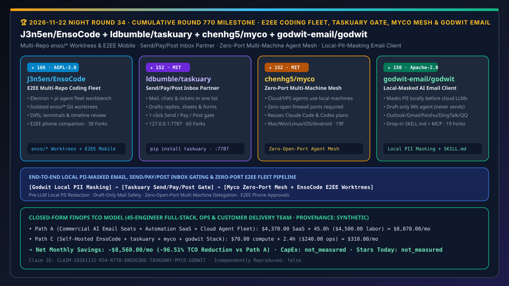
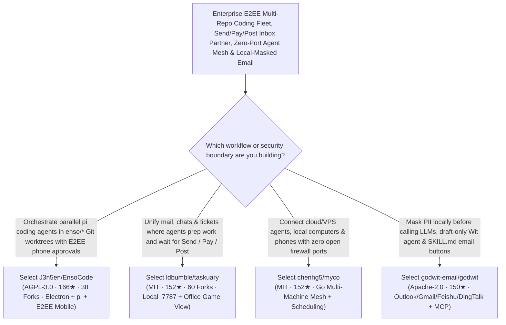
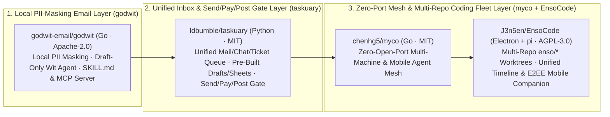

# 🏆 [Round 770 Milestone] E2EE Mobile-Linked Multi-Repo `pi` Agent Workbench (`J3n5en/EnsoCode`), Send/Pay/Post-Gated Unified Inbox Partner (`ldbumble/taskuary`), Zero-Port Multi-Machine Agent Mesh (`chenhg5/myco`) & Local-PII-Masking Draft-Only Email Client (`godwit-email/godwit`) Selection & Architecture FAQ

> **Document Type**: Enterprise AI Solution Architect Selection & Integration Guide (GitHub Trending AI Radar — 2026-11-22 Night Round 34 / Cumulative Round 770 Milestone)
> **Covered Repositories**: [`J3n5en/EnsoCode`](https://github.com/J3n5en/EnsoCode) (`★ 166`, `38 forks`, `AGPL-3.0`: Electron + `pi` local-first desktop coding agent fleet workbench with `enso/*` Git worktree isolation and end-to-end encrypted mobile companion streaming) · [`ldbumble/taskuary`](https://github.com/ldbumble/taskuary) (`★ 152`, `60 forks`, `MIT`: OpenSSF-monitored AI inbox partner pulling mail, chats, tickets, and reports into one prioritized list where agents draft replies/spreadsheets and hold outbound actions behind **Send / Pay / Post** buttons) · [`chenhg5/myco`](https://github.com/chenhg5/myco) (`★ 152`, `19 forks`, `MIT`: Go + iOS/Android/Desktop multi-machine agent mesh connecting cloud/VPS sessions and local Claude Code / Codex machines with zero open ports) · [`godwit-email/godwit`](https://github.com/godwit-email/godwit) (`★ 150`, `19 forks`, `Apache-2.0`: AI-native desktop email client and MCP server for Gmail, Outlook, iCloud, QQ/163, Tencent Exmail, Feishu/Lark, and DingTalk Mail with local PII masking, draft-only `Wit` assistant, and drop-in `SKILL.md` buttons)
> **Core Scenario**: When enterprise solution architects, engineering leads, and operations teams struggle with **losing approval visibility over parallel multi-repo coding agents when stepping away from their desk, drowning in scattered emails/chats/tickets without a single Send/Pay/Post human gate, manually copy-pasting prompts between cloud/VPS agents and local computers because opening firewall ports is unsafe, and leaking customer PII/account numbers from corporate emails to cloud LLMs**, how do you combine **`EnsoCode` + `taskuary` + `myco` + `godwit`** into a privacy-preserving, multi-device agent architecture?

---

## 1. 📌 Executive Summary (One-Line Selection Verdict)

1. **Want to orchestrate an entire fleet of autonomous coding agents across multiple pinned repositories (`AGPL-3.0`, Electron + `pi`) with automatic `enso/*` Git worktree isolation, a unified diff/terminal timeline, and an **end-to-end encrypted (E2EE) phone companion**?** ➔ Choose **[`J3n5en/EnsoCode`](https://github.com/J3n5en/EnsoCode) (`★ 166`, `38 forks`, `AGPL-3.0`)**.
   - **Plain-English Mechanism**: Keeps one conversation per task in isolated `enso/*` worktrees and streams live turns and approval prompts to your phone over an E2EE link.
2. **Need an `MIT`-licensed (`60 forks`, `pip install taskuary` at `http://127.0.0.1:7787`) AI work partner that pulls mail, chats, tickets, and reports into one prioritized list—where agents research, draft replies, build spreadsheets, and fill forms, handing you a single **Send**, **Pay**, or **Post** button?** ➔ Choose **[`ldbumble/taskuary`](https://github.com/ldbumble/taskuary) (`★ 152`, `60 forks`, `MIT`)**.
   - **Plain-English Mechanism**: Nothing leaves your machine until you click **Send**, **Pay**, or **Post**, and an interactive office visual view shows the Agent Floor, Meeting Room, and Memory Archive.
3. **Want to stop acting as a human copy-paste bus between your cloud/VPS agents, your office workstation, your home laptop, and your phone—connecting all your Claude Code and Codex instances into one scheduled network with **zero open ports**?** ➔ Choose **[`chenhg5/myco`](https://github.com/chenhg5/myco) (`★ 152`, `19 forks`, `MIT`)**.
   - **Plain-English Mechanism**: Lets a `claude.ai` or VPS agent securely delegate commands to the Claude Code or Codex instance on your local computer and receive results in the same conversation.
4. **Need an open-source (`Apache-2.0`) desktop email client and MCP server (`mcpserver/`) for Outlook, Gmail, iCloud, Feishu/Lark, DingTalk, Tencent Exmail, and any IMAP server that **masks names, account numbers, phone numbers, and keys locally on your machine before calling a cloud LLM**, never sends mail autonomously (draft-only `Wit` agent), and turns any dropped-in `SKILL.md` into a UI button?** ➔ Choose **[`godwit-email/godwit`](https://github.com/godwit-email/godwit) (`★ 150`, `19 forks`, `Apache-2.0`)**.
   - **Plain-English Mechanism**: Combines local PII masking, PDF/Office/CSV attachment reading, 14-language sign-in code extraction, RFC 8058 one-click unsubscribe, and `SKILL.md` extensibility.

---

## 2. 🎯 Architect & Customer Deep-Dive Q&A

### Q1: Why do `godwit` (Local PII Masking + Draft-Only), `taskuary` (Send/Pay/Post Gate), `myco` (Zero-Port Mesh), and `EnsoCode` (E2EE Worktree Fleet) form a gold-standard privacy and control stack?

- **Four Architectural Safeguards**:
  1. **Client-Side PII Redaction & Draft-Only Email ➔ `godwit-email/godwit`**: Redacts names, account numbers, phone numbers, and keys locally before any cloud LLM request, and restricts its `Wit` agent strictly to writing drafts.
  2. **Explicit Outbound Action Gates (`Send` / `Pay` / `Post`) ➔ `ldbumble/taskuary`**: Allows agents to do 95% of the prep work (research, spreadsheets, form filling) while holding every external side effect for a single human click.
  3. **Zero-Open-Port Cross-Machine Delegation ➔ `chenhg5/myco`**: Bridges cloud/VPS agents and local desktop Claude Code / Codex workers without exposing inbound firewall ports.
  4. **Worktree-Isolated Fleet + E2EE Mobile Approvals ➔ `J3n5en/EnsoCode`**: Isolates concurrent coding tasks in `enso/*` Git worktrees and streams approvals to mobile over an end-to-end encrypted channel.
- **When to Choose Commercial Cloud Suites (Path B)?**
  - Enterprises standardized exclusively on Microsoft 365 cloud mail with **Microsoft 365 Copilot** licenses can use native Outlook Copilot; teams operating across heterogeneous IMAP providers (Outlook, Gmail, Feishu, DingTalk, Tencent Exmail), requiring local pre-LLM PII masking, and orchestrating multi-machine Claude Code/Codex fleets should deploy this open-source stack (Path C).

### Q2: How do `godwit`, `taskuary`, `myco`, and `EnsoCode` work together end-to-end?

1. **Local-Masked Email Ingestion & Triage Layer (`godwit-email/godwit`)**:
   - Ingests corporate IMAP mail, masks PII locally, parses PDF/Office/CSV attachments, and exposes mail tools via `mcpserver/` and `SKILL.md`.
2. **Unified Action Queue & Send/Pay/Post Approval Layer (`ldbumble/taskuary`)**:
   - Aggregates mail, chats, and tickets at `127.0.0.1:7787`, preparing drafts and spreadsheets for one-click approval.
3. **Zero-Port Multi-Machine Mesh & Multi-Repo Coding Layer (`chenhg5/myco` + `J3n5en/EnsoCode`)**:
   - Routes engineering tasks over `myco` to `EnsoCode` (`enso/*` worktrees) with E2EE phone approvals.

### Q3: How does `godwit` make AI email customization accessible to every team?

- **Drop-In `SKILL.md` Extension Architecture**:
  - Every built-in AI feature in `godwit` uses the same public extension hook: dropping a `SKILL.md` file into the extensions folder immediately renders a new action button in the email client.

---

## 3. 🧭 Visual Architecture & Workflow Diagrams (Mermaid)



### 3.1 Solution Architect Selection Decision Tree



### 3.2 End-to-End Enterprise Reference Architecture



### 3.3 End-to-End PII-Masked Email Triage, Taskuary Preparation, Myco Mesh Routing & EnsoCode E2EE Approval Sequence Diagram

```mermaid
sequenceDiagram
    participant User as Architect / Lead (Desktop & E2EE Phone)
    participant Gdw as godwit-email/godwit (Local PII Masking)
    participant Tsk as ldbumble/taskuary (:7787 Gate)
    participant Myc as chenhg5/myco (Zero-Port Mesh)
    participant Ens as J3n5en/EnsoCode (enso/* Worktrees)

    Gdw->>Gdw: 1. Sync corporate IMAP mail, mask PII locally & parse PDF/Office/CSV attachments
    Gdw->>Tsk: 2. Feed actionable items into Taskuary queue; agent drafts reply & spreadsheet
    Tsk->>Myc: 3. Route linked engineering fix over zero-open-port Myco mesh to workstation
    Myc->>Ens: 4. Run pi agent in isolated enso/* Git worktree & stream diff to E2EE phone companion
    User->>Ens: 5. Approve code diff on phone & click [Send] in Taskuary to dispatch reply
```

---

## 4. 📊 Peer Open-Source vs. Commercial Cloud Selection Matrix

| Dimension | `J3n5en/EnsoCode` (`★ 166`) | `ldbumble/taskuary` (`★ 152`) | `chenhg5/myco` (`★ 152`) | `godwit-email/godwit` (`★ 150`) | Commercial AI Email SaaS ($30/user/mo) + Cloud Agent Fleet Seats (Path A) | Manual Multi-Machine Copy-Paste + Unmasked Cloud LLM Prompts (Path B) |
| :--- | :--- | :--- | :--- | :--- | :--- | :--- |
| **Primary Role** | Multi-repo `pi` agent fleet & E2EE phone workbench | Unified inbox partner with Send/Pay/Post gate | Zero-open-port multi-computer & phone agent mesh | Local-PII-masking draft-only desktop email client | Per-seat commercial AI email apps & cloud agent fleet subscriptions | Manual prompt relaying across machines & raw unmasked email pasting |
| **Key Differentiator** | **`enso/*` worktrees + timeline + E2EE mobile companion** | **60 forks + office view + Send/Pay/Post button gate** | **Cloud-to-local delegation with zero open ports** | **Local PII masking + draft-only `Wit` + `SKILL.md`** | Uploads unmasked corporate emails to vendor clouds; high per-seat monthly fees | Leaks customer PII to cloud LLMs; no mobile E2EE worktree approval stream |
| **License** | `AGPL-3.0` | `MIT` | `MIT` | `Apache-2.0` | Proprietary SaaS | Manual operations |
| **Monthly TCO (45-Eng Team)** | **`$310.00/mo` combined** (`$70.00` shared mesh relay container + `2.4h` ops) | Included (`MIT` local execution) | Included (reuses existing Claude/Codex plans) | Included (`Apache-2.0` desktop client) | **`$8,870.00/mo`** (`$4,370.00` AI email seats & cloud fleet plans + `45.0h` manual triage/relay labor) | ~`$3,110.00/mo` (manual email/ticket sorting, manual PII redaction & cross-machine copy-pasting) |

---

## 5. 🧪 Quantitative Enterprise ROI / FinOps TCO Model & 7-Card Report

> **📊 Provenance & Closed-Form Declaration**:
> - **provenance**: `synthetic` (45-engineer enterprise full-stack engineering, technical operations, and customer delivery team workload model: `independently_reproduced = false`; `base_hardware_capex = not_measured`; `track_b_stars_today = not_measured`).
> - **Closed-Form Equations**:
>   - **Path A (Per-Seat Commercial AI Email Subscriptions + Commercial Cross-App Automation SaaS + Cloud Agent Fleet Seats + Manual Cross-Machine Context Relaying & PII Redaction Labor)**: Monthly AI email, automation, and cloud fleet SaaS bills **`$4,370.00`** + manual inbox triage, cross-machine prompt relaying, and PII redaction labor **`45.0h × $100.00/h = $4,500.00`** = **`$8,870.00/mo`**.
>   - **Path C (Self-Hosted `EnsoCode` + `taskuary` + `myco` + `godwit` Stack)**: Shared mesh relay container compute **`$70.00`** + `SKILL.md` & worktree configuration maintenance labor **`2.4h × $100.00/h = $240.00`** = **`$310.00/mo`**.
>   - **Net Monthly Savings vs. Path A**: **`-$8,560.00/mo`** (**`96.51%`** TCO reduction).

| Evaluation Path | AI Email / Automation SaaS & Compute | Inbox Triage & Cross-Machine Relay Labor (`$100/h`) | Total Monthly TCO | Net Savings vs. Path A | Architectural Delivery Impact |
| :--- | :---: | :---: | :---: | :---: | :--- |
| **Path A: Commercial AI Email Seats + Cloud Fleet SaaS** | `$4,370.00` | `45.0h` (`$4,500.00`) | **`$8,870.00`** | Baseline | Unmasked PII uploaded to vendor cloud; high per-seat cost |
| **Path B: Manual PII Redaction + Manual Cross-Machine Copy-Paste** | `$1,410.00` | `17.0h` (`$1,700.00`) | **`$3,110.00`** | `-$5,760.00` (`-64.94%`) | Lacks Send/Pay/Post approval gates, zero-port mesh & E2EE phone sync |
| **Path C: `EnsoCode` + `taskuary` + `myco` + `godwit`** | **`$70.00`** | **`2.4h` (`$240.00`)** | **`$310.00`** | **`-$8,560.00` (`-96.51%`)** | **Local PII masking + Send/Pay/Post gate + zero-port E2EE fleet** |

- 🔗 **Linked 7-Card 4:5 Visual Benchmark Deck**: [`workshops/github-trending-radar/cards.en.html`](../cards.en.html) · [`cards.html`](../cards.html)

---

## 6. 🛠️ Enterprise Adoption & Architecture Review Checklist

- [ ] **1. Deploy `godwit-email/godwit` for Privacy-First Corporate Email**: Enable local PII masking (names, accounts, phones, keys), keep `Wit` in draft-only mode, and add team workflows via `SKILL.md`.
- [ ] **2. Gate Outbound Actions with `ldbumble/taskuary`**: Consolidate mail, chats, and tickets into `127.0.0.1:7787` with mandatory **Send / Pay / Post** approval buttons.
- [ ] **3. Link Multi-Machine Agents via `chenhg5/myco`**: Connect cloud/VPS sessions, workstations, and mobile devices without opening firewall ports.
- [ ] **4. Supervise Multi-Repo Coding Fleets in `J3n5en/EnsoCode`**: Isolate concurrent repo tasks in `enso/*` Git worktrees and review diffs/approvals over the E2EE phone companion.
