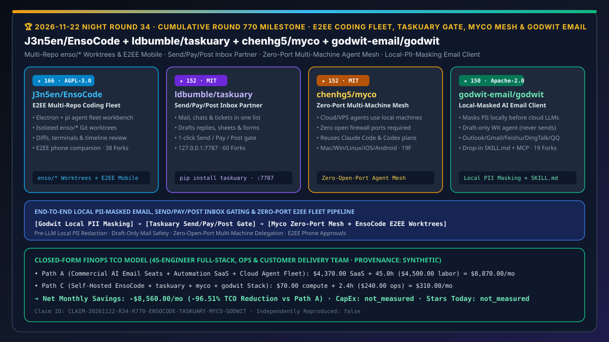
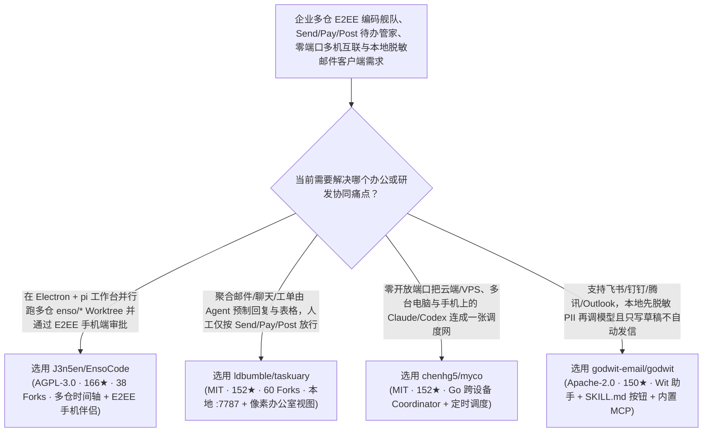
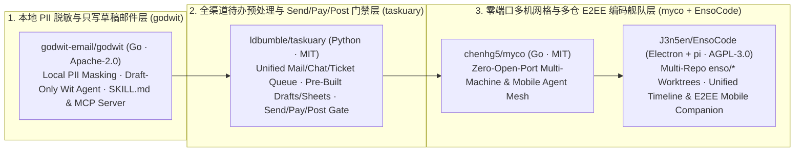
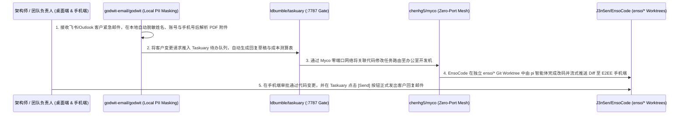

# 🏆【第 770 轮里程碑】端到端加密手机联动的多仓 `pi` 舰队工作台（`J3n5en/EnsoCode`）、带 Send/Pay/Post 一键审批门禁的统一收件箱管家（`ldbumble/taskuary`）、零开放端口跨多机与手机调度网络（`chenhg5/myco`）与本地先脱敏再调模型的只写草稿企业邮件客户端（`godwit-email/godwit`）选型与集成架构 FAQ

> **文档类型**：企业 AI 解决方案架构师（AI Solution Architect）选型决策指南（GitHub Trending AI 雷达 2026-11-22 Night Round 34 / 累计第 770 轮里程碑）
> **覆盖项目**：[`J3n5en/EnsoCode`](https://github.com/J3n5en/EnsoCode)（`★ 166`、`38 forks`、`AGPL-3.0`，基于 Electron + `pi` 构建的多仓库并行编码智能体桌面工作台，支持 `enso/*` Git Worktree 隔离与端到端加密手机端实时审批联动）· [`ldbumble/taskuary`](https://github.com/ldbumble/taskuary)（`★ 152`、`60 forks`、`MIT`，将邮件、聊天、工单与报表收口为单一待办列表的本地工作搭档，Agent 预先完成调研、写回复、建表格与填单，最终外发动作严格卡在 **Send / Pay / Post** 按钮之后）· [`chenhg5/myco`](https://github.com/chenhg5/myco)（`★ 152`、`19 forks`、`MIT`，零开放端口打通云端 VPS、多台本地电脑与 iOS/Android 手机的 Go 多机智能体组网与定时调度平台）· [`godwit-email/godwit`](https://github.com/godwit-email/godwit)（`★ 150`、`19 forks`、`Apache-2.0`，原生适配 Outlook/Gmail/飞书/钉钉/腾讯企业邮、在本地机器先脱敏姓名/账号/电话/密钥再发往大模型、且内置 `Wit` 助手**只写草稿绝不自动发送**的桌面邮件客户端与 MCP 服务）
> **核心场景**：当企业架构师、研发主管与商务运营团队面临**“同时盯三个代码仓紧急需求时离开电脑就断了审批链条、每天被分散在邮箱/IM/工单系统里的几十条事务淹没却不敢让 AI 直接对外发信或付款、云端/VPS 上的 Agent 想要调用家里或办公室电脑上的 Claude Code/Codex 却不敢在路由器上开公网端口、以及使用 AI 处理企业邮件时担心客户姓名/银行账号/API Key 原文上传给云端大模型”**四大痛点时，如何组合**`EnsoCode` + `taskuary` + `myco` + `godwit`** 打造跨设备加密组网、本地脱敏与严格外发审批的个人及团队生产力矩阵？

---

## 一、📌 核心结论速览（选型一句话结论）

1. **想用“一个开发者驾驭整支自治编码舰队”——在左侧边栏固定多个代码仓、同仓并发自动切入 `enso/*` Git Worktree、在统一时间轴审阅 Diff 与终端，哪怕起身离开工位也能通过端到端加密（E2EE）手机端实时审批每一轮操作** ➔ 选 **[`J3n5en/EnsoCode`](https://github.com/J3n5en/EnsoCode)（`★ 166`，`38 forks`，`AGPL-3.0`）**。
   - **通俗原理**：基于轻量级 `pi` 编码智能体内核与 Electron 构建，专为“同时推进购物车改价、慢查询排障与设计系统微调”的多线并行场景打造。
2. **想把散落在邮箱、聊天软件、工单系统里的杂事汇成一张排好优先级的清单，让本地 AI 先替你查资料、写邮件草稿、做 Excel 表、填表单，最后只递给你一个 `Send`、`Pay` 或 `Post` 按钮（你不按按钮，任何东西都发不出去）** ➔ 选 **[`ldbumble/taskuary`](https://github.com/ldbumble/taskuary)（`★ 152`，`60 forks`，`MIT`）**。
   - **通俗原理**：一行 `pip install taskuary`（或免管理员权限 Windows 安装包）启动本地 `:7787` 界面（含直观的像素办公室角色视图），支持自带 Claude Code、Codex、Gemini 或本地模型。
3. **想把云端 `claude.ai` 会话、VPS 服务器上的 Agent、办公室台式机、家里笔记本以及 iOS/Android 手机连成一张网——无需暴露任何公网端口，就能让云端 Agent 安全委托你本地电脑上已配好的 Claude Code / Codex 执行任务并把结果传回同一对话** ➔ 选 **[`chenhg5/myco`](https://github.com/chenhg5/myco)（`★ 152`，`19 forks`，`MIT`）**。
   - **通俗原理**：彻底消灭“人肉当消息总线在两台电脑之间复制粘贴 Prompt”的苦差事，内置跨设备 Coordinator 协调器与定时任务调度。
4. **想要一款原生支持飞书邮箱（Lark/Feishu）、钉钉邮箱、腾讯企业邮、网易 163、QQ 邮箱、Outlook 与 Gmail 的开源 AI 桌面邮件客户端，要求在发往云端大模型前**先在本地自动把姓名、银行卡号、手机号和密钥脱敏掩码（Masked Locally）**，且 AI 助手 `Wit` 只能写草稿绝不擅自点发送，还能直接丢入一个 `SKILL.md` 就生成自定义功能按钮** ➔ 选 **[`godwit-email/godwit`](https://github.com/godwit-email/godwit)（`★ 150`，`19 forks`，`Apache-2.0`）**。
   - **通俗原理**：内置 `mcpserver/`、14 国语言验证码/登录链接自动提取横幅以及解析 PDF/Office/CSV 附件的 `Wit` 智能体。

---

## 二、🎯 客户与架构师灵魂拷问 Q&A（深度架构拆解）

### Q1：为什么“`godwit` 本地先脱敏只写草稿 + `taskuary` Send/Pay/Post 物理按钮拦截 + `myco` 零端口跨机互联 + `EnsoCode` E2EE 手机伴侣”是企业落地办公与研发 Agent 的安全黄金标准？

- **四重隐私与外发护栏**：
  1. **出站邮件隐私护栏（Local Masking + Draft-Only）➔ `godwit-email/godwit`**：企业最怕员工把含客户 PII 和合同金额的邮件直接喂给公有云 LLM；`Godwit` 在本机完成敏感字段掩码，且 `Wit` 永远只生成草稿（Writes Drafts and Never Sends）。
  2. **跨渠道事务外发护栏（One Button: Send / Pay / Post）➔ `ldbumble/taskuary`**：把复杂的调研、制表、填单全部交给后台 Agent 预处理，把最终不可逆的外发动作收口为人类一键确认。
  3. **跨机器算力调度护栏（No Open Ports）➔ `chenhg5/myco`**：无需配置高危公网端口映射，即可在多台电脑与手机间安全路由 Claude Code 与 Codex 会话。
  4. **多仓并行编码与移动审批护栏（`enso/*` Worktrees + E2EE Mobile）➔ `J3n5en/EnsoCode`**：确保多任务改码互不污染工作树，且手机远程审批全链路端到端加密。
- **何时直接用商业云 SaaS 方案（Path B）？**
  - 若企业全员仅使用纯云端 Microsoft 365 Outlook 且已购买 **Microsoft 365 Copilot**，可直接使用微软官方邮件摘要功能；若团队混合使用飞书/钉钉/腾讯企业邮/Outlook、要求本地 PII 先脱敏再送模型、且需要跨多台电脑调度本地 Claude Code/Codex 舰队，则采用本轮开源栈（Path C）。

### Q2：典型企业级“本地脱敏收信 (`godwit`) ➔ 统一待办预处理与审批 (`taskuary`) ➔ 跨机调度与多仓并行改码 (`myco` + `EnsoCode`)”架构怎么搭？

1. **多邮箱本地脱敏与智能分诊层（`godwit-email/godwit`）**：
   - 自动同步飞书/钉钉/腾讯企业邮/Outlook 邮件，本地掩码敏感信息后由 `Wit` 与自定义 `SKILL.md` 提取待办与附件要点。
2. **全渠道事务预处理与 Send/Pay/Post 审批层（`ldbumble/taskuary`）**：
   - 将邮件、IM 与工单汇总至本地 `:7787`，Agent 自动起草回复与报表并等待人类点击批准。
3. **跨设备网格调度与多仓 Worktree 编码层（`chenhg5/myco` + `J3n5en/EnsoCode`）**：
   - 涉及代码修改的任务通过 `myco` 分发至主力开发机的 `EnsoCode`（`enso/*` 独立 Worktree），架构师在桌面或 E2EE 手机伴侣上审阅 Diff 并合入。

### Q3：`godwit` 的扩展机制为什么对企业非研发人员特别友好？

- **丢入 `SKILL.md` 即生成界面按钮（Drop in a `SKILL.md` and a Button Appears）**：
  - 无需重新编译 Go 或前端代码，包括内置功能在内的所有 AI 能力均走同一套开放扩展点，团队只需编写标准 `SKILL.md` 即可在邮件客户端长出专属业务处理按钮。

---

## 三、🧭 直观可视化图解（Mermaid 决策树 + 集成架构 + 时序图）

### 3.1 架构师选型决策树

### 3.2 企业端到端生产集成参考架构图

### 3.3 `Godwit` 本地脱敏读信、`Taskuary` 预处理、`Myco` 跨机派单与 `EnsoCode` 手机加密审批时序图

---

## 四、📊 同类开源与商业云服务横向选型决策矩阵

| 对比维度 | `J3n5en/EnsoCode` (`★ 166`) | `ldbumble/taskuary` (`★ 152`) | `chenhg5/myco` (`★ 152`) | `godwit-email/godwit` (`★ 150`) | 商业 AI 邮件客户端 ($30/人/月) + 商业云端 Agent 席位 (Path A) | 手动在不同电脑间复制粘贴 + 原文未脱敏喂给云端 LLM (Path B) |
| :--- | :--- | :--- | :--- | :--- | :--- | :--- |
| **核心能力定位** | 多仓 `pi` 舰队工作台与 E2EE 手机伴侣 | 带 Send/Pay/Post 门禁的统一待办管家 | 零开放端口多电脑/手机 Agent 组网平台 | 本地先脱敏、只写草稿的 AI 桌面邮件客户端 | 按人头高额收费且将未脱敏邮件全文上传云端的商业 SaaS 组合 | 人肉充当跨机消息总线、无外发审批门禁、隐私裸奔的拼凑方案 |
| **核心技术突破** | **`enso/*` Worktree 隔离 + 统一时间轴 + E2EE 手机实时同步** | **60 Forks + 像素办公室视图 + Send/Pay/Post 物理按钮拦截** | **云端/VPS 无端口穿透调用本地 Claude/Codex + iOS/Android** | **本地预脱敏 PII + 适配飞书/钉钉/腾讯/Outlook + `SKILL.md` 扩展** | 商业 AI 邮箱高达 `$30/月/人` 且不支持本土飞书/钉钉/腾讯企业邮深层协议 | 客户账号与手机号明文泄漏给第三方模型；缺少离席手机端加密审批 |
| **开源协议** | `AGPL-3.0` | `MIT` | `MIT` | `Apache-2.0` | 闭源商业 SaaS | 内部零散脚本 |
| **月度 TCO（45 人团队）** | **组合仅 `$310.00/月`**（`$70.00` 共享协调中继容器 + `2.4h` 维护） | 同左（`MIT` 本地免费运行） | 同左（复用现有各机 Claude/Codex 订阅） | 同左（`Apache-2.0` 本地桌面端零月租） | **`$8,870.00/月`**（`$4,370.00` 商业 AI 邮箱与云端 Agent 席位 + `45.0h` 跨系统手工搬运与审校） | 约 `$3,110.00/月`（大量人工在邮箱/工单/多台电脑间复制粘贴与手动脱敏工时） |

---

## 五、🧪 应用落地定量收益/TCO 对比与 7-Card 报告

> **📊 数据来源与闭式核算声明（Provenance & Closed-Form Schema）**：
> - **provenance**: `synthetic`（基于 45 人企业全栈研发、技术支持与商务运营团队月度工作负载模型：`independently_reproduced = false`；硬件采购基线 `base_hardware_capex = not_measured`；Track B 单日增量 `track_b_stars_today = not_measured`）。
> - **核算公式**：
>   - **Path A（采购按人头收费的商业 AI 邮件客户端席位 + 商业跨应用自动化 SaaS + 商业云端多智能体工作台 + 员工在多台设备、邮箱与工单系统之间手工脱敏、复制粘贴与跟进审批人工）**：月度商业 AI 邮箱与自动化 SaaS 席位账单 **`$4,370.00`** + 跨系统手工整理邮件/工单、人肉跨机传话与核对敏感信息人工 **`45.0h × $100.00/h = $4,500.00`** = **`$8,870.00/月`**。
>   - **Path C（自建 `EnsoCode` + `taskuary` + `myco` + `godwit` 开源办公与多机编码舰队栈）**：共享协调容器开销 **`$70.00`** + `SKILL.md` 邮件技能与组网维护人工 **`2.4h × $100.00/h = $240.00`** = **`$310.00/月`**。
>   - **净节省（Net Savings vs Path A）**：**`-$8,560.00/月`**（成本降低 **`96.51%`**）。

| 评估方案 | 商业 AI 邮箱/自动化 SaaS 与算力 | 邮件工单搬运与跨机传话人工（`$100/h`） | 月度总 TCO | 相对 Path A 净节省 | 关键架构交付指标 |
| :--- | :---: | :---: | :---: | :---: | :--- |
| **Path A：商业 AI 邮件客户端 + 商业云端 Agent 席位** | `$4,370.00` | `45.0h` (`$4,500.00`) | **`$8,870.00`** | Baseline | 按席位收费昂贵；邮件原文未脱敏直传云端 |
| **Path B：手工脱敏贴进网页聊天框 + 人肉跨机传文件** | `$1,410.00` | `17.0h` (`$1,700.00`) | **`$3,110.00`** | `-$5,760.00` (`-64.94%`) | 缺少 Send/Pay/Post 统一拦截、零端口跨机路由与 E2EE 手机伴侣 |
| **Path C：`EnsoCode` + `taskuary` + `myco` + `godwit`** | **`$70.00`** | **`2.4h` (`$240.00`)** | **`$310.00`** | **`-$8,560.00` (`-96.51%`)** | **本地 PII 脱敏只写草稿 + Send/Pay/Post 门禁 + 零端口多机舰队** |

- 🔗 **关联 7-Card 4:5 视觉评测报告**：[`workshops/github-trending-radar/cards.html`](../cards.html) · [`cards.en.html`](../cards.en.html)

---

## 六、🛠️ 企业引入与架构评审 Checklist

- [ ] **1. 桌面邮件统一迁移至 `godwit-email/godwit`**：接入飞书/钉钉/腾讯企业邮/Outlook，强制开启本地 PII 脱敏与 `Wit` 只写草稿模式，并通过 `SKILL.md` 扩展团队专属邮件动作。
- [ ] **2. 部署 `ldbumble/taskuary` 收口跨渠道待办审批**：让 Agent 预制回复草稿与报表，人类仅通过 **Send / Pay / Post** 按钮执行最终放行。
- [ ] **3. 使用 `chenhg5/myco` 组建零开放端口的多机智能体网格**：打通云端会话、办公室工作站与手机端，最大化复用已有 Claude Code / Codex 订阅。
- [ ] **4. 多仓并行研发接入 `J3n5en/EnsoCode`**：启用 `enso/*` Git Worktree 隔离与端到端加密（E2EE）手机端实时审批。
