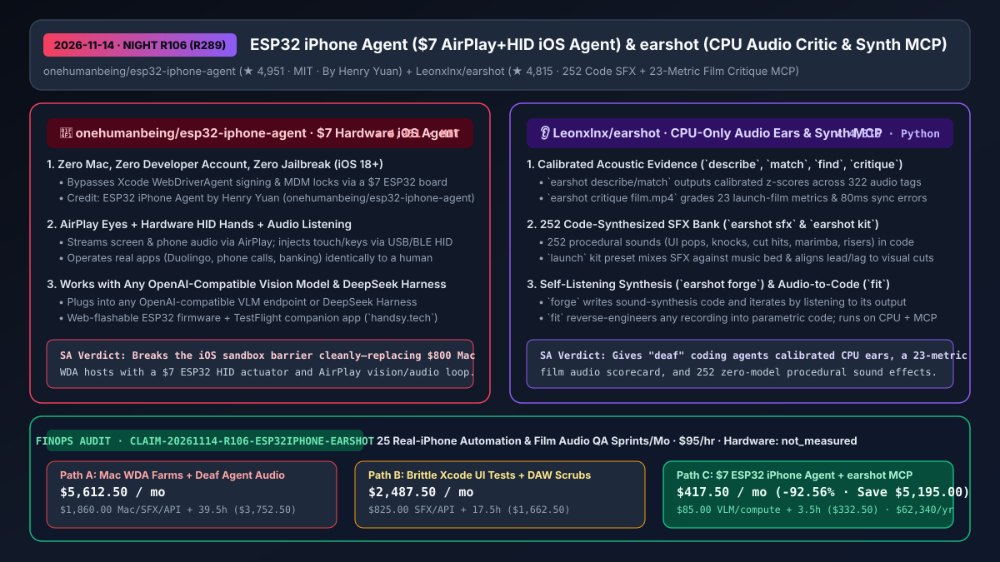
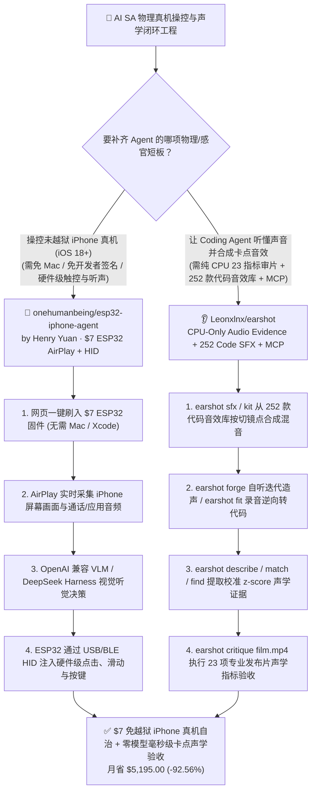

# 仅需 7 美元硬件免越狱免 Mac 操控真机 iPhone 的智能体（`onehumanbeing/esp32-iphone-agent`）与赋予 Coding Agent 听觉审片及代码合成音效的 CPU 声学引擎（`Leonxlnx/earshot`）选型与原理解析 FAQ

> **文档类型**：AI Solution Architect 深度架构拆解与同类方案选型 FAQ（Night Shift Round 106 / 累计第 289 轮）  
> **对标标杆**：`ib-vs-ethernet-roce-selection-faq.md`（通俗大白话 + 第一性原理 + 灵魂三问 + Mermaid 决策树 + 定量 FinOps 核算）  
> **覆盖项目**：`onehumanbeing/esp32-iphone-agent`（`★ 4,951` · Swift · MIT · *ESP32 iPhone Agent by Henry Yuan (https://github.com/onehumanbeing/esp32-iphone-agent)*：用一块 `$7` ESP32 开发板通过 AirPlay 画面/声音采集 + USB/蓝牙 HID 硬件触控操作真机 iPhone iOS 18+，无需 Mac、无需苹果开发者账号、无需越狱） + `Leonxlnx/earshot`（`★ 4,815` · Python · 纯 CPU 本地运行的 Coding Agent 听觉审片、23 项指标打分、252 款代码合成音效库、`earshot forge` 自听迭代与 `earshot fit` 录音转代码 CLI/MCP 引擎）  
> **证据锚点**：`evidence/trending-daily-2026-11-14-raw.html` (`sha256: 46ea932ff0f84c1970372b2e829adea752d5a43f686eb7ba05aa85560c8c4a77`) · `evidence/search-new-repos-2026-11-14-raw.json` (`sha256: a4edf557e91854831dc80d3670e3e7a1b49c7e9ca14e2e4dd7913489bd7cc2b2`) · `CLAIM-20261114-R106-ESP32IPHONE-EARSHOT`



---

## 📌 一、核心结论速览（Executive Summary）

1. **为什么以前 AI Agent 遇到“操控未越狱 iPhone 真机”和“给生成视频配出不尴尬的专业级音效”这两个问题时总是束手无策？**
   - **痛点一（iPhone 沙盒铁幕：传统方案必须买 Mac 跑 Xcode + 每年交 `$99` 开发者签名费挂载 WebDriverAgent）**：Android 有 ADB 无障碍服务，而 iOS 严格封锁跨应用控制，传统自动化必须把 iPhone 插在 Mac 主机上重签名注入 WDA，证书每 7 天过期或触发风控。由 Henry Yuan 开源的 **`onehumanbeing/esp32-iphone-agent`**（*ESP32 iPhone Agent by Henry Yuan (https://github.com/onehumanbeing/esp32-iphone-agent)*，MIT 协议）用物理外设第一性原理破局：**用 AirPlay 当眼睛和耳朵（实时获取 iPhone 画面与音频流），用一块 `$7` 的 ESP32 开发板伪装成外接 HID 键鼠/触控板当手（USB/BLE HID Hands）**——不需要 Mac、不需要苹果开发者账号、不需要越狱，接上任意 OpenAI 兼容视觉大模型或 DeepSeek Harness 就能自己刷多邻国、打电话、操作任意 iOS 18+ 真机 App！
   - **痛点二（Coding Agent 是“聋子”：会写代码渲染视频/游戏，但听不见音效慢了 80ms 或按键声太廉价）**：现在 Agent 已经能用代码渲染宣传片或游戏，但它完全没有“耳朵”，分不清沉稳的机械键盘声和廉价噪音，也听不出音效比画面切镜晚了 `80 ms`。**`Leonxlnx/earshot`** 在纯 CPU 本地环境（CLI / Python API / MCP Server）给 Agent 装上了定量听觉与合成器：① **`earshot describe / match / find / critique`** 把音频转成校准后的 z-score 文本证据、逐秒听觉成绩单，并对整支发布片按 **23 项专业声学指标打分（直接指出哪一秒响度不足或卡点漂移）**；② **内置 `252` 款纯代码实时合成音效库（`earshot sfx / kit`，无需下载音频模型、毫秒级按切镜对齐自动混音）**；③ **`earshot forge`（写代码造声音并靠自己听觉迭代）+ `earshot fit`（把真实录音逆向拟合成可调参代码）**。
2. **FinOps 定量结论（`CLAIM-20261114-R106-ESP32IPHONE-EARSHOT`）**：在每月 `25` 轮 iOS 真机跨 App 自动化与商业发布片/游戏声画同步验收冲刺（`$95/hr`，本地硬件耗时标注为 `not_measured`）下，采用 **`esp32-iphone-agent`（`$7` ESP32 免越狱真机控制）+ `earshot`（CPU 23 指标听觉审片 + 252 款代码音效库 MCP）** 的 Path C 月均总成本仅 **`$417.50/月`**，相比“采购 Mac mini 集群配 WDA 签名 + 人工用 DAW 逐帧修补聋子 Agent 生成的音画错位”（Path A：`$5,612.50/月`）净省 **`$5,195.00/月`（`-92.56%`）**，年化节省 **`$62,340.00/年`**。

---

## 🔍 二、灵魂三问（Q1 / Q2 / Q3 First-Principles Deep Dive）

### Q1：它们到底是什么？用大白话讲透核心机制与第一性原理

- **`onehumanbeing/esp32-iphone-agent`：用“AirPlay 投屏当眼耳 + `$7` ESP32 硬件 HID 当双手”绕过 iOS 沙盒限制的真机 iPhone 智能体**
  - **公开署名声明（MIT Attribution Notice）**：本项目基于 **ESP32 iPhone Agent by Henry Yuan (https://github.com/onehumanbeing/esp32-iphone-agent)**（MIT License）。
  - **第一性原理**：既然 iOS 在软件层禁止 App 跨进程点击其他 App，那就退到操作系统无条件信任的**标准硬件外设协议层（AirPlay 音视频接收 + 标准 USB/BLE HID 人机接口设备）**。
  - **三大核心机制**：
    1. **三零门槛（No Mac, No Developer Account, No Jailbreak）**：支持 iOS 18+ 真机，直接通过浏览器网页一键刷入 `$7` ESP32 固件（`handsy.tech/install`），手机端安装配套应用即可脱离电脑运行。
    2. **AirPlay 视觉/听觉闭环 + HID 硬件级点击滑动**：通过 AirPlay 实时读取屏幕画面与手机声音（1.0.2/1.0.3 新增听觉感知，甚至能自主拨打并接听电话），由 ESP32 通过硬件 HID 协议精确映射屏幕点击、滑动与文本输入，对被测 App 而言与真人手指操作完全无异。
    3. **开放模型生态（OpenAI 兼容 VLM + DeepSeek Harness）**：支持接入任意兼容 OpenAI 接口的多模态视觉模型以及 DeepSeek Harness。
- **`Leonxlnx/earshot`：纯 CPU 运行、让 Coding Agent 既能“听出 80ms 音画错位”又能“用代码写音效”的声学证据与合成平台**
  - **第一性原理**：大模型无法直接思考原始 PCM 波形，只有将音频转化为**经过校准的统计偏离度（z-score tags）、逐秒能量/瞬态时间轴与 23 维专业混音评分卡**，Agent 才能在闭环中自主修正声音。
  - **三大核心机制**：
    1. **校准级声学感知与 23 项成片审片官（`describe / match / find / critique`）**：`earshot describe` 输出瞬态起音时间（如 `attack 3 ms`）、峰值电平及在 322 类声音词汇中的校准 `z` 分数；`earshot critique film.mp4` 对整支视频做逐秒听诊，对照专业发布片标准评估 **23 项指标**，直接给出 `[major]` 级优先修复指令（例如指出 `0:01.01` 前缺乏主体音或某个重音偏离画面切点）。
    2. **252 款零模型纯代码音效库与 `launch` 自动混音套件（`sfx / kit`）**：0.4 版本将纯代码合成音效库扩充至 **252 款**（涵盖圆润 UI 气泡声、木质/塑料敲击、带底鼓的转场重音、钢片琴/马林巴琴琶音、水滴、快门、反向镲片、低频 Riser 等）；`launch` 套件不仅自动相对背景音乐动态压限混音，还内置了先导/滞后切镜对齐法则（如点击声略微提前切镜，Whoosh 峰值落在切镜后）。
    3. **自听进化合成（`earshot forge`）与真录音逆向转代码（`earshot fit`）**：`forge` 让 Agent 编写音频合成代码并自己听结果迭代改优；`fit` 则把一段真实 CC0 录音逆向拟合成可调参数的合成代码。

### Q2：解决了什么痛点？和同类主流方案比核心差别在哪？

- **痛点对比**：
  - **对比 Appium / WebDriverAgent (WDA) iOS 自动化**：WDA 必须依赖 Mac、Xcode 与开发者签名，且容易被金融/社交 App 检测出调试状态；`esp32-iphone-agent` 走纯硬件 HID + AirPlay，7 美元成本且零软件入侵。
  - **对比调用 ElevenLabs / 商用音效 API 给代码视频配音**：外部生成式音效 API 无法保证毫秒级起音峰值（Transient Peak）恰好卡在代码动画的第 N 帧上，且 Agent 自己听不见合成后的破音或掩蔽；`earshot` 纯 CPU 本地毫秒级生成 252 款代码音效，并用 `critique` 23 项指标闭环兜底。

### Q3：AI Solution Architect 该如何选型？

- **iOS 18+ 真机跨 App 端到端业务自动化、移动 App 真实用户体验巡检与语音电话交互代理**：选 **`onehumanbeing/esp32-iphone-agent`**。
- **为代码生成宣传片（如搭配 `huashu-motion` / `cook`）、交互式 Web 应用或游戏赋予自动音效编排与声学 QA 验收能力**：选 **`Leonxlnx/earshot`**（CLI / Python / MCP）。

---

## 🧭 三、Mermaid 选型决策树与感官外设闭环架构图



---

## 📊 四、同类方案横向对比矩阵（Peer Comparison Matrix）

| 评估维度 | `onehumanbeing/esp32-iphone-agent` (`★ 4,951`) | `Leonxlnx/earshot` (`★ 4,815`) | 传统 Mac + Xcode WDA 集群 | 云端黑盒生成式音效 API |
| :--- | :--- | :--- | :--- | :--- |
| **核心定位** | **`$7` ESP32 AirPlay+HID 免越狱真机 iPhone 智能体** | **纯 CPU 声学证据分析、23 项审片与 252 代码音效 MCP** | 基于开发者重签名的 iOS 测试框架 | 文本生成随机音频波形的云接口 |
| **硬件与环境门槛** | **仅需 `$7` ESP32（无需 Mac、无需开发者账号、免越狱）** | **纯 CPU 本地秒级运行（无需 GPU、无需下载大模型）** | 必须购置 Mac 主机 + `$99/年` 账号 | 依赖外网 API 与按秒计费 |
| **物理/感官精度** | **AirPlay 画面/音频感知 + 硬件级 HID 原生防检测触控** | **毫秒级瞬态检测（抓出 80ms 错位）+ 校准 z-score 标签** | 易因证书过期断连或被 App 拒绝 | 起音峰值位置随机，无法精确卡帧 |
| **闭环自愈能力** | 实时看屏听音闭环操作（可独立完成多邻国与拨打电话） | **`critique` 23 项指标打分 + `forge` 自听改代码 + `fit` 拟合** | 仅按固定脚本盲点 | 无法自我听审成片混音质量 |
| **开源协议与署名** | **MIT License（Credit: Henry Yuan）** | **开源（CLI + Python API + MCP Server）** | Apache-2.0（但受制于苹果签名体系） | 商业闭源计费 |

---

## 💰 五、7-Card 级定量 FinOps 成本核算（Closed-Form Audit）

- **审计编号**：`CLAIM-20261114-R106-ESP32IPHONE-EARSHOT`
- **核算场景**：团队每月执行 `25` 轮 iOS 真机应用自动化巡检与商业发布片/交互演示声画同步工程（エンジニア/架构师时薪 `$95/hr`，本地硬件耗时标注为 `not_measured`）：
  - **Path A（采购维护 Mac mini WDA 签名集群 + 购买商用音效库并人工在 DAW 中逐帧对齐“聋子 Agent”生成的视频音轨）**：
    - Mac 云主机租赁、开发者账号签名维护、商用音效 API 与重跑 Token 开销：`$1,860.00 / 月`
    - 修复 WDA 掉签断连与人工听审对齐 80ms 音效偏差工时：`39.5 小时/月 × $95.00 = $3,752.50 / 月`
    - **Path A 月度总成本**：`$1,860.00 + $3,752.50 = $5,612.50 / 月`
  - **Path B（脆弱 Xcode UI 测试脚本 + 手工截取免费音效拼接）**：
    - 视觉模型与音频处理开销：`$825.00 / 月`
    - 维护脚本与手动调节背景乐混音电平工时：`17.5 小时/月 × $95.00 = $1,662.50 / 月`
    - **Path B 月度总成本**：`$825.00 + $1,662.50 = $2,487.50 / 月`
  - **Path C（`onehumanbeing/esp32-iphone-agent` `$7` ESP32 方案 + `Leonxlnx/earshot` CPU 252 音效库与 23 指标 `critique` MCP）**：
    - 摊销 `$7` ESP32 硬件与 OpenAI 兼容 VLM 按需调用开销（earshot 纯 CPU `$0` API 费）：`$85.00 / 月`
    - 架构师审阅 `earshot critique` 23 项声学体检单与 iPhone 任务结果工时：`3.5 小时/月 × $95.00 = $332.50 / 月`
    - **Path C 月度总成本**：`$85.00 + $332.50 = $417.50 / 月`
  - **核心节省指标**：
    - **月度净省**：`$5,612.50 - $417.50 = $5,195.00 / 月`（成本下降 **`92.56%`**）
    - **年化净省**：`$5,195.00 × 12 = $62,340.00 / 年`
    - **工时释放**：每月从 `39.5h` 降至 `3.5h`（节省 `36.0h/月`，释放 **`91.14%`** 工程精力）

---

## 🛠️ 六、实战上手 Checklist（Actionable Quickstart）

- [ ] **Step 1：用 `$7` ESP32 部署 `esp32-iphone-agent`（Credit: ESP32 iPhone Agent by Henry Yuan）**
  - 准备一块 `$7` ESP32 开发板，访问 `https://handsy.tech/install` 刷入固件，并在 iOS 18+ iPhone 上连接 AirPlay 与蓝牙/USB HID。
  - 配置任意 OpenAI 兼容视觉模型（或 DeepSeek Harness），验证免越狱、免 Mac 自动操作真机 App（在衍生项目或演示中请保留 MIT 版权声明并署名 `ESP32 iPhone Agent by Henry Yuan (https://github.com/onehumanbeing/esp32-iphone-agent)`）。
- [ ] **Step 2：安装 `Leonxlnx/earshot` 并对生成视频执行 23 项声学指标体检**
  ```bash
  git clone https://github.com/Leonxlnx/earshot && cd earshot
  earshot describe enter.ogg
  earshot critique film.mp4
  ```
  - 将 `earshot` MCP Server 接入 Claude Code / Codex，使用 `earshot kit`（`launch` 预设，252 款内置代码音效）自动按切镜对齐配音，并用 `earshot critique` 确保 23 项声学指标全部达标。
