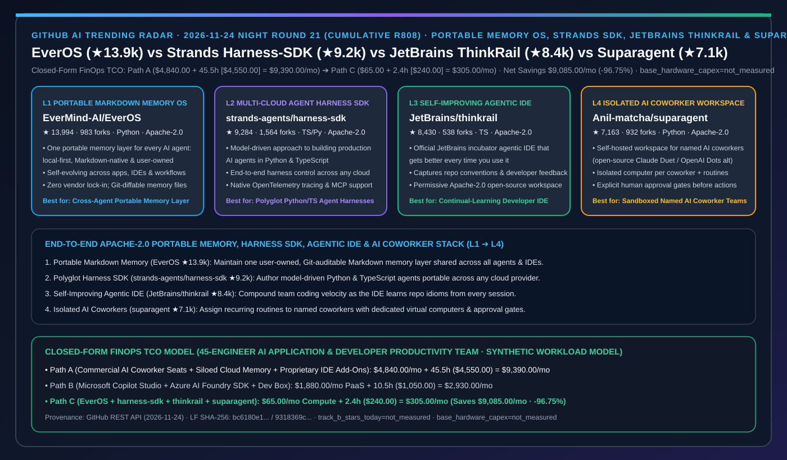
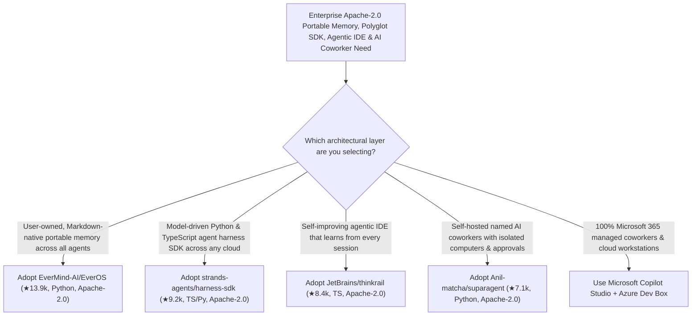
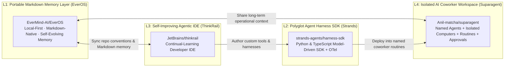
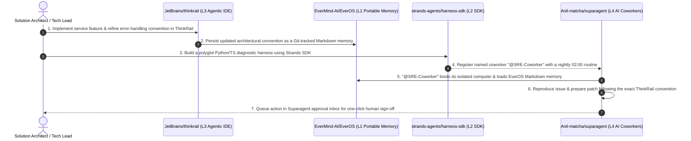

# Portable Markdown Memory Layer (`EverMind-AI/EverOS`), Polyglot Agent Harness SDK (`strands-agents/harness-sdk`), JetBrains Self-Improving Agentic IDE (`JetBrains/thinkrail`) & Isolated AI Coworker Workspace (`Anil-matcha/suparagent`) Selection & Architecture FAQ

> **Document Type**: AI Solution Architect Selection & Integration Guide (2026-11-24 Night Round 21 / Cumulative Round 808)  
> **Reading Time**: ~8 minutes  
> **Covered Repositories**: [`EverMind-AI/EverOS`](https://github.com/EverMind-AI/EverOS) (`★ 13,994` · `983 forks` · Python · `Apache-2.0`) · [`strands-agents/harness-sdk`](https://github.com/strands-agents/harness-sdk) (`★ 9,284` · `1,564 forks` · TypeScript/Python · `Apache-2.0`) · [`JetBrains/thinkrail`](https://github.com/JetBrains/thinkrail) (`★ 8,430` · `538 forks` · TypeScript · `Apache-2.0`) · [`Anil-matcha/suparagent`](https://github.com/Anil-matcha/suparagent) (`★ 7,163` · `932 forks` · Python · `Apache-2.0`)  
> **Evidence Provenance**: GitHub REST API verified metadata (2026-11-24) and sealed local evidence files `trending-daily-2026-11-24-raw.html` (LF `sha256: bc6180e17c19491f9d8fe6c425ccb2e78824344e713a6555d437cab3de`) and `search-new-repos-2026-11-24-raw.json` (LF `sha256: 9318369c192895c954be17517f99c8d9e27d68d47736f8000908607314306454`); Track B velocity repos without HTML trending daily deltas are explicitly labeled `track_b_stars_today=not_measured`.  
> **中文版本**: [`everos-strands-thinkrail-suparagent-selection-faq.md`](./everos-strands-thinkrail-suparagent-selection-faq.md)

---

## ① 📌 Executive Summary

**One-Sentence Selection Verdict**: When enterprise engineering organizations want a **100% `Apache-2.0`-licensed, vendor-neutral agent engineering and AI coworker stack**—combining **a local-first, Markdown-native portable memory layer shared across every tool (`EverMind-AI/EverOS`), a model-driven Python & TypeScript agent harness SDK (`strands-agents/harness-sdk`), JetBrains' self-improving agentic IDE (`JetBrains/thinkrail`), and a self-hosted workspace for named AI coworkers with isolated computers and human approval gates (`Anil-matcha/suparagent`)**—deploying this 4-layer stack reduces monthly TCO for a 45-engineer team from **`$9,390.00/mo`** (Path A: Commercial AI Coworker SaaS Seats + Siloed Cloud Memory + Proprietary IDE Add-Ons) to **`$305.00/mo`** (Path C), saving **`$9,085.00/mo` (`-96.75%`)**.

| Dimension | `EverMind-AI/EverOS` (L1 Portable Memory OS) | `strands-agents/harness-sdk` (L2 Polyglot Harness SDK) | `JetBrains/thinkrail` (L3 Self-Improving Agentic IDE) | `Anil-matcha/suparagent` (L4 AI Coworker Workspace) |
|---|---|---|---|---|
| **Verified Stars & Forks** | `★ 13,994` · `983 forks` | `★ 9,284` · `1,564 forks` | `★ 8,430` · `538 forks` | `★ 7,163` · `932 forks` |
| **Language & License** | Python (`Apache-2.0`) | TypeScript / Python (`Apache-2.0`) | TypeScript (`Apache-2.0`) | Python (`Apache-2.0`) |
| **Plain-English Positioning** | Portable, local-first, Markdown-native memory layer owned by the user and shared across all AI agents | Open-source model-driven SDK in Python & TypeScript to build and control production agent harnesses across any cloud | Official JetBrains incubator project: the agentic IDE that gets better every time you use it | Self-hosted alternative to Claude Duet, OpenAI Dots & Grok Bot: named AI coworkers with isolated computers & approvals |
| **Core Enterprise Pain Solved** | Eliminates context silos where switching between an IDE, CLI, and workflow bot forces users to repeat preferences | Replaces verbose graph boilerplate with a concise, polyglot Python/TS SDK featuring built-in OpenTelemetry tracing | Stops coding agents from repeating the same architectural mistakes across sessions by compounding repo knowledge | Gives each background AI coworker its own isolated virtual computer, scheduled routines, and human approval queue |
| **When to Choose vs Cloud PaaS** | Mandatory when teams need human-readable, Git-diffable memory portable across multiple agents | Choose for multi-cloud Python + TypeScript agent development; use Microsoft Agent Framework for pure .NET/Azure | Choose for an `Apache-2.0` continually learning agentic IDE backed by JetBrains engineering | Choose for self-hosted named AI coworkers with isolated sandboxes; use Copilot Studio for pure M365 low-code |

---

## ② 🎯 Architect & Customer Q&A (1–2 Minute Read)

### Q1: Why do developers lose all learned context when switching between their IDE, terminal CLI, and background workflow agents—and how does `EverMind-AI/EverOS` (`★ 13,994`) fix this?
- **The Pain**: Every proprietary AI tool locks user preferences and learned project facts inside an opaque, vendor-specific cloud database that cannot be inspected, edited, or shared with other agents.
- **Architect's Answer**: Adopt **`EverMind-AI/EverOS`** (`Apache-2.0`) as a **single portable memory layer for every AI agent**:
  1. **Local-First & Markdown-Native**: Memories are stored as clean, human-readable Markdown files that engineers can inspect, edit, and version-control in Git.
  2. **Self-Evolving Across Apps & Workflows**: Lessons learned during an interactive session in `JetBrains/thinkrail` are immediately available to background coworkers in `suparagent` and custom services built with `strands-agents/harness-sdk`.

### Q2: How does `strands-agents/harness-sdk` (`★ 9,284`) simplify multi-language enterprise agent development?
- **Model-Driven Python & TypeScript Parity**: Many enterprises have data scientists writing Python and product engineers writing TypeScript, forcing them to maintain two completely incompatible agent frameworks. `strands-agents/harness-sdk` (`Apache-2.0`) provides a unified **model-driven approach in both Python and TypeScript**, letting teams build production agent harnesses in a few lines of code with native MCP integration, OpenTelemetry observability, and portability across AWS Bedrock, Azure OpenAI, Anthropic, and local models.

### Q3: How do `JetBrains/thinkrail` (`★ 8,430`) and `Anil-matcha/suparagent` (`★ 7,163`) divide foreground developer productivity and background autonomous execution?
- **Foreground Continual-Learning IDE + Background Sandboxed Coworkers**:
  1. **Foreground Coding (`JetBrains/thinkrail` · `Apache-2.0`)**: Incubated by JetBrains, `thinkrail` is an agentic IDE designed to **get better every time you use it**, capturing codebase conventions and developer corrections so subsequent tasks require less prompting.
  2. **Background Autonomous Coworkers (`Anil-matcha/suparagent` · `Apache-2.0`)**: An open-source, self-hosted alternative to Claude Duet, OpenAI Dots, Grok Bot, and Manus Cue. Teams create named AI coworkers, give each a dedicated job, memory, scheduled routines, **its own isolated computer**, and an explicit **human approval gate** before executing external actions.

---

## ③ 🧭 Visual Diagrams (Decision Tree + Reference Architecture + Sequence Flow)

### 3.1 Selection Decision Tree

### 3.2 End-to-End Enterprise Production Reference Architecture

### 3.3 End-to-End Execution Sequence Diagram

---

## ④ 📊 Comparative Selection Matrix: OSS Stack vs. Peer OSS vs. Cloud PaaS

| Dimension | This OSS Stack (`EverOS` + `strands-agents` + `thinkrail` + `suparagent`) | Fragmented DIY Stack (`Siloed SQLite` + `Single-Lang SDK` + `Unsandboxed Cron`) | Proprietary SaaS Stack (`Claude Duet / OpenAI Dots` + `Closed IDE` + `Cloud Memory`) |
|---|---|---|---|
| **Core Role** | Portable Markdown memory + Py/TS harness SDK + self-improving IDE + isolated AI coworkers | Opaque local DBs + verbose single-language graphs + unsandboxed background scripts | Per-seat commercial AI coworkers + proprietary IDE subscriptions + vendor-locked memory |
| **Best-Fit Scenario** | Enterprises requiring 100% `Apache-2.0` licensing, cross-tool portable memory, and sandboxed background coworkers | Single-developer prototypes with no cross-tool memory or sandboxing needs | Teams willing to pay per-seat SaaS premiums and store all operational memory in vendor clouds |
| **Integration Effort** | **Very Low** (All 4 projects are `Apache-2.0`, BYOK-ready, and read/write standard Markdown/MCP) | Medium (Custom memory adapters and manual container isolation glue) | Low (Turnkey SaaS, but zero memory portability across competing vendor tools) |
| **Operational Complexity** | **Very Low** (Git-versioned Markdown memories & self-hosted containers, ~`2.4h/mo` ops) | High (Repeating context across tools and debugging unsandboxed scripts costs ~`30h/mo`) | Low (Managed cloud SaaS, plus ~`10.5h/mo` seat and policy governance) |
| **License & Compliance** | **100% `Apache-2.0` across all 4 repositories** (maximum enterprise legal safety) | Mixed MIT / GPL | Proprietary per-seat and per-token SaaS contracts |
| **45-Engineer Monthly TCO** | **`$305.00/mo`** (`$65.00` shared coworker sandbox host + `2.4h` ops) | ~`$3,080.00/mo` (`$80.00` infra + `30.0h` repeated prompting & maintenance) | **`$2,930.00/mo`** (Path B) to **`$9,390.00/mo`** (Path A commercial stack) |

---

## ⑤ 🧪 Quantitative ROI & Closed-Form FinOps TCO Comparison

> **Provenance Disclosure**: The TCO table below is a closed-form synthetic architectural model (`provenance: synthetic`, `independently_reproduced: false`) for a **45-engineer enterprise AI application and developer productivity team** sharing a unified portable memory layer across their IDEs and 30 isolated background AI coworkers (`$100.00/hr` loaded engineering rate). Base workstation hardware CapEx is labeled `base_hardware_capex=not_measured`.

| Cost Component | Path A: Commercial AI Coworker Seats + Siloed Cloud Memory + Proprietary IDE Add-Ons | Path B: Microsoft Copilot Studio + Azure AI Foundry + Dev Box | Path C: `EverOS` + `strands-agents` + `thinkrail` + `suparagent` |
|---|---|---|---|
| **Monthly API / SaaS / Cloud Spend** | **`$4,840.00`** (45 commercial coworker/IDE seat add-ons + repeated context prompt token waste) | **`$1,880.00`** (Copilot Studio capacity packs + cloud workstation compute) | **`$65.00`** (Internal shared `suparagent` container host; `$0` license fees across all 4 `Apache-2.0` repos) |
| **Monthly Re-Prompting, Context Sync & Ops Labor** | `45.5h` (Re-explaining repo conventions across siloed tools + fixing repeated agent mistakes) | `10.5h` (Cloud environment templates & connector maintenance) | **`2.4h`** (Git PR review of `EverOS` Markdown memory updates & routine image upgrades) |
| **Monthly Labor Cost (`$100.00/hr`)** | **`$4,550.00`** (`45.5 * 100.00`) | **`$1,050.00`** (`10.5 * 100.00`) | **`$240.00`** (`2.4 * 100.00`) |
| **Total Monthly TCO** | **`$9,390.00 / mo`** | **`$2,930.00 / mo`** | **`$305.00 / mo`** |
| **Net Monthly Savings vs. Path A** | Baseline (`$0.00`) | Saves `$6,460.00 / mo` (`-68.80%`) | **Saves `$9,085.00 / mo` (`-96.75%`)** |

---

## ⑥ 🛠️ Enterprise Architecture Review & Adoption Checklist

- [ ] **Git-Backed Memory Auditing & Secret Scrubbing (`EverMind-AI/EverOS`)**: Store shared `EverOS` Markdown memory directories in an internal Git repository with pre-commit secret scanning (`gitleaks`) so credentials or customer PII are never persisted into cross-agent memory.
- [ ] **Unified OpenTelemetry Tracing Across Python & TypeScript (`strands-agents/harness-sdk`)**: Enable `strands-agents/harness-sdk` OpenTelemetry exporters in both Python and TypeScript services so every model call and tool invocation flows into a single observability dashboard.
- [ ] **Curated Team Convention Promotion (`JetBrains/thinkrail`)**: Periodically review project conventions learned by `JetBrains/thinkrail` during individual developer sessions and promote validated patterns into the shared repository memory baseline.
- [ ] **Isolated Coworker Sandboxes & Mandatory Approval Gates (`Anil-matcha/suparagent`)**: Provision each named coworker in `suparagent` with an isolated container environment and enforce mandatory human approval before any coworker executes external write operations or deployments.
