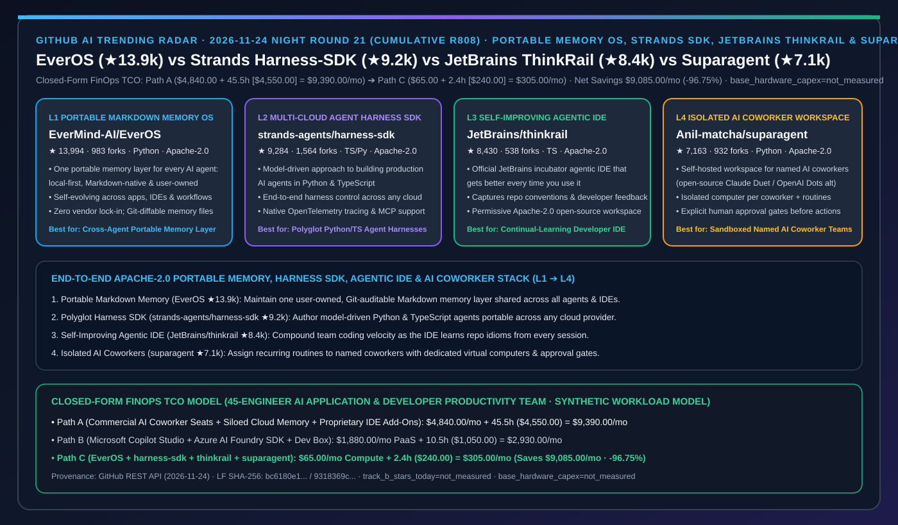
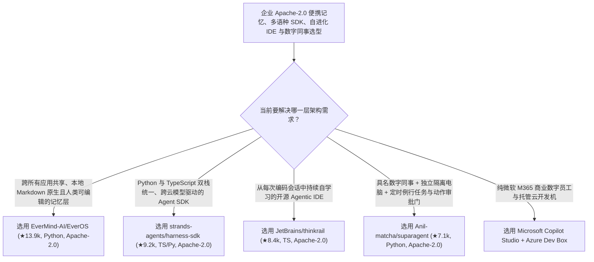
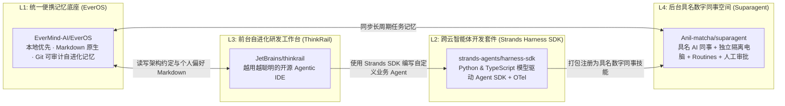
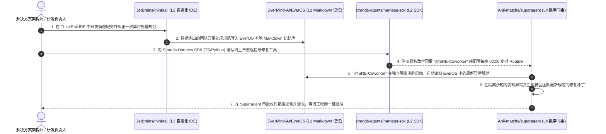

# 跨智能体便携 Markdown 记忆层（`EverMind-AI/EverOS`）、多云 Python/TS 智能体开发套件（`strands-agents/harness-sdk`）、JetBrains 自进化智能体 IDE（`JetBrains/thinkrail`）与隔离沙箱数字同事工作台（`Anil-matcha/suparagent`）选型与集成 FAQ

> **文档类型**：AI 解决方案架构师（AI Solution Architect）选型决策指南（2026-11-24 Night Round 21 / 累计第 808 轮）  
> **阅读耗时**：约 8 分钟  
> **覆盖项目**：[`EverMind-AI/EverOS`](https://github.com/EverMind-AI/EverOS)（`★ 13,994` · `983 forks` · Python · `Apache-2.0`） · [`strands-agents/harness-sdk`](https://github.com/strands-agents/harness-sdk)（`★ 9,284` · `1,564 forks` · TypeScript/Python · `Apache-2.0`） · [`JetBrains/thinkrail`](https://github.com/JetBrains/thinkrail)（`★ 8,430` · `538 forks` · TypeScript · `Apache-2.0`） · [`Anil-matcha/suparagent`](https://github.com/Anil-matcha/suparagent)（`★ 7,163` · `932 forks` · Python · `Apache-2.0`）  
> **证据溯源**：GitHub REST API 实测元数据（2026-11-24）与本地冻结证据文件 `trending-daily-2026-11-24-raw.html`（LF `sha256: bc6180e17c19491f9d8fe6c425ccb2e78824344e713a6555d437cab3de`）、`search-new-repos-2026-11-24-raw.json`（LF `sha256: 9318369c192895c954be17517f99c8d9e27d68d47736f8000908607314306454`）；Track B 仓库无 HTML 榜单对应的单日增量，统一标记为 `track_b_stars_today=not_measured`。  
> **English Version**: [`everos-strands-thinkrail-suparagent-selection-faq.en.md`](./everos-strands-thinkrail-suparagent-selection-faq.en.md)

---

## ① 📌 核心结论速览（Executive Summary）

**选型一句话结论**：当企业希望构建一套**全栈 `Apache-2.0` 开源协议、零供应商锁定**的智能体开发与数字同事协作底座——涵盖**跨工具共享的本地优先 Markdown 便携记忆层（`EverMind-AI/EverOS`）、模型驱动的 Python & TypeScript 双语多云 Agent SDK（`strands-agents/harness-sdk`）、越用越懂项目规范的 JetBrains 官方孵化智能体 IDE（`JetBrains/thinkrail`），以及为每个具名数字同事配备独立隔离电脑与人工审批门的开源协作工作台（`Anil-matcha/suparagent`）**——采用这套四层架构可将 45 人研发团队的月度 TCO 从商业数字员工席位 + 封闭云记忆 + 商业 IDE 订阅（Path A）的 **`$9,390.00/月`** 降至 **`$305.00/月`**（净省 **`$9,085.00/月`**，降幅 **`-96.75%`**）。

| 评估维度 | `EverMind-AI/EverOS` (L1 便携 Markdown 记忆层) | `strands-agents/harness-sdk` (L2 双语多云 Agent SDK) | `JetBrains/thinkrail` (L3 自进化智能体 IDE) | `Anil-matcha/suparagent` (L4 隔离沙箱数字同事) |
|---|---|---|---|---|
| **GitHub 实测热度** | `★ 13,994` · `983 forks` | `★ 9,284` · `1,564 forks` | `★ 8,430` · `538 forks` | `★ 7,163` · `932 forks` |
| **实现语言与开源协议** | Python (`Apache-2.0`) | TypeScript / Python (`Apache-2.0`) | TypeScript (`Apache-2.0`) | Python (`Apache-2.0`) |
| **一句话通俗定位** | 本地优先、Markdown 原生、用户完全自主拥有且跨应用自进化的统一智能体记忆层 | 支持 Python 与 TypeScript、跨任意模型与任意云端到端控制生产级 Agent 的模型驱动 SDK | JetBrains 官方孵化的开源 Agentic IDE（从每次使用中持续学习进化的智能开发环境） | 开源自托管的 Claude Duet / OpenAI Dots / Grok Bot 替代方案（具名数字同事 + 独立沙箱电脑 + 审批门） |
| **解决的核心业务痛点** | 打破每个 AI 应用各自维护黑盒向量数据库导致的“换个工具或 IDE 就失忆”的数据孤岛 | 解决传统重型框架（写几百行状态图模板代码）在 Python 算法组与 TS 全栈组之间难以统一的痛点 | 消除传统 AI 编辑器“每次新开会话都重复犯相同代码风格错误、不长记性”的挫败感 | 解决多个后台数字员工共用宿主机环境导致权限混串、缺乏定时例行任务（Routines）与动作前审批的隐患 |
| **何时选它 vs 云托管** | 需要人类可直接阅读修改、Git 可追踪且跨多 Agent 共享的便携记忆时必选 | 需要用极简代码在 Python 与 TypeScript 中构建跨云可移植生产 Agent 时选它；纯微软云选 Microsoft Agent Framework | 希望体验 JetBrains 孵化、持续自学习的 `Apache-2.0` 开源 Agentic IDE 时选它 | 需要自托管具名 AI 同事团队、每个同事配独立隔离电脑并带审批门时选它；纯 M365 选 Copilot Studio |

---

## ② 🎯 客户与架构师灵魂拷问 Q&A（1–2 分钟速读）

### Q1：员工在 IDE、终端 CLI、网页聊天框和后台自动化里用了四五种不同的 AI Agent，为什么每次换工具都要把项目背景和个人偏好重新交待一遍？`EverMind-AI/EverOS`（`★ 13,994`）怎么打通？
- **痛点**：商业 SaaS 工具把用户的偏好和上下文锁在各自的私有云数据库里，不仅无法跨工具复用，而且一旦写错一条记忆，用户根本找不到地方手动修正。
- **架构师解答**：部署 **`EverMind-AI/EverOS`**（`Apache-2.0`）作为企业的**统一便携记忆层（One Portable Memory Layer for Every AI Agent）**：
  1. **Markdown 原生与人类可读可改（Markdown-Native & User-Owned）**：所有记忆以结构化 Markdown 文件保存在本地或企业 Git 仓库中，工程师可以直接用编辑器打开查看、修改或通过 Git Diff 审查 Agent 学到了什么。
  2. **跨应用自进化（Self-Evolving Across Apps & Workflows）**：无论是 `JetBrains/thinkrail`、`strands-agents` 还是 `suparagent`，都可以挂载同一个 `EverOS` 记忆目录，真正做到“一处习得，处处生效”。

### Q2：AWS 开源孵化的 `strands-agents/harness-sdk`（`★ 9,284`）提出的“Model-Driven Approach（模型驱动构建 Agent）”与传统“手写复杂 DAG 工作流图”有何区别？
- **核心差异**：在早期大模型推理能力较弱时，开发者不得不写几百行死板的条件分支代码来强控每一步。`strands-agents/harness-sdk`（`Apache-2.0`）同时提供对等的 **Python 与 TypeScript SDK**，只需几行代码定义模型、系统提示词与工具（MCP），由前沿推理模型自主驱动规划循环，同时由 Harness SDK 提供端到端的 OpenTelemetry 追踪、状态拦截与跨云（AWS Bedrock / Azure OpenAI / Anthropic / 本地模型）无缝切换。

### Q3：`JetBrains/thinkrail`（`★ 8,430`）与 `Anil-matcha/suparagent`（`★ 7,163`）在企业研发与业务协同中如何配合？
- **前台自进化研发 IDE + 后台隔离沙箱数字同事**：
  1. **前台深度研发用 `JetBrains/thinkrail`（`Apache-2.0`）**：作为 JetBrains 官方孵化项目，它主打 *"The agentic IDE that gets better every time you use it"*——在工程师日常编码过程中持续沉淀仓库架构惯例与纠错反馈，越用返工率越低。
  2. **后台常驻协作与跨部门例行任务用 `Anil-matcha/suparagent`（`Apache-2.0`）**：它是 Claude Duet、OpenAI Dots、Grok Bot 与 Manus Cue 的开源自托管替代品。企业可以创建具名的数字同事（如 `@QA-Bot`、`@SecOps-Bot`、`@Release-Manager`），**为每个数字同事分配专属指令、记忆、定时例行任务（Routines）以及一台完全隔离的虚拟电脑（Isolated Computer）**，所有对外高风险动作必须在统一收件箱经人工点击批准（Your Approval Before They Act）后才会生效。

---

## ③ 🧭 直观可视化图解（Mermaid 决策树 + 集成架构 + 时序图）

### 3.1 技术选型决策树

### 3.2 企业端到端生产集成参考架构图

### 3.3 业务流全链路时序图

---

## ④ 📊 同类开源与商业云服务横向选型决策矩阵

| 对比维度 | 本轮开源组合 (`EverOS` + `strands-agents` + `thinkrail` + `suparagent`) | 传统碎片化开源方案 (`孤立 SQLite/Chroma` + `单语言 SDK` + `无沙箱后台脚本`) | 商业云与 SaaS 方案 (`Claude Duet / OpenAI Dots` + `商业 Agentic IDE` + `托管记忆云`) |
|---|---|---|---|
| **功能定位** | Markdown 便携记忆 + Py/TS 模型驱动 SDK + 自进化 IDE + 独立电脑数字同事工作台 | 不可直读的二进制向量库 + 繁琐图编排代码 + 裸跑在宿主机的 Cron 脚本 | 封闭云端数字同事席位 + 闭源商业 IDE 订阅 + 专有云记忆 API |
| **适用场景** | 追求 100% `Apache-2.0` 合规、跨工具记忆互通、Python/TS 双栈协同与高安全数字同事隔离的企业 | 仅使用单一工具、无多人协作与安全隔离要求的个人实验 | 完全接受高昂按席位订阅且允许代码与记忆全量托管在第三方 SaaS 的团队 |
| **集成成本** | **极低**（全栈 `Apache-2.0`，Markdown 文件即记忆，支持 BYOK 自带模型账号） | 中（需自行编写跨工具记忆导入导出转换器與容器沙箱管理） | 低（SaaS 开箱即用，但不同厂商的商业工具之间记忆完全割裂） |
| **运维复杂度** | **极低**（记忆可直接用 Git 管理，月均维护仅 `2.4h`） | 高（各工具记忆不一致导致重复调教，加上沙箱环境排障耗费 `30h/月`） | 低（云端全托管，月均权限与席位管理约 `10.5h`） |
| **开源协议与合规** | **四仓全部为 `Apache-2.0`**（商业修改、私有化部署与二次分发 0 法律风险） | MIT / GPL 混杂 | 商业闭源 SaaS 协议 |
| **45 人团队月度 TCO** | **`$305.00/月`**（含 `$65.00` 数字同事隔离容器宿主 + `2.4h` 运维） | 约 `$3,080.00/月`（含 `$80.00` 环境 + `30.0h` 跨工具重复调教工时） | **`$2,930.00/月`**（Path B）至 **`$9,390.00/月`**（Path A 商业全栈） |

---

## ⑤ 🧪 应用落地定量收益 / TCO 对比（Closed-Form FinOps 模型）

> **数据性质声明（Provenance Metadata）**：以下 TCO 模型为面向 **45 人企业 AI 应用研发与效能平台团队**（每名工程师使用自进化 IDE 并共享统一记忆底座，同时团队在后台运行 30 个带独立隔离电脑的具名数字同事执行定时巡检与研发辅助任务，工程师折算时薪 `$100.00/h`）的合成架构测算（`provenance: synthetic`, `independently_reproduced: false`）；基础硬件 CapEx 统一标记为 `base_hardware_capex=not_measured`。

| 成本构成项 | Path A：商业数字同事 SaaS 席位 + 闭源云记忆 + 商业专有 IDE 附加包 | Path B：Microsoft Copilot Studio + Azure AI Foundry + Dev Box | Path C：`EverOS` + `strands-agents` + `thinkrail` + `suparagent` |
|---|---|---|---|
| **API / SaaS / 云资源月费** | **`$4,840.00`**（45 人商业数字同事/IDE 席位溢价 + 跨工具重复注入上下文浪费的 Token） | **`$1,880.00`**（Copilot Studio 消息包 + 云开发机环境费） | **`$65.00`**（内网共享 `suparagent` 隔离容器宿主机；四套 `Apache-2.0` 软件 `$0` 许可费） |
| **月度跨工具重复调教、记忆纠偏与环境维护工时** | `45.5h`（在不同工具间重复交待项目背景 + 修复 Agent 重复犯错 + 手工巡检） | `10.5h`（云端工作区模板与连接器维护） | **`2.4h`**（基于 Git 审阅 `EverOS` Markdown 记忆演进与常规容器升级） |
| **人工运维成本（`$100.00/h`）** | **`$4,550.00`** (`45.5 * 100.00`) | **`$1,050.00`** (`10.5 * 100.00`) | **`$240.00`** (`2.4 * 100.00`) |
| **月度总拥有成本（Total Monthly TCO）** | **`$9,390.00 / 月`** | **`$2,930.00 / 月`** | **`$305.00 / 月`** |
| **相对 Path A 净节省** | 基准线 (`$0.00`) | 节省 `$6,460.00 / 月` (`-68.80%`) | **净省 `$9,085.00 / 月` (`-96.75%`)** |

---

## ⑥ 🛠️ 企业引入与架构评审 Checklist

- [ ] **Markdown 记忆库 Git 版本控制与脱敏钩子（`EverMind-AI/EverOS`）**：将团队共享的 `EverOS` 记忆层纳入内部 Git 仓库管理，并挂载 `git-secrets` / 正则脱敏钩子，严禁 Agent 将临时会话中的明文密码或客户 PII 写入持久化 Markdown 记忆文件。
- [ ] **Python / TypeScript 双栈统一 OpenTelemetry 追踪（`strands-agents/harness-sdk`）**：利用 `strands-agents/harness-sdk` 内置的遥测接口，将 Python 算法 Agent 与 TypeScript 业务 Agent 的调用链统一导出至内部可观测底座。
- [ ] **IDE 自进化规则团队共享评审（`JetBrains/thinkrail`）**：定期将 `thinkrail` 在个人开发过程中自动总结出的高价值项目架构约束（Conventions）通过 PR 合并至仓库公共配置，实现“一人踩坑纠偏，全组 IDE 同步进化”。
- [ ] **数字同事独立沙箱网络隔离与审批门禁（`Anil-matcha/suparagent`）**：在自托管 `suparagent` 时，确保每个具名 AI 同事运行在受限的独立容器/虚拟机（Isolated Computer）中，并对所有外部写操作（发版、合并代码、发送外部邮件）开启强制人工审批（Approval Required）。
