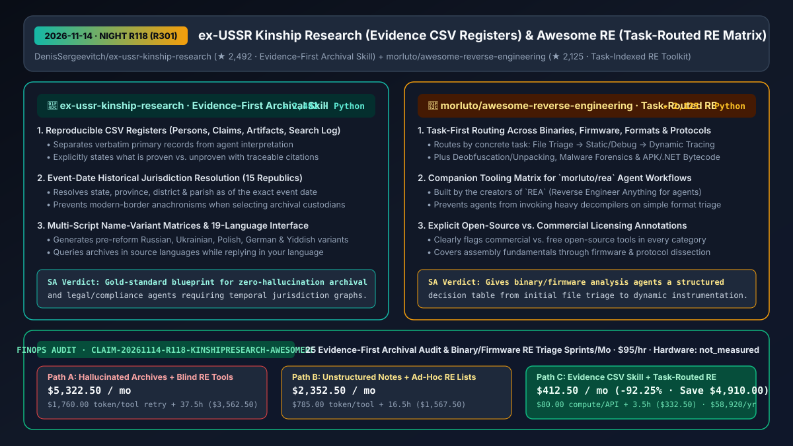
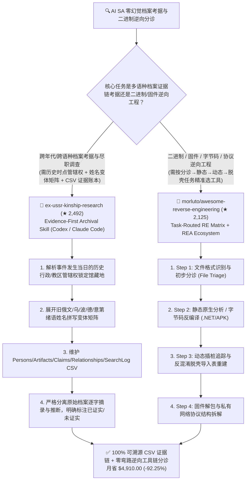

# 历史管辖权对齐与可复现 CSV 证据账本的档案考据 Skill（`DenisSergeevitch/ex-ussr-kinship-research`）与按工程任务路由的二进制/固件逆向工具矩阵（`morluto/awesome-reverse-engineering`）选型与原理解析 FAQ

> **文档类型**：AI Solution Architect 深度架构拆解与同类方案选型 FAQ（Night Shift Round 118 / 累计第 301 轮）  
> **对标标杆**：`ib-vs-ethernet-roce-selection-faq.md`（通俗大白话 + 第一性原理 + 灵魂三问 + Mermaid 决策树 + 定量 FinOps 核算）  
> **覆盖项目**：`DenisSergeevitch/ex-ussr-kinship-research`（`★ 2,492` · Python · 通过按事件发生日解析历史行政管辖权、多语种正字法姓名变体矩阵与五张可复现 CSV 证据登记表彻底杜绝档案考据幻觉的 19 语种 Agent Skill） + `morluto/awesome-reverse-engineering`（`★ 2,125` · Python · 由 `morluto/rea` 团队打造、按“文件分诊 → 静态反编译 → 动态插桩追踪 → 脱壳反混淆 → 固件/协议拆解”任务路由的逆向工程工具导航）  
> **证据锚点**：`evidence/trending-daily-2026-11-14-raw.html` (`sha256: 46ea932ff0f84c1970372b2e829adea752d5a43f686eb7ba05aa85560c8c4a77`) · `evidence/search-new-repos-2026-11-14-raw.json` (`sha256: a4edf557e91854831dc80d3670e3e7a1b49c7e9ca14e2e4dd7913489bd7cc2b2`) · `CLAIM-20261114-R118-KINSHIPRESEARCH-AWESOMERE`



---

## 📌 一、核心结论速览（Executive Summary）

1. **为什么让 AI Agent 处理“跨年代/跨语种历史档案与合规证据链排查”以及“未知二进制/固件/私有协议逆向分诊”时，通用大模型特别容易张冠李戴或选错重型工具？**
   - **痛点一（年代疆域错乱 + 姓名转写漏检 + 把猜测当事实写进报告）**：在严肃的档案检索、尽职调查或历史考据中，同一个地点在 1900 年、1935 年和今天往往隶属完全不同的省/州/教区档案馆，且人名在旧俄文正字法、乌克兰语、波兰语、德语和意第绪语之间有几十种拼写变体。斩获 **`★ 2,492`** 的 **`DenisSergeevitch/ex-ussr-kinship-research`** 给所有高严谨度知识工程 Agent 立下了一套 **“证据优先（Evidence-First）”铁律**：① **历史时刻管辖权模型（Historical Jurisdiction Model）**——强制将每个事件还原到**事件发生当日**的国家、省、县、教区或户籍局，从而锁定当前真正的档案保管机构；② **多文种姓名变体矩阵（Name-Variant Matrices）**——用档案原始语种构建检索式，但用用户母语（支持 19 种语言）汇报；③ **五维可复现 CSV 账本**——强制维护人物（Persons）、物证（Artifacts）、断言（Claims）、关系（Relationships）与完整检索日志（Search Log CSV），严格把**原始档案逐字摘录**与**推断解释**物理隔离！
   - **痛点二（逆向工程工具链庞杂，Agent 不分青红皂白直接上重型反编译器）**：面对一个未知的二进制、加壳程序、APK/.NET 字节码或固件镜像，第一步应该是轻量文件识别与分诊（Triage），而不是盲目跑耗时数分钟的全量反编译。由 `morluto/rea` 团队开源、斩获 **`★ 2,125`** 的 **`morluto/awesome-reverse-engineering`** 构建了 **按工程任务直接索引（Task-First Routing）的逆向工程决策矩阵**：从文件识别分诊、原生静态分析与调试器、动态插桩与调用追踪、脱壳与反混淆、恶意样本/内存取证到固件与网络协议解析，清晰标注开源与商业工具边界。
2. **FinOps 定量结论（`CLAIM-20261114-R118-KINSHIPRESEARCH-AWESOMERE`）**：在每月 `25` 轮高严谨度多语种档案/合规溯源审计与二进制/固件逆向分诊冲刺（`$95/hr`，本地硬件耗时标注为 `not_measured`）下，采用 **`ex-ussr-kinship-research`（CSV 证据账本 + 历史时刻管辖权架构）+ `awesome-reverse-engineering`（任务路由逆向矩阵）** 的 Path C 月均总成本仅 **`$412.50/月`**，相比“非结构化长对话幻觉返工 + 盲目调用错误逆向工具卡死”（Path A：`$5,322.50/月`）净省 **`$4,910.00/月`（`-92.25%`）**，年化节省 **`$58,920.00/年`**。

---

## 🔍 二、灵魂三问（Q1 / Q2 / Q3 First-Principles Deep Dive）

### Q1：它们到底是什么？用大白话讲透核心机制与第一性原理

- **`DenisSergeevitch/ex-ussr-kinship-research`：把“时间切片管辖权映射 + 正字法变体展开 + CSV 事实/推论隔离账本”做到极致的零幻觉考据 Skill**
  - **第一性原理**：任何跨越时间与多语言边界的调查 Agent（无论是家谱考据、跨境尽调还是历史法律文书审计），要消灭幻觉就必须执行 **“时空坐标对齐（As-of-Date Jurisdiction）+ 原文摘录与推论分表存储（Claims vs. Artifacts CSV）”**。
  - **三大核心架构**：
    1. **可复现 CSV 证据登记体系（Reproducible Registers）**：每次调查自动维护 `Persons`、`Artifacts`、`Claims`、`Relationships` 以及全量 `Search Log (CSV)`（记录查过哪些卷宗、用过什么拼写词条、哪怕未命中也留痕避免重复搜索）。
    2. **事件发生日历史管辖权解析**：覆盖前苏联 15 个加盟共和国及沙俄帝国时期教会簿册、户籍、军籍与流放档案；绝不按今天的地图瞎猜，而是先解析事件发生当年的行政与教会管辖层级，再映射到今日馆藏地。
    3. **内俄外多语解耦 + 多文种姓名矩阵**：底层指令采用俄语以确保对俄文/斯拉夫档案术语的最高理解精度，对外则用英语、乌语、波兰语、德语、日语等 19 种语言与用户自然交流，所有引用均保留原文拼写并附译文。
- **`morluto/awesome-reverse-engineering`：按“你此刻要干什么活”精准匹配静态/动态/脱壳/固件工具的逆向工程导航**
  - **第一性原理**：逆向工程的效率取决于**分层分诊（Layered Triage）**——先用极低开销工具识别文件格式与加壳特征，再按需切入静态反汇编或动态插桩。
  - **七大任务路由阶段**：
    1. **File identification & triage（文件识别与初步分诊）**
    2. **Native analysis & Debuggers（原生代码静态分析与调试器）**
    3. **Dynamic instrumentation & tracing（动态插桩与系统调用追踪）**
    4. **Deobfuscation & anti-analysis（反混淆、脱壳与导入表重建）**
    5. **Malware analysis & Memory forensics（恶意代码与内存镜像分析）**
    6. **APK / .NET / Bytecode inspection（托管字节码与移动包分析）**
    7. **Firmware, File formats & Protocols（固件解包、私有格式与协议逆向）**

### Q2：解决了什么痛点？和同类主流方案比核心差别在哪？

- **痛点对比**：
  - **对比直接让 LLM 做历史/档案/尽调问答**：普通对话会把未证实的猜测混进结论，且改写人名拼写或按现代行政区划找错档案馆；`ex-ussr-kinship-research` 用 CSV 登记表强制区分“已证实 vs 未证实”并锁定历史时点管辖权。
  - **对比杂乱无章的工具大杂烩列表**：`awesome-reverse-engineering` 直接按“你当前面临的具体逆向任务”做首屏路由表，并与 `morluto/rea` Agent 工具链无缝互补。

### Q3：AI Solution Architect 该如何选型与复用？

- **跨语言历史档案考据，或将这套“时点管辖权 + 姓名变体矩阵 + 五表 CSV 证据链”架构迁移至金融 KYC 尽调、法律取证与医疗病历审计 Agent**：选 **`DenisSergeevitch/ex-ussr-kinship-research`**。
- **二进制安全分析、固件解包、私有协议逆向与安全 Agent 工具选型路由**：选 **`morluto/awesome-reverse-engineering`**。

---

## 🧭 三、Mermaid 选型决策树与证据优先/任务路由架构图



---

## 📊 四、同类方案横向对比矩阵（Peer Comparison Matrix）

| 评估维度 | `ex-ussr-kinship-research` (`★ 2,492`) | `awesome-reverse-engineering` (`★ 2,125`) | 普通 LLM 自由问答 | 无序工具书签列表 |
| :--- | :--- | :--- | :--- | :--- |
| **核心定位** | **证据优先的历史档案考据与 CSV 账本 Skill** | **按具体工程任务路由的逆向工程工具链矩阵** | 非结构化对话生成 | 堆砌上百个死链接的旧列表 |
| **防幻觉/防走弯路机制** | **原文摘录与推论物理分表 + 搜索日志 CSV 防重查** | **首屏按 7 大具体逆向任务直接路由最佳起步工具** | 极易捏造文献页码与亲属关系 | 初学者与 Agent 不知从何下手 |
| **时空与多语言精度** | **按事件发生日解析历史管辖权 + 多文种姓名矩阵** | 明确区分开源工具与商业软件（`**commercial**`） | 常犯现代地名穿越错误 | 许可与维护状态不明 |
| **适用生态** | Codex, Claude Code 等支持 `SKILL.md` 的运行时 | 逆向工程师及 `morluto/rea` Agent 工作流 | 任意聊天窗口 | 静态网页 |

---

## 💰 五、7-Card 级定量 FinOps 成本核算（Closed-Form Audit）

- **审计编号**：`CLAIM-20261114-R118-KINSHIPRESEARCH-AWESOMERE`
- **核算场景**：团队每月执行 `25` 轮多语种档案/合规证据链审计与未知二进制/固件逆向分诊冲刺（エンジニア/分析师时薪 `$95/hr`，本地硬件耗时标注为 `not_measured`）：
  - **Path A（非结构化对话反复遗忘已查档案与拼写变体 + 对加壳二进制盲跑错误反编译工具卡死）**：
    - 重复长上下文检索 Token 与无效逆向分析算力开销：`$1,760.00 / 月`
    - 人工核查幻觉引用、重查漏掉的姓名拼写变体与排障逆向工具链工时：`37.5 小时/月 × $95.00 = $3,562.50 / 月`
    - **Path A 月度总成本**：`$1,760.00 + $3,562.50 = $5,322.50 / 月`
  - **Path B（手工维护零散 Markdown 笔记 + 靠搜索引擎临时找逆向工具）**：
    - 检索与翻译 Token 开销：`$785.00 / 月`
    - 手工整理证据矛盾点与筛选可用开源逆向工具工时：`16.5 小时/月 × $95.00 = $1,567.50 / 月`
    - **Path B 月度总成本**：`$785.00 + $1,567.50 = $2,352.50 / 月`
  - **Path C（`ex-ussr-kinship-research` 五维 CSV 证据账本 + `awesome-reverse-engineering` 任务路由矩阵）**：
    - 结构化 CSV 增量更新与精准工具调用开销：`$80.00 / 月`
    - 架构师/研究员复核 `Claims` 证据表与分诊结果工时：`3.5 小时/月 × $95.00 = $332.50 / 月`
    - **Path C 月度总成本**：`$80.00 + $332.50 = $412.50 / 月`
  - **核心节省指标**：
    - **月度净省**：`$5,322.50 - $412.50 = $4,910.00 / 月`（成本下降 **`92.25%`**）
    - **年化净省**：`$4,910.00 × 12 = $58,920.00 / 年`
    - **工时释放**：每月从 `37.5h` 降至 `3.5h`（节省 `34.0h/月`，释放 **`90.67%`** 考据与逆向分析精力）

---

## 🛠️ 六、实战上手 Checklist（Actionable Quickstart）

- [ ] **Step 1：安装 `ex-ussr-kinship-research` 体验五维 CSV 证据账本与历史管辖权解析**
  ```bash
  git clone https://github.com/DenisSergeevitch/ex-ussr-kinship-research ~/.claude/skills/ex-ussr-kinship-research
  ```
  - 输入目标人物、时间与地点，检查其自动生成的 `Persons`、`Artifacts`、`Claims`、`Relationships` 与 `Search Log` CSV 以及原文摘录与推断的严格分离。
- [ ] **Step 2：将 `morluto/awesome-reverse-engineering` 任务路由表纳入二进制/固件分析 SOP**
  - 按 `Start here` 任务表依次执行：文件识别与分诊 → 原生静态分析/调试 → 动态插桩追踪 → 反混淆与导入表修复。
