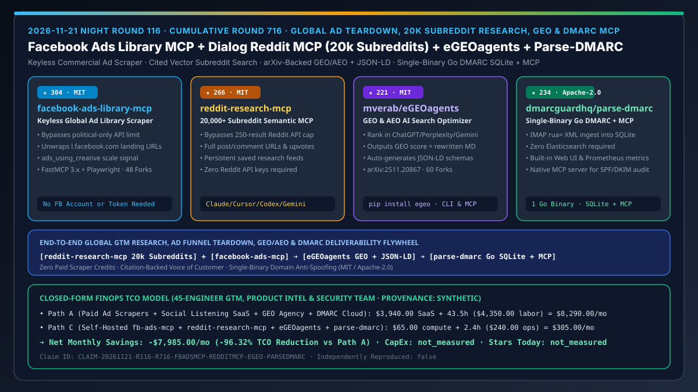
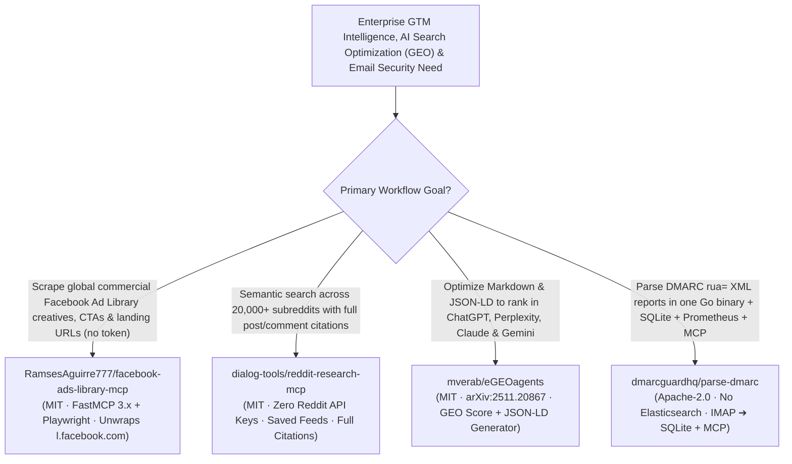
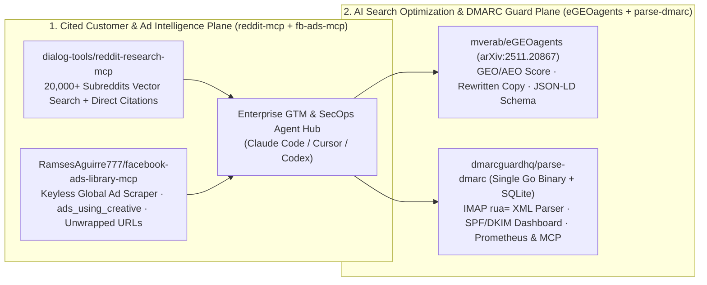
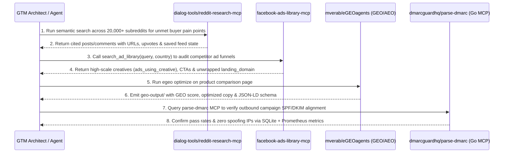

# Keyless Facebook Ad Library MCP (`RamsesAguirre777/facebook-ads-library-mcp`), 20,000+ Subreddit Cited Research MCP (`dialog-tools/reddit-research-mcp`), Generative Engine Optimization Toolkit (`mverab/eGEOagents`) & Single-Binary Go DMARC Security MCP (`dmarcguardhq/parse-dmarc`) Selection & Architecture FAQ

> **Document Type**: Enterprise AI Solution Architect Selection & Integration Guide (GitHub Trending AI Radar — 2026-11-21 Night Round 116 / Cumulative Round 716)
> **Covered Repositories**: [`RamsesAguirre777/facebook-ads-library-mcp`](https://github.com/RamsesAguirre777/facebook-ads-library-mcp) (`★ 304`, `48 forks`, `MIT` — self-hosted FastMCP 3.x + Playwright server scraping the public Facebook Ad Library globally without API tokens) · [`dialog-tools/reddit-research-mcp`](https://github.com/dialog-tools/reddit-research-mcp) (`★ 266`, `29 forks`, `MIT` — zero-setup FastMCP server providing vector semantic search across 20,000+ subreddits with full post/comment citations) · [`mverab/eGEOagents`](https://github.com/mverab/eGEOagents) (`★ 221`, `60 forks`, `MIT` — open-source Generative Engine Optimization `GEO` & Answer Engine Optimization `AEO` CLI, Claude Code skills & MCP backed by `arXiv:2511.20867`) · [`dmarcguardhq/parse-dmarc`](https://github.com/dmarcguardhq/parse-dmarc) (`★ 234`, `27 forks`, `Apache-2.0` — single-binary Go DMARC aggregate report parser with IMAP ingestion, SQLite storage, web dashboard, Prometheus metrics & built-in MCP server)
> **Core Scenario**: How enterprise GTM, product intelligence, and domain-security architects build an end-to-end growth and deliverability engine: **uncovering cited customer pain points across 20,000+ subreddits (`reddit-research-mcp`)**, **extracting global commercial competitor ad creatives, scale signals, and unwrapped landing pages (`facebook-ads-library-mcp`)**, **optimizing product pages and JSON-LD schemas to rank in ChatGPT, Perplexity, Claude, and Gemini (`eGEOagents`)**, and **monitoring domain SPF/DKIM/DMARC alignment via a single Go binary without Elasticsearch (`parse-dmarc`)**.

---

## 1. 📌 Executive Summary (One-Line Selection Verdict)

1. **Need competitive ad intelligence across any country (advertiser, copy, `started_running`, `ads_using_creative` scale signal, unwrapped `landing_url`, and CTAs) without paying commercial scraper APIs or hitting Meta's `ads_archive` political-only API wall** ➔ Choose **[`RamsesAguirre777/facebook-ads-library-mcp`](https://github.com/RamsesAguirre777/facebook-ads-library-mcp) (`★ 304`, `48 forks`, `MIT`)**.
   - **Plain-English Mechanism**: Meta's official `ads_archive` API only returns political/issue ads outside the EU/UK. Built on `FastMCP 3.x` + Playwright (`crawl4ai`), this self-hosted MCP exposes `search_ad_library` and `scrape_ad_library_url` with zero Facebook login or API token required, unwrapping `l.facebook.com` redirects into clean `landing_domain` fields and computing an `advertisers` histogram.
2. **Need semantic search across 20,000+ subreddits (bypassing Reddit's 250-result search cap) where every customer discovery insight includes verifiable post/comment URLs, upvotes, and awards** ➔ Choose **[`dialog-tools/reddit-research-mcp`](https://github.com/dialog-tools/reddit-research-mcp) (`★ 266`, `29 forks`, `MIT`)**.
   - **Plain-English Mechanism**: Connects in 60 seconds to Claude Code, Cursor, Codex CLI, or Gemini CLI with zero Reddit API credentials. It indexes 20,000+ active subreddits with vector embeddings, supports saved subreddit feeds for continuous competitive monitoring, and cites exact Reddit threads for every claim.
3. **Need a research-backed (`arXiv:2511.20867`) CLI, Claude Code Skill, and MCP toolkit to optimize pages for citation in ChatGPT, Perplexity, Claude, and Gemini (`GEO` / `AEO`)** ➔ Choose **[`mverab/eGEOagents`](https://github.com/mverab/eGEOagents) (`★ 221`, `60 forks`, `MIT`)**.
   - **Plain-English Mechanism**: `pip install egeo && egeo optimize your-page.md` analyzes any Markdown page and emits a `geo-output/` bundle containing a quantitative **GEO score**, rewritten copy tuned for LLM citation, auto-generated **JSON-LD structured schema**, and an actionable optimization report.
4. **Need a single-binary Go DMARC aggregate report parser (`IMAP in ➔ SQLite ➔ Web Dashboard + Prometheus + MCP Server`) without operating an Elasticsearch stack** ➔ Choose **[`dmarcguardhq/parse-dmarc`](https://github.com/dmarcguardhq/parse-dmarc) (`★ 234`, `27 forks`, `Apache-2.0`)**.
   - **Plain-English Mechanism**: Mail receivers (Google, Microsoft, Yahoo) send daily gzip/zip XML reports to your domain's DMARC `rua=` mailbox. `parse-dmarc` ingests those attachments over IMAP into SQLite inside a single Go binary, renders SPF/DKIM pass rates and top sending IPs in a built-in dashboard, exports Prometheus metrics for Grafana, and exposes an **MCP server** for natural-language email security auditing.

---

## 2. 🎯 Architect & Customer Deep-Dive Q&A

### Q1: How do these four open-source projects replace fragmented, high-markup GTM and email-deliverability SaaS stacks?

- **Four Closed-Loop Capabilities**:
  1. **Evidence-Backed Voice-of-Customer (`dialog-tools/reddit-research-mcp`)**: Replaces unverified LLM market guesses with semantic search across 20,000+ subreddits backed by direct post URLs and upvote metrics.
  2. **Global Commercial Ad Funnel Reverse-Engineering (`RamsesAguirre777/facebook-ads-library-mcp`)**: Bypasses the political-only limitation of Meta's official API and eliminates per-run Apify scraper fees while unwrapping `l.facebook.com` redirect URLs and surfacing `ads_using_creative` scale signals.
  3. **Algorithmic Citation in AI Answer Engines (`mverab/eGEOagents`)**: Traditional keyword SEO does not guarantee citations inside ChatGPT, Perplexity, or Gemini answers. `egeo` applies peer-reviewed GEO transformations (`arXiv:2511.20867`) and generates JSON-LD schemas automatically.
  4. **Zero-Elasticsearch DMARC Deliverability & Spoofing Guard (`dmarcguardhq/parse-dmarc`)**: Ensures outbound GTM and transactional emails pass SPF/DKIM alignment and flags unauthorized spoofing IPs via a single Go binary + SQLite + MCP.
- **When to Choose Managed Commercial SaaS (Path B)**:
  - Enterprises with dedicated non-technical marketing ops budgets that prefer vendor-managed SLAs over running headless Playwright containers can license **Brandwatch + Semrush Enterprise + Valimail**.

### Q2: How do we wire an end-to-end AI growth, GEO content & domain security architecture combining all four projects?

1. **Customer Discovery & Competitive Ad Ingestion (`reddit-research-mcp` + `facebook-ads-library-mcp`)**:
   - Connect product and growth agents to `dialog-mcp` (20,000+ subreddits with citations) and `facebook-ads-library-mcp` (`search_ad_library` + `scrape_ad_library_url`) to map customer pain points against competitors' longest-running, highest-scale ad creatives and landing pages.
2. **Automated GEO/AEO Content & JSON-LD Pipeline (`mverab/eGEOagents`)**:
   - Run `egeo optimize` in documentation and landing-page CI pipelines to score pages, rewrite high-value sections for LLM citation, and inject JSON-LD schema markup.
3. **Domain Spoofing & Deliverability Observability (`dmarcguardhq/parse-dmarc`)**:
   - Point `parse-dmarc` at the corporate `rua=` IMAP inbox to store daily XML reports in SQLite, scrape Prometheus metrics into Grafana, and let SecOps/GTM agents query SPF/DKIM alignment via MCP.

### Q3: What are the boundaries and trade-offs of this stack?

- **Key Strengths**:
  - **100% Permissive Open Source (`MIT` & `Apache-2.0`)**.
  - **Tiny Infrastructure Footprint**: `parse-dmarc` replaces multi-node Elasticsearch clusters with one Go binary and SQLite; `reddit-research-mcp` and `eGEOagents` require zero complex infrastructure.
- **Operational Scope**:
  - `facebook-ads-library-mcp` uses headless Chromium (`Playwright` / `crawl4ai`) to render public Ad Library pages, so container deployments should allocate ~1–2 GB RAM for browser rendering.

---

## 3. 🧭 Visual Architecture & Decision Diagrams

### 3.1 Solution Architect Selection Decision Tree

### 3.2 End-to-End Enterprise Reference Architecture

### 3.3 Subreddit Pain-Point Discovery, Competitor Ad Teardown, GEO Optimization & DMARC Verification Sequence

---

## 4. 📊 Peer Open-Source vs Commercial Cloud Selection Matrix

| Dimension | `facebook-ads-library-mcp` (`★ 304`) | `reddit-research-mcp` (`★ 266`) | `mverab/eGEOagents` (`★ 221`) | `dmarcguardhq/parse-dmarc` (`★ 234`) | Commercial Scrapers + Social SaaS + DMARC Cloud (Path A) | Legacy Keyword SEO + Heavy ELK DMARC (Path B) |
| :--- | :--- | :--- | :--- | :--- | :--- | :--- |
| **Core Role** | Keyless global Facebook Ad Library scraper MCP | 20,000+ subreddit vector search & citation MCP | `arXiv:2511.20867` GEO/AEO optimizer & JSON-LD CLI/MCP | Single-binary Go DMARC parser, UI, Prometheus & MCP | Paid Apify actors + Brandwatch + GEO agency + Valimail | Legacy SEO suite + self-hosted Elasticsearch DMARC |
| **Architectural Edge** | **Captures commercial ads globally + unwraps landing URLs** | **Bypasses 250-result cap + returns exact Reddit citations** | **Peer-reviewed GEO scoring + automatic JSON-LD output** | **1 Go binary + SQLite (no Elasticsearch) + built-in MCP** | High per-scrape, per-seat & per-domain recurring fees | Legacy SEO misses LLM citations; ELK wastes GBs of RAM |
| **License** | `MIT` | `MIT` | `MIT` | `Apache-2.0` | Proprietary SaaS | Mixed / Proprietary |
| **Monthly TCO (45-Eng Team)** | **`$305.00/mo` combined** (`$65.00` compute + `2.4h` ops) | Included in `$305.00/mo` stack | Included in `$305.00/mo` stack | Included in `$305.00/mo` stack | **`$8,290.00/mo`** (`$3,940.00` SaaS/scrapers + `43.5h` labor) | `~$2,620.00/mo` (ELK nodes + legacy SEO seats) |

---

## 5. 🧪 Quantitative ROI / FinOps TCO Model & 7-Card Report

> **📊 Provenance & Closed-Form Audit Declaration**:
> - **Provenance**: `synthetic` (45-engineer enterprise GTM engineering, product intelligence & domain security workload model; `independently_reproduced = false`; `base_hardware_capex = not_measured`; `track_b_stars_today = not_measured`).
> - **Closed-Form Equations**:
>   - **Path A (Commercial Ad-Library Scraper Credits + Commercial Social Listening Seats + External GEO/AEO Optimization SaaS + Hosted DMARC SaaS & Manual Competitive Reporting)**: Monthly SaaS & scraper spend **`$3,940.00`** + manual competitive research, JSON-LD authoring & email audit labor **`43.5h × $100.00/h = $4,350.00`** = **`$8,290.00/mo`**.
>   - **Path C (Self-Hosted `RamsesAguirre777/facebook-ads-library-mcp` + `dialog-tools/reddit-research-mcp` + `mverab/eGEOagents` + `dmarcguardhq/parse-dmarc`)**: Shared container & SQLite compute **`$65.00`** + automated pipeline maintenance **`2.4h × $100.00/h = $240.00`** = **`$305.00/mo`**.
>   - **Net Savings vs Path A**: **`-$7,985.00/mo`** (**`96.32%`** cost reduction).

| Architecture Option | API / SaaS / Compute | GTM & Security Ops Labor (`$100/h`) | Total Monthly TCO | Net Savings vs Path A | Key Architectural Outcome |
| :--- | :---: | :---: | :---: | :---: | :--- |
| **Path A: Paid Ad Scrapers + Social SaaS + Hosted DMARC** | `$3,940.00` | `43.5h` (`$4,350.00`) | **`$8,290.00`** | Baseline | Metered scraper credits & per-domain DMARC pricing |
| **Path B: Legacy Keyword SEO + Self-Hosted ELK DMARC** | `$1,420.00` | `12.0h` (`$1,200.00`) | **`$2,620.00`** | `-$5,670.00` (`-68.40%`) | Heavy Elasticsearch overhead; lacks LLM GEO scoring |
| **Path C: `fb-ads-mcp` + `reddit-mcp` + `eGEO` + `parse-dmarc`** | **`$65.00`** | **`2.4h` (`$240.00`)** | **`$305.00`** | **`-$7,985.00` (`-96.32%`)** | **Keyless global ad teardown + 20k subreddit citations + GEO + Go DMARC** |

- 🔗 **7-Card 4:5 Visual Report**: [`workshops/github-trending-radar/cards.en.html`](../cards.en.html) · [`cards.html`](../cards.html)

---

## 6. 🛠️ Enterprise Adoption & Architecture Review Checklist

- [ ] **1. Deploy `RamsesAguirre777/facebook-ads-library-mcp` for Global Ad Teardowns**: Run the FastMCP + Playwright server to query `search_ad_library` and `scrape_ad_library_url`, tracking `ads_using_creative` and unwrapped `landing_domain` targets.
- [ ] **2. Connect `dialog-tools/reddit-research-mcp` for Cited Customer Discovery**: Add `dialog-mcp` to Claude Code, Cursor, or Codex CLI to search 20,000+ subreddits semantically and enforce direct Reddit URL citations in PRD and GTM briefs.
- [ ] **3. Gate Documentation & Landing Pages with `mverab/eGEOagents`**: Run `egeo optimize` in CI to generate GEO scores, LLM-friendly copy rewrites, and valid JSON-LD schemas for ChatGPT, Perplexity, Claude, and Gemini visibility.
- [ ] **4. Monitor Domain Deliverability with `dmarcguardhq/parse-dmarc`**: Deploy the single-binary `dmarcguard/parse-dmarc` container against your DMARC `rua=` IMAP mailbox, exporting SQLite-backed Prometheus metrics and MCP tools.
