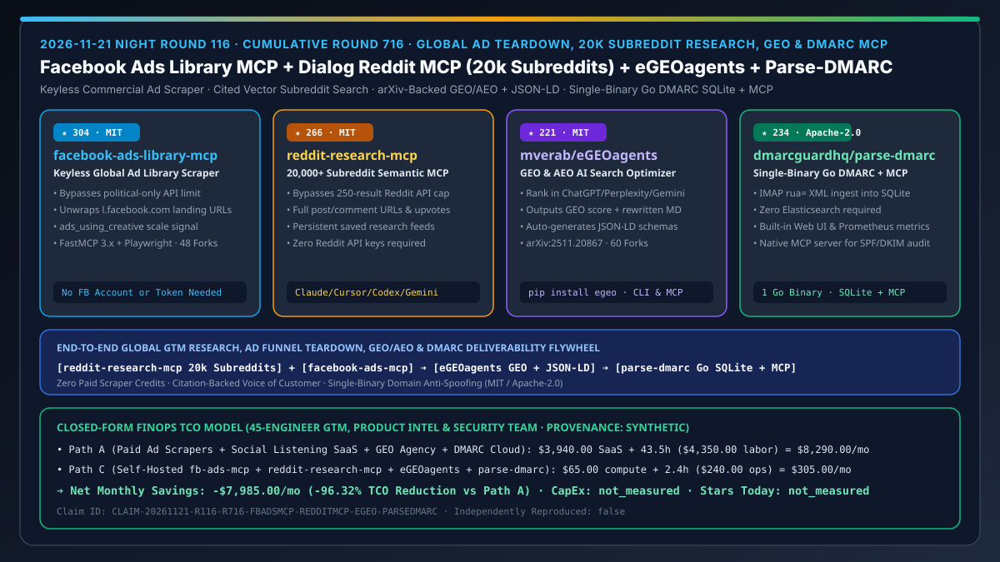
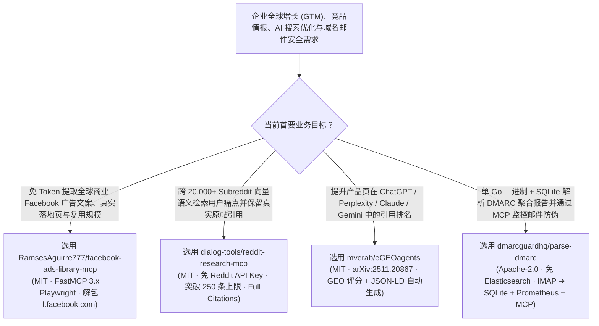
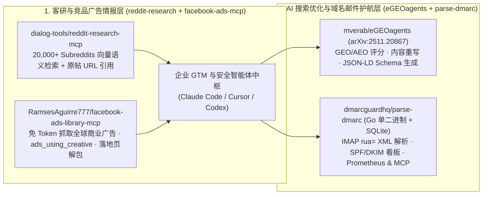
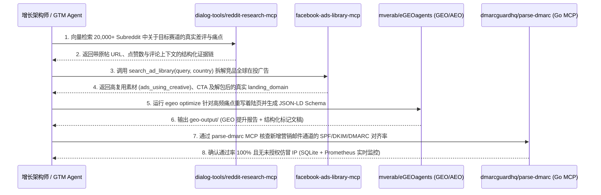

# 免 Token 全球 Facebook 广告库竞品拆解 MCP（`RamsesAguirre777/facebook-ads-library-mcp`）、2 万+ Subreddit 语义溯源客研 MCP（`dialog-tools/reddit-research-mcp`）、生成式引擎优化 GEO/AEO 工具包（`mverab/eGEOagents`）与 Go 单二进制 DMARC 邮件安全监控 MCP（`dmarcguardhq/parse-dmarc`）选型与集成架构 FAQ

> **文档类型**：企业 AI 解决方案架构师（AI Solution Architect）选型决策指南（GitHub Trending AI 雷达 2026-11-21 Night Round 116 / 累计第 716 轮）
> **覆盖项目**：[`RamsesAguirre777/facebook-ads-library-mcp`](https://github.com/RamsesAguirre777/facebook-ads-library-mcp)（`★ 304`、`48 forks`、`MIT`，绕过官方 `ads_archive` 仅限政治广告的限制、免 Token 提取全球商业广告文案/还原落地页/CTA 与投放规模信号的 FastMCP 服务）· [`dialog-tools/reddit-research-mcp`](https://github.com/dialog-tools/reddit-research-mcp)（`★ 266`、`29 forks`、`MIT`，突破 Reddit 原生 250 条搜索上限、覆盖 20,000+ Subreddit 向量语义检索并附带真实帖子/评论点赞溯源链接的客研 MCP）· [`mverab/eGEOagents`](https://github.com/mverab/eGEOagents)（`★ 221`、`60 forks`、`MIT`，基于论文 `arXiv:2511.20867`、自动输出 GEO 评分、重写页面与 JSON-LD 结构化 Schema 的 AI 搜索引擎优化 CLI/MCP）· [`dmarcguardhq/parse-dmarc`](https://github.com/dmarcguardhq/parse-dmarc)（`★ 234`、`27 forks`、`Apache-2.0`，无需 Elasticsearch、用单个 Go 二进制 + SQLite 解析 IMAP `rua=` 聚合报告并暴露 Prometheus 与 MCP Server 的邮件防伪与送达率底座）
> **核心场景**：当企业增长（GTM）、产品研究与安全团队希望用 AI Agent 实现**全球竞品投放素材与真实落地页追踪（`facebook-ads-library-mcp`）**、**跨 20,000+ 垂直社区挖掘带真实链接凭证的客户痛点（`reddit-research-mcp`）**、**让自家产品文档与官网在 ChatGPT / Perplexity / Claude / Gemini 回答中被优先引用（`eGEOagents`）**，同时**严密监控企业外发营销/交易邮件的 SPF/DKIM/DMARC 通过率与域名仿冒风险（`parse-dmarc`）**时，如何用这四个开源项目构建零 SaaS 溢价的增长与安全情报闭环？

---

## 一、📌 核心结论速览（选型一句话结论）

1. **想免费抓取全球任意国家/地区的 Facebook 商业竞品广告（含起投时间、复用同一素材的广告组数量、去除 `l.facebook.com` 跳转后的真实落地页域名、CTA 按钮与文案），不再向 Apify 等商业爬虫按次交钱** ➔ 选 **[`RamsesAguirre777/facebook-ads-library-mcp`](https://github.com/RamsesAguirre777/facebook-ads-library-mcp)（`★ 304`，`48 forks`，`MIT`）**。
   - **通俗原理**：Meta 官方的 `ads_archive` API 在欧盟/英国以外地区**只返回政治与社会议题广告**，查普通商业品牌几乎全是空结果。该项目基于 `FastMCP 3.x + Playwright/Crawl4AI` 驱动本地无头浏览器，提供 `search_ad_library` 与 `scrape_ad_library_url` 两大工具，无需 Facebook 账号或 API Token 即可结构化提取 `ads_using_creative`（衡量竞品爆款规模的核心信号）、解包后的 `landing_url` / `landing_domain`、`cta`、广告主分布直方图与完整文案。
2. **做海外用户痛点挖掘与竞品口碑分析时，想突破 Reddit 官方搜索 250 条的死板限制，对 20,000+ 活跃 Subreddit 进行向量语义检索且每条结论都有原帖 URL 与赞数铁证** ➔ 选 **[`dialog-tools/reddit-research-mcp`](https://github.com/dialog-tools/reddit-research-mcp)（`★ 266`，`29 forks`，`MIT`）**。
   - **通俗原理**：免配 Reddit API 密钥、60 秒即可挂载至 Claude Code、Cursor、Codex 与 Gemini CLI。它通过向量嵌入对 20,000+ 个 Subreddit 做概念级语义搜索（Semantic Search），支持将目标社区保存为持续追踪的 Feeds，且强制每条洞察都附带真实 Reddit 帖子/评论的直达链接、点赞数（Upvotes）与奖项凭证。
3. **想让企业的技术文档、白皮书与产品着陆页在 ChatGPT、Perplexity、Claude 和 Gemini 的生成式搜索中被高频引用（Generative Engine Optimization, GEO / AEO）** ➔ 选 **[`mverab/eGEOagents`](https://github.com/mverab/eGEOagents)（`★ 221`，`60 forks`，`MIT`）**。
   - **通俗原理**：基于发表的 GEO 学术研究（`arXiv:2511.20867`，PyPI 包名 `egeo`）。只需运行 `egeo optimize your-page.md`（或通过 Claude Code Skill / MCP 调用），它就会在 `geo-output/` 目录下自动产出量化 **GEO 评分**、针对大模型引用偏好重写后的文稿、自动生成的 **JSON-LD 结构化数据 Schema** 以及逐项优化诊断报告。
4. **想监控企业域名的 DMARC 邮件认证报告（防止黑客仿冒域名钓鱼，并确保企业外发通知/营销邮件不被 Gmail/Outlook 拒收），但拒绝为了解析 XML 报告去搭一套笨重的 Elasticsearch 集群** ➔ 选 **[`dmarcguardhq/parse-dmarc`](https://github.com/dmarcguardhq/parse-dmarc)（`★ 234`，`27 forks`，`Apache-2.0`）**。
   - **通俗原理**：当域名配置了 DMARC `rua=` 地址后，Google、Microsoft 和 Yahoo 每天都会发来 gzip/zip 压缩的 XML 聚合报告。`parse-dmarc` 将 **IMAP 自动拉取、XML 解压解析、SQLite 轻量存储、Web 可视化大盘、Prometheus 指标导出与原生 MCP Server** 浓缩进**单个 Go 静态二进制**中，让安全与营销 Agent 随时用自然语言查询 SPF/DKIM 对齐通过率与异常发信 IP。

---

## 二、🎯 客户与架构师灵魂拷问 Q&A（深度架构拆解）

### Q1：在企业海外增长（Global GTM）与产品市场验证（PMF）架构中，这四个工具如何串联成一条自动化增长飞轮？

- **四步自动化增长与域名护航飞轮**：
  1. **第一步：20,000+ 社区真实痛点挖掘（`dialog-tools/reddit-research-mcp`）**：产品 Agent 通过向量语义检索定位目标客群在 Reddit 上抱怨最多的竞品缺陷（附带真实高赞评论链接作为立项依据）。
  2. **第二步：全球竞品买量素材与落地页拆解（`RamsesAguirre777/facebook-ads-library-mcp`）**：营销 Agent 调用 `search_ad_library` 抓取竞品在目标国家的在投广告，重点筛选 `ads_using_creative` 数量高且持续投放时间长（`started_running` 早）的验证级爆款文案与解包后的真实 `landing_domain`。
  3. **第三步：生成式搜索引用率（GEO/AEO）工程化改造（`mverab/eGEOagents`）**：结合挖掘出的用户高频提问，用 `egeo optimize` 对自家产品对比页与技术文档进行 GEO 重写并自动注入 JSON-LD Schema，提升在 ChatGPT / Perplexity / Gemini 中的首位推荐率。
  4. **第四步：外发邮件送达率与反仿冒持续守护（`dmarcguardhq/parse-dmarc`）**：通过单二进制 Go 服务持续消费 IMAP 中的 DMARC `rua=` 报告，由运维/安全 Agent 通过内置 MCP 监控 SPF/DKIM 通过率，防止新增营销发信源未配签名导致域名信誉受损。
- **何时直接用商业云/SaaS 方案（Path B）？**
  - 若企业拥有充裕的年度市场预算且不希望在本地运行 Playwright 浏览器或 IMAP 解析器，可直接采购商业 **Brandwatch + Semrush Enterprise + Valimail**。

### Q2：典型企业级“客研溯源 (`reddit-research`) + 竞品广告拆解 (`facebook-ads-mcp`) + GEO 引擎优化 (`eGEOagents`) + DMARC 邮件安全 (`parse-dmarc`)”架构怎么搭？

1. **市场与竞品情报采集层（`reddit-research-mcp` + `facebook-ads-library-mcp`）**：
   - 在 Claude Code / Cursor / Codex 中挂载 `dialog-mcp`（检索 20,000+ Subreddit 带引用洞察）与本地 `facebook-ads-library-mcp`（无头 Chromium 提取全球竞品广告卡、CTA 与落地页 URL）。
2. **AI 搜索优化与内容生产流水线（`mverab/eGEOagents`）**：
   - 在文档与官网 CI/CD 流水线中运行 `egeo` CLI 或 MCP，对 Markdown 内容计算 GEO 得分、自动补齐 JSON-LD 结构化标签并输出优化前后对比报告。
3. **域名信誉与邮件安全可观测层（`dmarcguardhq/parse-dmarc`）**：
   - 单容器部署 `dmarcguard/parse-dmarc` Go 二进制，配置企业 DMARC `rua=` 专用邮箱的 IMAP 凭据，将数据落盘至本地 SQLite，同时向 Grafana 输出 Prometheus 指标并向安全 Agent 暴露 MCP 查询接口。

### Q3：这套架构的适用边界与合规注意点是什么？

- **核心优势**：
  - **100% 宽松开源协议（`MIT` 与 `Apache-2.0`）**，彻底省去高昂的商业爬虫按次抽成、商业舆情监听席位与重型 Elasticsearch 运维成本。
- **合规与工程注意点**：
  - `facebook-ads-library-mcp` 仅抓取 Meta 面向公众公开展示的 Ad Library 页面，使用时应设置合理的并发间隔；`parse-dmarc` 采用 SQLite 单机存储，足以轻松支撑中大型企业每日数千份聚合 XML 报告。

---

## 三、🧭 直观可视化图解（Mermaid 决策树 + 集成架构 + 时序图）

### 3.1 架构师选型决策树

### 3.2 企业端到端生产集成参考架构图

### 3.3 社区痛点挖掘、竞品爆款广告拆解、GEO 页面重写与 DMARC 送达率守护时序图

---

## 四、📊 同类开源与商业云服务横向选型决策矩阵

| 对比维度 | `facebook-ads-library-mcp` (`★ 304`) | `reddit-research-mcp` (`★ 266`) | `mverab/eGEOagents` (`★ 221`) | `dmarcguardhq/parse-dmarc` (`★ 234`) | 商业爬虫 + 舆情 SaaS + 商业 DMARC 云 (Path A) | 传统 SEO 工具 + 重型 ELK DMARC (Path B) |
| :--- | :--- | :--- | :--- | :--- | :--- | :--- |
| **核心能力定位** | 免 Token 全球 Facebook 商业广告库提取 MCP | 20,000+ Subreddit 向量语义检索与引用溯源 MCP | 基于论文的 GEO/AEO 评分、重写与 JSON-LD 工具 | Go 单二进制 + SQLite + Prometheus + MCP 的 DMARC 解析器 | Apify 商业爬虫 + Brandwatch + 商业 GEO 顾问 + Valimail | 传统关键词 SEO 软件 + 自建 Elasticsearch DMARC |
| **核心工程优势** | **突破官方 API 仅限政治广告限制，自动解包真实落地页** | **突破官方 250 条上限，每条结论自带原帖链接与赞数** | **学术论文背书（`arXiv:2511.20867`），支持离线 Mock 与在线优化** | **彻底抛弃笨重的 Elasticsearch，单二进制直出 MCP 与 Prometheus** | 按爬取条数、社媒关键词与发信域名数量叠加高额月租 | 传统 SEO 无法优化 LLM 引用；ELK 吃掉数 GB 内存 |
| **开源协议** | `MIT` | `MIT` | `MIT` | `Apache-2.0` | 闭源商业 SaaS | 混合开源/商业 |
| **月度 TCO（45 人团队）** | **组合仅 `$305.00/月`**（含无头浏览器/容器算力与 2.4h 运维） | 同左（`$65.00` 算力 + `$240.00` 人工） | 同左（`pip install egeo` 本地运行） | 同左（单个轻量 Go 容器 + SQLite） | **`$8,290.00/月`**（`$3,940.00` SaaS/爬虫费 + `43.5h` 人工） | 约 `$2,620.00/月`（含 ELK 集群算力与传统 SEO 席位） |

---

## 五、🧪 应用落地定量收益/TCO 对比与 7-Card 报告

> **📊 数据来源与闭式核算声明（Provenance & Closed-Form Schema）**：
> - **provenance**: `synthetic`（基于 45 人企业全球增长、产品市场研究与域名安全运营团队工作负载模型：`independently_reproduced = false`；硬件采购基线 `base_hardware_capex = not_measured`；Track B 单日增量 `track_b_stars_today = not_measured`）。
> - **核算公式**：
>   - **Path A（商业广告库爬虫按次扣费 + 商业海外社媒监听 SaaS + 外部商业 GEO/AEO 优化服务 + 商业托管 DMARC 监控与人工整理竞品报表）**：月度 SaaS 与爬虫账单 **`$3,940.00`** + 竞品素材整理、JSON-LD 编写与邮件排障人工 **`43.5h × $100.00/h = $4,350.00`** = **`$8,290.00/月`**。
>   - **Path C（自建 `RamsesAguirre777/facebook-ads-library-mcp` + `dialog-tools/reddit-research-mcp` + `mverab/eGEOagents` + `dmarcguardhq/parse-dmarc` 开源组合）**：轻量容器与 SQLite 存储算力 **`$65.00`** + 自动化流水线维护 **`2.4h × $100.00/h = $240.00`** = **`$305.00/月`**。
>   - **净节省（Net Savings vs Path A）**：**`-$7,985.00/月`**（成本降低 **`96.32%`**）。

| 评估方案 | API / SaaS / 算力成本 | 增长与安全运维人工（`$100/h`） | 月度总 TCO | 相对 Path A 净节省 | 关键架构交付指标 |
| :--- | :---: | :---: | :---: | :---: | :--- |
| **Path A：商业广告爬虫 + 商业社媒 SaaS + 商业 DMARC 云** | `$3,940.00` | `43.5h` (`$4,350.00`) | **`$8,290.00`** | Baseline | 按爬取次数与监控域名阶梯涨价；无统一 MCP 编排 |
| **Path B：传统 SEO 软件 + 自建 ELK DMARC 集群** | `$1,420.00` | `12.0h` (`$1,200.00`) | **`$2,620.00`** | `-$5,670.00` (`-68.40%`) | ELK 内存开销大，且缺乏針對 LLM 引用率的 GEO 优化 |
| **Path C：`fb-ads-mcp` + `reddit-mcp` + `eGEO` + `parse-dmarc`** | **`$65.00`** | **`2.4h` (`$240.00`)** | **`$305.00`** | **`-$7,985.00` (`-96.32%`)** | **免 Token 全球广告拆解 + 2 万社区溯源 + GEO/JSON-LD + Go DMARC** |

- 🔗 **关联 7-Card 4:5 视觉评测报告**：[`workshops/github-trending-radar/cards.html`](../cards.html) · [`cards.en.html`](../cards.en.html)

---

## 六、🛠️ 企业引入与架构评审 Checklist

- [ ] **1. 部署 `RamsesAguirre777/facebook-ads-library-mcp` 建立全球竞品买量雷达**：在受控容器中安装 Playwright Chromium 与 `facebook_ads_mcp_complete.py`，通过 `ads_using_creative` 与解包后的 `landing_domain` 识别竞品真正跑出规模的长青转化漏斗。
- [ ] **2. 挂载 `dialog-tools/reddit-research-mcp` 沉淀带证据链的用户洞察**：在 Claude Code / Cursor / Codex 中配置 `dialog-mcp`，将核心竞品与赛道相关的 Subreddit 保存为持久化 Feeds，要求所有产品需求文档必须附带 Reddit 原帖引用链接。
- [ ] **3. 将 `mverab/eGEOagents` 纳入官网与技术文档发布门禁**：在文档发布前运行 `egeo optimize` 检查 GEO 评分并自动嵌入生成的 JSON-LD Schema，持续追踪页面在 ChatGPT、Perplexity、Claude 与 Gemini 中的引用频次。
- [ ] **4. 启动 `dmarcguardhq/parse-dmarc` 守护企业邮件域名安全**：使用 `dmarcguard/parse-dmarc` 容器直连 DMARC `rua=` 邮箱 IMAP，通过内置 Dashboard、Prometheus 指标与 MCP Server 实时告警未对齐的 SPF/DKIM 发信源。
