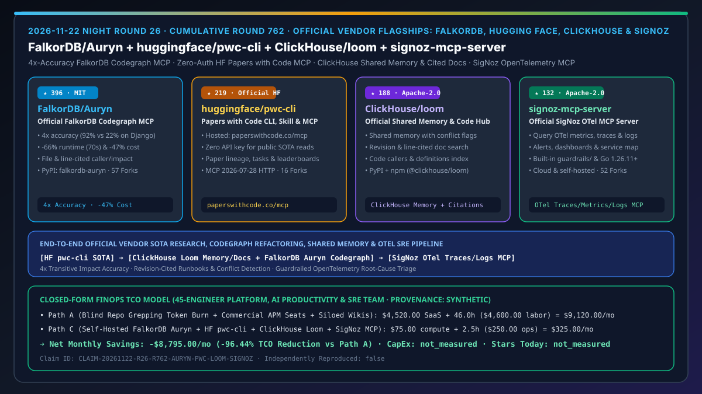
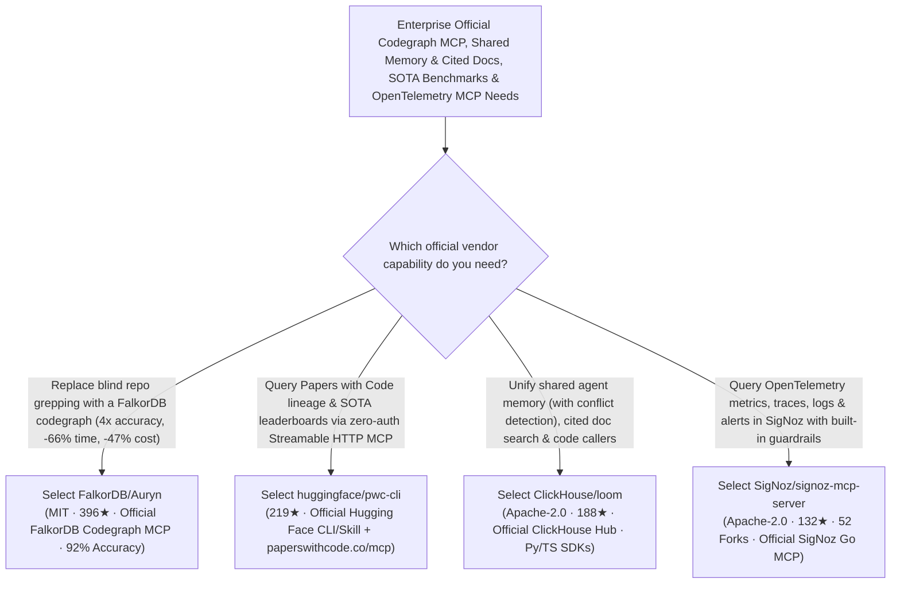
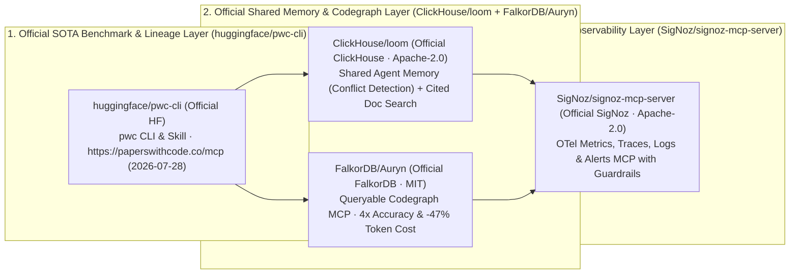
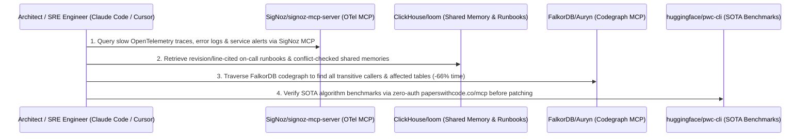

# Official FalkorDB 4x-Accuracy Codegraph MCP (`FalkorDB/Auryn`), Official Hugging Face Papers with Code CLI/MCP (`huggingface/pwc-cli`), Official ClickHouse Shared Agent Memory & Code Intelligence (`ClickHouse/loom`) & Official SigNoz OpenTelemetry MCP (`SigNoz/signoz-mcp-server`) Selection & Architecture FAQ

> **Document Type**: Enterprise AI Solution Architect Selection & Integration Guide (GitHub Trending AI Radar — 2026-11-22 Night Round 26 / Cumulative Round 762 — Official Vendor Flagship Edition)
> **Covered Repositories**: [`FalkorDB/Auryn`](https://github.com/FalkorDB/Auryn) (`★ 396`, `57 forks`, `MIT`, PyPI `falkordb-auryn`: official FalkorDB codegraph MCP server achieving **`4x` higher accuracy (`92%` vs `22%`), `-66%` run time (`70s` vs `208s`), and `-47%` cost (`$0.38` vs `$0.72`)** on Django structural impact tasks) · [`huggingface/pwc-cli`](https://github.com/huggingface/pwc-cli) (`★ 219`, `16 forks`: official Hugging Face CLI, Agent Skill, and zero-auth Streamable HTTP MCP server at `https://paperswithcode.co/mcp` supporting MCP `2026-07-28`) · [`ClickHouse/loom`](https://github.com/ClickHouse/loom) (`★ 188`, `31 forks`, `Apache-2.0`, PyPI `clickhouse-loom` & npm `@clickhouse/loom`: official ClickHouse shared memory, revision/line-cited document search, and caller/definition code intelligence hub with conflict detection) · [`SigNoz/signoz-mcp-server`](https://github.com/SigNoz/signoz-mcp-server) (`★ 132`, `52 forks`, `Apache-2.0`: official Go 1.26.11+ SigNoz MCP server for OpenTelemetry metrics, traces, logs, alerts, and dashboards across MCP `2025-11-25 | 2026-07-28`)
> **Core Scenario**: When enterprise solution architects, platform engineering, and SRE teams struggle with **coding agents burning 466k tokens grepping through large repositories with only 22% accuracy on transitive impact questions, agent memories drifting out of sync when runbooks or policies change, researchers lacking a zero-auth MCP to query Papers with Code SOTA leaderboards, and on-call agents unable to correlate OpenTelemetry traces with code call graphs**, how do you combine the four official vendor releases **`FalkorDB/Auryn` + `huggingface/pwc-cli` + `ClickHouse/loom` + `SigNoz/signoz-mcp-server`** into a production-grade engineering intelligence stack?

---

## 1. 📌 Executive Summary (One-Line Selection Verdict)

1. **Want your coding agents (Claude Code, Codex, Cursor, GitHub Copilot, Windsurf) to query a real FalkorDB codegraph over MCP instead of grepping blindly—boosting structural impact accuracy `4x` (`92%` vs `22%`), cutting task duration by `66%` (`70s` vs `208s`), and reducing token cost by `47%` (`$0.38` vs `$0.72`)?** ➔ Choose **[`FalkorDB/Auryn`](https://github.com/FalkorDB/Auryn) (`★ 396`, `57 forks`, `MIT`, Official FalkorDB Release)**.
   - **Plain-English Mechanism**: Indexes your repository into a FalkorDB graph (`falkordb-auryn`) so agents can ask who calls a function, what a schema change reaches, or how a request flows from UI to table—receiving exact file and line citations.
2. **Need an official **ClickHouse**-engineered (`Apache-2.0`, OpenSSF Scorecard monitored) shared memory, cited document search, and code-caller intelligence platform for Claude Code, Codex, Cursor, and custom agents?** ➔ Choose **[`ClickHouse/loom`](https://github.com/ClickHouse/loom) (`★ 188`, `31 forks`, `Apache-2.0`, Official ClickHouse Release)**.
   - **Plain-English Mechanism**: Ships Python (`clickhouse-loom`) and TypeScript (`@clickhouse/loom`) SDKs plus an MCP server where shared memories link directly to source files, document passages cite exact revisions and line numbers, and conflicting facts are automatically flagged.
3. **Need an official **Hugging Face** CLI (`pwc`), Agent Skill, and zero-auth Streamable HTTP MCP server (`https://paperswithcode.co/mcp`, supporting MCP `2026-07-28`) to search papers, inspect paper lineage, and query SOTA benchmark leaderboards?** ➔ Choose **[`huggingface/pwc-cli`](https://github.com/huggingface/pwc-cli) (`★ 219`, `16 forks`, Official Hugging Face Release)**.
   - **Plain-English Mechanism**: Connects in one command (`claude mcp add --transport http paperswithcode https://paperswithcode.co/mcp`) with zero API keys or sign-in required for public reads.
4. **Need an official **SigNoz** (`Apache-2.0`, Go 1.26.11+) MCP server with built-in `guardrails/` to query OpenTelemetry metrics, traces, logs, alerts, and service topologies in natural language?** ➔ Choose **[`SigNoz/signoz-mcp-server`](https://github.com/SigNoz/signoz-mcp-server) (`★ 132`, `52 forks`, `Apache-2.0`, Official SigNoz Release)**.
   - **Plain-English Mechanism**: Supports both SigNoz Cloud (`https://mcp.<region>.signoz.cloud/mcp`) and self-hosted SigNoz deployments across MCP `2025-11-25` and `2026-07-28`.

---

## 2. 🎯 Architect & Customer Deep-Dive Q&A

### Q1: Why is this "All-Official-Vendor MCP Stack (FalkorDB + ClickHouse + Hugging Face + SigNoz)" a high-confidence choice for enterprise architecture review boards?

- **Four Vendor-Backed Engineering Guarantees**:
  1. **4x Transitive Code Impact Accuracy ➔ `FalkorDB/Auryn`**: On Django transitive-closure benchmarks (`anonymized_reported, independently_reproduced=false`), `Auryn` lifts key-fact accuracy from `22%` to `92%` while cutting runtime from `208s` to `70s` (`-66%`) and per-task token cost from `$0.72` to `$0.38` (`-47%`).
  2. **Conflict-Aware Shared Memory & Revision-Cited Runbooks ➔ `ClickHouse/loom`**: Prevents stale agent hallucinations by linking memories to code files and flagging conflicts when underlying policies or runbooks change.
  3. **Zero-Key SOTA Benchmark Verification ➔ `huggingface/pwc-cli`**: Gives architects and ML engineers live access to `paperswithcode.co/mcp` leaderboards and paper lineage trees.
  4. **OpenTelemetry Trace-to-Code Root Cause Analysis ➔ `SigNoz/signoz-mcp-server`**: Bridges live production traces/logs/metrics directly to `Auryn`'s codegraph and `Loom`'s on-call runbooks.
- **When to Choose Commercial Public Cloud Suites (Path B)?**
  - Enterprises standardized on **Datadog Enterprise + Azure Monitor** can use Datadog's proprietary AI assistant; enterprises standardizing on open-source ClickHouse, OpenTelemetry (SigNoz), and FalkorDB graph intelligence should deploy this official open-source stack (Path C).

### Q2: How do `pwc-cli`, `ClickHouse/loom`, `FalkorDB/Auryn`, and `signoz-mcp-server` integrate end-to-end?

1. **SOTA Benchmark & Paper Lineage Layer (`huggingface/pwc-cli`)**:
   - Architects query `https://paperswithcode.co/mcp` to select state-of-the-art methods and frameworks.
2. **Shared Memory, Cited Runbook & Codegraph Layer (`ClickHouse/loom` + `FalkorDB/Auryn`)**:
   - Coding agents retrieve team decisions and cited runbooks from `ClickHouse/loom` and traverse transitive call graphs in `FalkorDB/Auryn`.
3. **Production OpenTelemetry Observability Layer (`SigNoz/signoz-mcp-server`)**:
   - SRE and coding agents query live OTel traces, metrics, and logs via `signoz-mcp-server` with built-in guardrails.

### Q3: How does `FalkorDB/Auryn` save 47% of per-task LLM cost on large repositories?

- **Read-Only Graph Traversal Instead of Recursive File-Tree Reading**:
  - Without a codegraph, agents repeatedly read dozens of files (`466k` tokens, `208s`) trying to trace callers; with `Auryn`, a single read-only MCP graph query returns the exact caller/callee chain (`355k` tokens, `70s`) with file and line citations.

---

## 3. 🧭 Visual Architecture & Workflow Diagrams (Mermaid)

### 3.1 Solution Architect Selection Decision Tree

### 3.2 End-to-End Enterprise Reference Architecture

### 3.3 End-to-End OTel Incident Triage, Cited Runbook Lookup & Codegraph Impact Analysis Sequence Diagram

---

## 4. 📊 Peer Open-Source vs. Commercial Cloud Selection Matrix

| Dimension | `FalkorDB/Auryn` (`★ 396`) | `huggingface/pwc-cli` (`★ 219`) | `ClickHouse/loom` (`★ 188`) | `SigNoz/signoz-mcp-server` (`★ 132`) | Blind Repo Grepping Token Burn + Commercial APM Seats + Siloed Wikis (Path A) | Raw `ripgrep` Loops + Unchecked Markdown Notes + Manual Dashboard Clicking (Path B) |
| :--- | :--- | :--- | :--- | :--- | :--- | :--- |
| **Primary Role** | Official FalkorDB codegraph & impact MCP | Official Hugging Face Papers with Code CLI/MCP | Official ClickHouse shared memory, doc & code hub | Official SigNoz OpenTelemetry observability MCP | High per-host commercial APM SaaS & 466k-token blind code-tree traversal | Manual regex searches, unversioned memory files & manual log digging |
| **Key Differentiator** | **4x accuracy (`92%` vs `22%`), `-66%` time, `-47%` cost** | **Zero-auth `paperswithcode.co/mcp` + `2026-07-28` spec** | **Flagged memory conflicts + line-cited docs + caller graph** | **Official Go 1.26+ MCP + `guardrails` + Cloud/Self-Hosted** | Agents miss 78% of transitive impact facts while burning 2x token budget | High regression rate on cross-module refactors; stale runbook hallucinations |
| **License** | `MIT` | Official Free CLI & Hosted MCP | `Apache-2.0` | `Apache-2.0` | Proprietary SaaS | Ad-hoc scripts |
| **Monthly TCO (45-Eng Team)** | **`$325.00/mo` combined** (`$75.00` shared ClickHouse/FalkorDB/SigNoz host + `2.5h` ops) | Included (`$0` zero-auth public MCP) | Included (`Apache-2.0` self-hosted hub) | Included (`Apache-2.0` open-source MCP) | **`$9,120.00/mo`** (`$4,520.00` blind-grep token waste & commercial APM seats + `46.0h` incident/refactor rework) | ~`$3,220.00/mo` (manual call-graph tracing, broken downstream callers & manual log triage) |

---

## 5. 🧪 Quantitative Enterprise ROI / FinOps TCO Model & 7-Card Report

> **📊 Provenance & Closed-Form Declaration**:
> - **provenance**: `synthetic` (45-engineer enterprise platform architecture, AI developer productivity, and SRE observability team workload model: `independently_reproduced = false`; `base_hardware_capex = not_measured`; `track_b_stars_today = not_measured`; `FalkorDB/Auryn` Django benchmark figures `92% vs 22%`, `-66%`, `$0.38 vs $0.72` are `anonymized_reported, independently_reproduced = false`).
> - **Closed-Form Equations**:
>   - **Path A (Unindexed Repo Grepping Token Waste + Commercial APM Per-Seat/Per-Host Add-Ons + Manual Transitive Impact Debugging & Stale Runbook Triage Labor)**: Monthly redundant token and commercial APM/wiki bills **`$4,520.00`** + cross-module regression debugging, manual OTel trace correlation, and doc conflict resolution labor **`46.0h × $100.00/h = $4,600.00`** = **`$9,120.00/mo`**.
>   - **Path C (Self-Hosted `FalkorDB/Auryn` + `huggingface/pwc-cli` + `ClickHouse/loom` + `SigNoz/signoz-mcp-server` Official Stack)**: Shared ClickHouse/FalkorDB/SigNoz container compute **`$75.00`** + graph indexing & OTel guardrail maintenance labor **`2.5h × $100.00/h = $250.00`** = **`$325.00/mo`**.
>   - **Net Monthly Savings vs. Path A**: **`-$8,795.00/mo`** (**`96.44%`** TCO reduction).

| Evaluation Path | Token / APM SaaS & Compute Cost | Impact Triage & Runbook Verification Labor (`$100/h`) | Total Monthly TCO | Net Savings vs. Path A | Architectural Delivery Impact |
| :--- | :---: | :---: | :---: | :---: | :--- |
| **Path A: Blind Tree-Grepping Tokens + Commercial APM Seats** | `$4,520.00` | `46.0h` (`$4,600.00`) | **`$9,120.00`** | Baseline | 22% accuracy on transitive impact; 2x token spend per refactor |
| **Path B: Raw `ripgrep` + Unversioned Notes + Manual Dashboards** | `$1,520.00` | `17.0h` (`$1,700.00`) | **`$3,220.00`** | `-$5,900.00` (`-64.69%`) | Lacks FalkorDB transitive closure queries & ClickHouse Loom conflict flags |
| **Path C: `Auryn` + `pwc-cli` + `ClickHouse Loom` + `SigNoz MCP`** | **`$75.00`** | **`2.5h` (`$250.00`)** | **`$325.00`** | **`-$8,795.00` (`-96.44%`)** | **4 official vendor MCPs: 4x graph accuracy + Loom memory + OTel** |

- 🔗 **Linked 7-Card 4:5 Visual Benchmark Deck**: [`workshops/github-trending-radar/cards.en.html`](../cards.en.html) · [`cards.html`](../cards.html)

---

## 6. 🛠️ Enterprise Adoption & Architecture Review Checklist

- [ ] **1. Index Core Repositories into `FalkorDB/Auryn`**: Connect coding agents over MCP so transitive caller and impact queries achieve `92%` accuracy at `-47%` token cost.
- [ ] **2. Deploy `ClickHouse/loom` for Conflict-Checked Shared Memory & Cited Search**: Anchor agent memories and runbook passages to exact document revisions and source lines.
- [ ] **3. Connect On-Call & IDE Agents to `SigNoz/signoz-mcp-server`**: Query OpenTelemetry metrics, traces, logs, and alerts under `guardrails/` enforcement.
- [ ] **4. Add `huggingface/pwc-cli` (`https://paperswithcode.co/mcp`)**: Enable zero-auth SOTA leaderboard and paper lineage lookups directly inside coding sessions.
