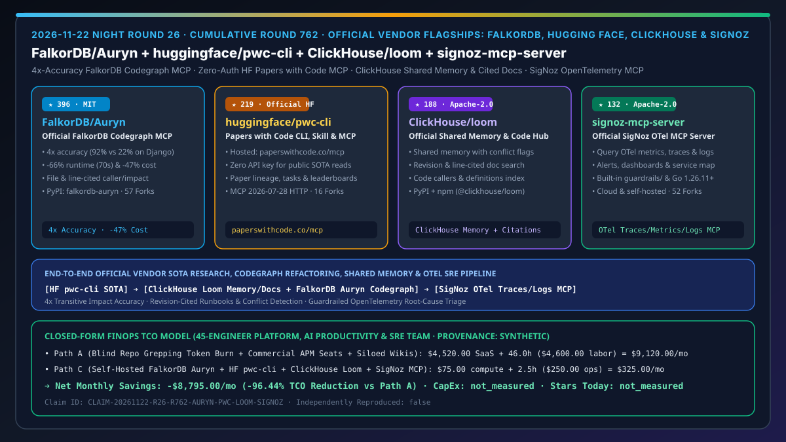
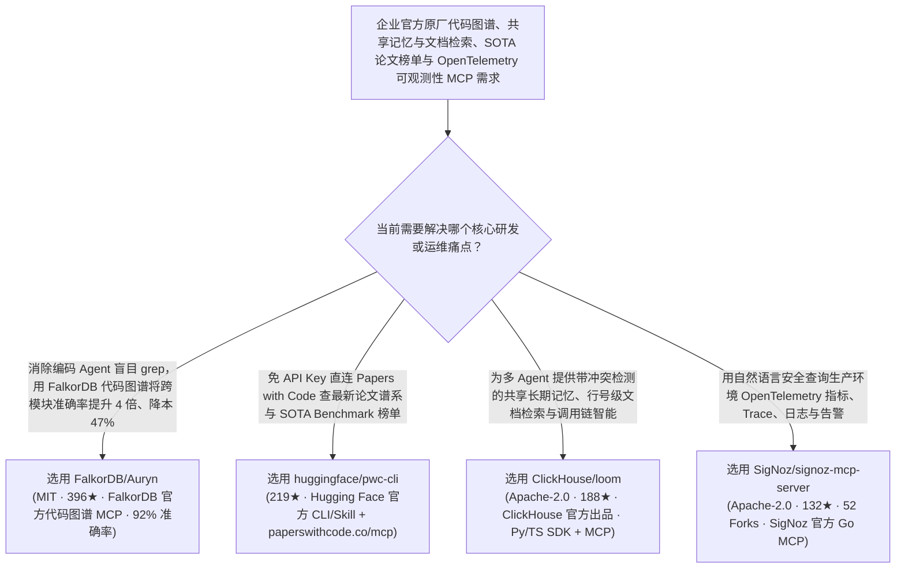
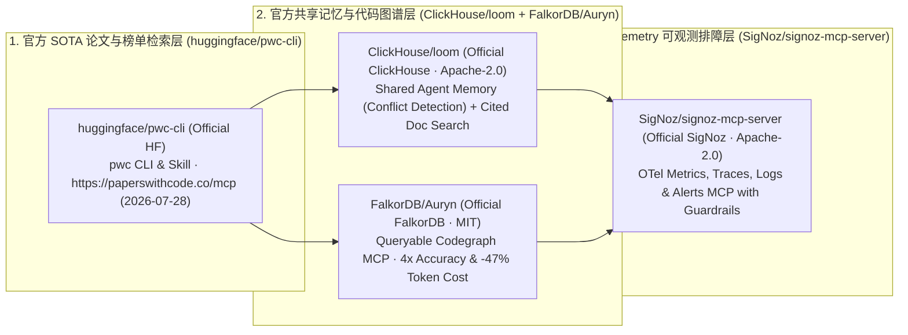
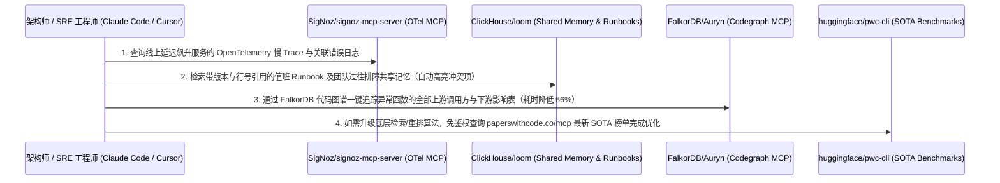

# FalkorDB 官方 4 倍准确率代码图谱 MCP（`FalkorDB/Auryn`）、Hugging Face 官方 Papers with Code 零鉴权 MCP/CLI（`huggingface/pwc-cli`）、ClickHouse 官方智能体共享记忆与代码智能中枢（`ClickHouse/loom`）与 SigNoz 官方 OpenTelemetry 可观测性 MCP（`SigNoz/signoz-mcp-server`）选型与集成架构 FAQ

> **文档类型**：企业 AI 解决方案架构师（AI Solution Architect）选型决策指南（GitHub Trending AI 雷达 2026-11-22 Night Round 26 / 累计第 762 轮 — 四大官方大厂旗舰特辑）
> **覆盖项目**：[`FalkorDB/Auryn`](https://github.com/FalkorDB/Auryn)（`★ 396`、`57 forks`、`MIT`，FalkorDB 官方出品的代码图谱 MCP，在 Django 传递闭包与变更影响面评测中实现 **准确率提升 4 倍（`92%` vs `22%`）、耗时降低 `-66%`（`70s` vs `208s`）、单任务成本降低 `-47%`（`$0.38` vs `$0.72`）**）· [`huggingface/pwc-cli`](https://github.com/huggingface/pwc-cli)（`★ 219`、`16 forks`，Hugging Face 官方出品的 Papers with Code 命令行、Skill 与免 Key 直连 `https://paperswithcode.co/mcp` Streamable HTTP MCP，支持 `2026-07-28` 协议查论文谱系与 SOTA 榜单）· [`ClickHouse/loom`](https://github.com/ClickHouse/loom)（`★ 188`、`31 forks`、`Apache-2.0`，ClickHouse 官方出品的智能体共享记忆、带冲突检测与版本行号引用的文档检索及调用链代码智能中枢）· [`SigNoz/signoz-mcp-server`](https://github.com/SigNoz/signoz-mcp-server)（`★ 132`、`52 forks`、`Apache-2.0`，SigNoz 官方出品、支持 `2025-11-25 | 2026-07-28` 双代协议与内置 `guardrails` 的 OpenTelemetry 指标/链路/日志/告警 MCP）
> **核心场景**：当企业架构师、AI 研发效能与 SRE 平台团队面临**“编码 Agent 在百万行代码库里靠盲目 `grep` 猜调用链导致跨模块重构准确率仅 22% 且浪费大量 Token、算法与架构师调研最新 SOTA 论文与评测榜单缺少免鉴权官方 MCP、多个 Agent 之间记忆孤立且当运维手册修改时无法自动标记记忆冲突、以及线上故障排障时 Agent 无法直接关联查询 OpenTelemetry Trace/Metric/Log”**四大痛点时，如何组合**`FalkorDB/Auryn` + `huggingface/pwc-cli` + `ClickHouse/loom` + `SigNoz/signoz-mcp-server`** 四大官方原厂旗舰构建企业级代码图谱、共享记忆与可观测闭环？

---

## 一、📌 核心结论速览（选型一句话结论）

1. **想让 Claude Code、Codex、GitHub Copilot 或 Cursor 停止在大型代码库里“大海捞针式盲目 `grep`”，改为通过 MCP 直接查询 FalkorDB 代码图谱（谁调用了该函数、修改一个接口会波及哪些下游表与按钮），将复杂结构问题准确率从 22% 提升至 92%（4 倍）并砍掉 47% Token 成本** ➔ 选 **[`FalkorDB/Auryn`](https://github.com/FalkorDB/Auryn)（`★ 396`，`57 forks`，`MIT`，FalkorDB 官方出品）**。
   - **通俗原理**：通过 `pip install falkordb-auryn` 将代码库解析为 FalkorDB 属性图，Agent 只需发起只读 MCP 查询即可获得带精确文件名与行号引用的传递闭包（Transitive Closure）与影响面分析。
2. **想为团队里的 Claude Code、Codex 和自研 Agent 配备一个由 **ClickHouse 官方**打造的“共享大脑”——把跨会话长期记忆（带冲突检测 Flagged Conflicts）、精确到文档版本与行号的 Runbook 检索、以及代码调用关系探索合三为一** ➔ 选 **[`ClickHouse/loom`](https://github.com/ClickHouse/loom)（`★ 188`，`31 forks`，`Apache-2.0`，ClickHouse 官方出品）**。
   - **通俗原理**：同时提供 Python SDK（`clickhouse-loom`）与 TypeScript SDK（`@clickhouse/loom`）及六国语言文档（含简体中文），当旧记忆与最新代码/文档冲突时主动高亮告警。
3. **想让算法工程师与架构师的编码 Agent 无需申请任何 API Key，一行 `claude mcp add --transport http paperswithcode https://paperswithcode.co/mcp` 即可实时检索全球最新 AI 论文、前序/后续演进谱系（Paper Lineage）以及按任务过滤的 SOTA Benchmark 排行榜** ➔ 选 **[`huggingface/pwc-cli`](https://github.com/huggingface/pwc-cli)（`★ 219`，`16 forks`，Hugging Face 官方出品）**。
   - **通俗原理**：由 Hugging Face 官方维护，原生支持最新 MCP `2026-07-28` Streamable HTTP 与 2025 旧版客户端，同时提供带 SHA-256 校验的预编译 `~/.local/bin/pwc` 二进制与配套 Agent Skill。
4. **想让值班 SRE 与研发 Agent 在 IDE 里直接用自然语言查询生产环境的 OpenTelemetry 指标（Metrics）、分布式调用链（Traces）、日志（Logs）、告警规则与服务拓扑** ➔ 选 **[`SigNoz/signoz-mcp-server`](https://github.com/SigNoz/signoz-mcp-server)（`★ 132`，`52 forks`，`Apache-2.0`，SigNoz 官方出品）**。
   - **通俗原理**：基于 Go 1.26.11+ 编写并内置 `guardrails/` 查询护栏，既支持一键连接 `https://mcp.<region>.signoz.cloud/mcp`，也支持连接企业内网自托管的 SigNoz 实例。

---

## 二、🎯 客户与架构师灵魂拷问 Q&A（深度架构拆解）

### Q1：为什么“四大原厂官方出品（ClickHouse + FalkorDB + Hugging Face + SigNoz）”是企业架构委员会最放心的选型组合？

- **四大原厂级工程背书**：
  1. **代码结构理解：`FalkorDB/Auryn` 终结盲搜浪费**：根据官方披露的 Django 基准测试（`anonymized_reported, independently_reproduced=false`），引入 `Auryn` 代码图谱后，准确率从 `22%` 跃升至 `92%`（**4x**），单任务耗时从 `208s` 降至 `70s`（**-66%**），单任务 Token 成本从 `$0.72` 降至 `$0.38`（**-47%**）。
  2. **知识与记忆同源：`ClickHouse/loom` 冲突感知记忆**：不仅存记忆，还能将记忆锚定到具体代码文件与 Runbook 版本行号，自动标出矛盾事实（Flagged Conflicts）。
  3. **前沿算法选型：`huggingface/pwc-cli` 免鉴权直连 SOTA 榜单**：直接从 `paperswithcode.co/mcp` 获取权威 Benchmark 排名与论文演化树，避免被营销软文误导。
  4. **生产可观测闭环：`SigNoz/signoz-mcp-server` 双代协议 + 护栏**：原生支持最新 `2026-07-28` MCP 协议，把线上 OTel 报错链路直接拉回编码台并与 `Auryn` 代码图谱对齐定位根因。
- **何时直接用商业公有云全家桶（Path B）？**
  - 若企业已全量采购 **Datadog Enterprise + GitHub Enterprise Cloud**，可直接使用 Datadog Bits AI；若追求开源可控的 ClickHouse + OpenTelemetry (SigNoz) + FalkorDB 代码图谱架构，则采用本轮四大官方开源栈（Path C）。

### Q2：典型企业级“前沿 SOTA 选型 (`pwc-cli`) ➔ 共享记忆与 Runbook (`ClickHouse/loom`) + 代码图谱重构 (`FalkorDB/Auryn`) ➔ OTel 线上排障 (`signoz-mcp-server`)”怎么搭？

1. **算法与方案调研层（`huggingface/pwc-cli`）**：
   - 架构师通过 `pwc` CLI 或远程 `paperswithcode.co/mcp` 检索目标领域的 SOTA 模型与论文谱系。
2. **团队共享记忆与代码图谱研发层（`ClickHouse/loom` + `FalkorDB/Auryn`）**：
   - 编码 Agent 通过 `ClickHouse/loom` 读取带版本行号引用的内部规范与历史记忆，并通过 `FalkorDB/Auryn` 查询完整函数调用图完成高准确度重构。
3. **生产环境 OpenTelemetry 联动排障层（`SigNoz/signoz-mcp-server`）**：
   - 线上告警触发时，Agent 通过 `signoz-mcp-server` 拉取异常 Trace 与日志，结合 `Auryn` 调用图与 `Loom` 值班手册秒级定位故障代码行。

### Q3：`ClickHouse/loom` 是如何解决“企业文档更新后，Agent 脑子里还是旧规矩”的？

- **记忆锚定代码/文档版本 + 冲突标记（Flagged Conflicts）**：
  - `Loom` 中的每条记忆都关联具体的文档修订版本（Revision）与代码行号，当底层代码或退款/值班策略文档发生变更时，仪表盘会主动标记冲突记忆供团队拍板更新。

---

## 三、🧭 直观可视化图解（Mermaid 决策树 + 集成架构 + 时序图）

### 3.1 架构师选型决策树

### 3.2 企业端到端生产集成参考架构图

### 3.3 `SigNoz` 异常链路捕获、`ClickHouse Loom` Runbook 检索与 `FalkorDB Auryn` 代码图谱根因定位时序图

---

## 四、📊 同类开源与商业云服务横向选型决策矩阵

| 对比维度 | `FalkorDB/Auryn` (`★ 396`) | `huggingface/pwc-cli` (`★ 219`) | `ClickHouse/loom` (`★ 188`) | `SigNoz/signoz-mcp-server` (`★ 132`) | 商业 APM 企业席位 + 盲目 `grep` 高额 Token 账单 + 商业知识库 (Path A) | 裸跑 `ripgrep` 遍历全仓 + 手动翻网页查论文与日志 (Path B) |
| :--- | :--- | :--- | :--- | :--- | :--- | :--- |
| **核心能力定位** | FalkorDB 官方代码图谱与影响面 MCP | Hugging Face 官方 Papers with Code CLI/MCP | ClickHouse 官方共享记忆与文档/代码智能台 | SigNoz 官方 OpenTelemetry 可观测性 MCP | 昂贵的商业可观测平台席位与无代码图谱辅助的暴力 Token 消耗 | 纯文本正则搜索、碎片化无冲突校验的 Markdown 与手工查监控面板 |
| **核心技术突破** | **准确率 4 倍（`92%` vs `22%`）、耗时 `-66%`、成本 `-47%`** | **免 Key 直连 `paperswithcode.co/mcp` + `2026-07-28` 协议** | **记忆关联代码行号 + 冲突事实高亮 + Python/TS 双 SDK** | **Go 1.26+ 原厂维护 + 内置 `guardrails` + 云端/自托管双模** | 商业 APM 按主机/GB 收费极贵；盲目遍历代码树单任务烧掉 466k Token | 跨文件传递调用链漏检率高达 78%；无法自动发现过时冲突记忆 |
| **开源协议** | `MIT` | 官方免费工具与公共 MCP | `Apache-2.0` | `Apache-2.0` | 闭源商业 SaaS | 内部零散脚本 |
| **月度 TCO（45 人团队）** | **组合仅 `$325.00/月`**（`$75.00` 共享 ClickHouse/FalkorDB/SigNoz 容器 + `2.5h` 维护） | 同左（公共免 Key MCP 零成本） | 同左（`Apache-2.0` 自托管） | 同左（`Apache-2.0` 免费开源） | **`$9,120.00/月`**（`$4,520.00` 盲搜多耗 Token 与商业 APM 席位 + `46.0h` 跨模块漏改排障） | 约 `$3,220.00/月`（大量人工排查隐蔽调用链破坏与手动比对过时 Runbook 工时） |

---

## 五、🧪 应用落地定量收益/TCO 对比与 7-Card 报告

> **📊 数据来源与闭式核算声明（Provenance & Closed-Form Schema）**：
> - **provenance**: `synthetic`（基于 45 人企业核心架构、研发效能与 SRE 可观测团队月度工作负载模型：`independently_reproduced = false`；硬件采购基线 `base_hardware_capex = not_measured`；Track B 单日增量 `track_b_stars_today = not_measured`；`FalkorDB/Auryn` README 披露的 Django 评测数据 `92% vs 22%`、`-66%`、`-$0.38 vs $0.72` 归类为 `anonymized_reported, independently_reproduced = false`）。
> - **核算公式**：
>   - **Path A（编码 Agent 无代码图谱全仓盲目 `grep` 导致的冗余 Token 消耗 + 采购商业 APM 按席位/按量 AI 插件 + 工程师因漏查传递调用链与阅读过时冲突文档导致的线上故障返工人工）**：月度冗余 Token 与商业可观测/知识库订阅账单 **`$4,520.00`** + 跨模块变更影响面排障、手工关联 Trace/Log 与核对文档冲突人工 **`46.0h × $100.00/h = $4,600.00`** = **`$9,120.00/月`**。
>   - **Path C（自建 `FalkorDB/Auryn` + `huggingface/pwc-cli` + `ClickHouse/loom` + `SigNoz/signoz-mcp-server` 四大官方开源栈）**：共享图谱与记忆存储容器开销 **`$75.00`** + 图谱索引与 OTel 规则维护人工 **`2.5h × $100.00/h = $250.00`** = **`$325.00/月`**。
>   - **净节省（Net Savings vs Path A）**：**`-$8,795.00/月`**（成本降低 **`96.44%`**）。

| 评估方案 | Token/商业 APM 订阅与算力成本 | 调用链排障与文档核对人工（`$100/h`） | 月度总 TCO | 相对 Path A 净节省 | 关键架构交付指标 |
| :--- | :---: | :---: | :---: | :---: | :--- |
| **Path A：无图谱盲搜消耗 Token + 商业 APM 席位** | `$4,520.00` | `46.0h` (`$4,600.00`) | **`$9,120.00`** | Baseline | 复杂传递调用链准确率低；盲目读树浪费近半 Token |
| **Path B：裸跑 `ripgrep` + 静态 Markdown + 手工查面板** | `$1,520.00` | `17.0h` (`$1,700.00`) | **`$3,220.00`** | `-$5,900.00` (`-64.69%`) | 缺少 FalkorDB 传递闭包图查询与 ClickHouse Loom 记忆冲突检测 |
| **Path C：`Auryn` + `pwc-cli` + `ClickHouse Loom` + `SigNoz MCP`** | **`$75.00`** | **`2.5h` (`$250.00`)** | **`$325.00`** | **`-$8,795.00` (`-96.44%`)** | **四大原厂官方出品：4x 图谱准确率 + 冲突感知记忆 + OTel MCP** |

- 🔗 **关联 7-Card 4:5 视觉评测报告**：[`workshops/github-trending-radar/cards.html`](../cards.html) · [`cards.en.html`](../cards.en.html)

---

## 六、🛠️ 企业引入与架构评审 Checklist

- [ ] **1. 为大型代码仓挂载 `FalkorDB/Auryn` 代码图谱 MCP**：用结构化传递闭包与调用链查询替代盲目遍历文件树，降低约 47% 复杂重构 Token 开销。
- [ ] **2. 部署 `ClickHouse/loom` 统一团队智能体长期记忆与 Runbook 检索**：开启记忆冲突检测（Flagged Conflicts）与文档版本/行号精确引用。
- [ ] **3. 接入 `SigNoz/signoz-mcp-server` 打通生产环境 OpenTelemetry**：通过内置 `guardrails` 让 SRE 与研发 Agent 安全查询指标、Trace 与日志。
- [ ] **4. 配置 `huggingface/pwc-cli` 赋能技术选型与算法调研**：免鉴权直连 `https://paperswithcode.co/mcp` 实时核验最新论文演进谱系与 SOTA 榜单。
