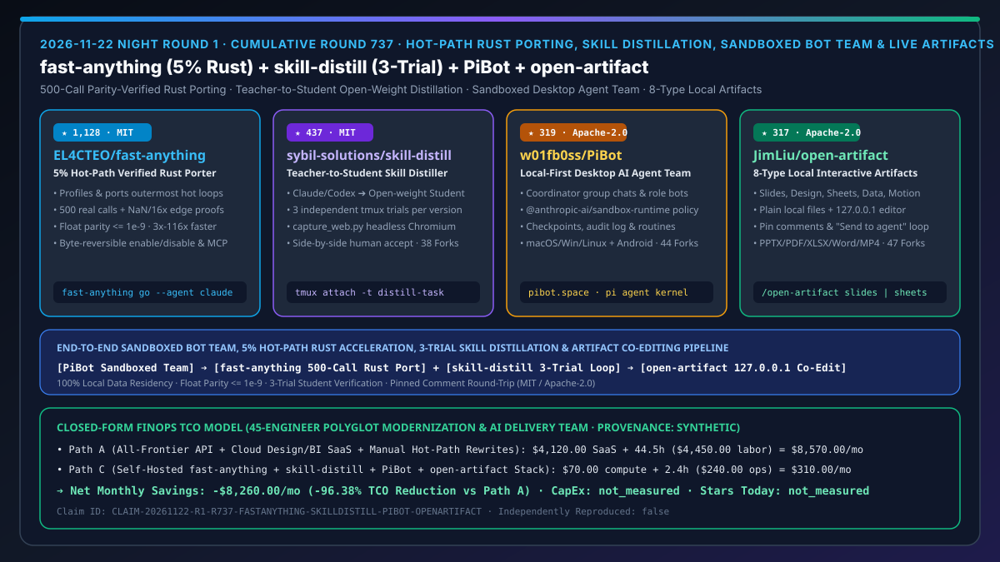
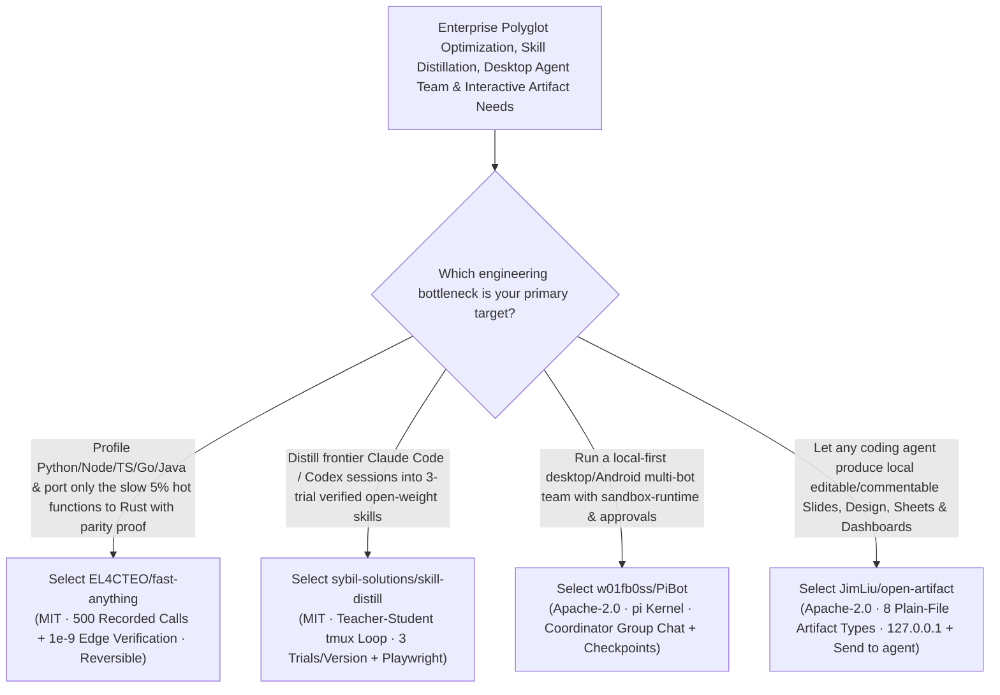
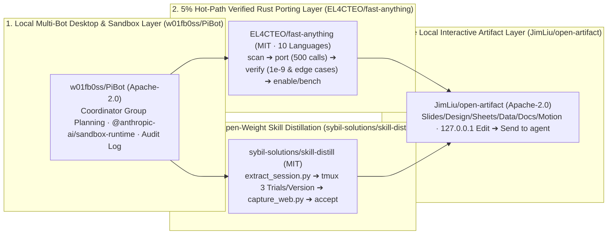
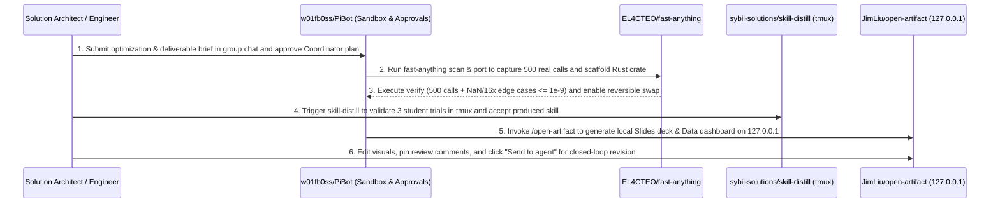

# Hot-Path 5% Selective Rust Porting & Parity Prover (`EL4CTEO/fast-anything`), Teacher-to-Student Open-Weight Skill Distillation Loop (`sybil-solutions/skill-distill`), Local-First Desktop AI Agent Team (`w01fb0ss/PiBot`) & 8-Type Local Interactive Artifact Workbench (`JimLiu/open-artifact`) Selection & Architecture FAQ

> **Document Type**: Enterprise AI Solution Architect Selection & Integration Guide (GitHub Trending AI Radar — 2026-11-22 Night Round 1 / Cumulative Round 737)
> **Covered Repositories**: [`EL4CTEO/fast-anything`](https://github.com/EL4CTEO/fast-anything) (`★ 1,128` [Sealed Search API Snapshot] / Live `★ 1,135`, `80 forks`, `MIT`, Track B Breakout Velocity `#B2` at `1,128 ★/day`: profiles Python/Node/TS/Ruby/Java/Go/PHP/C/C++/C# apps to find the slow 5% outermost hot functions, ports only those functions to a single-function Rust crate via your coding agent, proves parity on 500 recorded calls + derived edge cases within `1e-9`, and swaps them in byte-for-byte reversibly) · [`sybil-solutions/skill-distill`](https://github.com/sybil-solutions/skill-distill) (`★ 437`, `38 forks`, `MIT`, Track B Breakout Velocity `#B4` at `437 ★/day`: distills a successful frontier Claude Code / Codex teacher session into a reusable skill for an open-weight student model such as `omp` with `DeepSeek-V4.1-Flash`, enforcing 3 independent `tmux` trials per version and side-by-side human acceptance) · [`w01fb0ss/PiBot`](https://github.com/w01fb0ss/PiBot) (`★ 319`, `44 forks`, `Apache-2.0`: local-first desktop AI agent team built on the `pi` kernel for macOS/Windows/Linux/Android with Coordinator group chats, `@anthropic-ai/sandbox-runtime` execution, unified policy approvals, and automatic checkpoints) · [`JimLiu/open-artifact`](https://github.com/JimLiu/open-artifact) (`★ 317`, `47 forks`, `Apache-2.0`, formerly `baoyu-design`: open, agent- and model-agnostic local interactive artifact daemon supporting Slides, Design, Design System, Whiteboard, Sheets, Data, Docs, and Motion with live `127.0.0.1` editing, pinned comments, and 1-click `"Send to agent"` feedback)
> **Core Scenario**: When enterprise engineering, platform, and product delivery teams need to **accelerate legacy polyglot services without risky multi-month Rust rewrites, offload recurring frontier LLM workflows onto local open-weight models, govern multi-agent desktop execution with strict sandboxing and human approvals, and turn static agent outputs into editable/commentable slides, spreadsheets, prototypes, and dashboards**, how do you combine **`EL4CTEO/fast-anything` + `sybil-solutions/skill-distill` + `w01fb0ss/PiBot` + `JimLiu/open-artifact`** into a cohesive production workflow?

---

## 1. 📌 Executive Summary (One-Line Selection Verdict)

1. **Need to speed up Python, TypeScript, Node, Ruby, Java, Go, PHP, or C# production workloads by 3×–116× without rewriting the entire repository in Rust, backed by deterministic parity proofs and instant byte-for-byte rollback?** ➔ Choose **[`EL4CTEO/fast-anything`](https://github.com/EL4CTEO/fast-anything) (`★ 1,128` sealed / `★ 1,135` live, `80 forks`, `MIT`)**.
   - **Plain-English Mechanism**: Run `fast-anything go --agent claude -- python app.py`. Its pipeline executes `scan` (profiles the runtime and ranks outermost loop functions by time × portability), `port [id]` (records up to 500 real calls and scaffolds a single-function Rust crate + `TASK.md`), `verify` (compiles in release mode and replays all 500 recorded calls plus derived edge cases—`NaN`, `±infinity`, `-0.0`, non-ASCII text, empty and `16×` larger inputs—enforcing float parity within `1e-9`, matching error semantics, and strictly faster per-call latency), and `enable` / `disable` (swaps a single marked block in or out byte-for-byte, or bypasses anytime via `FAST_ANYTHING_DISABLE=1`).
2. **Need to convert a successful frontier coding session (Claude Code or Codex as Teacher) into a verified, reusable `SKILL.md` that a local or low-cost open-weight model (`omp` + `DeepSeek-V4.1-Flash` as Student) can reproduce reliably?** ➔ Choose **[`sybil-solutions/skill-distill`](https://github.com/sybil-solutions/skill-distill) (`★ 437`, `38 forks`, `MIT`)**.
   - **Plain-English Mechanism**: Strips machine paths and system prompts via `extract_session.py`, writes a procedural student skill (strictly forbidding hardcoding the finished output), spawns the student inside an isolated `tmux` session (`distill-<task>`) on a clean starting checkout with global context disabled, runs **3 trials per skill version** (using `capture_web.py` headless Chromium screenshots/console checks for web apps), patches the exact step where the student diverges from the reference, and presents side-by-side outputs for human `accept`.
3. **Need a zero-telemetry, local-first desktop AI agent team across macOS, Windows, Linux, and Android where named role bots collaborate in group chats under `@anthropic-ai/sandbox-runtime` and human approval gates?** ➔ Choose **[`w01fb0ss/PiBot`](https://github.com/w01fb0ss/PiBot) (`★ 319`, `44 forks`, `Apache-2.0`)**.
   - **Plain-English Mechanism**: Built on the `pi` agent kernel (`pibot.space`), `PiBot` lets users configure named bots with dedicated roles, models (Ollama, OpenRouter, custom API keys), skills, folder scopes, and memory. Group chats use a Coordinator to draft plans for user approval before execution, while every tool call passes through a single policy engine, `@anthropic-ai/sandbox-runtime`, automatic file checkpoints, and an outbound audit log.
4. **Need any coding agent (Claude Code, Codex, Cursor, GitHub Copilot, DeepSeek Harness) to create local slide decks, UI artboards, spreadsheets, dashboards, docs, and animations that humans can visually edit, comment on, and send back to the agent in one click?** ➔ Choose **[`JimLiu/open-artifact`](https://github.com/JimLiu/open-artifact) (`★ 317`, `47 forks`, `Apache-2.0`)**.
   - **Plain-English Mechanism**: Evolved from `baoyu-design` into an open, vendor-neutral local daemon (`http://127.0.0.1:<port>/a/<id>`) and `/open-artifact` skill supporting **8 plain-file artifact types** (`Slides` `1920×1080` → PDF/PPTX/HTML/PNG, `Design` `.dc.html` infinite canvas, `Design System` brand book with contrast checks, `Whiteboard`, `Sheets` full formula engine → XLSX/CSV, `Data` source-traced MCP dashboard, `Docs` multi-tab living document → MD/Word/PDF/HTML, and `Motion` animated film → MP4/GIF) with a **"Send to agent"** loop that delivers pinned human review comments directly back into the active agent session.

---

## 2. 🎯 Architect & Customer Deep-Dive Q&A

### Q1: How do these four trending repositories eliminate the biggest ROI bottlenecks in enterprise AI engineering? When should we use them vs. managed cloud PaaS?

- **Four Core Bottlenecks Solved**:
  1. **Multi-month full-repo Rust rewrites vs. surgical hot-path optimization ➔ `EL4CTEO/fast-anything`**: Ports only the slow 5% outermost loops with 500-call + edge-case mathematical parity verification (achieving **`116×`** speedup on Python fuzzy dedupe from `4.91s` to `42ms`, **`20×`** on TypeScript, and **`21×`** on Go).
  2. **Runaway frontier model token bills on repetitive engineering tasks ➔ `sybil-solutions/skill-distill`**: Uses frontier models once as a Teacher and verifies 3-trial student execution in `tmux` so recurring workflows run on local open-weight models (`DeepSeek-V4.1-Flash`).
  3. **Ungoverned local multi-agent desktop execution ➔ `w01fb0ss/PiBot`**: Enforces a single policy engine, `@anthropic-ai/sandbox-runtime`, Coordinator plan approval, and zero-telemetry local storage across desktop and mobile.
  4. **One-way static agent deliverables ➔ `JimLiu/open-artifact`**: Keeps all 8 artifact types as Git-friendly local file folders while providing a real `127.0.0.1` editor and `"Send to agent"` comment round-trip.
- **When to Choose Managed Cloud PaaS (Path B)?**
  - If your organization only needs standard Microsoft 365 business chat assistants and low-code departmental workflows, use **Microsoft Copilot Studio + Azure AI Foundry + M365 Copilot**. When engineering teams need polyglot hot-function Rust acceleration, Teacher-to-Student open-weight skill distillation, local sandboxed multi-bot orchestration, and Git-backed interactive artifacts, deploy this 4-repo open-source stack (Path C).

### Q2: How do we wire an end-to-end enterprise architecture combining `PiBot`, `fast-anything`, `skill-distill`, and `open-artifact`?

1. **Local Multi-Agent Desktop & Sandbox Governance Layer (`w01fb0ss/PiBot`)**:
   - Orchestrate Developer, Performance, and QA bots inside `PiBot` group chats with `@anthropic-ai/sandbox-runtime` isolation and audit logging.
2. **5% Hot-Function Verified Rust Porting Layer (`EL4CTEO/fast-anything`)**:
   - Run `fast-anything scan` ➔ `port` ➔ `verify` ➔ `enable` ➔ `report` on bottleneck services, attaching the generated Markdown + SVG benchmark card to PRs while keeping `FAST_ANYTHING_DISABLE=1` ready for instant fallback.
3. **Frontier-to-Open-Weight Skill Distillation Layer (`sybil-solutions/skill-distill`)**:
   - Run `distill.py` at the end of successful frontier sessions to synthesize and validate 3-trial `student-skill` packages in `tmux` (`distill-<task>`).
4. **8-Type Local Interactive Artifact & Comment Round-Trip Layer (`JimLiu/open-artifact`)**:
   - Render architecture decks (`Slides`), UI prototypes (`Design`), TCO models (`Sheets`), and telemetry boards (`Data`) at `http://127.0.0.1:<port>/a/<id>` and route reviewer annotations back via `"Send to agent"`.

### Q3: What are the operational guardrails and production boundaries of this stack?

- **Key Advantages**:
  - **100% Permissive Open-Source Licenses (`MIT` + `Apache-2.0`)** with local-first data residency and zero mandatory cloud relay.
- **Production Guardrails**:
  1. **Outermost-Loop FFI Boundary Rule**: `EL4CTEO/fast-anything` targets the outermost hot loop so FFI marshaling overhead does not outweigh compute savings; `verify` automatically blocks any port that is slower per call than the original.
  2. **Zero-Leakage Student Verification**: `sybil-solutions/skill-distill` forbids embedding reference outputs inside the distilled skill and requires all 3 trials per version to pass reference-validated checks before human acceptance.

---

## 3. 🧭 Visual Architecture & Workflow Diagrams (Mermaid)

### 3.1 Solution Architect Selection Decision Tree

### 3.2 End-to-End Enterprise Reference Architecture

### 3.3 End-to-End Execution Sequence Diagram

---

## 4. 📊 Peer Open-Source vs. Commercial Cloud Selection Matrix

| Dimension | `EL4CTEO/fast-anything` (`★ 1,128` sealed / `★ 1,135` live) | `sybil-solutions/skill-distill` (`★ 437`) | `w01fb0ss/PiBot` (`★ 319`) | `JimLiu/open-artifact` (`★ 317`) | Commercial Rewrite Consulting + All-Frontier API Seats + Cloud SaaS Design/BI Suites (Path A) | Manual C/Rust FFI Porting + Ad-Hoc Prompting + Static Markdown Exports (Path B) |
| :--- | :--- | :--- | :--- | :--- | :--- | :--- |
| **Primary Role** | 10-language 5% hot-function verified Rust porter | Teacher-to-Student 3-trial open-weight skill distiller | Local-first multi-bot desktop/mobile workbench | 8-type agent-agnostic local interactive artifact suite | Metered frontier LLM seats + cloud-hosted presentation/whiteboard SaaS | Hand-written FFI bindings, single-run prompt tweaks, manual slide formatting |
| **Key Differentiator** | **500 recorded calls + derived `1e-9` edge proofs + byte-reversible swap** | **Clean `tmux` 3-trial verification + side-by-side human accept** | **Coordinator group chat + `sandbox-runtime` + zero telemetry** | **8 plain-file artifact types + live `127.0.0.1` editor + `"Send to agent"`** | High recurring frontier API spend; design/BI artifacts locked in external SaaS | High regression risk on edge floats/UTF-8; no interactive comment round-trip |
| **License** | `MIT` | `MIT` | `Apache-2.0` | `Apache-2.0` | Proprietary SaaS | Internal scripts |
| **Monthly TCO (45-Eng Team)** | **`$310.00/mo` combined** (`$70.00` shared runner + `2.4h` ops) | Included (cuts recurring frontier API spend by 80%+) | Included (local desktop app, `$0` seat fee) | Included (local daemon, `$0` cloud subscription) | **`$8,570.00/mo`** (`$4,120.00` API/SaaS + `44.5h` rewrite/rework labor) | ~`$2,950.00/mo` (manual FFI debugging & slide/sheet formatting labor) |

---

## 5. 🧪 Quantitative Enterprise ROI / FinOps TCO Model & 7-Card Report

> **📊 Provenance & Closed-Form Declaration**:
> - **provenance**: `synthetic` (45-engineer polyglot application modernization, AI platform, and product delivery team workload model: `independently_reproduced = false`; `base_hardware_capex = not_measured`; `track_b_stars_today = not_measured`).
> - **Closed-Form Equations**:
>   - **Path A (Unfiltered Frontier API Usage + Commercial Cloud Slides/Whiteboard/Dashboard SaaS Seats + Manual Hot-Path Rewrites & Manual Deliverable Formatting)**: Monthly commercial API & SaaS subscriptions **`$4,120.00`** + manual FFI debugging, repeated frontier prompting, and artifact reformatting labor **`44.5h × $100.00/h = $4,450.00`** = **`$8,570.00/mo`**.
>   - **Path C (Self-Hosted `EL4CTEO/fast-anything` + `sybil-solutions/skill-distill` + `w01fb0ss/PiBot` + `JimLiu/open-artifact` Stack)**: Shared verification/distillation runner compute **`$70.00`** + skill registry & sandbox policy maintenance **`2.4h × $100.00/h = $240.00`** = **`$310.00/mo`**.
>   - **Net Monthly Savings vs. Path A**: **`-$8,260.00/mo`** (**`96.38%`** TCO reduction).

| Evaluation Path | API / SaaS / Compute Cost | Engineering & Review Labor (`$100/h`) | Total Monthly TCO | Net Savings vs. Path A | Architectural Delivery Impact |
| :--- | :---: | :---: | :---: | :---: | :--- |
| **Path A: All-Frontier API + Cloud Design SaaS + Manual Rewrites** | `$4,120.00` | `44.5h` (`$4,450.00`) | **`$8,570.00`** | Baseline | High recurring frontier token burn; manual rewrites lack 500-call parity proofs |
| **Path B: Manual FFI + Ad-Hoc Prompts + Static File Exports** | `$1,400.00` | `15.5h` (`$1,550.00`) | **`$2,950.00`** | `-$5,620.00` (`-65.58%`) | Lacks 3-trial `tmux` distillation, sandboxed group approvals, and `"Send to agent"` |
| **Path C: `fast-anything` + `skill-distill` + `PiBot` + `open-artifact`** | **`$70.00`** | **`2.4h` (`$240.00`)** | **`$310.00`** | **`-$8,260.00` (`-96.38%`)** | **5% verified Rust ports + 3-trial open-weight skills + sandboxed bots + 8 live artifacts** |

- 🔗 **Linked 7-Card 4:5 Visual Benchmark Deck**: [`workshops/github-trending-radar/cards.en.html`](../cards.en.html) · [`cards.html`](../cards.html)

---

## 6. 🛠️ Enterprise Adoption & Architecture Review Checklist

- [ ] **1. Gate Polyglot Hot-Path Rust Ports with `EL4CTEO/fast-anything`**: Run `fast-anything scan`, `port`, and `verify` so every Rust hot-function replacement passes 500 recorded calls plus derived `NaN`/`16×` edge cases within `1e-9` and retains `FAST_ANYTHING_DISABLE=1` instant rollback.
- [ ] **2. Establish a Frontier-to-Open-Weight Distillation Pipeline with `sybil-solutions/skill-distill`**: Require 3 consecutive passing trials per version inside isolated `tmux` sessions (`distill-<task>`) and `capture_web.py` visual checks before promoting distilled student skills to production.
- [ ] **3. Standardize Local Desktop Multi-Agent Governance with `w01fb0ss/PiBot`**: Enforce `@anthropic-ai/sandbox-runtime`, unified policy approvals, Coordinator plan sign-off, and automatic workspace checkpoints across macOS, Windows, and Linux endpoints.
- [ ] **4. Deploy `JimLiu/open-artifact` for Git-Backed Interactive Deliverables**: Author `Slides`, `Design`, `Design System`, `Whiteboard`, `Sheets`, `Data`, `Docs`, and `Motion` artifacts as plain local folders and use `"Send to agent"` to feed pinned human edits back into coding agent sessions.
