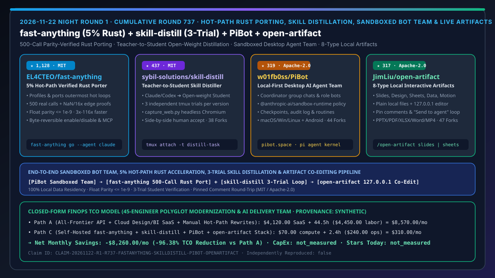
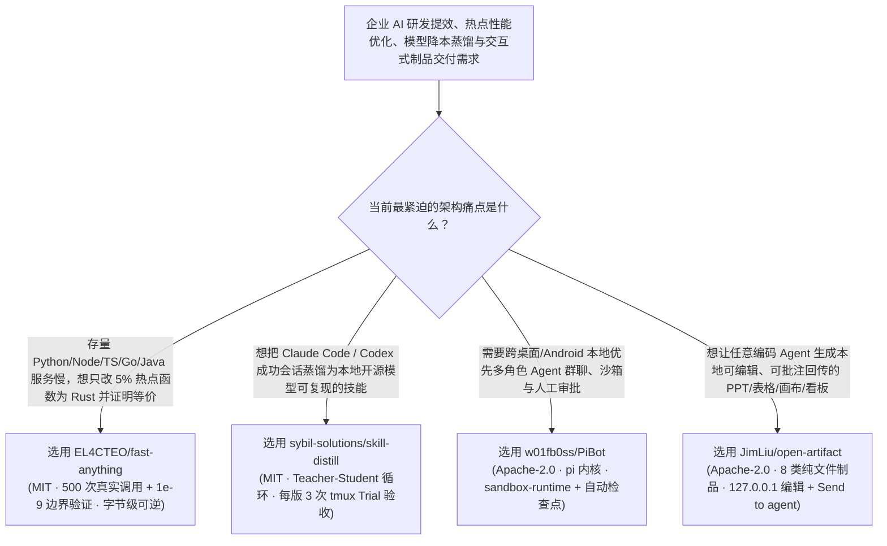
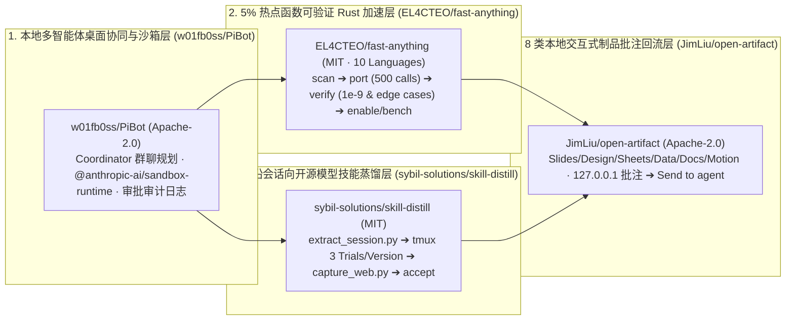
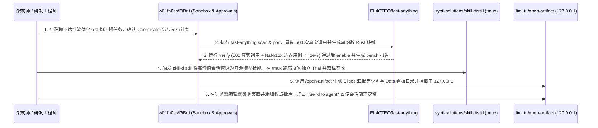

# 热点函数 5% 选择性 Rust 加速与等价证明 CLI/MCP（`EL4CTEO/fast-anything`）、前沿模型会话向开源小模型技能蒸馏闭环（`sybil-solutions/skill-distill`）、本地优先多智能体桌面协同与沙箱审批团队（`w01fb0ss/PiBot`）及跨 Agent 本地可编辑可批注 8 类制品工作台（`JimLiu/open-artifact`）选型与集成架构 FAQ

> **文档类型**：企业 AI 解决方案架构师（AI Solution Architect）选型决策指南（GitHub Trending AI 雷达 2026-11-22 Night Round 1 / 累计第 737 轮）
> **覆盖项目**：[`EL4CTEO/fast-anything`](https://github.com/EL4CTEO/fast-anything)（`★ 1,128` [Search API 封存快照] / 实时 `★ 1,135`、`80 forks`、`MIT`，赛道 B 新仓爆发速率榜 `#B2`（`1,128 ★/天`）：拒绝全量重写，自动剖析 Python/Node/TS/Ruby/Java/Go/PHP/C/C++/C# 应用中最慢的 5% 热点函数，驱动编码 Agent 仅将其移植为单函数 Rust Crate，并用 500 次真实录制调用 + 边界用例完成 `1e-9` 精度与性能等价证明后字节级可逆替换）· [`sybil-solutions/skill-distill`](https://github.com/sybil-solutions/skill-distill)（`★ 437`、`38 forks`、`MIT`，赛道 B 新仓爆发速率榜 `#B4`（`437 ★/天`）：将 Claude Code 或 Codex 前沿模型成功完成的会话蒸馏为开源权重模型（如 `omp` + `DeepSeek-V4.1-Flash`）可稳定复现的标准化技能，内置 `tmux` 干净工作区、每版 3 次重复试验与双栏人工验收闭环）· [`w01fb0ss/PiBot`](https://github.com/w01fb0ss/PiBot)（`★ 319`、`44 forks`、`Apache-2.0`，基于 `pi` 内核构建的跨 macOS/Windows/Linux/Android 本地优先桌面 AI 智能体团队，内置 Coordinator 群聊规划、`@anthropic-ai/sandbox-runtime` 沙箱执行、统一策略审批与自动检查点回滚）· [`JimLiu/open-artifact`](https://github.com/JimLiu/open-artifact)（`★ 317`、`47 forks`、`Apache-2.0`，原 `baoyu-design`，宝玉开源的跨模型/跨 Agent 本地交互式制品引擎，支持幻灯片、UI 画布、设计系统、白板、电子表格、数据看板、多标签文档与短片动画 8 大制品本地编辑、锚点批注与一键 `"Send to agent"` 回传会话）
> **核心场景**：当企业研发、架构与产品交付团队面临**“全量用 Rust 重写老系统周期长风险高、前沿大模型 Token 账单昂贵难以规模化下沉至本地开源模型、多 Agent 本地操作缺乏沙箱与审批门禁、以及 Agent 生成的 PPT/表格/原型只能看代码无法直接在编辑器里批注回传”**四大痛点时，如何构建一套**“5% 热点函数可验证 Rust 加速（`fast-anything`）+ 前沿模型技能蒸馏至开源小模型（`skill-distill`）+ 本地沙箱多 Bot 桌面协同（`PiBot`）+ 8 类交互式制品本地批注回流（`open-artifact`）”**的企业级生产力底座？

---

## 一、📌 核心结论速览（选型一句话结论）

1. **想把 Python、TypeScript、Node、Ruby、Java、Go、PHP 或 C# 生产服务提速 3×–116×，但绝不接受耗时数月的全量 Rust 重写，且要求 100% 数学/边界等价证明与一键字节级回退** ➔ 选 **[`EL4CTEO/fast-anything`](https://github.com/EL4CTEO/fast-anything)（`★ 1,128` 封存值 / 实时 `★ 1,135`，`80 forks`，`MIT`）**。
   - **通俗原理**：二八定律在软件性能中更为极端——95% 的 CPU 时间往往消耗在 5% 的最外层热点循环里。执行 `fast-anything go --agent claude -- python app.py`，它会先通过 `scan` 定位耗时最高且最易移植的最外层函数，通过 `port` 录制最多 500 次真实调用并生成单函数 Rust Crate 与 `TASK.md` 交由编码 Agent 改写，随后通过 `verify` 自动重放全部 500 次真实调用及自动派生的边界压力用例（`NaN`、`±infinity`、`-0.0`、非 ASCII 字符、空输入与 16 倍放大输入），验证浮点数误差在 `1e-9` 以内、异常抛出行为一致且单次调用确实比原版更快后，才通过 `enable` 注入单块可逆标记（随时可通过 `fast-anything disable` 或环境变量 `FAST_ANYTHING_DISABLE=1` 字节级无损还原）。
2. **想把资深架构师用昂贵前沿闭源大模型（Claude Code / Codex）跑通的复杂研发或前端构建任务，“蒸馏”成公司内网免费/低成本开源权重模型（如 `DeepSeek-V4.1-Flash` / Qwen 本地服务）也能 100% 稳定复现的标准 `SKILL.md`** ➔ 选 **[`sybil-solutions/skill-distill`](https://github.com/sybil-solutions/skill-distill)（`★ 437`，`38 forks`，`MIT`）**。
   - **通俗原理**：前沿模型是 **Teacher（老师）**，本地开源模型与对应 Harness（`omp`、`pi`、`Codex`、`Claude Code`、`opencode`）是 **Student（学生）**。在一轮高质量会话结束后调用 `skill-distill`，Teacher 会提取会话日志（`extract_session.py` 自动剔除系统提示词与本地路径隐私），为 Student 编写不含现成答案作弊代码的步骤技能，并在 `tmux` 隔离会话（`distill-<task>`）中基于全新克隆的初始代码状态启动 Student；**每个技能版本强制连续跑满 3 次独立 Trial**（杜绝单次碰巧跑通），若针对 Web 应用还会调用 `capture_web.py` 启动无头 Chromium 截图与抓取报错，精准定位 Student 第一次出错的步骤并迭代修补技能，最后双栏并排展示 Reference 与 Student 成果由人工 `accept` 签收。
3. **想在研发与运营团队的 macOS、Windows、Linux 桌面（及 Android 手机端）部署一套零遥测、带角色分工群聊、强制沙箱隔离（`@anthropic-ai/sandbox-runtime`）与高危动作人工审批的本地多智能体数字员工团队** ➔ 选 **[`w01fb0ss/PiBot`](https://github.com/w01fb0ss/PiBot)（`★ 319`，`44 forks`，`Apache-2.0`）**。
   - **通俗原理**：基于 `pi` 智能体内核打造，允许为每个 Bot 设定独立角色（研发、研究员、写作者、翻译）、模型（Ollama 本地模型、OpenRouter 或自有 API Key）、技能、目录权限与记忆。在多 Bot 群聊中由 Coordinator 先制定分步计划并经人工确认后再派发执行；所有工具调用统一经过单一策略引擎与 `@anthropic-ai/sandbox-runtime` 沙箱，支持定时/文件夹变更/外部连接触发的 Routines 以及自动检查点恢复。
4. **想让任何编码 Agent（Claude Code、Codex、Cursor、GitHub Copilot、DeepSeek Harness）不仅能写代码文件，还能直接生成可在本地浏览器可视化编辑、打点批注并一键把修改意见回传给 Agent 的幻灯片、UI 画布、电子表格、数据看板与动画短片** ➔ 选 **[`JimLiu/open-artifact`](https://github.com/JimLiu/open-artifact)（`★ 317`，`47 forks`，`Apache-2.0`）**。
   - **通俗原理**：前身为广受欢迎的 `baoyu-design`，重构为完全中立的本地守护进程（`http://127.0.0.1:<port>/a/<id>`）与 `/open-artifact` 技能。内置 **8 大交互式制品类型**（`Slides` 1920×1080 演示文稿导出 PDF/PPTX、`Design` `.dc.html` 无限画布原型、`Design System` 含对比度校验的品牌设计规范、`Whiteboard` 协作白板、`Sheets` 带完整公式引擎的电子表格导出 XLSX/CSV、`Data` 可溯源 MCP 数据看板、`Docs` 多标签活文档导出 Word/PDF/MD、`Motion` 帧级批注动画短片导出 MP4/GIF）。人类在本地页面直接拖拽微调或留下位置锚点评论后，点击 **"Send to agent"** 即可将批注精确回注到当前编码 Agent 会话中完成闭环修改！

---

## 二、🎯 客户与架构师灵魂拷问 Q&A（深度架构拆解）

### Q1：在企业推进“AI 原生研发提效与遗留系统现代化”时，这四个高热度开源项目各自解决了什么核心工程瓶颈？何时选它们 vs 云厂商托管 PaaS？

- **四大工程瓶颈与精准解方**：
  1. **性能瓶颈改造 ROI 极低（全量重写动辄半年且易引入隐蔽 Bug）➔ `EL4CTEO/fast-anything`**：只对 5% 热点最外层循环做手术式 Rust 移植，用 500 条真实录制样本 + `NaN`/`16×` 衍生边界测试做数学级等价门禁（Python 模糊去重实测从 `4.91s` 降至 `42ms`，提速 **`116×`**；TypeScript 提速 **`20×`**；Go 提速 **`21×`**）。
  2. **前沿大模型 API 成本高昂，重复性工程任务每次都烧旗舰 Token ➔ `sybil-solutions/skill-distill`**：用一次旗舰模型会话作为 Teacher，通过 3-Trial `tmux` 对照实验蒸馏出针对 `DeepSeek-V4.1-Flash` 等开源模型的专用 Skill，让后续 90% 的同类常规任务下沉至本地/低成本开源模型执行。
  3. **桌面端多 Agent 缺乏统一权限收口与跨设备协同 ➔ `w01fb0ss/PiBot`**：提供桌面端多角色群聊 Coordinator、统一 Policy Engine、`@anthropic-ai/sandbox-runtime` 沙箱与审计日志，并自带自托管 Cloudflare Worker Relay 支持 Android 端与远程 Runner 联动。
  4. **Agent 交付物缺乏“人机共编（Human-in-the-Loop Artifact Editing）”体验 ➔ `JimLiu/open-artifact`**：所有制品均为本地纯文件目录（`project/deck.json`、`sheet/sheet.json`、`db/dash/meta.json` 等），既能入库 Git 版本控制，又能在 `127.0.0.1` 真实编辑器中批注并一键回传给任意编码 Agent。
- **何时直接用云厂商托管方案（Path B）？**
  - 若企业完全基于 Microsoft 365 生态构建标准化办公助手与部门级低代码门户，优先选用 **Microsoft Copilot Studio + Azure AI Foundry + Office 365 Copilot**；若需要在研发本机进行跨语言热点函数 Rust 移植、将 Claude/Codex 经验蒸馏给本地开源模型、或在本地 Git 仓库内闭环编辑 8 类工程与设计制品，则采用本轮四合一开源栈（Path C）。

### Q2：典型企业级“前沿技能蒸馏 (`skill-distill`) + 本地多 Bot 协同 (`PiBot`) + 5% 热点 Rust 加速 (`fast-anything`) + 8 类本地制品共编 (`open-artifact`)”生产架构怎么搭？

1. **桌面与远程多智能体协同控制层（`w01fb0ss/PiBot`）**：
   - 在架构师与工程师终端运行 `PiBot`，通过 Coordinator 群聊组织 Researcher、Developer、QA 等角色 Bot，所有外部命令经 `@anthropic-ai/sandbox-runtime` 沙箱与人工审批门禁放行。
2. **代码热点函数可验证 Rust 移植层（`EL4CTEO/fast-anything`）**：
   - 针对性能卡点服务执行 `fast-anything scan` ➔ `port` ➔ `verify` ➔ `enable` ➔ `report`，自动产出 PR 级别的性能对比 Markdown 与 SVG 报告卡，并在生产环境保留 `FAST_ANYTHING_DISABLE=1` 零停机熔断开关。
3. **前沿模型向开源模型技能蒸馏层（`sybil-solutions/skill-distill`）**：
   - 将高价值的架构重构、组件开发或排障会话通过 `distill.py` 与 `extract_session.py` 提炼为 `student-skill`，在 `tmux` 隔离环境中完成每版 3 次 Trial 验证与 Playwright 视觉核验后，分发给团队内部的本地开源模型实例复用。
4. **本地 8 类交互式制品编辑与批注回流层（`JimLiu/open-artifact`）**：
   - 通过 `/open-artifact` 生成架构汇报 PPT（`Slides`）、UI 原型（`Design`）、品牌规范（`Design System`）、TCO 测算表（`Sheets`）或数据看板（`Data`），架构师在 `127.0.0.1` 浏览器中批注后一键 `"Send to agent"` 驱动 Agent 定向修订。

### Q3：这套架构的局限性与生产落地红线是什么？

- **核心优势**：
  - **100% 宽松开源协议（`MIT` + `Apache-2.0`）**，数据、代码、制品与会话日志全部保留在企业内网或开发者本机，零强制云端锁定。
- **架构师落地红线**：
  1. **FFI 跨语言调用边界检查**：`EL4CTEO/fast-anything` 明确遵循“移植最外层循环而非内层微小函数”原则；若单次跨 FFI 边界开销大于节省的计算时间，`verify` 会自动拒绝启用该移植。
  2. **蒸馏技能防作弊审计**：使用 `sybil-solutions/skill-distill` 时，必须遵守其内置铁律——生成的 `SKILL.md` 严禁硬编码参考会话的最终输出产物，且必须通过 `3 trials per version` 门禁才可签收上线。

---

## 三、🧭 直观可视化图解（Mermaid 决策树 + 集成架构 + 时序图）

### 3.1 架构师选型决策树

### 3.2 企业端到端生产集成参考架构图

### 3.3 团队任务审批、热点函数 Rust 移植验证、开源模型 3-Trial 技能蒸馏与本地制品批注回流时序图

---

## 四、📊 同类开源与商业云服务横向选型决策矩阵

| 对比维度 | `EL4CTEO/fast-anything` (`★ 1,128` 封存 / `★ 1,135` 实时) | `sybil-solutions/skill-distill` (`★ 437`) | `w01fb0ss/PiBot` (`★ 319`) | `JimLiu/open-artifact` (`★ 317`) | 商业全量代码迁移外包 + 全员旗舰大模型席位 + 商业云端白板/PPT SaaS (Path A) | 手工盲改 C/Rust 扩展 + 人工写 Prompt 调优 + 静态 Markdown 交付 (Path B) |
| :--- | :--- | :--- | :--- | :--- | :--- | :--- |
| **核心能力定位** | 10 语言 5% 热点函数可验证 Rust 移植 CLI/MCP | 前沿模型会话向开源小模型 3-Trial 技能蒸馏 | 本地优先多角色桌面/移动端 Agent 团队工作台 | 跨 Agent 本地 8 类可编辑可批注制品引擎 | 按席位/Token 计费的商业云端编码套件与 SaaS 协作设计软件 | 人工手写 FFI 绑定、单次碰巧测试与手动复制修改意见 |
| **核心技术突破** | **录制 500 次真实调用 + 衍生边界 `1e-9` 验证 + 字节级可逆替换** | **Teacher-Student 自动纠错循环 + 强制每版 3 次 Trial 防侥幸** | **Coordinator 群聊 + `sandbox-runtime` 沙箱 + 零遥测全本地存储** | **8 类纯文件制品 + 本地 `127.0.0.1` 真实编辑器 + `"Send to agent"` 回注** | 旗舰模型全量调用账单极高；设计/文档资产锁定在第三方 SaaS 云端 | 手工 FFI 极易出现字符/浮点不一致 Bug；缺少可视化批注回流 |
| **开源协议** | `MIT` | `MIT` | `Apache-2.0` | `Apache-2.0` | 闭源商业 SaaS | 内部脚本 |
| **月度 TCO（45 人团队）** | **组合仅 `$310.00/月`**（`$70.00` 本地蒸馏/验证容器 + `2.4h` 维护） | 同左（一次蒸馏长期省 80%+ 旗舰 Token） | 同左（本地桌面零席位费） | 同左（本地守护进程零云端订阅费） | **`$8,570.00/月`**（`$4,120.00` 商业订阅/API + `44.5h` 迁移返工与人工排版） | 约 `$2,950.00/月`（大量手写 FFI 排障与文档格式转换工时） |

---

## 五、🧪 应用落地定量收益/TCO 对比与 7-Card 报告

> **📊 数据来源与闭式核算声明（Provenance & Closed-Form Schema）**：
> - **provenance**: `synthetic`（基于 45 人企业全栈研发、性能工程与产品交付团队月度工作负载模型：`independently_reproduced = false`；硬件采购基线 `base_hardware_capex = not_measured`；Track B 单日增量 `track_b_stars_today = not_measured`）。
> - **核算公式**：
>   - **Path A（全员高频直接调用昂贵前沿闭源大模型 API + 商业云端 PPT/白板/看板协作 SaaS 席位 + 工程师手工重写性能瓶颈模块与人工来回搬运排版修改意见）**：月度商业 API 与 SaaS 席位费 **`$4,120.00`** + 性能移植返工、重复 Prompt 调试与文档手工排版人工 **`44.5h × $100.00/h = $4,450.00`** = **`$8,570.00/月`**。
>   - **Path C（自建 `EL4CTEO/fast-anything` + `sybil-solutions/skill-distill` + `w01fb0ss/PiBot` + `JimLiu/open-artifact` 开源工程生产力栈）**：本地开源模型蒸馏验证与构建容器分摊开销 **`$70.00`** + 技能库与沙箱策略维护人工 **`2.4h × $100.00/h = $240.00`** = **`$310.00/月`**。
>   - **净节省（Net Savings vs Path A）**：**`-$8,260.00/月`**（成本降低 **`96.38%`**）。

| 评估方案 | API / SaaS / 算力成本 | 性能优化与制品修订人工（`$100/h`） | 月度总 TCO | 相对 Path A 净节省 | 关键架构交付指标 |
| :--- | :---: | :---: | :---: | :---: | :--- |
| **Path A：全量前沿 API 调用 + 商业协作 SaaS + 手工性能优化** | `$4,120.00` | `44.5h` (`$4,450.00`) | **`$8,570.00`** | Baseline | 重复任务持续消耗高价 Token；性能改造缺少 500 样本等价门禁 |
| **Path B：手工编写 Rust FFI + 零散 Prompt 模板 + 静态文件导出** | `$1,400.00` | `15.5h` (`$1,550.00`) | **`$2,950.00`** | `-$5,620.00` (`-65.58%`) | 缺少 3-Trial 自动化蒸馏闭环、沙箱群聊审批与 `"Send to agent"` 批注回流 |
| **Path C：`fast-anything` + `skill-distill` + `PiBot` + `open-artifact`** | **`$70.00`** | **`2.4h` (`$240.00`)** | **`$310.00`** | **`-$8,260.00` (`-96.38%`)** | **5% 热点可逆 Rust 加速 + 3-Trial 技能蒸馏 + 沙箱多 Bot + 8 类交互制品** |

- 🔗 **关联 7-Card 4:5 视觉评测报告**：[`workshops/github-trending-radar/cards.html`](../cards.html) · [`cards.en.html`](../cards.en.html)

---

## 六、🛠️ 企业引入与架构评审 Checklist

- [ ] **1. 引入 `EL4CTEO/fast-anything` 执行 5% 热点函数可逆加速**：在 CI/预发环境运行 `fast-anything scan` 与 `verify`，强制要求 500 次真实录制调用与衍生边界用例（浮点误差 `<= 1e-9`）100% 通过后才启用 Rust 替换块，并配置 `FAST_ANYTHING_DISABLE=1` 应急回退预案。
- [ ] **2. 部署 `sybil-solutions/skill-distill` 建立“前沿 Teacher ➔ 开源 Student”技能蒸馏流水线**：将高频研发任务通过 `distill.py` 在 `tmux` 隔离环境中完成每版 3 次独立 Trial 验证与 `capture_web.py` 视觉检查，验收通过后下沉至内部开源模型执行。
- [ ] **3. 使用 `w01fb0ss/PiBot` 规范桌面端多智能体协作与沙箱门禁**：开启 `@anthropic-ai/sandbox-runtime` 沙箱与单一策略引擎审批日志，通过 Coordinator 群聊机制实现计划确认后再执行文件修改与外部命令。
- [ ] **4. 挂载 `JimLiu/open-artifact` 打通 8 类交互式制品人机共编闭环**：将架构演示文稿（`Slides`）、UI 画布（`Design`）、TCO 表格（`Sheets`）与看板（`Data`）统一存为 Git 仓库内的纯文件目录，通过本地 `127.0.0.1` 编辑器批注并一键 `"Send to agent"` 驱动迭代。
