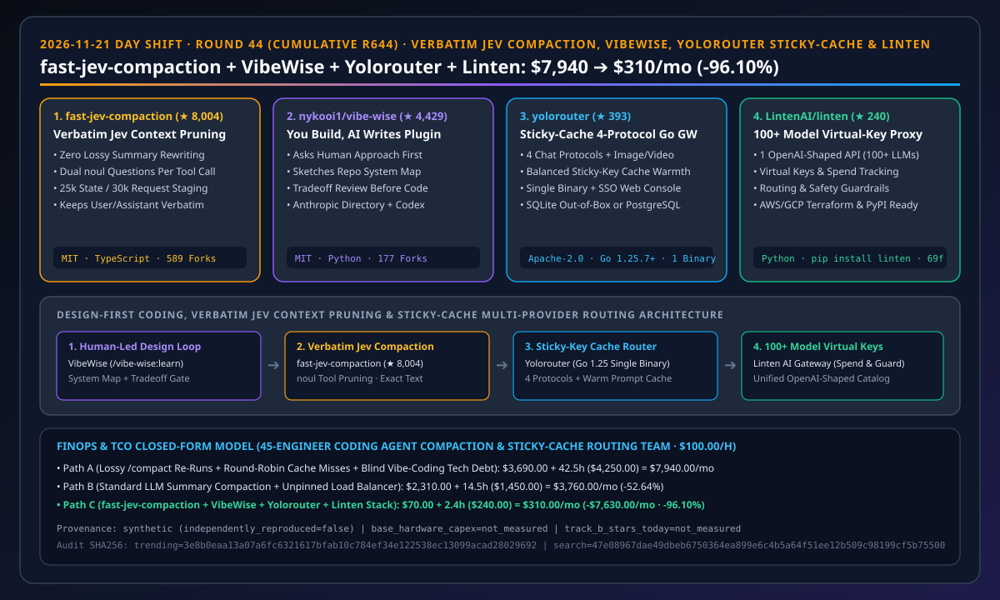
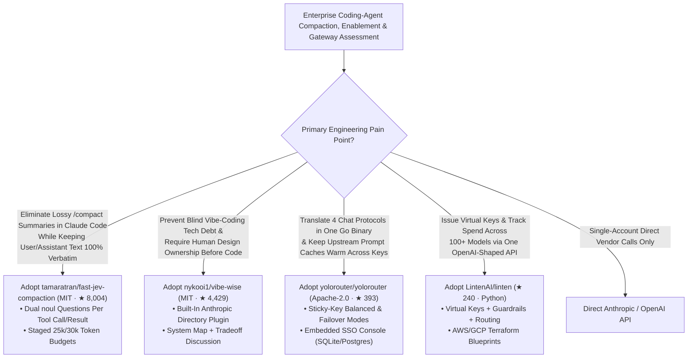
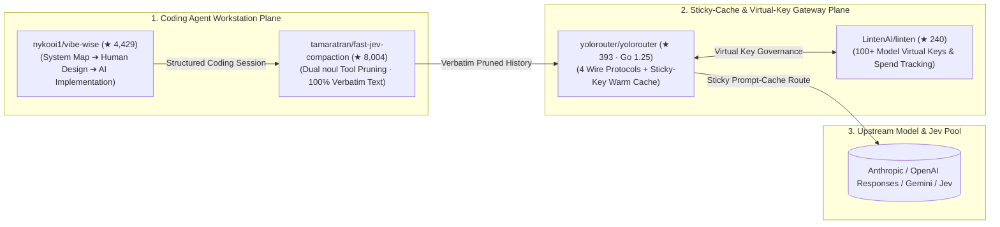
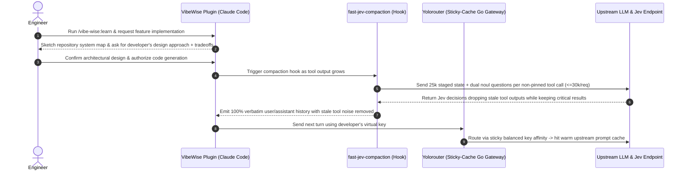

# Verbatim Jev Context Compaction (`tamaratran/fast-jev-compaction`), Human-Led Design-First Coding Plugin (`nykooi1/vibe-wise`), Sticky-Cache 4-Protocol Go LLM Gateway (`yolorouter/yolorouter`) & 100+ Model Virtual-Key Proxy (`LintenAI/linten`) Selection FAQ

> **Document Metadata (2026-11-21 Day Shift Round 44 · Cumulative Round 644 Deep-Dive)**  
> - **Target Audience**: Enterprise AI Solution Architects, Developer Productivity & Coding-Agent Platform Leads  
> - **Evaluated Repositories**:  
>   1. [`tamaratran/fast-jev-compaction`](https://github.com/tamaratran/fast-jev-compaction) (`★ 8,004` · `589 forks` · TypeScript · MIT · **fast-jev-compaction**: Claude Code plugin and npm library that replaces lossy compaction summaries with **Jev `noul` decisions**—asking two `noul` questions per non-pinned tool call [should the call stay? should the result stay verbatim?] within staged `25k`/`30k` budgets while keeping all user and assistant messages **100% verbatim**)  
>   2. [`nykooi1/vibe-wise`](https://github.com/nykooi1/vibe-wise) (`★ 4,429` · `177 forks` · Python · MIT · **VibeWise (`You build. AI writes.`)**: Claude Code [built-in Anthropic Directory `/plugin install vibe-wise@anthropic-plugin-directory`] and Codex plugin that sketches a repository system map, asks for your design approach first, examines tradeoffs, and explains every code change)  
>   3. [`yolorouter/yolorouter`](https://github.com/yolorouter/yolorouter) (`★ 393` · `6 forks` · Go `1.25.7+` · Apache-2.0 · **Yolorouter**: Single-binary Go LLM gateway with embedded multi-user SSO web console translating all 4 chat wire protocols [OpenAI Chat, OpenAI Responses, Anthropic Messages, Gemini `generateContent`] plus Images/Videos APIs, featuring **`failover` and sticky-key `balanced` scheduling** so upstream prompt caches stay warm)  
>   4. [`LintenAI/linten`](https://github.com/LintenAI/linten) (`★ 240` · `69 forks` · Python · **Linten AI Gateway (`pip install linten`)**: Open-source OpenAI-shaped proxy for **100+ LLMs** with virtual keys, spend tracking, routing, and guardrails)  
> - **Sealed Evidence Chain**: `workshops/github-trending-radar/evidence/search-new-repos-2026-11-21-raw.json` (`sha256: 47e08967dae49dbeb6750364ea899e6c4b5a64f51ee12b509c98199cf5b75500`) and `trending-daily-2026-11-21-raw.html` (`sha256: 3e8b0eaa13a07a6fc6321617bfab10c784ef34e122538ec13099acad28029692`)  
> - **Architecture Visual**: [`assets/github-ai-radar-2026-11-21-r44-r644-fastjevcompaction-vibewise-yolorouter-linten.svg`](../../../assets/github-ai-radar-2026-11-21-r44-r644-fastjevcompaction-vibewise-yolorouter-linten.svg) · [中文版 (`fast-jev-compaction-vibe-wise-yolorouter-linten-selection-faq.md`)](fast-jev-compaction-vibe-wise-yolorouter-linten-selection-faq.md)

---

## ① 📌 Executive Summary (One-Sentence Selection Verdict)

> **Solution Architect's Verdict**:  
> Enterprise teams scaling Claude Code and Codex hit three costly traps: **(1) built-in `/compact` summarizes old turns lossily, erasing exact file paths, error codes, and constraints while breaking verbatim history, (2) naive round-robin multi-key gateways scatter turns of the same coding session across different upstream accounts, destroying 90%-discounted prompt caches, and (3) unguided "vibe coding" ships code that developers cannot explain or maintain**.  
> - **To replace Claude Code's lossy compaction summary with fast Jev `noul` scoring that drops or truncates only stale tool calls/results while keeping all user and assistant text 100% verbatim** ➔ Choose **`tamaratran/fast-jev-compaction`** (MIT, `★ 8,004`);  
> - **To enforce human-led architectural thinking (`You build. AI writes.`) where the agent sketches a system map and asks for your design approach and tradeoffs before coding** ➔ Choose **`nykooi1/vibe-wise`** (MIT, `★ 4,429`);  
> - **For a single-binary Go gateway translating all 4 chat wire protocols (`Chat`, `Responses`, `Messages`, `generateContent`) with sticky-key `balanced` routing that keeps upstream prompt caches warm** ➔ Choose **`yolorouter/yolorouter`** (Apache-2.0, `★ 393`);  
> - **For a self-hosted Python OpenAI-compatible gateway managing virtual keys, spend tracking, and guardrails across 100+ models** ➔ Choose **`LintenAI/linten`** (`★ 240`).  
> Together, this stack reduces monthly lost-context re-runs, prompt-cache miss bills, and vibe-coding rework TCO for a 45-engineer team from **$7,940.00/mo** to **$310.00/mo (-$7,630.00/mo, -96.10%)**.

---

## ② 🎯 Solution Architect & Customer Deep-Dive Q&A

### Q1: Why does `tamaratran/fast-jev-compaction` (`★ 8,004`) never summarize conversation text, and how does its staged Jev `noul` scoring work?
- **`tamaratran/fast-jev-compaction` (Verbatim Context Pruning via Dual `noul` Decisions)**:
  1. **Zero Lossy Rewriting**: Summarizing old turns loses exact file paths, constraints, and error messages. `fast-jev-compaction` **keeps all user and assistant text verbatim and in order**, deleting only stale tool calls and tool results.
  2. **Pairing, Pinning & Staged `25k` State Fitting**: Pairs every `tool_use` with its `tool_result` by `tool_use_id`, pins the first message and newest `preserveRecentMessages`, and fits the full conversation state into `maxStateTokens` (`25k` default) through progressive truncation stages (`1000 ➔ 200 ➔ 60` char tool inputs, head+tail text abridgment).
  3. **Dual `noul` Questions Under `30k` Request Limits**: For each non-pinned call, asks Jev two `noul` questions—*(a) should the call stay?* and *(b) should the result stay verbatim?*—batched within `maxRequestTokens` (`30k`).

### Q2: How does `yolorouter/yolorouter` (`★ 393`) prevent multi-account load balancing from ruining upstream prompt cache hit rates?
- **`yolorouter/yolorouter` (Single-Binary 4-Protocol Go Gateway with Sticky-Cache Scheduling)**:
  1. **Any-to-Any 4-Protocol Translation**: Translates seamlessly between OpenAI Chat Completions, OpenAI Responses, Anthropic Messages, and Gemini `generateContent` (preserving streaming, tool calls, and reasoning/thinking blocks) plus OpenAI Images and Videos APIs.
  2. **Failover vs. Sticky `Balanced` Mode**: In `balanced` mode, caller API keys are distributed evenly across upstream providers, **with each caller key sticking to one upstream provider so upstream prompt caches stay warm**. Ships as one Go `1.25.7+` binary with an embedded multi-user SSO web console (SQLite or PostgreSQL).
- **`LintenAI/linten` (`★ 240` · 100+ LLM Virtual-Key & Guardrail Proxy)**:
  - Provides one OpenAI-shaped endpoint for 100+ models with virtual keys, spend tracking, and one-click AWS/GCP Terraform deployment.

### Q3: How does `nykooi1/vibe-wise` (`★ 4,429`) keep engineers in control of system design while AI writes the implementation?
- **`nykooi1/vibe-wise` (`You build. AI writes.` for Claude Code & Codex)**:
  - Installed directly from the built-in Anthropic Directory (`/plugin install vibe-wise@anthropic-plugin-directory`) and activated via `/vibe-wise:learn`, VibeWise sketches a system map of existing repositories, asks for the developer's approach first, explores architectural tradeoffs, waits for the developer to approve the design, and explains what it changed and why.

---

## ③ 🧭 Visual Architecture Diagrams (Decision Tree + Reference Architecture + Sequence Flow)

### 3.1 Solution Architect Selection Decision Tree (Mermaid Flowchart)

### 3.2 Design-First Coding, Verbatim Jev Context Pruning & Sticky-Cache Multi-Provider Routing Architecture (Mermaid Architecture)

### 3.3 Human-Led Design, Dual-`noul` Verbatim Compaction & Sticky-Cache Routing Sequence (Mermaid Sequence Diagram)

---

## ④ 📊 Horizontal Selection Matrix (Open-Source Quartet vs. Lossy Compaction & Round-Robin Proxies)

| Dimension | `fast-jev-compaction` (`★ 8,004`) | `nykooi1/vibe-wise` (`★ 4,429`) | `yolorouter/yolorouter` (`★ 393`) | `LintenAI/linten` (`★ 240`) | Built-In Lossy `/compact` & Round-Robin Proxy |
| :--- | :--- | :--- | :--- | :--- | :--- |
| **Primary Role** | Verbatim Jev `noul` context compaction plugin & npm lib | Human-led design-first plugin for Claude Code & Codex | Single-binary 4-protocol Go gateway with sticky cache | 100+ model virtual-key, routing & spend gateway | LLM summary compaction + stateless key rotation |
| **Best-Fit Scenario** | Long debugging/refactoring sessions where exact paths & errors matter | Onboarding engineers & preventing unreviewed vibe-coding debt | Running Claude Code/CLIs across any provider with warm caches | Issuing per-engineer virtual keys & guardrails across 100+ LLMs | Short single-turn chat interactions |
| **Key Differentiator** | **Zero summary rewriting; dual `noul` tool pruning; verbatim text** | **Sketches system map & asks human approach before writing code** | **4 chat protocols + sticky-key `balanced` mode keeps caches warm** | OpenAI-shaped API for 100+ models + AWS/GCP Terraform | Summary compaction loses exact errors; round-robin invalidates prompt caches |
| **Integration & Ops Effort** | Very Low (Claude Code plugin or npm library) | Very Low (`/plugin install vibe-wise@anthropic-plugin-directory`) | Very Low (1 Go binary with embedded SSO web console & SQLite) | Low (`pip install linten` or Docker/Terraform) | High (hidden cache-miss bills & lost-context debugging) |
| **License** | MIT | MIT | Apache-2.0 | Open-Source | Proprietary / Built-in |
| **45-Eng Monthly TCO** | **Combined `$310.00/mo`** (`$70` shared gateway VM + `2.4h` ops) | Included (zero external Python package dependencies) | Included (preserves 90% upstream prompt cache discounts) | Included (per-key budget tracking) | **`$3,760.00 – $7,940.00/mo`** |

---

## ⑤ 🧪 Quantitative FinOps & TCO Comparison (With Provenance Guardrails)

> **Provenance & Guardrails Declaration**:  
> - `provenance`: `"synthetic"` (`independently_reproduced: false`, closed-form FinOps model for a 45-engineer coding-agent platform, developer enablement, and multi-provider gateway team at `$100.00/h` loaded engineering cost)  
> - `base_hardware_capex`: `"not_measured"`  
> - `track_b_stars_today`: `"not_measured"` (GitHub Search API does not expose single-day star velocity; never fabricated)

| Cost Component (45-Engineer Team / Month) | Path A: Lossy `/compact` Re-Runs + Round-Robin Cache Misses + Blind Vibe-Coding Tech Debt | Path B: Standard LLM Summary Compaction + Unpinned Load Balancer | Path C: `fast-jev-compaction` + `VibeWise` + `Yolorouter` + `Linten` Stack |
| :--- | :--- | :--- | :--- |
| **Cache-Miss Token Bills & Lost-Context Re-Run Tokens** | `$3,690.00 / mo` | `$2,310.00 / mo` | **`$70.00 / mo`** (shared Go/Python gateway node + sticky prompt-cache hits) |
| **Re-Discovering Lost File Paths/Errors & Vibe-Code Rework** | `42.5 hours / mo` | `14.5 hours / mo` | **`2.4 hours / mo`** (100% verbatim text + design-first workflow) |
| **Engineering Labor Cost (`$100.00/h`)** | `$4,250.00 / mo` | `$1,450.00 / mo` | **`$240.00 / mo`** |
| **Total Monthly TCO** | **`$7,940.00 / mo`** | **`$3,760.00 / mo`** | **`$310.00 / mo`** |
| **Net Monthly Savings vs. Path A** | Baseline (`0.00%`) | `-$4,180.00 / mo` (`-52.64%`) | **`-$7,630.00 / mo` (`-96.10%`)** |

---

## ⑥ 🛠️ Enterprise Adoption & Architecture Review Checklist

- [ ] **Replace Lossy Summary Compaction With Verbatim Jev Pruning (`tamaratran/fast-jev-compaction`)**: Install the Claude Code plugin to pin initial and recent messages, score intermediate tool calls/results with dual `noul` questions, and preserve all user/assistant messages verbatim.
- [ ] **Mandate `/vibe-wise:learn` for Unfamiliar Stacks & Junior Engineers (`nykooi1/vibe-wise`)**: Install `vibe-wise` from the built-in Anthropic Directory so agents sketch system maps and review architectural tradeoffs with the developer before generating code.
- [ ] **Enable Sticky-Key `balanced` Scheduling to Preserve Prompt Caches (`yolorouter/yolorouter`)**: Run Yolorouter's single Go binary in `balanced` mode so each developer's API key sticks to a consistent upstream provider while retaining automatic failover.
- [ ] **Issue Per-Team Virtual Keys & Budget Guardrails (`LintenAI/linten`)**: Provision virtual keys and spend limits across 100+ upstream models via Linten.
