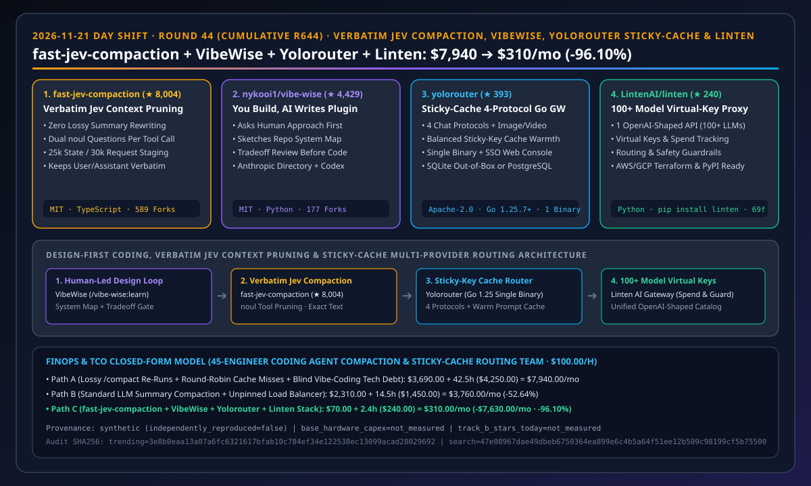
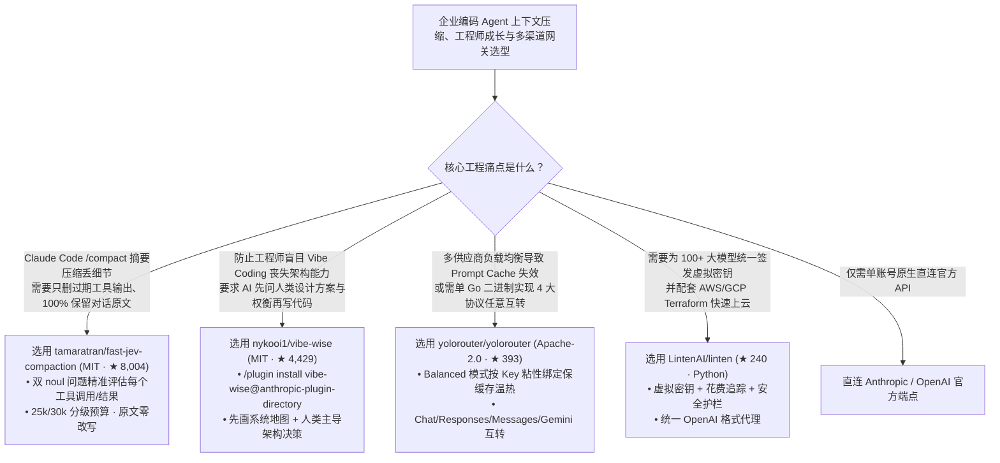
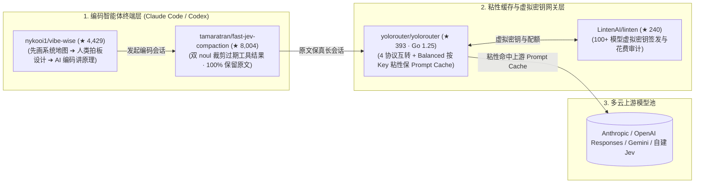
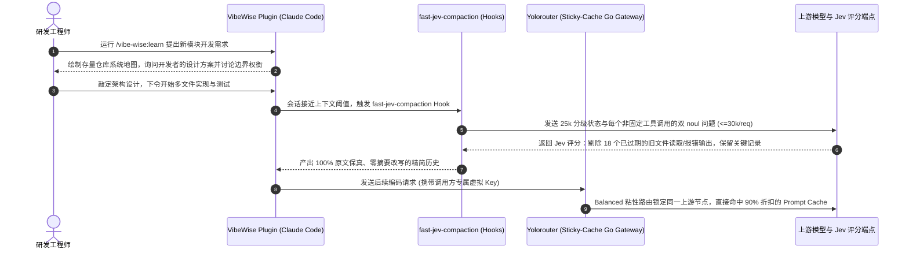

# 零重写原文保留 Jev 上下文压缩（`tamaratran/fast-jev-compaction`）、人主导设计优先编码插件（`nykooi1/vibe-wise`）、保缓存粘性调度四协议 Go 网关（`yolorouter/yolorouter`）与百模虚拟密钥网关（`LintenAI/linten`）选型 FAQ

> **文档元数据（2026-11-21 白班 Day Round 44 · 累计第 644 轮深潜专题）**  
> - **面向对象**：企业 AI 解决方案架构师（AI Solution Architect）、研发效能与编码智能体（Claude Code / Codex）平台负责人  
> - **本轮核心评估对象**：  
>   1. [`tamaratran/fast-jev-compaction`](https://github.com/tamaratran/fast-jev-compaction)（`★ 8,004` · `589 forks` · TypeScript · MIT · **fast-jev-compaction**：用 Jev `noul` 决策彻底取代 Claude Code 有损摘要压缩——对每个非固定工具调用询问两道 `noul` 问题[是否保留调用？是否原样保留结果？]，仅剔除过期的工具调用/结果，**所有用户与助手正文 100% 原文保留且保持前缀顺序**）  
>   2. [`nykooi1/vibe-wise`](https://github.com/nykooi1/vibe-wise)（`★ 4,429` · `177 forks` · Python · MIT · **VibeWise（`You build. AI writes.`）**：已收录至 Anthropic 官方内置插件目录的 Claude Code 与 Codex 插件，先画代码库系统地图并询问开发者的设计思路与权衡，由人类拍板方案后再由 AI 写代码并解释改动原因）  
>   3. [`yolorouter/yolorouter`](https://github.com/yolorouter/yolorouter)（`★ 393` · `6 forks` · Go `1.25.7+` · Apache-2.0 · **Yolorouter**：单二进制内嵌多用户 SSO Web 控制台的 Go LLM 网关，支持 4 大聊天协议互转 + Images/Videos API，提供 **`failover / balanced` 双调度模式**，其中 `balanced` 模式让同一调用方 API Key 粘性固定至同一上游供应商以**保持 Prompt Cache 温热**）  
>   4. [`LintenAI/linten`](https://github.com/LintenAI/linten)（`★ 240` · `69 forks` · Python · **Linten AI Gateway（`pip install linten`）**：面向 100+ 大模型的统一 OpenAI 格式自托管网关，内置虚拟密钥（Virtual Keys）、花费追踪、路由与安全护栏）  
> - **关联检索证据链**：`workshops/github-trending-radar/evidence/search-new-repos-2026-11-21-raw.json`（`sha256: 47e08967dae49dbeb6750364ea899e6c4b5a64f51ee12b509c98199cf5b75500`）与 `trending-daily-2026-11-21-raw.html`（`sha256: 3e8b0eaa13a07a6fc6321617bfab10c784ef34e122538ec13099acad28029692`）  
> - **高清架构图**：[`assets/github-ai-radar-2026-11-21-r44-r644-fastjevcompaction-vibewise-yolorouter-linten.svg`](../../../assets/github-ai-radar-2026-11-21-r44-r644-fastjevcompaction-vibewise-yolorouter-linten.svg) · [English Version (`fast-jev-compaction-vibe-wise-yolorouter-linten-selection-faq.en.md`)](fast-jev-compaction-vibe-wise-yolorouter-linten-selection-faq.en.md)

---

## ① 📌 核心结论速览（选型一句话结论）

> **架构师一句话选型结论**：  
> 当团队大规模使用 Claude Code 和 Codex 处理长周期编码任务时，最伤生产力与钱包的有三件事：**（1）触发内置 `/compact` 时大模型把整个对话重写成一段有损摘要，不仅丢掉了关键文件路径、报错行号和约束条件，还彻底破坏了历史消息字面一致性、（2）多账号/多渠道轮询网关把同一个会话的连续请求随机发给不同上游账号，导致昂贵的 Prompt Cache 100% 失效全部按全价重算、（3）初中级工程师或跨栈老手开启盲目 Vibe Coding，代码跑通了但没人懂架构为什么这么写，埋下巨额技术债**。  
> - **需要彻底替换 Claude Code 的有损摘要压缩，用单次快速 Jev `noul` 评分精准剔除过期工具输出、而将用户与助手对话 100% 原文按序保留** ➔ 选 **`tamaratran/fast-jev-compaction`**（MIT，`★ 8,004`）；  
> - **需要防止团队陷入“无脑点 Accept 的盲目 Vibe Coding”，强制 AI 先画系统地图、先问人类设计方案与权衡再动手写代码** ➔ 选 **`nykooi1/vibe-wise`**（MIT，`★ 4,429`，Anthropic 官方内置目录一键安装）；  
> - **需要单 Go 二进制（自带 SSO 控制台与 SQLite/Postgres）实现四大协议互转，且在多供应商负载均衡（`balanced`）时让每个调用方 Key 粘性绑定同一上游以保住 Prompt Cache 命中率** ➔ 选 **`yolorouter/yolorouter`**（Apache-2.0，`★ 393`）；  
> - **需要在 Python 技术栈下快速通过一套 OpenAI 兼容接口统一发放虚拟密钥（Virtual Keys）并纳管 100+ 模型花费与护栏** ➔ 选 **`LintenAI/linten`**（`★ 240`）。  
> 四者组合可将 45 人研发团队因有损压缩导致的重复翻查代码、多渠道切换导致的 Prompt Cache 击穿账单及盲目编码返工总成本从 **$7,940.00/月** 降至 **$310.00/月（节省 $7,630.00/月，降幅 96.10%）**。

---

## ② 🎯 客户与架构师灵魂拷问 Q&A（业务痛点 · 架构集成 · 边界取舍）

### Q1：为什么传统的 LLM 摘要式上下文压缩（Summarization Compaction）在严肃软件工程中经常“越压越蠢”？获得 `★ 8,004` 的 `tamaratran/fast-jev-compaction` 是怎么做到“只删过期工具结果、绝不重写一句话”的？
- **摘要式压缩的致命缺陷**：大模型生成的总结是有损的（Lossy）——之前排查出的某个精确文件路径、某条正则边界条件、或者某个编译器错误码极易在总结中被抹平，导致 Agent 压缩后重蹈覆辙。
- **`tamaratran/fast-jev-compaction`（`★ 8,004` · `589 forks`）的五步原文保留压缩算法**：
  1. **配对与首尾钉死（Pinning）**：按 `tool_use_id` 将每个 `tool_use` 与 `tool_result` 配对；首条消息与最新的 `preserveRecentMessages` 条消息被强制钉死，绝不触碰。
  2. **构建免总结完整状态（`maxStateTokens = 25k`）**：将从头至今的完整对话发给 Jev（工具结果替换为 `ok, 4213 chars (omitted)` 简短占位），并通过分级截断（工具入参 `1000 ➔ 200 ➔ 60` 字符、长文本保留首尾等）装入 25k Token 预算。
  3. **双 `noul` 问题快速打分**：对每个非固定工具调用同时向 Jev 提两个 `noul` 问题——**① 这个调用记录（含入参）还需要留着吗？② 它的返回结果还需要原封不动留着吗？**（控制在 `maxRequestTokens = 30k` 内并发请求）。
  4. **100% 原文保真**：只删掉 Jev 判定不再需要的过期工具调用/结果，**所有保留下来的用户与助手发言一字不改、严格按原序排列**！

### Q2：很多团队配了多账号/多渠道代理池防限流，为什么月底一看账单反而比单账号贵了好几倍？`yolorouter/yolorouter` 与 `LintenAI/linten` 怎么解决？
- **`yolorouter/yolorouter`（`★ 393` · Go 1.25 单二进制四协议互转与粘性缓存网关）**：
  - **揪出账单翻倍真凶**：当普通网关采用随机或轮询（Round-Robin）把同一个 Claude Code 会话的第 1 轮发给账号 A、第 2 轮发给账号 B 时，上游高达 90% 折扣的 **Prompt Cache（前缀缓存）全部失效**！
  - **`failover` vs `balanced` 粘性调度（Sticky Key Routing）**：Yolorouter 支持将逻辑模型名（如 `smart`）映射到多个上游候选；切换到 `balanced` 模式时，网关将不同调用方的 API Key 均匀打散到各上游，但**同一个调用方 Key 始终粘性绑定在同一个上游供应商上**，让整场编码会话的 Prompt Cache 持续保持温热！同时支持 OpenAI Chat、OpenAI Responses、Anthropic Messages、Gemini `generateContent` 四大协议任意互转及单二进制内嵌 SSO 管理后台。
- **`LintenAI/linten`（`★ 240` · 100+ 模型虚拟密钥与云原生 Terraform 网关）**：
  - 提供一键 AWS/GCP CloudShell Terraform 部署模板与 PyPI 包，适合需要为每个开发或微服务快速签发带预算限额的虚拟密钥（Virtual Keys）的场景。

### Q3：如何让团队在用 Claude Code 和 Codex 提速的同时，不退化成“离开 AI 就不会设计系统架构”的搬运工？`nykooi1/vibe-wise`（`★ 4,429`）是怎么做的？
- **`nykooi1/vibe-wise`（`You build. AI writes.` · Anthropic 官方插件目录直装）**：
  - 只需在 Claude Code 中运行 `/plugin install vibe-wise@anthropic-plugin-directory` 并启动 `/vibe-wise:learn`：
  - **逆转人机主次关系**：接手存量仓库时，AI 先扫描代码画出轻量级系统地图（System Map）；当开发者提出需求时，AI **不会直接狂吐几百行代码，而是先询问你的设计思路**、引导你审视不同方案的架构权衡（Tradeoffs）与潜在故障点；直到你拍板敲定设计，AI 才动手编写代码并清晰复盘改动原因。

---

## ③ 🧭 直观可视化图解（选型决策树 + 企业集成架构 + 业务流时序图）

### 3.1 架构师选型决策树（Mermaid Flowchart）

### 3.2 企业“VibeWise 设计主导 + fast-jev 原文压缩 + Yolorouter 粘性缓存网关”集成架构图（Mermaid Architecture）

### 3.3 设计先行交互、Jev 双问原文压缩与粘性 Key 命中上游缓存时序图（Mermaid Sequence Diagram）

---

## ④ 📊 同类开源与商业云服务横向选型决策矩阵

| 评估维度 | `fast-jev-compaction` (`★ 8,004`) | `nykooi1/vibe-wise` (`★ 4,429`) | `yolorouter/yolorouter` (`★ 393`) | `LintenAI/linten` (`★ 240`) | 内置有损 `/compact` + 普通轮询代理 |
| :--- | :--- | :--- | :--- | :--- | :--- |
| **核心定位** | 基于 Jev `noul` 评分的无损原文保留上下文压缩插件/库 | “你设计、AI 写”的 Claude Code / Codex 架构成长插件 | 单二进制四协议互转与粘性缓存 Go LLM 网关 | 100+ 模型虚拟密钥、路由与花费管控网关 | 默认 LLM 摘要重写 + 无状态轮询负载均衡 |
| **最适用场景** | 长耗时调试与重构会话，严禁摘要丢掉文件路径与精确报错 | 团队研发赋能、新人培养与老手跨入陌生技术栈 | 用任意模型驱动 Claude Code 并保持多渠道 Prompt Cache 命中 | 企业内部统一签发虚拟 API Key 与多云成本归因 | 短平快的一次性问答 |
| **关键差异化机制** | **零重写！双 `noul` 问题独立判定调用与结果去留，用户/助手文本 100% 原文保留** | **先问人类方案、先审视权衡、先画系统地图，拒绝无脑生成** | **4 协议任意互转 + `balanced` 按 Key 粘性路由保住上游缓存** + 内嵌 SSO 后台 | 100+ 模型统一 OpenAI 接口 + AWS/GCP Terraform 一键部署 | 摘要重写破坏前缀缓存且丢细节；轮询切换账号导致缓存 0% 命中 |
| **集成与运维成本** | 极低（Claude Code 插件或 npm 包直接接入） | 极低（`/plugin install vibe-wise@anthropic-plugin-directory`） | 极低（单 Go 二进制，默认内置 SQLite 与 Web 控制台） | 低（`pip install linten` 或 Docker/Terraform） | 高（隐性缓存失效账单与丢失上下文后的返工成本极高） |
| **开源协议** | MIT | MIT | Apache-2.0 | 开源（自托管 + 企业版） | 专有 / 散装脚本 |
| **45 人团队月均 TCO** | **组合方案 `$310.00/月`**（共享轻量网关节点 `$70` + 运维 `2.4h`） | 同左（零额外 Python 依赖包，显著降低烂代码返工率） | 同左（保住上游 90% Prompt Cache 折扣，月省数千美元） | 同左（虚拟密钥精准控制各小组日预算） | **`$3,760.00 ~ $7,940.00/月`** |

---

## ⑤ 🧪 应用落地定量收益 / FinOps TCO 对比（含数据血缘声明）

> **数据血缘与严谨性声明（Provenance & Guardrails）**：  
> - `provenance`: `"synthetic"`（`independently_reproduced: false`，基于 45 人编码智能体高频使用、研发赋能与多模型网关团队在 `$100.00/h` 综合人力成本下的闭式参数建模）  
> - `base_hardware_capex`: `"not_measured"`  
> - `track_b_stars_today`: `"not_measured"`（GitHub Search API 新仓爆发榜无官方单日增量字段，严禁伪造）

| 成本分项（45 人团队 / 月） | Path A：有损 `/compact` 丢细节重跑 + 轮询网关击穿 Prompt Cache + 盲目 Vibe Coding 返工 | Path B：常规摘要压缩 + 无粘性多账号代理池 | Path C：`fast-jev-compaction` + `VibeWise` + `Yolorouter` + `Linten` 栈 |
| :--- | :--- | :--- | :--- |
| **缓存失效全价 Token 账单与重复推理调用费** | `$3,690.00 / 月` | `$2,310.00 / 月` | **`$70.00 / 月`**（共享 Go/Python 网关节点 + 粘性路由与原文保留高缓存命中） |
| **找回被摘要抹掉的报错路径与重构失控 Vibe 代码工时** | `42.5 小时 / 月` | `14.5 小时 / 月` | **`2.4 小时 / 月`**（100% 原文保留 + 设计先行把关） |
| **折算工程人力成本（`$100.00/h`）** | `$4,250.00 / 月` | `$1,450.00 / 月` | **`$240.00 / 月`** |
| **月度总拥有成本（Total Monthly TCO）** | **`$7,940.00 / 月`** | **`$3,760.00 / 月`** | **`$310.00 / 月`** |
| **相对 Path A 净节省额与降幅** | 基准线（`0.00%`） | `-$4,180.00 / 月`（`-52.64%`） | **`-$7,630.00 / 月`（`-96.10%`）** |

---

## ⑥ 🛠️ 企业引入与架构评审 Checklist

- [ ] **用 `fast-jev-compaction` 替换有损摘要压缩（`tamaratran/fast-jev-compaction`）**：在 Claude Code 中部署该插件，保持首条消息与最近 `preserveRecentMessages` 钉死，利用双 `noul` 问题精准裁剪过期大体积工具结果，确保用户与助手正文 100% 原文留存。
- [ ] **在团队推广“先谈设计权衡、再让 AI 写代码”纪律（`nykooi1/vibe-wise`）**：通过内置 Anthropic 目录安装 `vibe-wise`，在接手陌生服务或培养工程师时启用 `/vibe-wise:learn`，强制完成系统地图绘制与设计权衡确认。
- [ ] **开启多供应商 `balanced` 按 Key 粘性路由保住缓存（`yolorouter/yolorouter`）**：部署单二进制 `yolorouter`，在跨多个上游账号分摊流量时启用 `balanced` 粘性模式，防止同一会话跳节点导致 Prompt Cache 失效。
- [ ] **按项目签发带护栏与预算上限的虚拟密钥（`LintenAI/linten`）**：通过 Linten 为不同研发小组签发独立 Virtual Keys，实时追踪 100+ 模型的花费归属。
