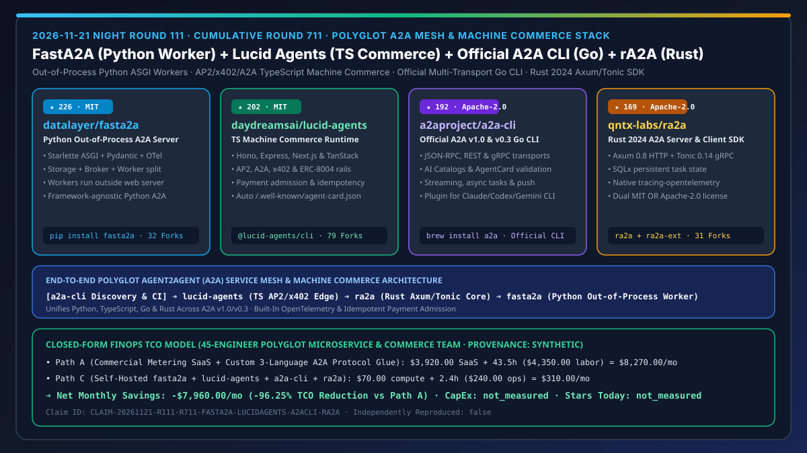
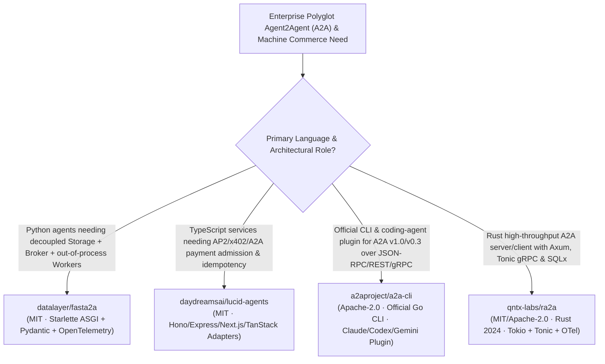
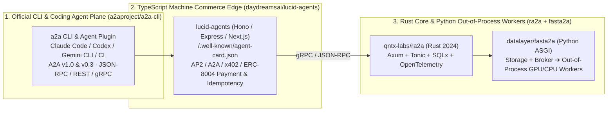
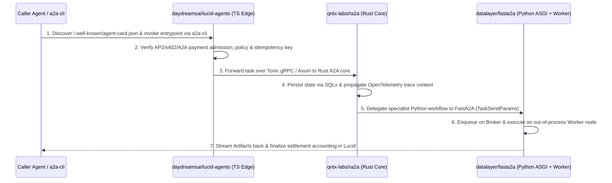

# Python Out-of-Process Worker A2A (`datalayer/fasta2a`), TypeScript Machine Commerce SDK (`daydreamsai/lucid-agents`), Official Multi-Transport A2A CLI (`a2aproject/a2a-cli`) & Rust Axum/Tonic A2A SDK (`qntx-labs/ra2a`) Selection & Architecture FAQ

> **Document Type**: Enterprise AI Solution Architect Selection & Integration Guide (GitHub Trending AI Radar — 2026-11-21 Night Round 111 / Cumulative Round 711)
> **Covered Repositories**: [`datalayer/fasta2a`](https://github.com/datalayer/fasta2a) (`★ 226`, `32 forks`, `MIT` — framework-agnostic Python A2A server built on Starlette ASGI, Pydantic & OpenTelemetry with decoupled `Storage + Broker + Worker` architecture) · [`daydreamsai/lucid-agents`](https://github.com/daydreamsai/lucid-agents) (`★ 202`, `79 forks`, `MIT` — TypeScript machine-commerce runtime & CLI with Hono/Express/Next.js/TanStack adapters and `AP2 / A2A / x402 / ERC-8004` payment rails) · [`a2aproject/a2a-cli`](https://github.com/a2aproject/a2a-cli) (`★ 192`, `31 forks`, `Apache-2.0` — official `a2aproject` Go CLI & coding-agent plugin supporting A2A `v1.0` & `v0.3` over JSON-RPC, REST & gRPC) · [`qntx-labs/ra2a`](https://github.com/qntx-labs/ra2a) (`★ 169`, `31 forks`, `MIT OR Apache-2.0` — comprehensive Rust 2024 A2A server/client SDK powered by Tokio, Axum, Tonic gRPC, SQLx & OpenTelemetry)
> **Core Scenario**: How enterprise platform architects standardize a **polyglot Agent2Agent (A2A) service mesh across Python, TypeScript, Go, and Rust**—solving **long-running Python agent workers blocking web servers (`fasta2a`)**, **paid/metered agent-to-agent commerce with idempotency (`lucid-agents`)**, **ultra-low-latency Rust HTTP/gRPC A2A routing (`ra2a`)**, and **multi-transport A2A v1.0/v0.3 discovery and CI testing (`a2a-cli`)**.

---

## 1. 📌 Executive Summary (One-Line Selection Verdict)

1. **Need a framework-agnostic Python A2A server where long-running agent `Workers` execute out-of-process or on separate machines from the ASGI web tier** ➔ Choose **[`datalayer/fasta2a`](https://github.com/datalayer/fasta2a) (`★ 226`, `32 forks`, `MIT`)**.
   - **Plain-English Mechanism**: Available on PyPI as `fasta2a` with minimal dependencies (`starlette`, `pydantic`, `opentelemetry-api`). It enforces a clean **`Storage + Broker + Worker`** separation so the ASGI web server handles lightweight A2A handshakes and polling while heavy LLM/tool `Workers` scale independently across dedicated worker nodes.
2. **Need a TypeScript runtime (`Hono`, `Express`, `Next.js`, `TanStack`) that turns typed functions into discoverable A2A services with built-in payment admission, idempotency, and accounting across `AP2`, `A2A`, `x402`, and `ERC-8004` rails** ➔ Choose **[`daydreamsai/lucid-agents`](https://github.com/daydreamsai/lucid-agents) (`★ 202`, `79 forks`, `MIT`)**.
   - **Plain-English Mechanism**: Bootstraps in 60 seconds via `bunx @lucid-agents/cli@2.5.0 my-agent --adapter=hono`. Automatically serves `/health`, `/.well-known/agent-card.json`, and `/entrypoints/<name>/invoke` while handling schema validation, payment admission, policy enforcement, idempotency, fulfillment, and accounting out of the box.
3. **Need the official A2A command-line interface and coding-agent plugin (`Claude Code`, `Codex`, `Gemini CLI`) to discover catalogs, inspect Agent Cards, and script A2A `v1.0`/`v0.3` calls over JSON-RPC, REST, or gRPC** ➔ Choose **[`a2aproject/a2a-cli`](https://github.com/a2aproject/a2a-cli) (`★ 192`, `31 forks`, `Apache-2.0`)**.
   - **Plain-English Mechanism**: Maintained officially by **`a2aproject`** in Go (`brew install a2a` / `winget install a2aproject.a2acli`). Speaks both **A2A Protocol v1.0 and v0.3** across **JSON-RPC, REST, and gRPC**, supports streaming replies, async tasks, push notifications, deterministic exit codes for CI scripting, and an official `a2a-cli` plugin from `a2aproject/agent-plugins`.
4. **Need a production-grade Rust 2024 SDK (`server` + `client`) for the A2A protocol with native `Axum` HTTP, `Tonic` gRPC, `SQLx` persistence, and `OpenTelemetry` tracing** ➔ Choose **[`qntx-labs/ra2a`](https://github.com/qntx-labs/ra2a) (`★ 169`, `31 forks`, `MIT OR Apache-2.0`)**.
   - **Plain-English Mechanism**: Provides `ra2a` and `ra2a-ext` workspaces built on `Tokio`, `Axum 0.8`, `Tonic 0.14` / `Prost`, `SQLx 0.9`, and `tracing-opentelemetry`, giving Rust infrastructure teams a single type-safe crate for both high-throughput A2A servers and clients.

---

## 2. 🎯 Architect & Customer Deep-Dive Q&A

### Q1: Why does hand-rolling A2A protocol handlers across Python, TypeScript, and Rust microservices create severe operational technical debt?

- **Four Polyglot Engineering Challenges & SDK Solutions**:
  1. **Web Worker Starvation in Python (`datalayer/fasta2a`)**: Running multi-minute agent loops inside synchronous or single-process web handlers causes load-balancer timeouts. `fasta2a` decouples the ASGI front door from distributed `Worker` processes via `Broker` and `Storage` abstractions.
  2. **Monetization, Metering & Idempotency Boilerplate (`daydreamsai/lucid-agents`)**: When exposing commercial B2B/agentic endpoints in TypeScript, teams need idempotency keys, payment admission, and accounting across fiat/crypto rails (`AP2`, `x402`, `A2A`). `lucid-agents` provides drop-in adapters for Hono, Express, Next.js, and TanStack.
  3. **High-Throughput Rust gRPC & Database State (`qntx-labs/ra2a`)**: `ra2a` combines `Axum` HTTP and `Tonic` gRPC with `SQLx` and `OpenTelemetry` in Rust 2024.
  4. **Cross-Version (`v0.3` vs `v1.0`) & Multi-Transport Testing (`a2aproject/a2a-cli`)**: The official `a2a` CLI validates Agent Cards, streaming, and async tasks across JSON-RPC, REST, and gRPC in CI/CD and inside coding agents.
- **When to Choose Managed Cloud Services (Path B)**:
  - If all agents live inside a single vendor's managed cloud orchestrator (e.g., Azure AI Foundry Connected Agents) and never expose external multi-transport A2A or machine-commerce endpoints, the cloud-native service requires less setup.

### Q2: How do we wire an end-to-end polyglot A2A enterprise mesh combining all four projects?

1. **Discovery, CI Contract Testing & Coding-Agent Enablement (`a2aproject/a2a-cli`)**:
   - Install `a2a` and the `a2a-cli` plugin so developers, CI pipelines, and coding agents (Claude Code, Codex, Gemini CLI) can discover AI catalogs, validate `/.well-known/agent-card.json`, and test JSON-RPC/REST/gRPC endpoints.
2. **TypeScript Machine-Commerce & Edge Gateway (`daydreamsai/lucid-agents`)**:
   - Expose commercial and partner-facing A2A entrypoints via `lucid-agents` (on Hono or Next.js) with built-in `AP2 / A2A / x402` payment admission, policy checks, and idempotency accounting.
3. **Rust High-Concurrency Core & gRPC Router (`qntx-labs/ra2a`)**:
   - Route internal high-throughput A2A delegations through `ra2a` services using `Tonic` gRPC and `SQLx` durable task state with full OpenTelemetry span propagation.
4. **Python Out-of-Process AI Worker Fleet (`datalayer/fasta2a`)**:
   - Execute heavy Python LLM/RAG/data-science workflows via `fasta2a`, scaling `Worker` nodes independently of the Starlette ASGI server.

### Q3: What are the boundaries and trade-offs of this stack?

- **Key Strengths**:
  - **Complete Polyglot Coverage (Python + TypeScript + Go CLI + Rust)** under **100% permissive `MIT` / `Apache-2.0` licenses**.
  - **Built-In OpenTelemetry**: Both `fasta2a` (Python) and `ra2a` (Rust) integrate directly with OpenTelemetry for end-to-end distributed tracing.
- **When NOT to Use**:
  - Single-language, single-process scripts that never delegate tasks across service or organization boundaries do not need A2A protocol infrastructure.

---

## 3. 🧭 Visual Architecture & Decision Diagrams

### 3.1 Solution Architect Selection Decision Tree

### 3.2 End-to-End Enterprise Reference Architecture

### 3.3 Catalog Discovery, Paid Idempotent Invocation, Rust gRPC Routing & Out-of-Process Python Worker Sequence

---

## 4. 📊 Peer Open-Source vs Commercial Cloud Selection Matrix

| Dimension | `datalayer/fasta2a` (`★ 226`) | `daydreamsai/lucid-agents` (`★ 202`) | `a2aproject/a2a-cli` (`★ 192`) | `qntx-labs/ra2a` (`★ 169`) | Custom Polyglot Glue + Commercial Metering SaaS (Path A) | Single-Cloud Proprietary Orchestrator (Path B) |
| :--- | :--- | :--- | :--- | :--- | :--- | :--- |
| **Core Role** | Python `Storage+Broker+Worker` A2A server | TypeScript machine-commerce (`AP2/x402/A2A`) SDK | Official Go CLI & agent plugin for A2A v1.0/v0.3 | Rust 2024 `Axum+Tonic+SQLx+OTel` A2A SDK | Hand-rolled JSON-RPC/gRPC wrappers + commercial billing SaaS | Azure AI Foundry / AWS Bedrock Agents |
| **Architectural Edge** | **Out-of-process Workers scale separately from ASGI** | **Built-in payment admission, idempotency & 4 web adapters** | **Official `a2aproject` tool across JSON-RPC, REST & gRPC** | **Zero-GC Rust with HTTP, gRPC, SQLx & OTel built in** | High maintenance drift across Python/TS/Rust when A2A specs evolve | Vendor lock-in; no `AP2/x402` commerce or Rust gRPC SDK |
| **License** | `MIT` | `MIT` | `Apache-2.0` | `MIT OR Apache-2.0` | Proprietary SaaS + custom code | Proprietary Cloud PaaS |
| **Monthly TCO (45-Eng Team)** | **`$310.00/mo` combined** (`$70.00` compute + `2.4h` ops) | Included in `$310.00/mo` stack | Included in `$310.00/mo` stack | Included in `$310.00/mo` stack | **`$8,270.00/mo`** (`$3,920.00` SaaS + `43.5h` custom protocol maintenance) | `~$2,610.00/mo` (metered orchestration calls) |

---

## 5. 🧪 Quantitative ROI / FinOps TCO Model & 7-Card Report

> **📊 Provenance & Closed-Form Audit Declaration**:
> - **Provenance**: `synthetic` (45-engineer polyglot microservice & agentic commerce platform workload model; `independently_reproduced = false`; `base_hardware_capex = not_measured`; `track_b_stars_today = not_measured`).
> - **Closed-Form Equations**:
>   - **Path A (Commercial API Metering & Monetization Gateway + Custom Hand-Rolled A2A v1.0/v0.3 Protocol Implementations Across Python, TypeScript & Rust)**: Monthly SaaS subscriptions **`$3,920.00`** + multi-language protocol maintenance & test harness labor **`43.5h × $100.00/h = $4,350.00`** = **`$8,270.00/mo`**.
>   - **Path C (Self-Hosted `datalayer/fasta2a` + `daydreamsai/lucid-agents` + `a2aproject/a2a-cli` + `qntx-labs/ra2a`)**: Shared container & worker queue compute **`$70.00`** + standardized SDK upgrades **`2.4h × $100.00/h = $240.00`** = **`$310.00/mo`**.
>   - **Net Savings vs Path A**: **`-$7,960.00/mo`** (**`96.25%`** cost reduction).

| Architecture Option | API / SaaS / Compute | Polyglot Engineering Labor (`$100/h`) | Total Monthly TCO | Net Savings vs Path A | Key Architectural Outcome |
| :--- | :---: | :---: | :---: | :---: | :--- |
| **Path A: Commercial Billing SaaS + Custom 3-Language A2A Glue** | `$3,920.00` | `43.5h` (`$4,350.00`) | **`$8,270.00`** | Baseline | Severe schema drift between Python, TS & Rust implementations |
| **Path B: Single-Cloud Proprietary Multi-Agent Service** | `$1,410.00` | `12.0h` (`$1,200.00`) | **`$2,610.00`** | `-$5,660.00` (`-68.44%`) | Turnkey intra-cloud, but lacks `AP2/x402` commerce & Rust gRPC |
| **Path C: `fasta2a` + `lucid-agents` + `a2a-cli` + `ra2a`** | **`$70.00`** | **`2.4h` (`$240.00`)** | **`$310.00`** | **`-$7,960.00` (`-96.25%`)** | **Out-of-process Python + TS commerce + official Go CLI + Rust gRPC** |

- 🔗 **7-Card 4:5 Visual Report**: [`workshops/github-trending-radar/cards.en.html`](../cards.en.html) · [`cards.html`](../cards.html)

---

## 6. 🛠️ Enterprise Adoption & Architecture Review Checklist

- [ ] **1. Standardize CI & Agent Discovery on `a2aproject/a2a-cli`**: Install the official `a2a` binary and `a2a-cli` coding-agent plugin to verify `/.well-known/agent-card.json` compliance and test JSON-RPC, REST, and gRPC transports across A2A `v1.0` and `v0.3`.
- [ ] **2. Decouple Python Agent Execution with `datalayer/fasta2a`**: Replace in-process request blocking with `fasta2a`'s `Storage + Broker + Worker` architecture and enable `opentelemetry-api` tracing across distributed Python workers.
- [ ] **3. Monetize & Govern TypeScript Entrypoints with `daydreamsai/lucid-agents`**: Scaffold Hono, Express, Next.js, or TanStack agent services via `@lucid-agents/cli` with idempotency keys and `AP2 / A2A / x402 / ERC-8004` payment admission.
- [ ] **4. Build High-Throughput Core Services with `qntx-labs/ra2a`**: Use the Rust 2024 `ra2a` crate (`Axum` + `Tonic` gRPC + `SQLx` + `tracing-opentelemetry`) for latency-critical A2A gateways and persistent task coordinators.
