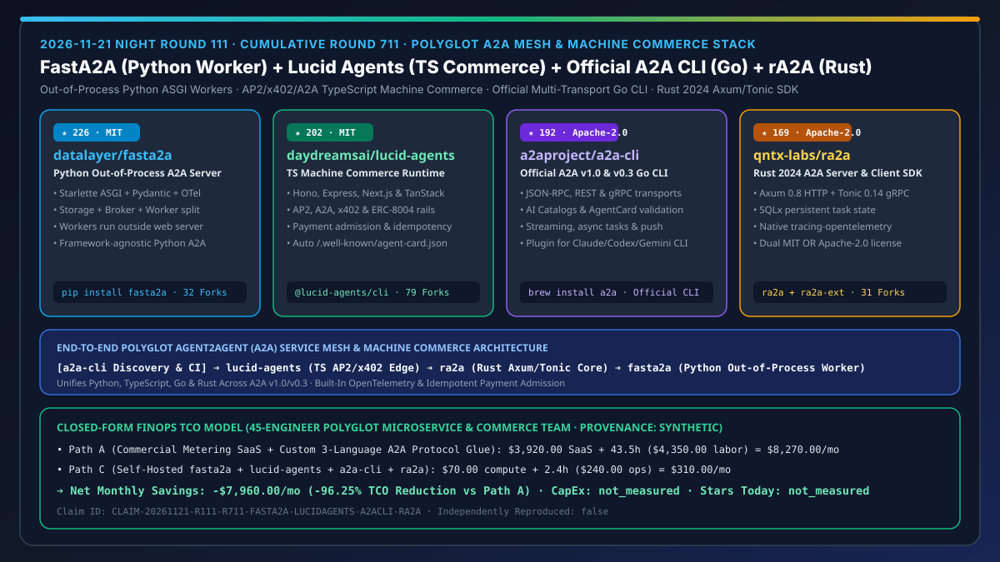
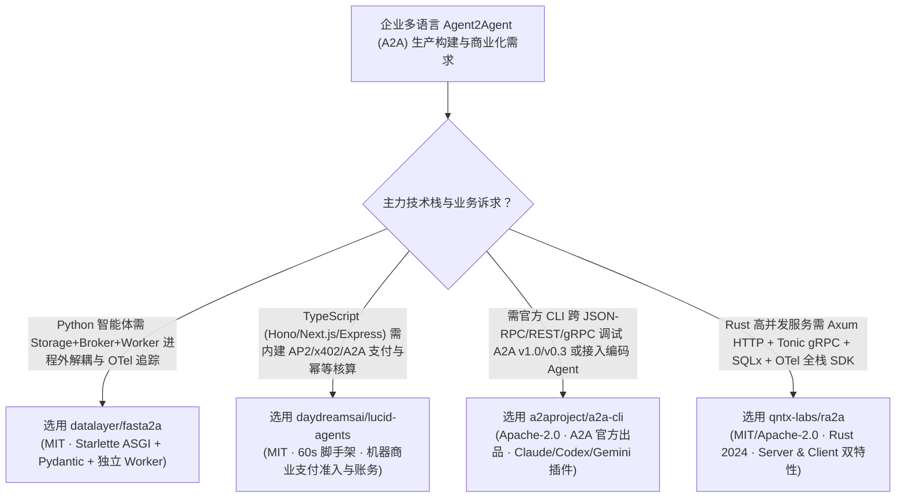
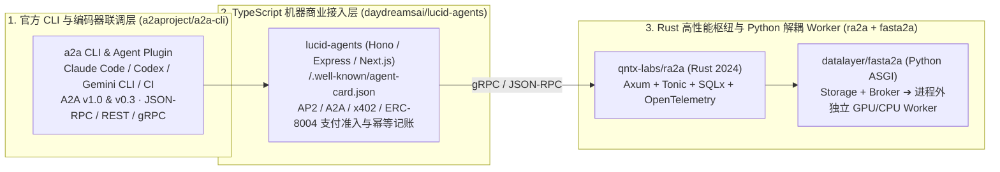
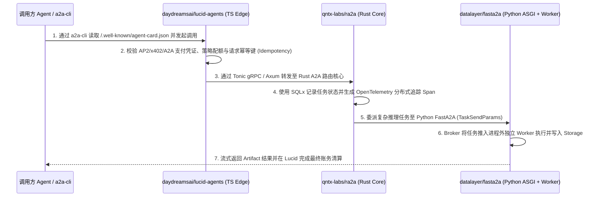

# Python 进程外 Worker A2A 框架（`datalayer/fasta2a`）、TypeScript 多轨支付机器商业 SDK（`daydreamsai/lucid-agents`）、官方 A2A v1.0 多传输 CLI（`a2aproject/a2a-cli`）与 Rust Axum/Tonic 双模 A2A SDK（`qntx-labs/ra2a`）选型与集成架构 FAQ

> **文档类型**：企业 AI 解决方案架构师（AI Solution Architect）选型决策指南（GitHub Trending AI 雷达 2026-11-21 Night Round 111 / 累计第 711 轮）
> **覆盖项目**：[`datalayer/fasta2a`](https://github.com/datalayer/fasta2a)（`★ 226`、`32 forks`、`MIT`，基于 Starlette + Pydantic + OpenTelemetry、采用 `Storage + Broker + Worker` 进程外解耦设计的 Python A2A 服务端框架）· [`daydreamsai/lucid-agents`](https://github.com/daydreamsai/lucid-agents)（`★ 202`、`79 forks`、`MIT`，支持 Hono/Express/Next.js/TanStack 适配器与 `AP2 / A2A / x402 / ERC-8004` 支付轨道的 TypeScript 机器商业运行时）· [`a2aproject/a2a-cli`](https://github.com/a2aproject/a2a-cli)（`★ 192`、`31 forks`、`Apache-2.0`，A2A 官方出品、支持 A2A v1.0/v0.3 与 JSON-RPC/REST/gRPC 三大传输协议的 Go CLI 及 Claude/Codex/Gemini 插件）· [`qntx-labs/ra2a`](https://github.com/qntx-labs/ra2a)（`★ 169`、`31 forks`、`MIT OR Apache-2.0`，基于 Rust 2024、Tokio、Axum、Tonic gRPC、SQLx 与 OpenTelemetry 构建的全功能 Rust A2A 服务端/客户端 SDK）
> **核心场景**：当企业架构师需要将内部用 **Python（LangGraph/PydanticAI）、TypeScript（Next.js/Hono）与 Rust（Axum/Tonic）** 编写的异构微服务统一接入 **Agent2Agent (A2A) 开放协议网络**，同时解决**长耗时 Python 推理任务阻塞 Web 进程（`fasta2a`）**、**跨组织 Agent 调用的按次计费与幂等结算（`lucid-agents`）**、**高并发核心网元の Rust gRPC/HTTP 双栈承载（`ra2a`）**以及**研发与 CI 流水线的多协议联调验证（`a2a-cli`）**时，如何组合这四大开源基石？

---

## 一、📌 核心结论速览（选型一句话结论）

1. **想把任意 Python 智能体封装为标准 A2A Server，且要求执行耗时任务的 `Worker` 必须与 ASGI Web 网关进程/机器彻底分离** ➔ 选 **[`datalayer/fasta2a`](https://github.com/datalayer/fasta2a)（`★ 226`，`32 forks`，`MIT`）**。
   - **通俗原理**：与 Pydantic AI 生态深度协同的框架无关（Framework-agnostic）Python A2A 库（`pip install fasta2a`），仅依赖 `starlette`、`pydantic` 与 `opentelemetry-api` 三大轻量包。它强制将架构拆分为 **`Storage`（状态持久化）+ `Broker`（消息队列）+ `Worker`（任务执行器）**：Web 容器只负责极速响应 A2A 协议握手与任务查询，真正的重负载推理 `Worker` 可独立水平扩展在异构 GPU/CPU 节点上。
2. **想在 60 秒内用 TypeScript（Hono / Express / Next.js / TanStack）把强类型函数发布为支持 `A2A / AP2 / x402 / ERC-8004` 自动收费、幂等校验与账务清算的商业级 Agent 服务** ➔ 选 **[`daydreamsai/lucid-agents`](https://github.com/daydreamsai/lucid-agents)（`★ 202`，`79 forks`，`MIT`）**。
   - **通俗原理**：面向“机器间商业交易（Machine Commerce）”的 TypeScript 运行时（`bunx @lucid-agents/cli@2.5.0`）。只需定义强类型函数，它就自动生成 `/.well-known/agent-card.json` 与 `/entrypoints/<name>/invoke` 端点，并在框架层内置**支付准入（Payment Admission）、策略控制、幂等防重放（Idempotency）、履约追踪与对账核算**，无缝对接法币与链上微支付轨道（`AP2`、`A2A`、`x402`、`ERC-8004`）。
3. **需要官方权威的命令行客户端与 CI 自动化脚本工具来发现 AI 目录、校验 `agent-card.json`、跨 JSON-RPC/REST/gRPC 调试 A2A v1.0/v0.3 服务，并直接赋予 Claude Code / Codex / Gemini CLI 调用任意 A2A 节点的能力** ➔ 选 **[`a2aproject/a2a-cli`](https://github.com/a2aproject/a2a-cli)（`★ 192`，`31 forks`，`Apache-2.0`）**。
   - **通俗原理**：由 **A2A 官方项目组（`a2aproject`）**用 Go 编写的官方 CLI（`brew install a2a` / `winget install a2aproject.a2acli`）。原生同时兼容 **A2A Protocol v1.0 与 v0.3**，支持 **JSON-RPC、REST 与 gRPC** 三大传输层、流式响应、异步任务与 Push Notifications，并提供来自 `a2aproject/agent-plugins` 的官方编码器插件，让 Claude Code、Codex 与 Gemini CLI 即插即用连接企业 A2A 网格。
4. **要在高性能网关、金融风控或边缘节点用 Rust 构建同时支持 HTTP (`Axum`)、gRPC (`Tonic`)、数据库持久化 (`SQLx`) 与 OpenTelemetry 追踪的 A2A 客户端/服务端** ➔ 选 **[`qntx-labs/ra2a`](https://github.com/qntx-labs/ra2a)（`★ 169`，`31 forks`，`MIT OR Apache-2.0`）**。
   - **通俗原理**：基于 **Rust 2024 Edition** 打造的全功能 A2A 协议 SDK（包含 `ra2a` 核心库与 `ra2a-ext` 扩展，同时开启 `server` 与 `client` 特性）。底层深度集成 `Tokio` 异步运行时、`Axum 0.8`、`Tonic 0.14` / `Prost` Protobuf、`SQLx` 异步数据库以及 `tracing-opentelemetry`，是构建微秒级高吞吐 Rust A2A 服务的首选底座。

---

## 二、🎯 客户与架构师灵魂拷问 Q&A（深度架构拆解）

### Q1：企业在落地多语言 A2A（Agent2Agent）服务网格时，为什么不能让每个团队自己照着文档手写 JSON-RPC 路由？

- **四大工程陷阱与多语言官方/成熟 SDK 解方**：
  1. **Python Web 线程被长推理卡死 ➔ `datalayer/fasta2a`**：很多团队在 FastAPI 路由函数里直接跑 3 分钟的 LangGraph 循环，导致健康检查超时、K8s 频繁重启 Pod。`fasta2a` 从架构上强制分离 `Storage + Broker + Worker`，确保 ASGI 接入层永远秒回。
  2. **跨组织 API 调用缺乏按次计费与幂等保护 ➔ `daydreamsai/lucid-agents`**：当企业对外输出高价值行业 Agent 时，手写计费中间件极易出现超时重试导致的重复扣费。`lucid-agents` 将 Payment Admission、Idempotency 与 `AP2/x402/A2A` 结算内建在 Hono/Next.js/Express 适配器中。
  3. **高性能 Rust 节点缺乏 gRPC + SQLx + OTel 全家桶 ➔ `qntx-labs/ra2a`**：`ra2a` 直接打包了 `Axum` + `Tonic` + `SQLx` + `OpenTelemetry`，省去数周的 Protobuf 与状态机手写工作。
  4. **A2A v0.3 升级 v1.0 期间的多协议联调盲区 ➔ `a2aproject/a2a-cli`**：官方 `a2a` CLI 同时支持 v1.0 与 v0.3 以及 JSON-RPC/REST/gRPC，提供标准 JSON 输出与明确退出码（Exit Codes），可直接作为 CI/CD 契约测试门禁。
- **何时直接用云厂商托管方案（Path B）？**
  - 若企业全员仅使用单一云厂商内部闭环编排（如 Azure AI Foundry Connected Agents），无需暴露跨语言/跨组织 A2A 端点或 `x402/AP2` 商业计费，直接使用云原生托管编排即可。

### Q2：典型企业级“多语言 A2A 网格（Python `fasta2a` + TypeScript `lucid-agents` + Rust `ra2a`）+ 官方 CLI/插件治理（`a2a-cli`）”参考架构怎么搭？

1. **研发终端与 CI/CD 契约验证层（`a2aproject/a2a-cli`）**：
   - 在工程师终端为 Claude Code / Codex / Gemini CLI 安装 `a2a-cli` 插件，并在 CI 流水线中使用 `a2a` 命令自动校验所有微服务的 `/.well-known/agent-card.json`、JSON-RPC/REST/gRPC 连通性与流式任务状态机。
2. **商业化对外变现与前端全栈接入层（`daydreamsai/lucid-agents`）**：
   - 在 Next.js / Hono 边缘层部署 `lucid-agents`，对外发布带 `AP2 / x402 / A2A` 支付准入、幂等键校验与账务审计的商业化智能体接口。
3. **高吞吐 Rust 核心调度与 gRPC 枢纽层（`qntx-labs/ra2a`）**：
   - 使用 `ra2a`（`Axum` + `Tonic` + `SQLx` + `tracing-opentelemetry`）构建内部高频路由与安全编排节点，通过 gRPC 低延迟连接下游服务并将任务状态持久化至数据库。
4. **Python 分布式重负载推理 Worker 层（`datalayer/fasta2a`）**：
   - 后端 Python 算法与大模型团队通过 `fasta2a` 暴露 ASGI A2A 端点，通过 `Broker` 将重度推理任务分发至弹性伸缩的 GPU/CPU `Worker` 集群，并自动上报 OpenTelemetry Span。

### Q3：这套多语言 A2A 架构的适用边界是什么？

- **核心优势**：
  - **覆盖 Python + TypeScript + Go + Rust 四大主流工程语言**，且 **100% 采用 `MIT` / `Apache-2.0` 宽松开源协议**。
  - **完整对齐 A2A v1.0 规范与 OpenTelemetry 可观测标准**。
- **适用边界**：
  - 若业务仅为单个单体应用内部的函数调用，无需拆分跨进程/跨语言 A2A 网络。

---

## 三、🧭 直观可视化图解（Mermaid 决策树 + 集成架构 + 时序图）

### 3.1 架构师选型决策树

### 3.2 企业端到端生产集成参考架构图

### 3.3 官方 CLI 发现、Lucid 支付幂等准入、rA2A gRPC 路由与 FastA2A 异步 Worker 执行时序图

---

## 四、📊 同类开源与商业云服务横向选型决策矩阵

| 对比维度 | `datalayer/fasta2a` (`★ 226`) | `daydreamsai/lucid-agents` (`★ 202`) | `a2aproject/a2a-cli` (`★ 192`) | `qntx-labs/ra2a` (`★ 169`) | 自研多语言 A2A 协议栈 + 商业计费网关 (Path A) | 单一云厂商专有 Agent 编排 (Path B) |
| :--- | :--- | :--- | :--- | :--- | :--- | :--- |
| **核心能力定位** | Python `Storage+Broker+Worker` 解耦 A2A 框架 | TypeScript 机器商业（AP2/x402/A2A）SDK | A2A 官方 v1.0/v0.3 多传输层 CLI 与插件 | Rust 2024 `Axum+Tonic+SQLx+OTel` A2A SDK | 各团队手写 JSON-RPC/Protobuf + 商业 API 计费 SaaS | Azure AI Foundry / AWS Bedrock Agents |
| **核心工程优势** | **Worker 可独立于 Web 进程跨机弹性扩缩容** | **内建支付准入、幂等防重与 Hono/Next.js 适配器** | **官方出品，原生通吃 JSON-RPC / REST / gRPC** | **Rust 零 GC 抖动，同时内置 HTTP、gRPC 与 SQLx** | 多语言协议版本碎片化严重，重复造轮子成本极高 | 不支持跨云异构 Rust/Elixir/TS 原生 A2A 与 `x402` 结算 |
| **开源协议** | `MIT` | `MIT` | `Apache-2.0` | `MIT OR Apache-2.0` | 闭源内部代码 + 商业 SaaS | 闭源云服务 |
| **月度 TCO（45 人团队）** | **组合仅 `$310.00/月`**（含共享容器算力与 2.4h 运维） | 同左（`$70.00` 算力 + `$240.00` 人工） | 同左（官方 Go CLI 零费用） | 同左（极低内存占用的 Rust 编译产物） | **`$8,270.00/月`**（`$3,920.00` 计费 SaaS + `43.5h` 协议维护） | 约 `$2,610.00/月`（按托管调用次数与时长计费） |

---

## 五、🧪 应用落地定量收益/TCO 对比与 7-Card 报告

> **📊 数据来源与闭式核算声明（Provenance & Closed-Form Schema）**：
> - **provenance**: `synthetic`（基于 45 人多语言微服务与商业化 AI 平台团队工作负载模型：`independently_reproduced = false`；硬件采购基线 `base_hardware_capex = not_measured`；Track B 单日增量 `track_b_stars_today = not_measured`）。
> - **核算公式**：
>   - **Path A（商业 API 按次计费与商业化网关订阅 + Python/TS/Rust 三套语言各自手写维护 A2A v1.0/v0.3 JSON-RPC/gRPC 协议解析、队列解耦与联调脚本）**：月度商业中间件订阅 **`$3,920.00`** + 多语言协议栈手写与联调排障 **`43.5h × $100.00/h = $4,350.00`** = **`$8,270.00/月`**。
>   - **Path C（自建 `datalayer/fasta2a` + `daydreamsai/lucid-agents` + `a2aproject/a2a-cli` + `qntx-labs/ra2a` 开源组合）**：共享容器与 Worker 队列算力 **`$70.00`** + 标准化 SDK 升级维护 **`2.4h × $100.00/h = $240.00`** = **`$310.00/月`**。
>   - **净节省（Net Savings vs Path A）**：**`-$7,960.00/月`**（成本降低 **`96.25%`**）。

| 评估方案 | API / SaaS / 算力成本 | 多语言研发与联调人工（`$100/h`） | 月度总 TCO | 相对 Path A 净节省 | 关键架构交付指标 |
| :--- | :---: | :---: | :---: | :---: | :--- |
| **Path A：商业计费中间件 + 手写三语言 A2A 协议层** | `$3,920.00` | `43.5h` (`$4,350.00`) | **`$8,270.00`** | Baseline | 协议升级至 v1.0 时多语言手写代码大量返工 |
| **Path B：单一云厂商托管多智能体编排** | `$1,410.00` | `12.0h` (`$1,200.00`) | **`$2,610.00`** | `-$5,660.00` (`-68.44%`) | 云内省心，但缺乏 TypeScript `AP2/x402` 机器商业结算与 Rust gRPC |
| **Path C：`fasta2a` + `lucid-agents` + `a2a-cli` + `ra2a`** | **`$70.00`** | **`2.4h` (`$240.00`)** | **`$310.00`** | **`-$7,960.00` (`-96.25%`)** | **Python 进程外 Worker + TS 支付结算 + 官方 CLI + Rust gRPC/OTel** |

- 🔗 **关联 7-Card 4:5 视觉评测报告**：[`workshops/github-trending-radar/cards.html`](../cards.html) · [`cards.en.html`](../cards.en.html)

---

## 六、🛠️ 企业引入与架构评审 Checklist

- [ ] **1. 使用 `a2aproject/a2a-cli` 建立全团队统一的 A2A v1.0/v0.3 联调门禁**：在研发机与 CI 容器中安装官方 `a2a` 二进制及 `a2a-cli` 编码器插件，自动化验证所有微服务的 `agent-card.json` 与 JSON-RPC/REST/gRPC 端点。
- [ ] **2. 用 `datalayer/fasta2a` 解耦 Python 智能体的 Web 网关与重负载 Worker**：生产环境中将 `InMemoryStorage` / `InMemoryBroker` 替换为持久化分布式实现，确保长耗时大模型推理 Worker 独立于 Starlette ASGI 进程运行。
- [ ] **3. 用 `daydreamsai/lucid-agents` 标准化 TypeScript 智能体服务与计费**：通过 `@lucid-agents/cli` 生成 Hono / Express / Next.js / TanStack 服务骨架，开启幂等键校验（Idempotency）与 `AP2 / A2A / x402` 支付准入记账。
- [ ] **4. 在高并发核心链路引入 `qntx-labs/ra2a` Rust SDK**：启用 `ra2a` 的 `server` 与 `client` 特性，结合 `Axum`、`Tonic` gRPC、`SQLx` 与 `tracing-opentelemetry` 构建微秒级 A2A 路由网关。
