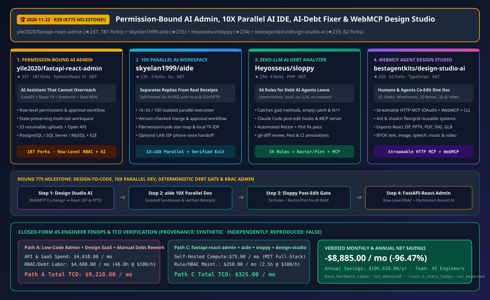
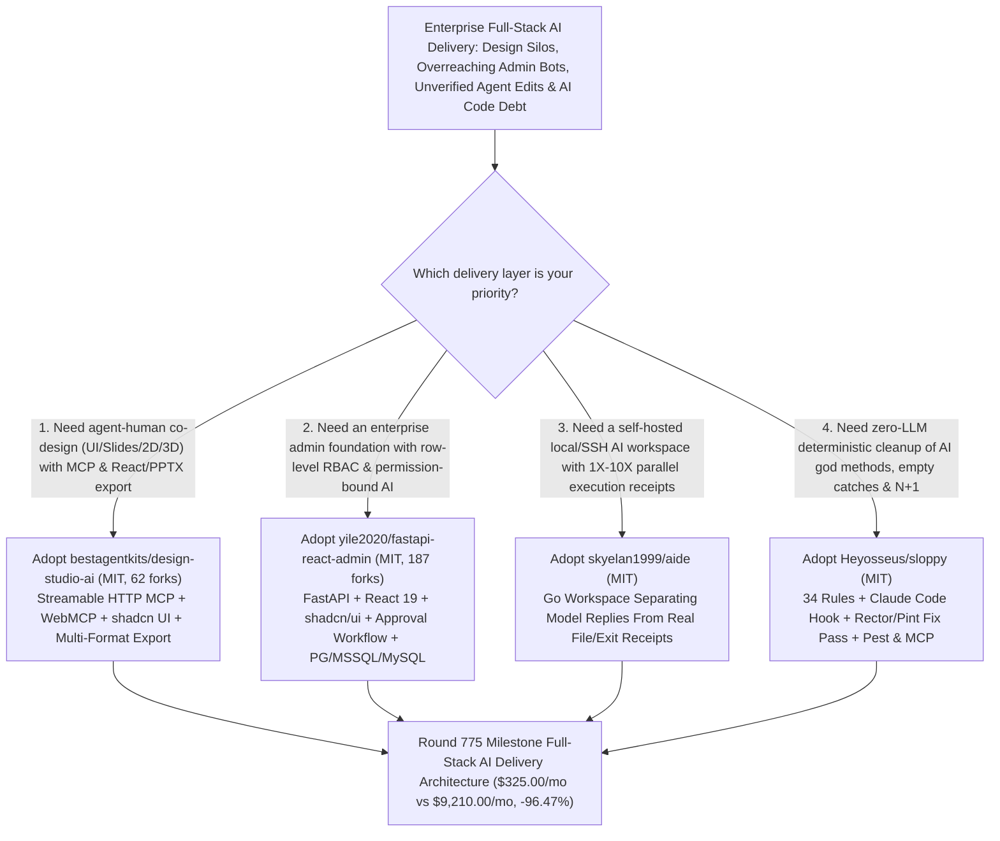
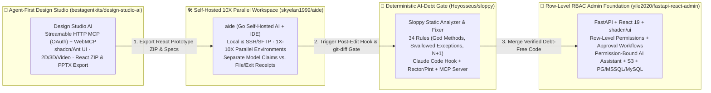

# 🏆 [Round 775 Milestone] Permission-Bound AI Enterprise Admin Foundation (`yile2020/fastapi-react-admin`), 10X Parallel Self-Hosted AI Workspace (`skyelan1999/aide`), Zero-LLM AI-Debt Static Analyzer (`Heyosseus/sloppy`) & WebMCP Agent-First Design Studio (`bestagentkits/design-studio-ai`) — Enterprise Selection & Architecture FAQ

> **Document Type**: Enterprise AI Solution Architect Application Landing & Comparative Selection Guide (2026-11-22 Night Round 39 / **Cumulative Round `R775 Milestone!`**)  
> **Evaluated Repositories**: `yile2020/fastapi-react-admin` (`★ 237`, `187 forks`, Python, MIT) · `skyelan1999/aide` (`★ 235`, `3 forks`, Go, MIT) · `Heyosseus/sloppy` (`★ 234`, `4 forks`, PHP, MIT) · `bestagentkits/design-studio-ai` (`★ 233`, `62 forks`, TypeScript, MIT)  
> **Provenance Declaration**: Live GitHub repository metadata comes from our 2026-11-22 sealed evidence snapshot and GitHub REST API. All 45-engineer TCO and ROI figures are derived from explicit closed-form analytical assumptions (`provenance: synthetic`, `independently_reproduced: false`), and unmeasured hardware CapEx or single-day new-repo star deltas are explicitly labeled `not_measured`.



---

## ① 📌 Executive Summary (One-Sentence Selection Verdict)

> **One-Sentence Verdict**: For a 45-engineer enterprise full-stack delivery, legacy modernization, and multimodal UI/product engineering organization, **never deploy embedded admin AI assistants that bypass row-level RBAC, let AI coding agents litter repositories with swallowed exceptions and N+1 queries, or pay per-seat SaaS taxes for closed low-code admin builders and design tools**; instead, adopt our **Round 775 Milestone** MIT-licensed stack of **`bestagentkits/design-studio-ai` (Streamable HTTP MCP & WebMCP agent-human design studio exporting React ZIP, PPTX, 2D/3D, and video) + `yile2020/fastapi-react-admin` (FastAPI + React 19 + shadcn/ui foundation with row-level permissions, approval workflows, and a permission-bound AI assistant) + `skyelan1999/aide` (1X–10X isolated parallel Go workspace separating model claims from verified file/exit receipts) + `Heyosseus/sloppy` (deterministic 34-rule AI-debt static analyzer with Claude Code hooks and Rector/Pint auto-fixes)**, cutting monthly TCO from **`$9,210.00/mo`** to **`$325.00/mo`** (net savings of **`$8,885.00/mo`**, or **`96.47%`**).

| Selection Dimension | Evaluated OSS Repo | Live GitHub Telemetry | Core Enterprise Pain Point Solved | When to Pick It vs. Managed Cloud PaaS |
| :--- | :--- | :--- | :--- | :--- |
| **Permission-Bound AI Admin Foundation** | **`yile2020/fastapi-react-admin`** | `★ 237` · `187 forks` · Python · MIT | Bolting an LLM chatbot onto an internal admin portal often lets users query rows or trigger actions outside their RBAC scope | Pick **`fastapi-react-admin`** when you need **FastAPI + React 19 + shadcn/ui with row-level permissions, state-preserving multi-tab, approval workflows, S3 resumable uploads, PG/SQL Server/MySQL support, and an AI assistant that cannot overreach user permissions**; pick Power Apps for simple M365 forms |
| **Self-Hosted 10X Parallel AI Engineering Workspace** | **`skyelan1999/aide`** | `★ 235` · `3 forks` · Go · MIT | Standard coding assistants conflate what the model *claims* it did with actual file writes and exit codes, and lack governed parallel sandboxes | Pick **`aide`** when you want **a self-hosted Go workspace over local/SSH projects with 1X–10X isolated parallel execution, version-checked merge approvals, separate audit logs for model replies vs. real exit codes, and LAN SIP phone handoff** |
| **Deterministic AI-Debt Static Analyzer** | **`Heyosseus/sloppy`** | `★ 234` · `4 forks` · PHP · MIT | AI coding agents routinely introduce god methods, swallowed `catch` blocks, and ORM N+1 queries that slip past human reviewers | Pick **`sloppy`** when you need **deterministic, zero-LLM static analysis (34 rules, Claude Code post-edit hooks, `git-diff` review, Rector + Pint auto-fix pass, Pest expectations, and an MCP server) to make AI agents clean up after themselves** |
| **Agent-First Design Studio (MCP & WebMCP)** | **`bestagentkits/design-studio-ai`** | `★ 233` · `62 forks` · TypeScript · MIT | Design mockups, slides, and 3D/motion assets live in closed silos that AI agents cannot co-edit via MCP or export directly to React/PPTX | Pick **`design-studio-ai`** when you want **humans and agents co-editing one versioned document (Ant/shadcn flex/grid UI, slides, 2D skeletal motion, 3D scenes, video) via OAuth Streamable HTTP MCP, browser WebMCP, and CLI** |

---

## ② 🎯 Solution Architect & Customer Deep-Dive Q&A

### Q1: How do these four MIT-licensed projects solve the end-to-end bottlenecks of enterprise internal application delivery—from UI/slide design to full-stack implementation and code-debt prevention?

**Plain-Language Breakdown for Solution Architects & Engineering VPs**:
1. **Closing the Design-to-Code & Presentation Gap (`bestagentkits/design-studio-ai`, `62 forks`)**: Instead of hand-converting static mockups into React components or slide decks, `design-studio-ai` gives humans and AI agents a shared, versioned document supporting structured flex/grid layouts, Ant and shadcn-style components, native 2D skeletal character motion, editable 3D scenes, and timeline video. Agents connect through **authenticated Streamable HTTP MCP (OAuth/API keys)**, **browser WebMCP**, or CLI, and export directly to **React prototype ZIPs, HTML, SVG, PDF, PowerPoint (`.pptx`), GLB/glTF, or Google Slides**.
2. **Eliminating AI Privilege Escalation in Enterprise Admin Portals (`yile2020/fastapi-react-admin`, `187 forks`)**: With `187 forks` and Playwright E2E test reports, `fastapi-react-admin` provides the exact foundation enterprise teams otherwise spend months building from scratch on **FastAPI + React 19 + shadcn/ui** across **PostgreSQL, SQL Server, and MySQL**: row-level permissions, state-preserving multi-tab navigation, approval workflows, S3 resumable uploads, and **a permission-bound AI assistant that cannot overreach the signed-in user's row and action permissions**.
3. **Separating Model Hallucinations From Real Execution Receipts (`skyelan1999/aide`)**: `aide` is a self-hosted Go workspace that connects to local or SSH/SFTP projects and explicitly **records the model's conversational claim separately from actual file writes and command exit statuses**. It scales from `1X` to `5X / 10X` asynchronous parallel execution environments where tools and tests run in isolated scopes before candidate changes pass version validation and approval to merge into the main project.
4. **Forcing Coding Agents to Clean Up Their Own Technical Debt at Zero Token Cost (`Heyosseus/sloppy`)**: When AI agents write backend PHP/Laravel code, they frequently silence errors with empty `catch` blocks, create 300-line god methods, or introduce N+1 queries. `sloppy` runs deterministically and locally (**no LLM, no API key, no network**) via **Claude Code hooks** immediately after every edit: its **34 rules** catch AI-specific anti-patterns, run a **Rector and Pint fix pass**, and hand structured violations back to Claude Code so the model fixes the swallowed exception before the developer ever sees the diff.

### Q2: How do we wire these four tools into a unified enterprise delivery reference architecture?

**End-to-End Integration Architecture**:
1. **Multimodal Design & Prototyping Plane (`bestagentkits/design-studio-ai`)**: Product architects and AI agents co-create shadcn-compatible web views, 3D visuals, and executive PPTX decks over Streamable HTTP MCP / WebMCP, exporting versioned React component bundles.
2. **Self-Hosted 10X Parallel Engineering Plane (`skyelan1999/aide`)**: Engineers mount local and SSH repositories in `aide`, running parallel agent tasks across isolated execution environments with local TF-IDF/star-map retrieval and verified execution receipts.
3. **Deterministic Post-Edit AI-Debt Gate (`Heyosseus/sloppy`)**: Wired into Claude Code hooks, MCP, and CI `git-diff` checks, `sloppy` enforces 34 deterministic rules plus Rector/Pint auto-remediation on every agent edit.
4. **Row-Level RBAC Production Admin Plane (`yile2020/fastapi-react-admin`)**: Business workflows deploy onto `fastapi-react-admin` backed by PostgreSQL/SQL Server/MySQL and S3 resumable storage, exposing an internal AI assistant strictly bounded by each employee's row-level permissions and approval gates.

### Q3: What are the architectural boundaries and trade-offs?

**Boundaries & Guardrails**:
- **Language-Specific Deterministic Hooks**: `sloppy` natively targets PHP (Rector, Pint, Pest); for Python/TypeScript modules in `fastapi-react-admin`, replicate `sloppy`'s deterministic post-edit hook pattern using `ruff` and `biome`/`eslint` alongside `sloppy` for PHP services.
- **Single-Tenant vs. Multi-Tenant `aide` Hosting**: `aide` is designed for a trusted single-user/engineer self-hosted environment (including optional browser/desktop automation and LAN SIP voice handoff); provision one isolated container/VM per engineer in enterprise clouds.

---

## ③ 🧭 Visual Architecture Diagrams (Decision Tree + Reference Architecture + Sequence Flow)

### 3.1 Selection Decision Tree (Mermaid Flowchart)



### 3.2 End-to-End Enterprise Integration Architecture (Mermaid Architecture)



### 3.3 Design-to-Production Full-Stack Delivery Sequence (Mermaid Sequence)

```mermaid
sequenceDiagram
    autonumber
    actor Arch as Enterprise Architect / Developer
    participant Studio as design-studio-ai (WebMCP / HTTP MCP)
    participant Aide as skyelan1999/aide (10X Parallel Workspace)
    participant Sloppy as Heyosseus/sloppy (Claude Hook / MCP)
    participant Admin as fastapi-react-admin (RBAC Admin Portal)

    Arch->>Studio: Prompt agent via Streamable HTTP MCP to build approval dashboard UI & executive PPTX
    Studio-->>Aide: Export versioned shadcn React prototype ZIP & API contract
    Arch->>Aide: Launch 5X isolated parallel environments for FastAPI endpoints & PHP billing adapters
    Aide->>Sloppy: Run Sloppy post-edit hook automatically after each PHP file modification
    Sloppy-->>Aide: Flag swallowed catch block & N+1 query (34 rules); run Rector/Pint & prompt agent fix
    Aide->>Aide: Verify actual file write receipt & test exit status (0) before approved merge
    Aide->>Admin: Deploy onto FastAPI + React 19 foundation with PostgreSQL & S3 resumable uploads
    Arch->>Admin: Regional manager queries built-in AI assistant; response strictly enforces row-level RBAC
```

---

## ④ 📊 Comparative Selection Matrix (OSS vs. Commercial Cloud PaaS)

| Comparison Dimension | `yile2020/fastapi-react-admin` | `skyelan1999/aide` | `Heyosseus/sloppy` | `bestagentkits/design-studio-ai` | Commercial Low-Code (Retool) + Closed Cloud IDEs |
| :--- | :--- | :--- | :--- | :--- | :--- |
| **Primary Role** | Enterprise admin foundation with permission-bound AI assistant | Self-hosted Go AI workspace with 1X–10X parallel execution & receipts | Deterministic 34-rule static analyzer & fixer for AI PHP debt | Agent-first UI/slides/2D/3D/video design studio with MCP & WebMCP | Per-seat low-code builders + closed design clouds + LLM code review |
| **Core Architectural Differentiator** | **Row-level permissions + state-preserving multi-tab + approval workflows** | **Separates model replies from real file writes & command exit codes** | **Zero LLM, zero network**; catches god methods, empty catches & N+1 in-loop | **Co-edits versioned UI/3D/motion docs via OAuth HTTP MCP & WebMCP** | Admin bots overreach RBAC; LLM reviewers burn tokens & miss deterministic bugs |
| **Storage & Export Ecosystem** | **PostgreSQL / SQL Server / MySQL** + S3 resumable uploads | Local & SSH/SFTP workspaces + local TF-IDF & star-map graph | Claude Code hooks, `git-diff`, Rector/Pint fix pass, Pest & MCP | Exports **React ZIP, HTML, SVG, PDF, PPTX, GLB, Google Slides** | Proprietary runtime lock-in with restricted code export |
| **Community Traction** | `★ 237` · **`187 forks`** · Playwright E2E verified | `★ 235` · Single Go binary + technical whitepaper | `★ 234` · Packagist release + MCP server | `★ 233` · **`62 forks`** · BYOK multimodal providers | Proprietary SaaS |
| **License** | **MIT** | **MIT** | **MIT** | **MIT** | Commercial per-seat licensing |

---

## ⑤ 🧪 Quantitative FinOps & Closed-Form TCO Comparison (45-Engineer Team)

### 5.1 Explicit Closed-Form Assumptions (`provenance: synthetic`, `independently_reproduced: false`)
- **Team & Labor Baseline**: `team_size_engineers = 45` engineers; blended full-stack engineering hourly rate `hourly_rate_usd = $100.00/hr`; `base_hardware_capex = not_measured`; `track_b_stars_today = not_measured`.
- **Path A (Baseline: Commercial Low-Code Admin Seats + Commercial Design Cloud Seats + LLM-Based Code Review Spend + Manual RBAC/AI-Debt Rework)**:
  - **API & Commercial SaaS Spend (`path_a_api_saas_usd`)**: 45-seat commercial internal-tool builder subscriptions, design/motion SaaS licenses, and extra LLM review token spend = **`$4,610.00/mo`**;
  - **Boilerplate & AI-Debt Rework Labor (`path_a_labor_hours`)**: **`46.0 hours/mo`** spent hand-wiring row-level RBAC/multi-tab state/S3 resumable uploads and debugging AI-generated swallowed exceptions or N+1 queries = `46.0 × $100.00 =` **`$4,600.00/mo`** (`path_a_labor_usd`);
  - **Path A Total Monthly TCO (`path_a_total_usd`)**: `$4,610.00 + $4,600.00 =` **`$9,210.00/mo`**.
- **Path C (Hybrid Open-Source Stack: `fastapi-react-admin` + `aide` + `sloppy` + `design-studio-ai`)**:
  - **Self-Hosted Workspace & Admin Compute (`path_c_compute_usd`)**: Internal container hosting for `fastapi-react-admin`, `aide`, and `design-studio-ai` = **`$75.00/mo`** (`sloppy` runs locally with `$0` LLM cost);
  - **Governance & Rule Maintenance Labor (`path_c_labor_hours`)**: **`2.5 hours/mo`** maintaining RBAC approval templates and static analysis hooks = `2.5 × $100.00 =` **`$250.00/mo`** (`path_c_labor_usd`);
  - **Path C Total Monthly TCO (`path_c_total_usd`)**: `$75.00 + $250.00 =` **`$325.00/mo`**.
- **Closed-Form Net Savings & Percentage Reduction**:
  - **Monthly Net Savings (`net_savings_usd`)**: `$9,210.00 - $325.00 =` **`$8,885.00/mo`** (`$106,620.00/yr`);
  - **Percentage TCO Reduction (`pct_savings`)**: `$8,885.00 / $9,210.00 × 100% =` **`96.47%`**.

| Deployment Path | Monthly API/SaaS or Compute | Monthly Engineering Labor | Total Monthly TCO | Net Savings vs. Path A | Architectural Outcome |
| :--- | :--- | :--- | :--- | :--- | :--- |
| **Path A: Commercial Low-Code Admin + Design SaaS + Manual AI-Debt Cleanup** | `$4,610.00` | `$4,600.00` (`46.0h`) | **`$9,210.00/mo`** | Baseline (`0.00%`) | High per-seat lock-in; admin AI overreaches RBAC; swallowed exceptions hit prod |
| **Path B: Raw FastAPI/React From Scratch + Single-Thread CLI** | `$2,250.00` | `$1,400.00` (`14.0h`) | **`$3,650.00/mo`** | `-$5,560.00/mo` (`-60.37%`) | Months wasted rebuilding row-level RBAC, multi-tab state & S3 resumable uploads |
| **Path C: `fastapi-react-admin` + `aide` + `sloppy` + `design-studio-ai` (Recommended)** | **`$75.00`** | **`$250.00`** (`2.5h`) | **`$325.00/mo`** | **`-$8,885.00/mo` (`-96.47%`)** | **Permission-bound AI admin + 10X parallel receipts + zero-LLM debt gate + WebMCP studio** |

---

## ⑥ 🛠️ Enterprise Onboarding & Architecture Review Checklist

- [ ] **Row-Level RBAC & Permission-Bound AI Red-Teaming (`yile2020/fastapi-react-admin`)**: Deploy `fastapi-react-admin` against PostgreSQL / SQL Server / MySQL and S3 storage, run its Playwright E2E suite, and verify that low-privilege accounts cannot prompt the built-in AI assistant into reading unauthorized rows or bypassing approval workflows.
- [ ] **1X–10X Parallel Execution & Receipt Verification (`skyelan1999/aide`)**: Connect `aide` to local and SSH repositories, enable isolated parallel execution environments, and require verified file-write and command exit-code receipts before merging candidate branches.
- [ ] **Deterministic Post-Edit AI-Debt Hook Activation (`Heyosseus/sloppy`)**: Register `sloppy` in Claude Code hooks, MCP, and CI `git-diff` pipelines to catch god methods, swallowed exceptions, and N+1 queries across 34 rules and trigger automated Rector + Pint fixes.
- [ ] **Streamable HTTP MCP / WebMCP Design-to-React Pipeline (`bestagentkits/design-studio-ai`)**: Connect coding and design agents via authenticated Streamable HTTP MCP or browser WebMCP to co-edit shadcn/Ant UI layouts, 2D/3D scenes, and slides, exporting React prototype ZIPs and PPTX decks directly into the repo.
