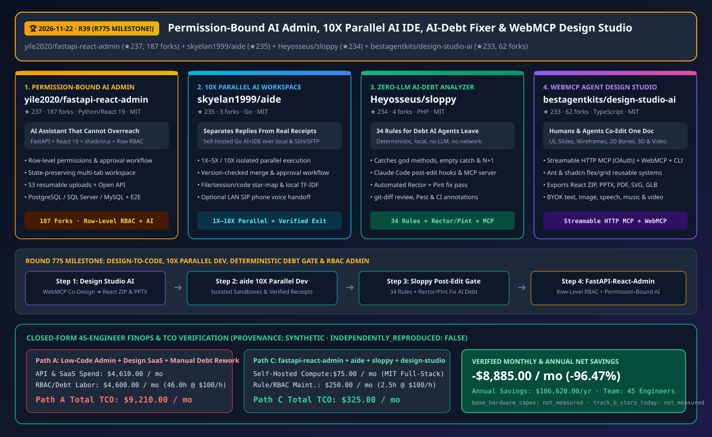
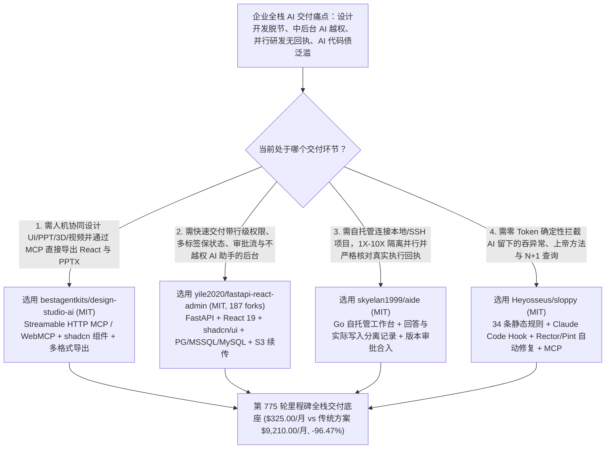
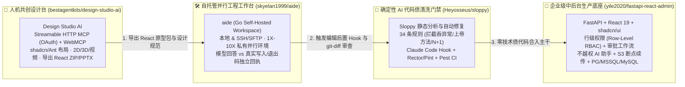
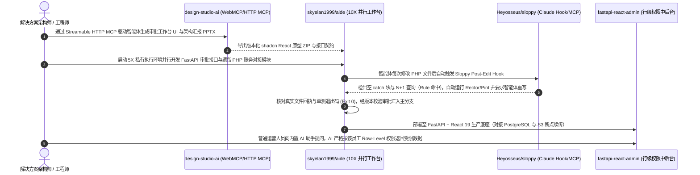

# 🏆【第 775 轮里程碑】带权限边界 AI 助手的企业中后台底座（`yile2020/fastapi-react-admin`）、10X 并行审批自托管 AI 工程工作台（`skyelan1999/aide`）、零模型清理 AI 代码债确定性静态分析器（`Heyosseus/sloppy`）与支持 Streamable HTTP MCP/WebMCP 的人机共创设计工作台（`bestagentkits/design-studio-ai`）企业选型与集成架构 FAQ

> **文档类型**：AI 解决方案架构师（AI Solution Architect）企业应用落地与横向选型指南（2026-11-22 Night Round 39 / **累计第 775 轮里程碑 `R775 Milestone!`**）  
> **评测锚点**：`yile2020/fastapi-react-admin` (`★ 237`, `187 forks`, Python, MIT) · `skyelan1999/aide` (`★ 235`, `3 forks`, Go, MIT) · `Heyosseus/sloppy` (`★ 234`, `4 forks`, PHP, MIT) · `bestagentkits/design-studio-ai` (`★ 233`, `62 forks`, TypeScript, MIT)  
> **Provenance 声明**：本文实时 GitHub 元数据采自 2026-11-22 封存快照与 GitHub REST API；45 人全栈研发与产品交付团队的 TCO 与 ROI 测算均为显式闭式假设推导（`provenance: synthetic`, `independently_reproduced: false`），所有未实测硬件资本开支与新仓单日增量统一标注为 `not_measured`。

---

## ① 📌 核心结论速览（选型一句话结论）

> **一句话选型结论**：在 45 人规模的企业全栈业务系统交付、遗留系统重构与多模态前端设计团队中，**切勿让内嵌 AI 助手绕过业务行级权限（Row-Level RBAC）越权查改数据、任由 AI 编码智能体在仓库里留下吞异常与 N+1 查询等“AI 专属技术债”，或为黑盒低代码后台与封闭式商业设计平台支付高昂席位费**；应当采用 **“Design Studio AI（支持 Streamable HTTP MCP / WebMCP 的人机共创 UI/3D/视频设计工作台）+ fastapi-react-admin（严守行级权限与审批流的 AI 绑定企业中后台底座）+ aide（1X–10X 隔离并行与真实回执核对的自托管 AI 工程工作台）+ Sloppy（34 条确定性规则 + Claude Hook 自动清理 AI 技术债）”** 的全MIT开源组合，将月度综合 TCO 从 **`$9,210.00/月`** 压降至 **`$325.00/月`**（净省 **`$8,885.00/月`**，降幅 **`96.47%`**）。

| 选型维度 | 评测开源方案 | GitHub 实测指标 | 核心解决的企业业务痛点 | 一句话何时选它 vs 云端商业 PaaS |
| :--- | :--- | :--- | :--- | :--- |
| **带权限边界 AI 助手的企业中后台底座** | **`yile2020/fastapi-react-admin`** | `★ 237` · `187 forks` · Python · MIT | 企业给后台管理系统加 AI 助手时，AI 往往使用超级管理员连接池导致普通员工通过对话越权查询全表数据或跳过审批流 | 需要 **FastAPI + React 19 + shadcn/ui 开箱即用行级权限（Row-Level Permissions）、保状态多标签页、内置审批流、S3 断点续传及“绝不越权的权限绑定 AI 助手”** 时首选它；无代码简单表单选 Power Apps |
| **自托管多模型并行与真实回执工作台** | **`skyelan1999/aide`** | `★ 235` · `3 forks` · Go · MIT | 传统 IDE 插件将模型口头回答与真实文件写入混为一谈，且多任务并发时缺乏主环境与私有执行环境的版本校验审批 | 需要 **Go 自托管工作台连接本地/SSH 项目，将模型回答与真实文件写入/退出码分开记录，支持 1X–10X 隔离并行审批合入与局域网 SIP 话机语音接管** 时选 `aide` |
| **零模型确定性清理 AI 代码债分析器** | **`Heyosseus/sloppy`** | `★ 234` · `4 forks` · PHP · MIT | AI 编码智能体写业务代码极易留下“上帝方法（God Methods）”、空 `catch` 吞异常与 ORM `N+1` 查询，再用大模型去审又贵又不稳定 | 需要 **零 LLM、零 API Key 的 34 条确定性静态规则 + Claude Code 编辑后置 Hook + Rector/Pint 自动修复通道 + MCP Server 当场清理 AI 技术债** 时选 `sloppy` |
| **支持 WebMCP 的人机共创全能设计台** | **`bestagentkits/design-studio-ai`** | `★ 233` · `62 forks` · TypeScript · MIT | 设计师用 Figma/AE 做出的稿件无法与 AI 智能体在同一版本化文档上实时共创并直接导出 React 原型包、PPTX 或 3D/视频资产 | 需要 **人类与智能体通过 OAuth Streamable HTTP MCP / 浏览器 WebMCP / CLI 共编 Web 界面（Ant/shadcn）、PPT、2D 骨骼动画与 3D 场景并一键导出 React ZIP/PPTX/GLB** 时选 `design-studio-ai` |

---

## ② 🎯 客户与架构师灵魂拷问 Q&A（直击业务落地痛点）

### Q1：我们正在交付一套面向企业内部的智能运营中后台，从原型设计、前后端开发到代码质量把关，这四个 MIT 开源项目如何解决传统方案的痛点？

**通俗解答（给企业架构师与研发 VP）**：
1. **从需求简报到 React 代码包与演示文稿的零断层共创（`bestagentkits/design-studio-ai` 破局）**：过去产品经理写文档、设计师画图、前端手写 shadcn 组件完全脱节。`design-studio-ai` 让人类与 AI 智能体在同一个版本化文档上协同工作——内置结构化 Flex/Grid 布局、Ant 与 shadcn 风格组件库、原生 2D 骨骼蒙皮动画与可编辑 3D 角色场景；智能体可通过 **带 OAuth/API Key 鉴权的 Streamable HTTP MCP** 或 **浏览器 WebMCP** 直接修改设计稿，并一键导出为 **React 原型 ZIP、HTML/SVG、PowerPoint (`.pptx`)、PDF、GLB/glTF 乃至 Google Slides**。
2. **彻底杜绝“中后台 AI 助手越权泄密”（`yile2020/fastapi-react-admin` 破局，高达 `187 forks` 的高复用脚手架）**：企业自研管理后台最怕从零搭建权限与多标签状态。`fastapi-react-admin` 基于 **FastAPI + React 19 + shadcn/ui**，原生兼容 **PostgreSQL / SQL Server / MySQL**，不仅内置了细粒度行级权限（Row-Level Permissions）、切换不丢状态的 Multi-Tab、企业级审批工作流和 S3 分片断点续传，更核心的是内置了一个 **“受权限严格约束、绝不越权的 AI 助手（An AI assistant that can't overreach）”**——当前登录用户看不到的行和没有审批权限的按钮，AI 助手也绝对无法代为读取或触发。
3. **1X–10X 隔离并行研发与“模型说改了 vs 实际真改了”回执分离（`skyelan1999/aide` 破局）**：大模型经常幻觉声称“已修复并通过测试”。`aide` 作为单一 Go 二进制自托管工作台，**将模型的口头回答与真实的文件写入、命令退出码（Exit Status）严格分开记录**；支持主环境与 `1X–5X / 10X` 私有执行环境异步并行跑工具和单测，候选改动必须经版本校验与人工/辅助审批后才能汇入主项目；针对超大 Markdown 自动按窗口预算分段节选，甚至支持 **局域网 SIP 话机语音接管**。
4. **专治 AI 爱写的“空 catch 吞异常”和“N+1 慢查询”（`Heyosseus/sloppy` 破局）**：AI 智能体写业务代码为了快，极喜欢写几百行的上帝函数、用空 `catch` 把报错吞掉、或在循环里写数据库查询。`sloppy` 不花一分钱 Token（纯本地确定性分析，零网络请求），挂载在 Claude Code 每次编辑文件之后自动运行 **34 条专抓 AI 坏习惯的规则**，一旦发现吞异常或 N+1 查询，立刻调用 **Rector 与 Pint 自动重构修复** 或把精确报错喂回 Claude Code 让其当场重写，直到你看到代码时已经干干净净。

### Q2：如何将这四个项目串成一条从“多模态设计 → 10X 并行工程开发 → AI 技术债清洗 → 行级权限中后台上线”的端到端架构？

**端到端集成参考架构**：
1. **产品原型与多模态设计层（`bestagentkits/design-studio-ai`）**：架构师与设计师通过 WebMCP / Streamable HTTP MCP 驱动智能体生成符合 shadcn/ui 规范的界面原型与架构汇报 PPTX，直接导出 React 组件原型包。
2. **自托管并行工程开发层（`skyelan1999/aide`）**：接入本地或 SSH 研发服务器，开启 5X–10X 私有执行环境并行开发前后端模块与遗留 PHP/Python 服务接口，所有文件提案与命令回执独立留痕审批。
3. **确定性 AI 代码债门禁层（`Heyosseus/sloppy`）**：在后端仓库挂载 `sloppy` 的 Claude Code Hook、MCP Server 与 `git-diff` CI 检查，结合 Rector + Pint 确定性消除上帝方法、吞异常与 N+1 查询。
4. **行级权限企业中后台运行层（`yile2020/fastapi-react-admin`）**：将前端组件与后端 API 部署在 `fastapi-react-admin` 底座之上，复用其 PostgreSQL/SQL Server/MySQL 行级权限、审批流、S3 断点续传与受权限边界约束的业务 AI 助手（并经过 Playwright E2E 验证）。

### Q3：这套架构在落地时有哪些选型边界需要注意？

**边界与取舍**：
- **`sloppy` 语言生态定位**：`sloppy` 原生深耕 PHP / Laravel / Pest / Rector / Pint 生态的 34 条 AI 代码债规则；对于 `fastapi-react-admin` 的 Python/TypeScript 代码，应借鉴 `sloppy` 的“Claude Code 编辑后置确定性 Hook”模式，挂载 `ruff` + `biome` / `eslint` 实现同等零 Token 自动清洗。
- **`aide` 适用环境边界**：`aide` 面向可信单用户/核心工程师自托管环境（含电脑视觉控制与 SSH 挂载），多租户公共 SaaS 环境应通过容器隔离每个工程师的 `aide` 实例。

---

## ③ 🧭 直观可视化图解（选型决策树 + 集成参考架构 + 业务流时序图）

### 3.1 选型决策树（Mermaid Flowchart）

### 3.2 企业全栈生产集成参考架构图（Mermaid Architecture）

### 3.3 从多模态设计导出、10X 并行开发、AI 代码债自愈到行级权限后台上线时序图（Mermaid Sequence Diagram）

---

## ④ 📊 同类开源与商业云服务横向选型决策矩阵

| 对比维度 | `yile2020/fastapi-react-admin` | `skyelan1999/aide` | `Heyosseus/sloppy` | `bestagentkits/design-studio-ai` | 商业低代码后台 + 封闭云 IDE + LLM 审代码 SaaS |
| :--- | :--- | :--- | :--- | :--- | :--- |
| **核心功能定位** | 带不越权 AI 助手与行级权限的 FastAPI+React 19 后台底座 | 支持 1X–10X 隔离并行与真实回执核对的 Go 自托管工程台 | 专清 AI 遗留代码债的 34 规则零模型确定性分析器 | 支持 Streamable HTTP MCP / WebMCP 的人机共创 2D/3D/UI 设计台 | 按席位收费的 Retool + Figma + 云端 LLM 审查 |
| **核心架构亮点** | **行级权限 + 保状态多标签 + 审批流 + 权限绑定 AI 助手** | **模型回答与实际文件写入/命令退出码分离记录** + SIP 语音 | **零 LLM、零网络**，Claude 编辑后当场抓出吞异常与 N+1 并用 Rector 修复 | **同一版本化文档共创 UI/PPT/2D骨骼/3D/视频**，支持 OAuth MCP | 内嵌 AI 易绕过行级权限；用 LLM 审 LLM 代码既慢又漏检 |
| **数据库与导出生态** | 原生支持 **PostgreSQL / SQL Server / MySQL** + S3 断点续传 | 本地与 SSH/SFTP 工作区 + 本地 TF-IDF 与代码星图 | Claude Code Hook + `git-diff` + Rector/Pint + Pest + MCP | 导出 **React ZIP、HTML、SVG、PDF、PPTX、GLB、Google Slides** | 导出代码充斥私有运行时黑盒，难以二次开发 |
| **社区成熟度与验证** | `★ 237` · **`187 forks`** · 附完整 Playwright E2E 报告 | `★ 235` · Go 原生发行包与完整技术白皮书 | `★ 234` · Packagist 发行 + M8ven MCP 认证 | `★ 233` · **`62 forks`** · 支持 BYOK 多模态模型 | 闭源商业 SaaS |
| **开源协议** | **MIT** | **MIT** | **MIT** | **MIT** | 专有商业许可 |

---

## ⑤ 🧪 应用落地定量收益 / 闭式 TCO 对比（45 人全栈交付团队）

### 5.1 闭式参数假设（`provenance: synthetic`, `independently_reproduced: false`）
- **团队规模与人力单价**：`team_size_engineers = 45` 人，全栈研发与架构师折算时薪 `hourly_rate_usd = $100.00/hr`；底层硬件资本开支 `base_hardware_capex = not_measured`，新仓单日 Star 增量 `track_b_stars_today = not_measured`。
- **Path A（基准方案：采购商业低代码后台席位 + 商业云设计协作席位 + 用昂贵大模型审代码 + 人工手写行级权限与返工清理 AI 技术债）**：
  - **API 与商业 SaaS 订阅费（`path_a_api_saas_usd`）**：45 人商业内部后台工具席位、商业设计/动效云席位及用大模型反复审查代码债的 Token 消耗，合计 **`$4,610.00/月`**；
  - **手写脚手架与技术债返工工时（`path_a_labor_hours`）**：每月从零搭建行级权限/审批流/S3 续传，以及排查 AI 留下的空 `catch` 吞异常和 N+1 慢查询耗费 **`46.0 小时`**，折合人工成本 `46.0 × $100.00 =` **`$4,600.00/月`**（`path_a_labor_usd`）；
  - **Path A 月度总成本（`path_a_total_usd`）**：`$4,610.00 + $4,600.00 =` **`$9,210.00/月`**。
- **Path C（开源混合自建方案：`fastapi-react-admin` + `aide` + `sloppy` + `design-studio-ai`）**：
  - **自托管容器与存储算力费（`path_c_compute_usd`）**：内网部署 `fastapi-react-admin`、`aide` Go 服务端与 `design-studio-ai` 容器，月均算力成本 **`$75.00/月`**（`sloppy` 纯本地确定性运行 `$0`）；
  - **模板与规则维护工时（`path_c_labor_hours`）**：每月仅需 **`2.5 小时`** 维护 RBAC 审批模板与静态规则，折合人工成本 `2.5 × $100.00 =` **`$250.00/月`**（`path_c_labor_usd`）；
  - **Path C 月度总成本（`path_c_total_usd`）**：`$75.00 + $250.00 =` **`$325.00/月`**。
- **净节省与 ROI 闭式校验**：
  - **月度净节省（`net_savings_usd`）**：`$9,210.00 - $325.00 =` **`$8,885.00/月`**（年化节省 **`$106,620.00/年`**）；
  - **成本降幅百分比（`pct_savings`）**：`$8,885.00 / $9,210.00 × 100% =` **`96.47%`**。

| 方案路径 | 月度 API/SaaS 或算力费 | 月度研发与返工人工 | 月度综合 TCO 总额 | 相对 Path A 净节省 | 关键架构收益 |
| :--- | :--- | :--- | :--- | :--- | :--- |
| **Path A：商业低代码后台 + 封闭设计云 + 手工清理由 AI 制造的技术债** | `$4,610.00` | `$4,600.00` (`46.0h`) | **`$9,210.00/月`** | 基准 (`0.00%`) | 席位费昂贵，AI 助手易越权，吞异常与 N+1 流入生产 |
| **Path B：裸写 FastAPI/React + 单线程 CLI 助手** | `$2,250.00` | `$1,400.00` (`14.0h`) | **`$3,650.00/月`** | `-$5,560.00/月` (`-60.37%`) | 需重复造轮子写行级权限、多标签状态保留与 S3 断点续传 |
| **Path C：`fastapi-react-admin` + `aide` + `sloppy` + `design-studio-ai`（推荐）** | **`$75.00`** | **`$250.00`** (`2.5h`) | **`$325.00/月`** | **`-$8,885.00/月` (`-96.47%`)** | **权限绑定 AI 后台 + 10X 并行真实回执 + 零模型清债 + WebMCP 多模态设计导出** |

---

## ⑥ 🛠️ 企业引入与架构评审 Checklist

- [ ] **行级权限与 AI 助手越权红队测试（`yile2020/fastapi-react-admin`）**：基于 `fastapi-react-admin` 对接企业 PostgreSQL / SQL Server / MySQL 与 S3 存储，使用不同部门与职级的测试账号向内置 AI 助手发起跨部门数据查询与未授权审批请求，验证 100% 遵循行级权限（Row-Level Permissions）并跑通自带 Playwright E2E 测试集。
- [ ] **1X–10X 私有并行环境与真实回执核验（`skyelan1999/aide`）**：部署 `aide` 连接本地与远程 SSH 代码仓，开启多倍并行执行环境，强制要求所有候选分支合并前校验真实文件写入回执与测试命令退出码（而非仅采信模型文本回复）。
- [ ] **Claude Code 编辑后置确定性清债 Hook 挂载（`Heyosseus/sloppy`）**：在 PHP 工程与遗留系统中配置 `sloppy` 的 Claude Code Hook、MCP Server 与 `git-diff` 门禁，验证 34 条规则自动拦截上帝方法、空 `catch` 块与 N+1 查询并触发 Rector/Pint 自动修复。
- [ ] **Streamable HTTP MCP / WebMCP 设计到代码流水线（`bestagentkits/design-studio-ai`）**：通过 OAuth 鉴权的 Streamable HTTP MCP 或浏览器 WebMCP 将智能体接入 `design-studio-ai`，验证从自然语言简报生成 shadcn 风格界面、3D/动效演示并直接导出 React 原型 ZIP 与 PPTX 汇报材料。
