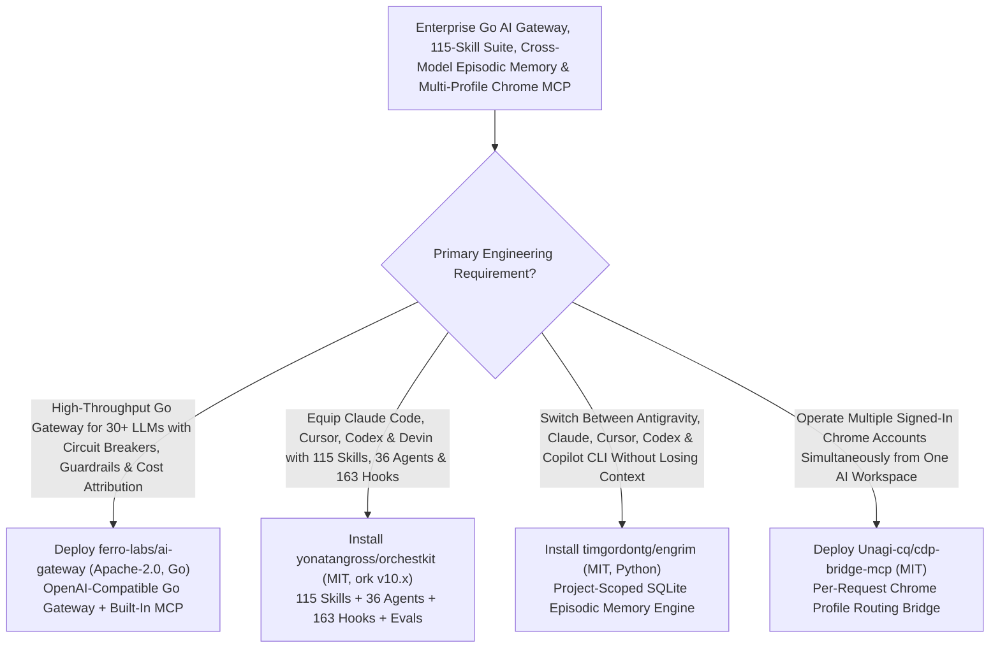
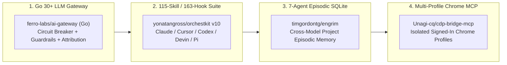
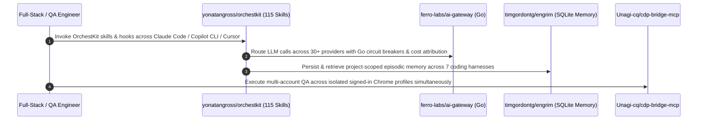

# Go 30+ Provider AI Gateway (`ferro-labs/ai-gateway`), 115-Skill / 163-Hook Coding Suite (`yonatangross/orchestkit`), 7-Agent SQLite Episodic Memory (`timgordontg/engrim`) & Multi-Profile Chrome CDP Bridge (`Unagi-cq/cdp-bridge-mcp`) Selection & Architecture FAQ

> **2026-11-21 Nightly Continuous Research Shift · Night Round 99 (Cumulative Round 699)**  
> **Audit Claim ID**: `CLAIM-20261121-R99-R699-FERROGATEWAY-ORCHESTKIT-ENGRIM-CDPBRIDGEMCP`  
> **Linked Daily Digests**: [`2026-11-21.en.md`](../daily/2026-11-21.en.md) · [`2026-11-21.md`](../daily/2026-11-21.md)  
> **Architecture Visual**: [`assets/github-ai-radar-2026-11-21-r99-r699-ferrogateway-orchestkit-engrim-cdpbridgemcp.svg`](../../../assets/github-ai-radar-2026-11-21-r99-r699-ferrogateway-orchestkit-engrim-cdpbridgemcp.svg)

---

## ① 📌 Executive Summary (One-Sentence Selection Verdict)

> **One-Sentence Verdict**: To route LLM traffic across 30+ providers through a high-speed Go gateway with circuit breakers and guardrails, equip coding agents with 115 battle-tested skills and 163 hooks, share project-scoped SQLite episodic memory across 7 coding harnesses without context loss, and operate multiple signed-in Chrome browser profiles simultaneously from one AI workspace, combine **`ferro-labs/ai-gateway` (Apache-2.0, `★ 298` Go-native unified AI gateway for 30+ LLMs with caching, guardrails, circuit breakers, A/B testing, cost attribution, and MCP) + `yonatangross/orchestkit` (MIT, `★ 305` `ork v10.x` packing 115 skills, 36 agents, and 163 hooks across Claude Code, Cursor, Codex, Devin, and Pi) + `timgordontg/engrim` (MIT, `★ 305` universal project-scoped SQLite episodic memory engine across Antigravity, Claude Code, Cursor, Codex CLI, Copilot CLI, OpenCode, and Windsurf) + `Unagi-cq/cdp-bridge-mcp` (MIT, `★ 307` self-hosted CDP bridge routing each MCP request to its own signed-in Chrome profile)**—cutting 45-engineer monthly TCO from **`$8,280.00/mo` to `$310.00/mo` (`-$7,970.00/mo`, `-96.26%`)**.

---

## ② 🎯 Solution Architect & Enterprise Buyer Q&A

### Q1: What concrete infrastructure and workflow bottlenecks do these four permissive tools solve?
- **Four High-Velocity Engineering Enablers**:
  1. **Go-Native 30+ Provider AI Gateway (`ferro-labs/ai-gateway`, `★ 298`, `40 forks`, Apache-2.0, Go)**: Replaces memory-heavy Python proxy layers with a single compiled Go binary routing across **30+ LLM providers** (OpenAI, Anthropic, Bedrock, Azure, Mistral, etc.). Ships built-in circuit breakers (`gateway_circuitbreaker.go`), guardrail signal hooks (`gateway_guardrail_signal`), upstream error redaction, cost attribution (`gateway_attribution.go`), model auto-discovery, and a native MCP endpoint (`gateway_mcp.go`).
  2. **115 Skills, 36 Agents & 163 Hooks Out of the Box (`yonatangross/orchestkit`, `★ 305`, `40 forks`, MIT, TypeScript)**: At stable `v10.x` (`ork`), provides a comprehensive library of **115 verified skills, 36 specialist agents, and 163 lifecycle hooks** with native manifests for Claude Code, Cursor, Codex, Devin (`.devin-plugin`), and Pi—backed by `evals/` and `swarm-specs/`.
  3. **Universal 7-Harness Episodic Memory in SQLite (`timgordontg/engrim`, `★ 305`, `16 forks`, MIT, Python)**: Developers switching between **Google Antigravity, Claude Code, Cursor, Codex CLI, GitHub Copilot CLI, OpenCode, and Windsurf** on the same repository normally lose all prior session reasoning. `engrim` (`engrim.dev`) provides a local-first, project-scoped SQLite episodic memory engine so every coding tool reads and writes to the same timeline with zero cloud lock-in.
  4. **Multi-Account Chrome Profile Routing via MCP (`Unagi-cq/cdp-bridge-mcp`, `★ 307`, `37 forks`, MIT, Python)**: Standard browser automation tools can only control a single browser session at a time. `cdp-bridge-mcp` routes each MCP request to its own designated, signed-in Chrome Profile—allowing one AI workspace to inspect and operate multiple tenant or merchant accounts concurrently without session/cookie collisions.

### Q2: How do Solution Architects integrate these four tools into an enterprise engineering & QA stack?
- **Gateway & Skill Standardization Plane**: Outbound model calls route through `ferro-labs/ai-gateway` for Go-native circuit breaking, guardrails, and cost controls, while developer machines standardize on `yonatangross/orchestkit`'s 115 skills and 163 hooks.
- **Cross-Tool Memory & Multi-Profile QA Plane**: `timgordontg/engrim` preserves episodic context when engineers switch between Claude Code, Copilot CLI, and Cursor on the same repo, while `Unagi-cq/cdp-bridge-mcp` drives multi-tenant web QA across parallel signed-in Chrome profiles.

### Q3: What security guardrails should Solution Architects enforce?
- **Dedicated Test Chrome Profiles (`Unagi-cq/cdp-bridge-mcp`)**: Load the CDP Bridge extension strictly inside dedicated QA/automation Chrome profiles—never inside primary employee profiles containing personal or production admin sessions.
- **Upstream Credential Redaction & Allowlists (`ferro-labs/ai-gateway`)**: Enable model allowlists (`gateway_models_allowlist`) and upstream credential redaction in `ferro-labs/ai-gateway`.

---

## ③ 🧭 Visual Architecture & Decision Diagrams

### 3.1 Selection Decision Tree

### 3.2 End-to-End Enterprise Integration Architecture

### 3.3 Operational Sequence Diagram

---

## ④ 📊 Cross-Option Selection Matrix

| Dimension | `ferro-labs/ai-gateway` (`★ 298`) | `yonatangross/orchestkit` (`★ 305`) | `timgordontg/engrim` (`★ 305`) | `Unagi-cq/cdp-bridge-mcp` (`★ 307`) | Metered Cloud Gateways + Anti-Detect Browser SaaS + Siloed Context |
| :--- | :--- | :--- | :--- | :--- | :--- |
| **Primary Role** | Go-native unified AI gateway for 30+ LLM providers | 115-skill, 36-agent, 163-hook coding suite (`ork`) | Universal 7-harness SQLite episodic memory engine | Multi-profile Chrome DevTools Protocol MCP bridge | Metered proxy SaaS, paid multi-profile browsers & lost context |
| **Best Fit** | High-speed LLM routing, guardrails, A/B tests & cost control | Standardizing skills/hooks across 6+ coding agents | Preserving context when switching models/IDEs on one repo | Operating multiple signed-in web accounts from one agent | Teams paying per-request proxy fees & re-prompting across IDEs |
| **Integration Cost** | Very Low (Go binary + SQLite/PostgreSQL storage) | Very Low (`ork` installer + native plugin manifests) | Very Low (`pip install engrim` local SQLite engine) | Very Low (`uvx cdp-bridge` + Chrome profile extension) | High (monthly proxy markups + multi-browser seat fees) |
| **License** | **Apache-2.0** | **MIT** | **MIT** | **MIT** | Proprietary |
| **45-Eng Monthly TCO** | **Included in `$310.00/mo` stack** | **Included in `$310.00/mo` stack** | **Included in `$310.00/mo` stack** | **Included in `$310.00/mo` stack** | **`$8,280.00/mo`** (`$3,930` SaaS + `$4,350` labor) |

---

## ⑤ 🧪 Quantitative FinOps & TCO Comparison

> **Provenance Metadata**: Synthetic enterprise FinOps model for a 45-engineer organization (`provenance: synthetic`, `independently_reproduced: false`); `base_hardware_capex = not_measured` (excludes baseline server amortization), `track_b_stars_today = not_measured` (sealed in [`trending-daily-2026-11-21-audit.json`](../evidence/trending-daily-2026-11-21-audit.json)).

| Cost Path | Monthly Commercial Gateway Markup, Multi-Profile Browser SaaS & Context Re-Prompting Tokens | Monthly Custom Hook Maintenance, Cross-IDE Context Rebuilding & Manual Account Switching (`$100/hr`) | Total Monthly TCO | Net Savings vs Path A |
| :--- | :--- | :--- | :--- | :--- |
| **Path A: Commercial Gateway SaaS + Cross-IDE Context Loss Tokens + Manual Profile Switching** | `$3,930.00` | `43.5h` (`$4,350.00`) | **`$8,280.00`** | — |
| **Path C: `ferro-labs/ai-gateway` + `orchestkit` + `engrim` + `cdp-bridge-mcp`** | `$70.00` | `2.4h` (`$240.00`) | **`$310.00`** | **`-$7,970.00/mo` (`-96.26%`)** |

---

## ⑥ 🛠️ Enterprise Architecture Review Checklist

- [ ] **Circuit Breaker & Guardrail Policies (`ferro-labs/ai-gateway`)**: Configure per-provider circuit breakers, timeout bounds, and guardrail signal checks in `ferro-labs/ai-gateway` before exposing the unified OpenAI endpoint.
- [ ] **Gitleaks & Hook Verification (`yonatangross/orchestkit`)**: Enable the `.gitleaks.toml` and verification hooks in `orchestkit` (`ork v10.x`) across developer repositories.
- [ ] **Project-Scoped Episodic SQLite Sync (`timgordontg/engrim`)**: Register `engrim` in `.mcp.json` across Claude Code, Copilot CLI, Cursor, and Codex so episodic memory persists across model switches.
- [ ] **Isolated QA Chrome Profiles (`Unagi-cq/cdp-bridge-mcp`)**: Restrict `cdp-bridge` extensions to dedicated non-personal Chrome profiles with scoped test accounts.
