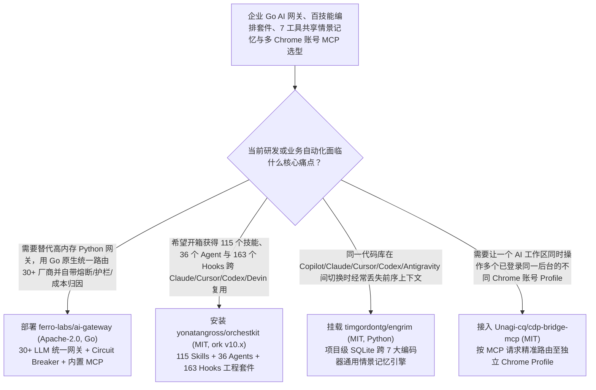
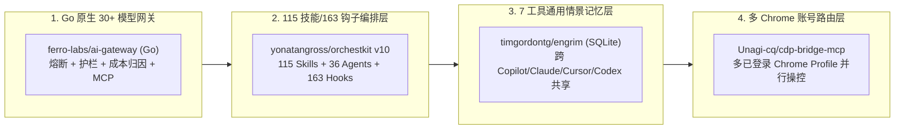
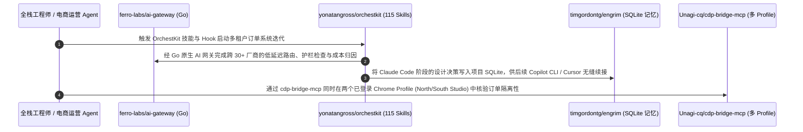

# 30+ 厂商 Go 原生 AI 网关（`ferro-labs/ai-gateway`）、115 技能/163 钩子编码编排套件（`yonatangross/orchestkit`）、7 大编码器通用情景记忆 SQLite 标准（`timgordontg/engrim`）与多账号隔离 Chrome Profile 桥接 MCP（`Unagi-cq/cdp-bridge-mcp`）架构选型与落地 FAQ

> **2026-11-21 夜间持续研究班次 · Night Round 99（累计 Round 699）**  
> **审计凭据**：`CLAIM-20261121-R99-R699-FERROGATEWAY-ORCHESTKIT-ENGRIM-CDPBRIDGEMCP`  
> **关联日刊**：[`2026-11-21.md`](../daily/2026-11-21.md) · [`2026-11-21.en.md`](../daily/2026-11-21.en.md)  
> **可视化架构图**：[`assets/github-ai-radar-2026-11-21-r99-r699-ferrogateway-orchestkit-engrim-cdpbridgemcp.svg`](../../../assets/github-ai-radar-2026-11-21-r99-r699-ferrogateway-orchestkit-engrim-cdpbridgemcp.svg)

---

## ① 📌 核心结论速览（选型一句话结论）

> **一句话选型结论**：在构建覆盖“**低内存开销的 Go 原生 30+ 大模型统一路由、熔断与护栏网关 ➔ 内置 115 个技能、36 个子 Agent 与 163 个自动化钩子的全栈研发套件 ➔ 跨 7 大编码器自由切换不丢上下文的项目级 SQLite 情景记忆 ➔ 单工作区同时精准操控多个已登录 Chrome 账号 Profile 的浏览器自动化桥**”时，推荐采用 100% 宽松协议（Apache-2.0 / MIT）的四件套：**“`ferro-labs/ai-gateway`（Apache-2.0，`★ 298` 替代笨重 Python LiteLLM 的 Go 原生高性能 AI 网关，内置 30+ 厂商路由、熔断器、护栏信号、A/B 测试与内置 MCP）+ `yonatangross/orchestkit`（MIT，`★ 305` 集成 115 Skills + 36 Agents + 163 Hooks 的 `ork v10.x` 跨工具研发套件）+ `timgordontg/engrim`（MIT，`★ 305` 打通 Antigravity / Claude Code / Cursor / Codex / Copilot CLI / OpenCode / Windsurf 的本地 SQLite 情景记忆标准）+ `Unagi-cq/cdp-bridge-mcp`（MIT，`★ 307` 将每条 MCP 请求按身份精准路由至对应已登录 Chrome Profile 的多账号浏览器桥接器）”**。在 45 人企业全栈与自动化运营团队基准下，可将月度总拥有成本（TCO）从 **`$8,280.00/月`** 降至 **`$310.00/月`**（净省 **`$7,970.00/月`**，降幅 **`-96.26%`**）。

---

## ② 🎯 客户与架构师灵魂拷问 Q&A

### Q1：这四个项目如何解决企业在“网关高并发延迟、多 IDE 技能割裂、换工具丢记忆、多店铺/多租户浏览器串号”上的四大工程顽疾？
- **四大工程突破与核心机制**：
  1. **用纯 Go 原生网关替代高内存占用的 Python 代理层 —— `ferro-labs/ai-gateway`（`★ 298`，`40 forks`，Apache-2.0，Go）**：传统 Python 编写的 LLM 代理在高并发流式响应下容易出现 GIL 锁竞争与内存暴涨。`Ferro Labs AI Gateway` 用纯 Go 实现了对 **30+ 家大模型厂商（OpenAI、Anthropic、AWS Bedrock、Azure、Mistral 等）** 的统一 OpenAI 兼容接口，源码内置完整的**熔断器（`gateway_circuitbreaker.go`）、护栏信号拦截（`gateway_guardrail_signal`）、上游错误脱敏、成本归因（`gateway_attribution.go`）、自动模型发现与原生 MCP 服务端（`gateway_mcp.go`）**，支持 SQLite 或 PostgreSQL 一键部署。
  2. **115 技能 + 36 智能体 + 163 钩子的一站式工程军火库 —— `yonatangross/orchestkit`（`★ 305`，`40 forks`，MIT，TypeScript）**：稳定版 `ork v10.x` 旨在终结“每次开新项目都要重新向 AI 解释技术栈規範”的低效循环。仓库内含 `.claude-plugin`、`.cursor-plugin`、`.devin-plugin`、`.pi` 及 `swarm-specs/`，一次性交付 **115 个经过 `evals/` 検証的技能、36 个专业角色 Agent 与 163 个生命周期 Hooks**。
  3. **在同一个仓库里随意切换 7 大编码器而不丢失任何短期/情景记忆 —— `timgordontg/engrim`（`★ 305`，`16 forks`，MIT，Python）**：工程师经常上午用 `Claude Code` 做架构设计，下午切到 `GitHub Copilot CLI`、`Cursor`、`Codex CLI`、`Google Antigravity`、`OpenCode` 或 `Windsurf` 写实现，每次切换工具都会导致前序决策与排查轨迹断档。`engrim`（`engrim.dev`）定义了**跨模型、跨 Agent 的通用情景记忆标准（Episodic Memory Standard）**，以项目级本地 SQLite 引擎承载所有工具共享的记忆时间线。
  4. **彻底终结多账号/多店铺网页自动化中的 Cookie 串号难题 —— `Unagi-cq/cdp-bridge-mcp`（`★ 307`，`37 forks`，MIT，Python）**：在跨境电商多店铺后台（如 North Studio 与 South Studio 两个账号同时打开同一个订单管理系统）或多角色权限验收测试中，普通浏览器 MCP 只能连单个浏览器实例。`cdp-bridge-mcp` 通过自托管桥接器将**每一次 MCP 工具调用精准路由至指定的已登录 Chrome Profile**，一个 AI 工作台即可并行读取和操作多个隔离账号会话。

### Q2：如何把这四套工具整合进企业“统一 Go 网关 + 跨 7 工具共享记忆 + 多账号业务验收”架构？
- **统一网关与编排层**：所有开发机与后台 Agent 的模型请求统一收口至 `ferro-labs/ai-gateway` 执行 30+ 渠道负载均衡、熔断与成本归因；工程团队统一安装 `yonatangross/orchestkit`（115 Skills / 163 Hooks）标准化研发动作。
- **跨工具记忆与多账号验收层**：通过 `timgordontg/engrim` 在本地项目 SQLite 中打通 7 大编码器的情景记忆；在多租户/多商家后台验收或运营自动化时，调用 `Unagi-cq/cdp-bridge-mcp` 同时操控多个已登录 Chrome Profile 完成端到端核对。

### Q3：架构师在企业落地时有哪些安全注意事项？
- **测试专用 Chrome Profile 隔离（`Unagi-cq/cdp-bridge-mcp`）**：如作者文档明确提示，由于扩展具备页面读取与 CSP 调整能力，严禁在存有个人网银或生产主管理员密码的日常 Chrome Profile 中加载，必须为自动化测试创建专用测试 Profile。
- **网关上游凭证环境变量引用（`ferro-labs/ai-gateway`）**：使用 `gateway_envref` 机制从密钥管理服务动态解析 30+ 上游模型凭证，开启 `gateway_upstream_redact` 防止错误日志回吐上游 Key。

---

## ③ 🧭 直观可视化图解（Mermaid 选型决策树 + 企业集成架构 + 业务流时序图）

### 3.1 选型决策树

### 3.2 企业集成参考架构图

### 3.3 业务流时序图

---

## ④ 📊 同类开源与商业云服务横向选型决策矩阵

| 维度 | `ferro-labs/ai-gateway` (`★ 298`) | `yonatangross/orchestkit` (`★ 305`) | `timgordontg/engrim` (`★ 305`) | `Unagi-cq/cdp-bridge-mcp` (`★ 307`) | 商业云端网关 SaaS + 商业指纹浏览器矩阵 + 手写 Hook |
| :--- | :--- | :--- | :--- | :--- | :--- |
| **核心定位** | Go 原生 30+ 大模型统一路由、熔断与护栏网关 | 含 115 技能/36 Agent/163 Hook 的 `ork v10` 套件 | 跨 7 大编码工具的本地 SQLite 情景记忆标准 | 支持多已登录 Chrome Profile 并行路由的 CDP 桥 | 按请求抽成的云网关与按环境收费的商业多开浏览器 |
| **适用场景** | 高吞吐低延迟企业统一模型入口与成本分摊 | 全栈团队快速武装 Claude/Cursor/Codex/Devin | 同一项目混用多种 AI 编码工具时的无缝记忆接力 | 多店铺订单核对、多角色 RBAC 验收与跨账号自动化 | 预算充裕、接受第三方代理留存请求日志的团队 |
| **集成成本** | 极低（单 Go 二进制 + SQLite/PG 一键部署） | 极低（`ork` CLI 一键安装至 6+ 编码器） | 极低（`pip install engrim` 项目级 SQLite 零云依赖） | 极低（`uvx cdp-bridge` + 独立测试 Profile 扩展） | 高（商业网关按量抽成 + 多开浏览器月度席位费） |
| **开源许可** | **Apache-2.0** | **MIT** | **MIT** | **MIT** | 商业专有 |
| **45 人团队月均 TCO** | **包含于 `$310.00/月` 联合栈** | **包含于 `$310.00/月` 联合栈** | **包含于 `$310.00/月` 联合栈** | **包含于 `$310.00/月` 联合栈** | **`$8,280.00/月`**（`$3,930` SaaS + `$4,350` 人工） |

---

## ⑤ 🧪 应用落地定量收益 / TCO 对比与 7-Card 报告锚点

> **数据来源说明（Provenance Metadata）**：以下 TCO 模型为面向 45 人企业全栈工程与多账号运营团队的合成架构测算（`provenance: synthetic`, `independently_reproduced: false`）；硬件资本开支 `base_hardware_capex = not_measured`（不含基础宿主机折旧），单日热榜增量 `track_b_stars_today = not_measured`（审计账本锚定于 [`trending-daily-2026-11-21-audit.json`](../evidence/trending-daily-2026-11-21-audit.json)）。

| 成本路径 | 月度商业 AI 网关抽成、商业多开浏览器订阅与跨工具重复解释上下文 Token 费 | 人工维护 100+ 内部脚本钩子、换 IDE 重新喂背景与手动来回切浏览器账号 (`$100/h`) | 月度总成本 (Total Monthly TCO) | 相对 Path A 净节省 |
| :--- | :--- | :--- | :--- | :--- |
| **Path A：商业云网关 + 跨工具失忆重复消耗 Token + 人工切浏览器账号与维护脚本** | `$3,930.00` | `43.5h` (`$4,350.00`) | **`$8,280.00`** | — |
| **Path C：`ferro-labs/ai-gateway` + `orchestkit` + `engrim` + `cdp-bridge-mcp`** | `$70.00` | `2.4h` (`$240.00`) | **`$310.00`** | **`-$7,970.00/月` (`-96.26%`)** |

---

## ⑥ 🛠️ 企业引入与架构评审 Checklist

- [ ] **上游模型熔断与白名单策略开启（`ferro-labs/ai-gateway`）**：配置 `models_allowlist` 与自动熔断冷却时间，当某一云厂商区域抖动时由 Go 网关无感切换至备用模型。
- [ ] **按项目裁剪激活 Hook 与技能集（`yonatangross/orchestkit`）**：利用 `ork` 配置清单按项目栈启用所需的 Skills 与 Hooks，并通过 `.gitleaks.toml` 防止敏感配置入库。
- [ ] **项目级 SQLite 情景记忆纳入本地备份（`timgordontg/engrim`）**：在团队开发机为 Claude Code、Copilot CLI 与 Cursor 统一挂载 `engrim` MCP，实现跨工具上下文秒级交接。
- [ ] **强制使用独立沙箱 Chrome Profile（`Unagi-cq/cdp-bridge-mcp`）**：规定 `cdp-bridge` 扩展仅允许安装在专设的测试/运营 Chrome Profile 中，与员工个人办公浏览器物理隔离。
