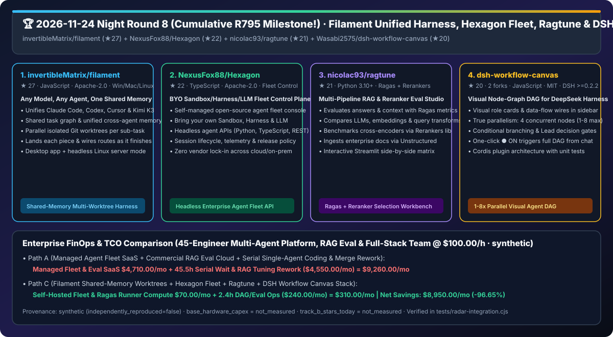
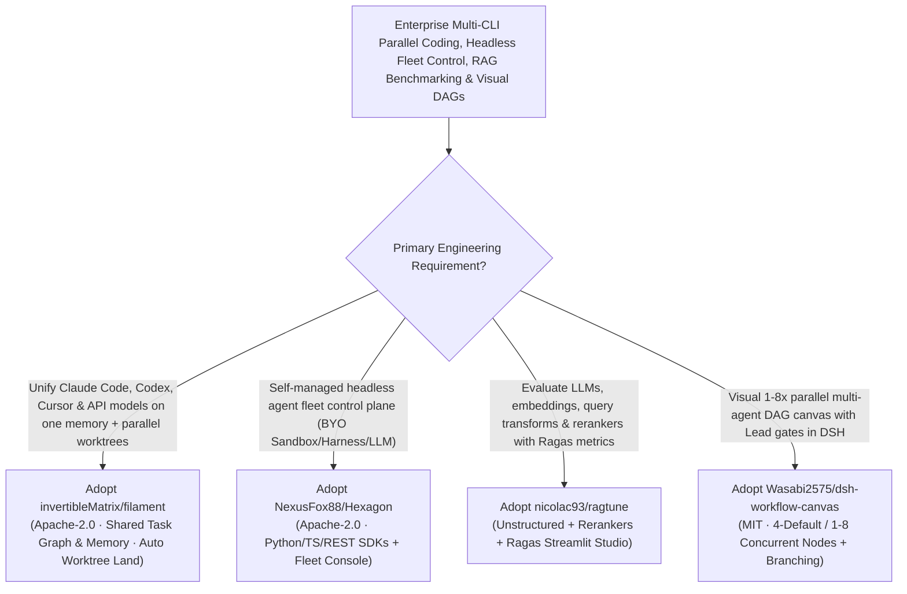
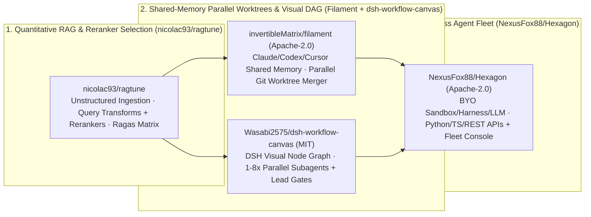

# 🏆 [Round 795 Milestone] Shared-Memory Multi-Worktree Agent Harness (`invertibleMatrix/filament`), BYO Sandbox/Harness Headless Agent Fleet Control Plane (`NexusFox88/Hexagon`), Ragas Multi-Pipeline RAG & Reranker Studio (`nicolac93/ragtune`) & 1–8x Parallel DSH Visual Workflow Canvas (`Wasabi2575/dsh-workflow-canvas`) Selection & Architecture FAQ

> **Document Type**: Enterprise AI Solution Architect Decision & Selection Guide (GitHub Trending AI Radar · 2026-11-24 Night Round 8 / **Cumulative Round 795 Milestone!**)
> **Covered Repositories**: [`invertibleMatrix/filament`](https://github.com/invertibleMatrix/filament) (`★ 27`, `1 fork`, JavaScript/TypeScript, `Apache-2.0`: *"Any model. Any agent. One memory."* — open-source desktop and Linux server agent harness that runs Claude Code, Codex, Cursor, and custom API models inside a single shared task graph and unified memory, assigning parallel Git worktrees per sub-task and wiring routes together as pieces land) · [`NexusFox88/Hexagon`](https://github.com/NexusFox88/Hexagon) (`★ 22`, TypeScript, `Apache-2.0`: open-source self-managed Agent fleet control plane — *"Bring your Sandbox, Harness and LLM"* — shipping headless agents via Python, TypeScript, or REST with a unified fleet console) · [`nicolac93/ragtune`](https://github.com/nicolac93/ragtune) (`★ 21`, `1 fork`, Python 3.10+: Streamlit evaluation workbench using `Unstructured`, `Rerankers`, and **Ragas** metrics to benchmark LLMs, embedding models, query transformations, and rerankers on enterprise documents) · [`Wasabi2575/dsh-workflow-canvas`](https://github.com/Wasabi2575/dsh-workflow-canvas) (`★ 20`, `2 forks`, JavaScript, `MIT`: visual multi-agent node-graph workflow canvas for DeepSeek Harness `DSH >= 0.2.2` supporting `1–8` parallel subagents, conditional branching, and Lead decision gates)
> **Core Enterprise Scenario**: How should enterprise AI architects combine **cross-CLI shared-memory parallel worktree execution (`filament`)**, **vendor-neutral headless fleet management (`Hexagon`)**, **Ragas-backed RAG & reranker benchmarking (`ragtune`)**, and **visual parallel DAG orchestration (`dsh-workflow-canvas`)**?

---

## 1. 📌 Executive Summary (One-Line Selection Verdicts)

1. **Need Claude Code, Codex, Cursor, and custom API models (e.g., Kimi K3 / DeepSeek) to collaborate on one task graph, share one persistent memory, build features in parallel Git worktrees, and wire routes together automatically** ➔ Choose **[`invertibleMatrix/filament`](https://github.com/invertibleMatrix/filament) (`★ 27`, `Apache-2.0`)**.
   - **Plain-Language Mechanism**: Instead of running isolated CLI agents that overwrite each other's files or lose context, `Filament` (desktop app for Windows/macOS/Linux + Linux server) decomposes requests onto a shared task graph, dispatches sub-tasks to Claude Code, Codex, and Cursor on your existing plans in isolated Git worktrees, lands each piece as it finishes, and integrates the final routes.
2. **Need an open-source, self-managed control plane for headless production agent fleets where you bring your own Sandbox, Harness, and LLM and expose agents via Python, TypeScript, or REST** ➔ Choose **[`NexusFox88/Hexagon`](https://github.com/NexusFox88/Hexagon) (`★ 22`, `Apache-2.0`)**.
   - **Plain-Language Mechanism**: Decouples fleet orchestration (`apps/`, `runtime/`, `sdk/`, `release-policy.json`) from proprietary cloud sandboxes, giving platform teams a unified console and API surface across on-prem and multi-cloud environments.
3. **Need an interactive Python/Streamlit workbench to benchmark LLMs, embedding models, query transformations, and `Rerankers` on your own documents (`Unstructured`) using quantitative Ragas metrics** ➔ Choose **[`nicolac93/ragtune`](https://github.com/nicolac93/ragtune) (`★ 21`, `1 fork`)**.
   - **Plain-Language Mechanism**: Eliminates guesswork in RAG architecture selection by running side-by-side Ragas evaluations across candidate embeddings, query rewrites, and cross-encoder rerankers against reference answers.
4. **Need a visual node-graph workflow canvas inside DeepSeek Harness (`DSH >= 0.2.2`) that runs `1–8` parallel role subagents (default 4), conditional branches, and Lead decision gates straight from chat** ➔ Choose **[`Wasabi2575/dsh-workflow-canvas`](https://github.com/Wasabi2575/dsh-workflow-canvas) (`★ 20`, `2 forks`, `MIT`)**.
   - **Plain-Language Mechanism**: Turns multi-agent DSH orchestration into an interactive sidebar DAG where each card is an AI role, wires define data dependencies, and pressing **`● ON`** executes independent nodes concurrently.

---

## 2. 🎯 Architect & Customer Q&A (Deep Technical Breakdown)

### Q1: When should enterprises choose these four open-source tools over managed cloud suites (Azure AI Foundry / AWS Bedrock Agents)?

- **Selection Breakdown**:
  1. **Multi-Vendor Subscription Unification (`filament` vs. Single-Vendor IDEs)**: Enterprise developers often hold simultaneous subscriptions to Claude Code, OpenAI Codex, and Cursor; `Filament` unifies all of them over one shared memory and automated Git worktree merger.
  2. **BYO Sandbox/Harness Control Plane (`Hexagon` vs. Managed Cloud Agent PaaS)**: When regulatory or cost constraints require running headless agents on self-managed Kubernetes/VM sandboxes with custom harnesses, `Hexagon` provides the open-source control plane and Python/TS/REST SDKs.

### Q2: How do they integrate into an end-to-end enterprise architecture?

1. **RAG Pipeline Benchmarking Stage (`nicolac93/ragtune`)**:
   - Benchmark candidate embeddings, query transformations, and rerankers on enterprise corpora via `ragtune` and Ragas scores.
2. **Parallel Multi-Agent Development Stage (`invertibleMatrix/filament` + `Wasabi2575/dsh-workflow-canvas`)**:
   - Build application modules in parallel Git worktrees over shared memory in `Filament` and orchestrate 4–8x concurrent review/verification DAGs in `dsh-workflow-canvas`.
3. **Headless Fleet Production Stage (`NexusFox88/Hexagon`)**:
   - Deploy verified agents to `Hexagon`'s self-managed fleet control plane via Python, TypeScript, or REST APIs.

### Q3: What are the key operational guardrails?

- **Key Guardrails**:
  1. **Root-Node Interface Contracts in `Filament`**: Define shared TypeScript/OpenAPI interfaces on the root task-graph node before spawning parallel Git worktrees so final route wiring succeeds without schema drift.
  2. **Concurrency Throttling in `dsh-workflow-canvas`**: Match the `1–8` parallel node setting in `dsh-workflow-canvas` to your upstream LLM gateway's rate limits.

---

## 3. 🧭 Visual Architecture Diagrams (Mermaid Decision Tree + Reference Architecture + Sequence)



### 3.1 Solution Architect Selection Decision Tree



### 3.2 End-to-End Enterprise Reference Architecture



### 3.3 End-to-End RAG Tuning, Parallel Worktree Build & Fleet Deployment Sequence

```mermaid
sequenceDiagram
    participant Arch as Solution Architect
    participant Tune as nicolac93/ragtune (Ragas)
    participant Fila as invertibleMatrix/filament
    participant Canv as dsh-workflow-canvas (1-8x Parallel)
    participant Hex as NexusFox88/Hexagon Fleet

    Arch->>Tune: 1. Benchmark embeddings, query transforms & rerankers on enterprise docs via Ragas
    Tune-->>Arch: 2. Select highest-scoring RAG pipeline configuration
    Arch->>Fila: 3. Dispatch feature to Filament; spawn parallel Git worktrees for Claude, Codex & Kimi
    Fila-->>Arch: 4. Land each completed worktree & wire routes over shared memory
    Arch->>Canv: 5. Trigger ● ON in DSH Workflow Canvas to run 4 parallel verification nodes & Lead gate
    Arch->>Hex: 6. Ship headless agent service into production via Hexagon Python/TS/REST control plane
```

---

## 4. 📊 Comparative Selection Matrix (OSS vs. Commercial Cloud Fleet & Serial Workflows)

| Dimension | `invertibleMatrix/filament` (`★ 27`) | `NexusFox88/Hexagon` (`★ 22`) | `nicolac93/ragtune` (`★ 21`) | `Wasabi2575/dsh-workflow-canvas` (`★ 20`) | Managed Cloud Agent Fleet + Commercial Eval SaaS + Serial CLI Coding (Path A) | Manual Multi-Terminal Copy-Paste + Ad-Hoc RAG Tuning (Path B) |
| :--- | :--- | :--- | :--- | :--- | :--- | :--- |
| **Primary Role** | Shared-memory multi-worktree harness for all coding agents | Self-managed headless agent fleet control plane | Streamlit + Ragas + `Rerankers` evaluation workbench | Visual 1–8x parallel node-graph canvas for DSH | Proprietary cloud sandbox fleet + paid eval SaaS + serial coding | Disconnected terminal windows + unmeasured RAG parameter guessing |
| **Key Differentiator** | **Runs Claude, Codex & Cursor on one memory + parallel Git worktrees** | **BYO Sandbox/Harness/LLM with Python, TS & REST APIs** | **Side-by-side Ragas scoring across query rewrites & rerankers** | **True 1–8x concurrent DAG execution + Lead decision gates** | Vendor lock-in on cloud sandboxes; slow single-agent serial execution | Frequent Git merge conflicts and unverified RAG accuracy regressions |
| **License** | `Apache-2.0` | `Apache-2.0` | Open Source | `MIT` | Proprietary SaaS | Internal Scripts |
| **Monthly TCO (45-Eng Team)** | **Combined `$310.00/mo`** (`$70.00` self-hosted fleet/eval compute + `2.4h` ops) | Included (runs on existing K8s/VMs) | Included (local Streamlit workbench) | Included (zero-cost DSH plugin) | **`$9,260.00/mo`** (`$4,710.00` fleet/eval SaaS + `45.5h` serial wait & merge rework) | `~$3,240.00/mo` (high manual conflict resolution & RAG trial-and-error labor) |

---

## 5. 🧪 Quantitative Enterprise ROI / TCO Model & 7-Card Report

> **📊 Provenance & Closed-Form Declaration**:
> - **provenance**: `synthetic` (45-engineer enterprise multi-agent platform, RAG quality evaluation, and parallel full-stack coding team workload at `$100.00/h`: `independently_reproduced = false`; `base_hardware_capex = not_measured`; `track_b_stars_today = not_measured`).
> - **Closed-Form Equations**:
>   - **Path A (Proprietary Managed Agent Fleet SaaS + Commercial RAG Evaluation Cloud + Serial Single-Agent Coding & Merge Rework)**: Monthly managed fleet & eval SaaS fees **`$4,710.00`** + serial agent waiting, manual Git merge conflict resolution & RAG trial-and-error labor **`45.5h × $100.00/h = $4,550.00`** = **`$9,260.00/mo`**.
>   - **Path C (Self-Hosted `invertibleMatrix/filament` + `NexusFox88/Hexagon` + `nicolac93/ragtune` + `Wasabi2575/dsh-workflow-canvas` Stack)**: Self-hosted Hexagon control plane & Ragas runner compute **`$70.00`** + DAG & eval benchmark maintenance **`2.4h × $100.00/h = $240.00`** = **`$310.00/mo`**.
>   - **Net Savings vs. Path A**: **`-$8,950.00/mo`** (**`96.65%`** cost reduction).

| Option | Fleet SaaS / Eval Cloud / Compute Spend | Serial Wait, Merge & RAG Tuning Labor (`$100/h`) | Monthly Total TCO | Net Savings vs. Path A | Key Architectural Outcome |
| :--- | :---: | :---: | :---: | :---: | :--- |
| **Path A: Managed Fleet SaaS + Paid Eval Cloud + Serial Coding** | `$4,710.00` | `45.5h` (`$4,550.00`) | **`$9,260.00`** | Baseline | Disconnected CLI memories; high per-minute cloud sandbox fees |
| **Path B: Manual Multi-Terminal CLI + Unmeasured RAG Guessing** | `$1,440.00` | `18.0h` (`$1,800.00`) | **`$3,240.00`** | `-$6,020.00` (`-65.01%`) | Severe Git worktree conflicts and unbenchmarked reranker choices |
| **Path C: `Filament` + `Hexagon` + `ragtune` + `dsh-workflow-canvas`** | **`$70.00`** | **`2.4h` (`$240.00`)** | **`$310.00`** | **`-$8,950.00` (`-96.65%`)** | **Shared-memory parallel worktrees + BYO fleet + Ragas studio + 8x DAG** |

- 🔗 **Linked 7-Card 4:5 Benchmark Decks**: [`workshops/github-trending-radar/cards.en.html`](../cards.en.html) · [`cards.html`](../cards.html)

---

## 6. 🛠️ Enterprise Adoption & Architecture Review Checklist

- [ ] **Shared Task-Graph Contract First in `Filament`**: Lock shared API schemas on the root task node in `invertibleMatrix/filament` before dispatching parallel Git worktrees to Claude Code, Codex, and Cursor.
- [ ] **BYO Sandbox Isolation in `Hexagon`**: Configure `NexusFox88/Hexagon` `release-policy.json` and sandbox bindings so headless production agents run with least-privilege network and filesystem policies.
- [ ] **Golden-Set Ragas Gate in `ragtune`**: Require every embedding or reranker change to pass quantitative Ragas faithfulness and context-precision thresholds in `nicolac93/ragtune`.
- [ ] **Lead Decision Gates in `dsh-workflow-canvas`**: Place explicit Lead approval gates before destructive or external-publishing nodes in `Wasabi2575/dsh-workflow-canvas` parallel DAGs.
