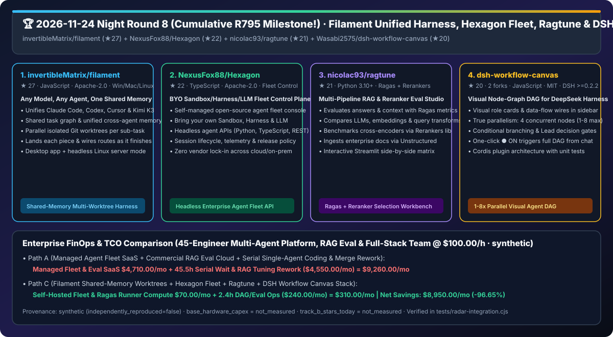
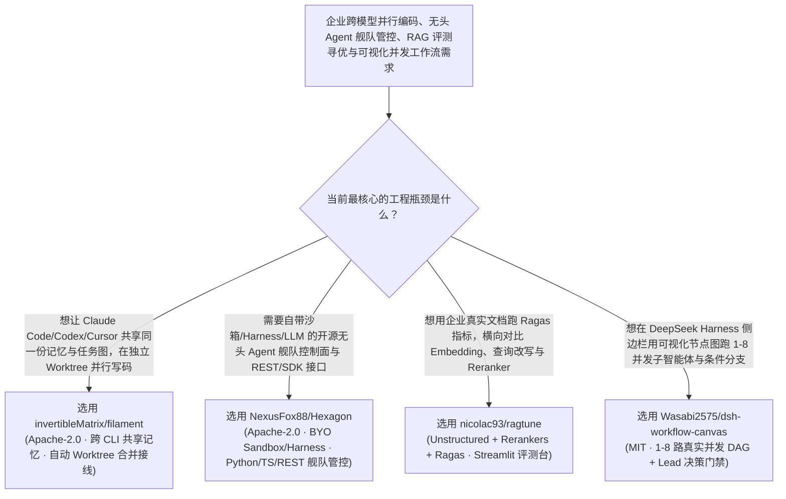
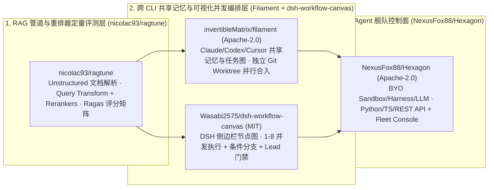
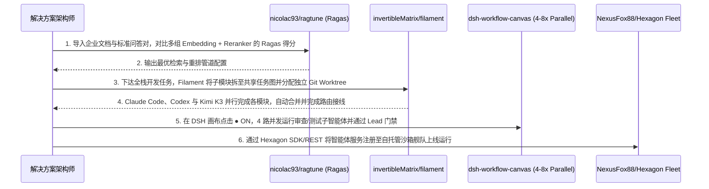

# 🏆【第 795 轮里程碑】跨模型共享记忆与并行 Worktree 编码底座（`invertibleMatrix/filament`）、自带沙箱/Harness/LLM 的无头 Agent 舰队控制面（`NexusFox88/Hexagon`）、基于 Ragas 的多配置 RAG 与重排器评测台（`nicolac93/ragtune`）及 DeepSeek Harness 1–8 并发可视化节点工作流画布（`Wasabi2575/dsh-workflow-canvas`）选型与集成架构 FAQ

> **文档类型**：企业 AI 解决方案架构师（AI Solution Architect）选型决策指南（GitHub Trending AI 雷达 2026-11-24 Night Round 8 / **累计第 795 轮里程碑**）
> **覆盖项目**：[`invertibleMatrix/filament`](https://github.com/invertibleMatrix/filament)（`★ 27`、`1 fork`、`Apache-2.0`，核心理念 **"Any model. Any agent. One memory."** 的跨平台桌面与 Linux 服务端开发底座，将 Claude Code、Codex、Cursor 与自研编码 Agent 融合在**同一张任务图（Task Graph）与同一份共享记忆**下，自动为每个子任务分配独立 Git Worktree 并行开发并随完成随合并接线）· [`NexusFox88/Hexagon`](https://github.com/NexusFox88/Hexagon)（`★ 22`、`Apache-2.0`，开源自托管 Agent 舰队控制面——**Bring your own Sandbox, Harness and LLM**，通过 Python、TypeScript 或 REST API 交付生产级无头智能体并统一纳管会话生命周期）· [`nicolac93/ragtune`](https://github.com/nicolac93/ragtune)（`★ 21`、`1 fork`，基于 Python + Streamlit + `Unstructured` + `Rerankers` + **Ragas** 的企业级 RAG 管道横向评测工作台，支持基于企业真实文档与标准答案对比不同 LLM、Embedding 模型、查询改写与重排器组合）· [`Wasabi2575/dsh-workflow-canvas`](https://github.com/Wasabi2575/dsh-workflow-canvas)（`★ 20`、`2 forks`、`MIT`，为 DeepSeek Harness `DSH >= 0.2.2` 打造的侧边栏可视化节点工作流画布，支持 **1–8 路真实并发子智能体（默认 4 路）**、条件分支与 Lead 决策门禁，点击 `● ON` 即可在对话中一键驱动全图执行）
> **核心场景**：当企业架构师规划下一代多智能体工程平台与知识检索底座时，如何解决**“开发者同时订阅了 Claude Code、Codex 和 Cursor 却各自为政、记忆割裂且在同一目录改代码互相覆盖；企业上云部署后台无头 Agent 舰队被单一云沙箱供应商绑定；RAG 选型靠拍脑袋选 Embedding 和 Reranker 缺乏 Ragas 定量对标；以及终端多 Agent 编排缺乏直观的并发 DAG 连线与条件门禁”**四大核心痛点？

---

## 一、📌 核心结论速览（选型一句话结论）

1. **想把团队已经付费订阅的 Claude Code、Codex、Cursor 以及 Kimi K3 / DeepSeek API 统一装进一个桌面或 Linux 服务端底座，让它们共享同一份记忆与同一张任务图，并各自在独立 Git Worktree 里并行写代码、写完自动合并接线** ➔ 选 **[`invertibleMatrix/filament`](https://github.com/invertibleMatrix/filament)（`★ 27`，`Apache-2.0`）**。
   - **通俗原理**：比如你要开发一套完整的 Notes API，`Filament` 会先把任务拆解到统一的任务图（Task Graph）上，同时把 `create`、`delete` 和 `search` 三个子模块分别派给 Claude Code、Codex 和 Kimi K3，**每个 Agent 在各自隔离的 Git Worktree 中并行施工**；谁先写完测试通过就先合并（Land）哪块，最后由主控 Agent 统一把路由和前端界面串起来，全程共享同一份项目记忆。
2. **想在企业内部构建一套不绑定任何特定云沙箱、不绑定特定 Harness 或模型供应商的“自托管无头 Agent 舰队控制面（Control Plane）”，通过标准 Python / TypeScript SDK 或 REST API 驱动后台智能体集群** ➔ 选 **[`NexusFox88/Hexagon`](https://github.com/NexusFox88/Hexagon)（`★ 22`，`Apache-2.0`）**。
   - **通俗原理**：很多商业 Agent 托管平台要求你必须买它的高价云沙箱和专属运行时。`Hexagon` 采用彻底解耦的 **BYO（Bring Your Own Sandbox, Harness and LLM）** 架构，提供统一的 Fleet Console、会话管理、模块扩展与发布策略（`release-policy.json`），非常适合嵌入企业现有的 K8s/VM 基础设施。
3. **在企业正式采购或上线 RAG 知识库前，想用本部门真实的 PDF/Word 文档（`Unstructured` 解析）与标准问答集，定量跑出不同“大模型 × Embedding × 查询改写（Query Transformation）× 重排器（`Rerankers`）”组合的 Ragas 指标得分** ➔ 选 **[`nicolac93/ragtune`](https://github.com/nicolac93/ragtune)（`★ 21`，`1 fork`）**。
   - **通俗原理**：告别凭感觉调参。在 Streamlit 可视化界面中导入企业真实语料与参考答案，勾选多组候选 Embedding、Query Rewrite 策略与 Cross-Encoder 重排器，自动计算 Ragas 上下文召回率、忠实度（Faithfulness）与回答相关性，用一张定量对比表拍板最优 RAG 配方。
4. **想在 DeepSeek Harness（`DSH >= 0.2.2`）里摆脱纯文本串行等待，用侧边栏可视化节点连线图（DAG）编排多个角色子智能体，实现最高 8 路真正并发执行、条件分支路由与 Lead 拍板门禁** ➔ 选 **[`Wasabi2575/dsh-workflow-canvas`](https://github.com/Wasabi2575/dsh-workflow-canvas)（`★ 20`，`2 forks`，`MIT`）**。
   - **通俗原理**：每张卡片代表一个 AI 角色，每根连线定义数据流向；点击 **`● ON`** 后，画布引擎会自动识别无依赖的独立节点并启动 **真实并发执行（默认 4 并发，可在 `⋯` 下调节为 `1–8` 并发）**，一旦上游节点完成立即唤醒下游就绪节点，并支持条件分支与 Lead 审核门禁。

---

## 二、🎯 客户与架构师灵魂拷问 Q&A（深度架构拆解）

### Q1：在企业级多智能体编排与 RAG 选型中，何时选这四个开源项目 vs 云厂商全托管服务（如 Azure AI Foundry Agent Service / Prompt Flow）？

- **选型边界拆解**：
  1. **多 CLI 订阅联合编码（`filament` vs 单一厂商 IDE）**：没有任何一家云厂商或单一 IDE 能原生把你已付费的 Claude Code、Codex、Cursor 和开源模型放进同一个共享记忆与自动 Worktree 合并流水线里，`Filament` 是跨厂牌编码协同的最佳粘合层。
  2. **无头 Agent 舰队与 RAG 选型评测（`Hexagon` + `ragtune` vs Azure AI Foundry）**：若企业已在 Azure 上全面采用托管服务，可直接使用 Foundry Evaluators 与 Hosted Agents；若企业要求跨云/本地私有沙箱解耦（BYO Sandbox/Harness）或需要轻量级本地 Streamlit + Ragas + `Rerankers` 快速比选开源重排器，则采用 `Hexagon` + `ragtune`。

### Q2：典型企业级“RAG 配方定量寻优 (`ragtune`) + 可视化并发 DAG (`dsh-workflow-canvas`) + 跨 CLI 共享记忆并行 Worktree (`filament`) + 无头舰队控制面 (`Hexagon`)”架构怎么搭？

1. **知识检索配方评测层（`nicolac93/ragtune`）**：
   - 架构师先用 `ragtune` 对企业文档跑 Ragas 评测矩阵，锁定忠实度与召回率最高的 Embedding + Query Transformation + Reranker 组合。
2. **开发者桌面多 CLI 并行施工层（`invertibleMatrix/filament` + `Wasabi2575/dsh-workflow-canvas`）**：
   - 在研发端，通过 `Filament` 将复杂功能拆解至共享任务图，调度 Claude Code、Codex 与 Cursor 在独立 Git Worktree 中并行开发；在 DSH 环境中通过 `dsh-workflow-canvas` 开启 4–8 路并发角色 DAG 与 Lead 决策门禁。
3. **生产级无头智能体舰队控制层（`NexusFox88/Hexagon`）**：
   - 将验证通过的智能体工作流部署至 `Hexagon` 控制面，接入企业自有沙箱池并通过 Python/TS/REST API 向生产业务系统提供服务。

### Q3：这套架构的生产落地红线是什么？

- **架构师落地红线**：
  1. **并行 Worktree 接口契约先行**：在 `Filament` 中让多个编码 Agent 并行开发不同子模块前，必须先在共享任务图的根节点锁定共享类型定义与 OpenAPI/Schema 契约，避免最后接线（Wiring routes）时出现字段名不匹配。
  2. **并发节点速率限制保护**：在 `Wasabi2575/dsh-workflow-canvas` 中将并发度调至最高 `8` 路时，需确认底层模型网关的 RPM/TPM 限额，防止瞬时并发触发 `429 Too Many Requests`。

---

## 三、🧭 直观可视化图解（Mermaid 决策树 + 集成架构 + 时序图）

### 3.1 架构师选型决策树

### 3.2 企业端到端生产集成参考架构图

### 3.3 RAG 配方评测、多 Worktree 并行编码、DSH 并发画布验证与 Hexagon 舰队发布时序图

---

## 四、📊 同类开源与商业云服务横向选型决策矩阵

| 对比维度 | `invertibleMatrix/filament` (`★ 27`) | `NexusFox88/Hexagon` (`★ 22`) | `nicolac93/ragtune` (`★ 21`) | `Wasabi2575/dsh-workflow-canvas` (`★ 20`) | 商业托管 Agent 舰队云 + 商业评测 SaaS + 单线程串行写码 (Path A) | 手工切多个 CLI 窗口 + 拍脑袋调 RAG 参数 (Path B) |
| :--- | :--- | :--- | :--- | :--- | :--- | :--- |
| **核心能力定位** | 跨模型/跨 CLI 共享记忆与并行 Worktree 底座 | 自带沙箱/Harness 的开源无头 Agent 舰队控制面 | 基于 Ragas 与 `Rerankers` 的 RAG 管道评测台 | DSH 侧边栏 1–8 并发可视化节点工作流画布 | 按容器分钟与评测次数高价计费的闭源平台 | 记忆割裂的多终端手动复制粘贴与无指标盲调 |
| **核心技术突破** | **复用已有 Claude/Codex/Cursor 订阅，共享记忆并自动合入多 Worktree** | **彻底解耦 Sandbox/Harness/LLM，统一 Python/TS/REST 管控** | **一站式横比 LLM × Embedding × Query 改写 × Reranker** | **1–8 路真实并发 DAG + 条件分支 + Lead 决策门禁** | 商业托管沙箱绑定严重；单 Agent 串行写大功能耗时漫长 | 手工合并多 Agent 代码极易冲突；盲选 Reranker 导致线上答非所问 |
| **开源协议** | `Apache-2.0` | `Apache-2.0` | 开源 Python | `MIT` | 闭源商业 SaaS | 内部脚本 |
| **月度 TCO（45 人团队）** | **组合仅 `$310.00/月`**（`$70.00` 自托管控制面/评测算力 + `2.4h` 维护） | 同左（复用自有 K8s/VM 沙箱） | 同左（本地 Streamlit 零席位费） | 同左（插件级零运行费） | **`$9,260.00/月`**（`$4,710.00` 托管舰队/评测 SaaS + `45.5h` 串行等待与合并冲突返工） | 约 `$3,240.00/月`（大量人工解决 Git 冲突与 RAG 返工工时） |

---

## 五、🧪 应用落地定量收益/TCO 对比与 7-Card 报告

> **📊 数据来源与闭式核算声明（Provenance & Closed-Form Schema）**：
> - **provenance**: `synthetic`（基于 45 人企业多智能体平台、RAG 质量评测与全栈并行研发团队月度工作负载模型：`independently_reproduced = false`；硬件采购基线 `base_hardware_capex = not_measured`；Track B 单日增量 `track_b_stars_today = not_measured`）。
> - **核算公式**：
>   - **Path A（采购商业托管 Agent 舰队云平台 + 采购商业 RAG 评测 SaaS 席位 + 单线程串行等待编码 Agent 与人工解决多终端代码冲突）**：月度商业托管舰队与评测 SaaS 账单 **`$4,710.00`** + 串行排队等待、手动合并冲突与盲调 RAG 返工人工 **`45.5h × $100.00/h = $4,550.00`** = **`$9,260.00/月`**。
>   - **Path C（自建 `invertibleMatrix/filament` + `NexusFox88/Hexagon` + `nicolac93/ragtune` + `Wasabi2575/dsh-workflow-canvas` 开源栈）**：内网自托管 Hexagon 控制面与 Ragas 评测容器分摊开销 **`$70.00`** + 舰队发布策略与评测集维护人工 **`2.4h × $100.00/h = $240.00`** = **`$310.00/月`**。
>   - **净节省（Net Savings vs Path A）**：**`-$8,950.00/月`**（成本降低 **`96.65%`**）。

| 评估方案 | 托管平台 / 评测 SaaS / 容器成本 | 串行等待、冲突合并与 RAG 调优人工（`$100/h`） | 月度总 TCO | 相对 Path A 净节省 | 关键架构交付指标 |
| :--- | :---: | :---: | :---: | :---: | :--- |
| **Path A：商业托管舰队 + 商业评测 SaaS + 串行写码** | `$4,710.00` | `45.5h` (`$4,550.00`) | **`$9,260.00`** | Baseline | 多工具记忆割裂；云沙箱按分钟计费昂贵 |
| **Path B：手工切多 CLI 窗口 + 无 Ragas 盲调 RAG** | `$1,440.00` | `18.0h` (`$1,800.00`) | **`$3,240.00`** | `-$6,020.00` (`-65.01%`) | 同一工作区多 Agent 改码互相踩踏；缺乏定量重排器对比 |
| **Path C：`Filament` + `Hexagon` + `ragtune` + `dsh-workflow-canvas`** | **`$70.00`** | **`2.4h` (`$240.00`)** | **`$310.00`** | **`-$8,950.00` (`-96.65%`)** | **跨 CLI 共享记忆并行 Worktree + BYO 舰队 + Ragas 寻优 + 8 并发画布** |

- 🔗 **关联 7-Card 4:5 视觉评测报告**：[`workshops/github-trending-radar/cards.html`](../cards.html) · [`cards.en.html`](../cards.en.html)

---

## 六、🛠️ 企业引入与架构评审 Checklist

- [ ] **Filament 并行 Worktree 接口契约冻结**：在使用 `invertibleMatrix/filament` 将任务拆分给 Claude Code、Codex 与 Cursor 并行执行前，先在共享任务图根节点生成统一的接口 Schema，确保各分支合并接线一次通过。
- [ ] **Hexagon 舰队发布策略与沙箱隔离**：在 `NexusFox88/Hexagon` 中配置 `release-policy.json`，将生产无头 Agent 绑定至受控容器/微虚拟机沙箱池。
- [ ] **RAG 上线前强制 `ragtune` 基线打分**：任何知识库更换 Embedding 模型或 Reranker 前，必须在 `nicolac93/ragtune` 上跑完黄金测试集，确认 Ragas 综合得分提升后再切流。
- [ ] **DSH 工作流画布并发度与 Lead 门禁配置**：在 `Wasabi2575/dsh-workflow-canvas` 中根据网关配额合理设置 `1–8` 并发上限，并在代码合入或外部通知节点前串联 Lead 决策门禁卡片。
