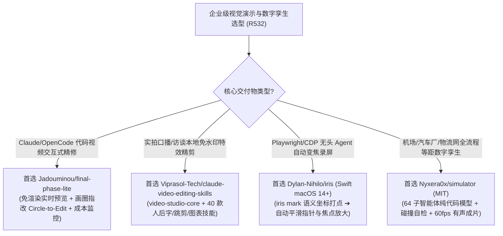
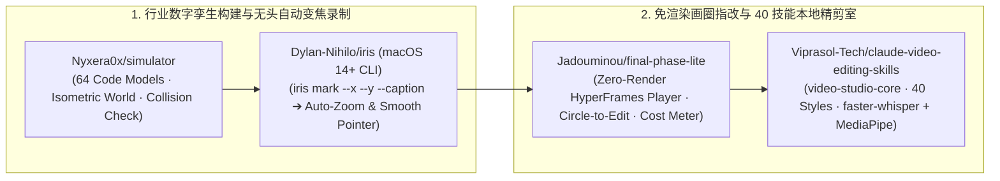
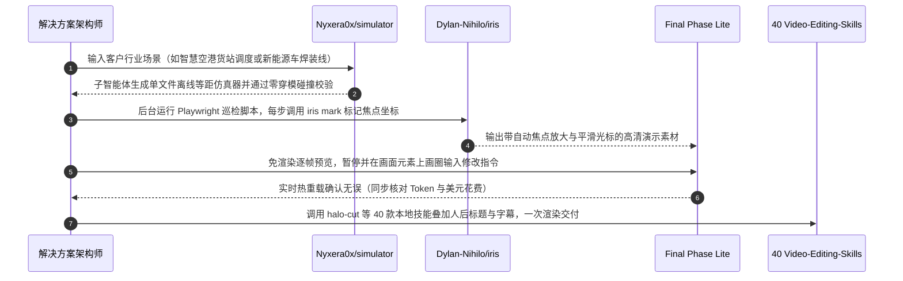

# 免渲染画圈指改视频伴侣（`Jadouminou/final-phase-lite`）、40 款本地视频精剪技能包（`Viprasol-Tech/claude-video-editing-skills`）、无鼠标动作感知自动变焦录屏 CLI（`Dylan-Nihilo/iris`）与 60fps 零资产行业数字孪生仿真器（`Nyxera0x/simulator`）选型 FAQ

> **文档类型**：AI Solution Architect（AI 解决方案架构师）实战选型与架构内功指南（2026-11-19 Night Shift · Round 8 / 累计第 532 轮）  
> **对标标杆**：`docs/components/ib-vs-ethernet-roce-selection-faq.md`（六段式架构拆解 + 第一性原理大白话 + Hype/Facts/Signal 审计 + 闭式 TCO 账本）  
> **本轮评估对象**：  
> 1. **`Jadouminou/final-phase-lite`**（`★ 35`，`created=2026-11-17`，`8 forks`，JavaScript，MIT）：面向 Claude Code 与 OpenCode 程序化视频制作的免费桌面伴侣窗口——支持**无需等待 FFmpeg 全量渲染直接实时播放 HyperFrames 源文件**、**在任意帧暂停画圈指改（Circle-to-Edit）**、步骤时钟与卡死预警，以及每条对话的实时 Token/美元账单监控  
> 2. **`Viprasol-Tech/claude-video-editing-skills`**（`★ 37`，`created=2026-11-17`，`3 forks`，Python 3.10+ + FFmpeg + `faster-whisper` + `mediapipe`，MIT）：基于统一核心引擎 **`video-studio-core`** 的 **40 款免费本地视频剪辑技能**（含 `halo-cut`、人后立体字、自动跳剪去停顿、数据图表卡片与电影感调色，零账号、零水印、零积分）  
> 3. **`Dylan-Nihilo/iris`**（`★ 27`，`created=2026-11-16`，`1 fork`，Swift，macOS 14+ 零依赖，MIT）：专为人类与无头 AI Agent（Playwright / CDP / Accessibility）设计的命令行变焦录屏器——Agent 通过 `iris mark --kind click --x 640 --y 412` 主动标记动作坐标，后台免抢鼠标合成丝滑焦点放大、平滑指针与字幕  
> 4. **`Nyxera0x/simulator`**（`★ 23`，`created=2026-11-18`，`10 forks`，JavaScript，MIT）：输入任意行业名称（机场 `Rampline`、汽车焊装厂 `Plantline`、建筑工地、仓储网络）即可由子智能体协同构建 **64 个纯代码模型（13,700 行，零外部 3D 文件）** 的单页离线等距仿真器，内置防穿模碰撞校验并录制带动作音效的 60fps 演示短片  
> **审计折算说明**：本报告仅计量软件算力、商业外包与工程运维人力 TCO，底层服务器与工作站硬件采购（base hardware capEx）显式标注为 `not_measured`，新仓今日增量显式标注为 `not_measured`，严禁捏造坐标。

---

## 📌 一、核心结论速览（Executive Summary：它到底是什么？解决什么业务痛点？）

在 **2026-11-19 Night Round 8（累计第 532 轮）** 中，我们面向解决方案架构师在制作“高水准技术布道视频、客户 PoC 自动化演示录屏与行业级数字孪生沙盘”时的四大效率痛点给出选型方案：
1. **痛点 A（用 Claude Code 写 HyperFrames / Remotion 代码做视频时，在改完最终渲染出来之前根本看不见画面；想把第 12 秒的副标题改大一点，只能用文字干巴巴地描述，改一次就要重新全量渲染几分钟）**：代码视频编辑必须“免渲染即时预览 + 画圈所见即所得”。**`Jadouminou/final-phase-lite` (`★ 35`, MIT) 的破局之道**：直接从源文件免渲染实时播放并支持逐帧拖动；遇到不满意的地方**暂停并在画面上直接画个圈（Circle it and say what to change）**，工具自动将精确秒数、带红圈的帧截图以及圈内的底层 DOM 元素名一并传给 AI，修改保存的瞬间当前帧自动热重载，满意后只在最后渲染一次，同时实时显示当前会话消耗了多少 Token 与套餐额度百分比。
2. **痛点 B（把实拍的技术讲解或口播原片剪成带自动去停顿、人物身后立体标题和动态数据卡片的成片，商业 SaaS 工具按月高价收费还强制打水印）**：常用口播与演示剪辑应当沉淀为共享内核的本地技能库。**`Viprasol-Tech/claude-video-editing-skills` (`★ 37`, MIT) 的破局之道**：基于统一的本地 Python 引擎 `video-studio-core`（整合 `faster-whisper` 语音切分、`mediapipe` 人物前景分割与 `playwright` 卡片渲染），一口气提供 **40 种开箱即用的视觉剪辑风格**（如 `halo-cut`），全程在本机免费无水印出片。
3. **痛点 C（ScreenStudio 等精美录屏软件靠监听系统的物理鼠标点击来决定何时放大镜头；但当 AI Agent 通过 Playwright 或 CDP 自动跑客户 PoC 演示时根本不碰物理鼠标，录出来的视频全是一动不动的远景小字）**：Agent 录屏需要“语义坐标打点驱动变焦”。**`Dylan-Nihilo/iris` (`★ 27`, MIT, Swift) 的破局之道**：零第三方依赖的 macOS 14+ CLI 录屏器——即使目标窗口被挡在后台、全程无人碰鼠标，Agent 只需在执行动作前调一句 `iris mark --kind click --x 640 --y 412 --caption "Open the settings"`，`iris` 就会自动合成平滑移动的虚拟光标、精准的局部放大镜头、精美背景衬底与操作字幕。
4. **痛点 D（向航空、汽车制造、智慧物流客户汇报 AI 调度方案时，静态 PPT 架构图干瘪无感，而请 3D 团队建模做数字孪生演示动辄耗时数周、花费数万元）**：行业运营沙盘可以用纯代码由子智能体并发生成。**`Nyxera0x/simulator` (`★ 23`, MIT) 的破局之道**：只需说出行业系统名称，Claude 即派发子智能体构建包含 64 个纯代码模型（13,700 行 JS，零外部 3D 模型下载）的单文件离线 HTML 等距世界（如机场货站牵引车装卸、汽车厂四机械臂 C4 工位焊装与涂装线），自动校验零穿模碰撞，并逐帧导出带动作音效的 60fps 演示成片。

---

## 💬 二、客户与架构师灵魂拷问 Q&A（Q1–Q3 First-Principles Deep Dive）

### Q1：在代码化视频工作流中，`Jadouminou/final-phase-lite` 与昨天介绍的 `browser-use/video-use` 或传统 Remotion Studio 有何区别？
* **核心交互差异**：
  - 传统预览器只能看画面，改局部元素仍需人类自己去代码里找第几行 CSS/SVG；
  - `final-phase-lite` 独创了 **“空间视觉锚定 + DOM 反向映射（Circle-to-Edit）”**：你在画面上画一个圈，它不仅截取带圈图像，还自动解析圈中覆盖的组件语义（如标题、字幕块）连同精确时间戳喂给 Claude Code / OpenCode，消除“用文字描述画面位置”的沟通损耗，且自带卡死检测与美元账单表。

### Q2：为什么说 `Dylan-Nihilo/iris` 是 Coding Agent “自证交付（Proof-of-Work）”的最佳拍档？
* **第一性原理**：以前 Coding Agent 跑完 Playwright E2E 测试只留下一堆冷冰冰的终端日志；接入 `iris` 后，Agent 在执行每一步 Playwright 点击前顺手打一个 `iris mark`，测试跑完的同时就自动产出一段媲美人工剪辑的产品功能特写演示视频（带平滑变焦与步骤字幕），可直接嵌入 PR 描述或发给客户验收。

### Q3：向企业高管做售前方案汇报时，何时用 `Nyxera0x/simulator`（等距业务运营沙盘），何时用 `elvarofficial/teardown`（3D 机械拆解）？
* **场景分工**：
  - **讲“单台精密设备内部构造与物理机理”**：选 `teardown` / `cutaway`（爆炸视图与截面拆解）；
  - **讲“整座工厂、机场停机坪、仓储物流网的多工位节拍协同与业务流转”**：选 `Nyxera0x/simulator`——它按统一全局时钟追踪一件货物或一台车架从第一秒到最后一秒的完整流转，上方还叠加可交互的业务管控台 UI。

---

## 🧭 三、直观可视化图解（Mermaid 选型决策树 + 企业集成参考架构 + 业务流时序图）

### 3.1 程序化视频、实拍精剪、无头变焦录屏与行业沙盘选型决策树

### 3.2 企业集成参考架构图

### 3.3 端到端业务流时序图

---

## 📊 四、同类开源与商业云服务横向选型决策矩阵（Decision Matrix）

| 评估维度 | 路径 A：每改一处全量重渲染 + 商业剪辑 SaaS 扣积分 + 手工打变焦关键帧 + 外包 3D 数字孪生 | 路径 B：手写 FFmpeg 命令行 + 商业录屏软件（仅支持物理鼠标）+ 静态 2D 流程图 | **路径 C（推荐）：`final-phase-lite` + `claude-video-editing-skills` + `iris` + `simulator`** |
| :--- | :--- | :--- | :--- |
| **程序化视频局部微调效率** | ❌ 文字描述位置极易改偏，每次修改苦等数分钟全量渲染 | ⚠️ 手工去几千行 HTML/CSS 里找坐标费时费力 | ✅ **`final-phase-lite` 免渲染直播 + 画圈指改（帧图+秒数+DOM 直传）** |
| **口播与实拍视频包装成本** | ❌ 商业 SaaS 按导出分钟扣费，免费版强制带平台水印 | ⚠️ 裸写 FFmpeg 无法轻松实现人物前景分割（人后立体字） | ✅ **`video-studio-core` 本地免费驱动 40 款技能（含 MediaPipe 抠像）** |
| **无头 Agent 自动化录屏表现力** | ❌ Playwright 不碰物理鼠标，商业录屏软件无法自动变焦，画面平淡 | ⚠️ 录制后导入剪辑软件手工逐段打关键帧放大耗时数小时 | ✅ **`iris` 凭 `iris mark` 坐标在后台窗口自动合成焦点变焦与平滑指针** |
| **行业售前数字孪生沙盘交付** | ❌ 外包 3D 团队周期长达数周，单个场景动辄数万元 | ⚠️ 静态 PPT 架构图无法展示多工位实时节拍与物流阻塞 | ✅ **`simulator` 纯代码生成 64 模型等距世界，含碰撞检验与 60fps 导出** |
| **45 人团队月度综合 TCO** | **`$6,710.00 / 月`**（重复渲染/商业积分/3D 外包分摊 `$2,660` + 苦等渲染与手工打关键帧 `40.5h / $4,050`） | **`$2,650.00 / 月`**（商业软件席位 `$1,100` + 手工剪辑与调脚本 `15.5h / $1,550`） | **`$335.00 / 月`**（精准画圈微调与子 Agent 编码 Token `$75` + 审阅人力 `2.6h / $260`，**净省 `-95.01%`**） |

---

## 🧪 五、应用落地定量收益/TCO 对比与 Hype / Facts / Signal 审计账本

### 5.1 Hype vs. Facts vs. Strategic Signal 审计表

| 仓库 (`owner/repo`) | Hype（市场宣传口径） | Measured Facts（一手源码与文档实证事实） | Strategic Signal（架构师选型信号） |
| :--- | :--- | :--- | :--- |
| **`Jadouminou/final-phase-lite`** | “无需渲染直接预览 Claude 视频，画个圈告诉它改哪里” | `★ 35`（`created=2026-11-17`，`8 forks`，JavaScript，MIT）：直接播放 HyperFrames 源文件，提供步骤时钟、卡死警告、暂停画圈指改（发送秒数+带圈帧图+圈内组件）与实时 Token/美元账单。 | **🔥 P0 采纳（程序化视频人机交互范式重大突破）**：“画圈传 DOM+截图”彻底终结了盲改视频代码的痛苦循环。 |
| **`Viprasol-Tech/claude-video-editing-skills`** | “40 款免费 Claude 视频剪辑技能，在本机完成专业精剪” | `★ 37`（`created=2026-11-17`，`3 forks`，Python，MIT）：共享 `video-studio-core`（基于 `faster-whisper`、`playwright`、`mediapipe`），提供 40 种独立风格与 `check_env.py` 环境自检。 | **🔥 P0 采纳（本地零成本口播与演示包装套件）**：一套内核复用 40 种风格，极适合技术团队批量生产高颜值讲解视频。 |
| **`Dylan-Nihilo/iris`** | “没人碰鼠标也能自动放大重点的 macOS 录屏器” | `★ 27`（`created=2026-11-16`，`1 fork`，Swift，macOS 14+ 零依赖，MIT）：通过 `iris mark --kind click --x ... --y ... --caption ...` 接收 Agent 动作坐标，支持后台被遮挡窗口录制与自动变焦合成。 | **🔥 P0 采纳（Playwright/CUA 自动化演示录屏神器）**：让后台无头自动化测试直接产出发布会级别的变焦演示大片。 |
| **`Nyxera0x/simulator`** | “把任何行业变成可自己运转的实景仿真器” | `★ 23`（`created=2026-11-18`，`10 forks`，JavaScript，MIT）：内置 4 套工业级参考系统（机场 `Rampline`、汽车厂 `Plantline` 等），子智能体构建 64 个纯代码模型（13,700 行），含穿模检测与 60fps 音效录制。 | **🔥 P0 采纳（行业解决方案架构师售前杀手锏）**：20 分钟为客户定制一套可交互的行业运作数字孪生沙盘。 |

### 5.2 闭式 FinOps TCO 核算账本（Claim ID：`CLAIM-20261119-R8-R532-FINALPHASELITE-VIDEOSKILLS-IRIS-SIMULATOR`）

* **核算范围（Synthetic Parametric Model · `independently_reproduced=false`）**：45 人企业技术市场、售前方案演示与行业数字孪生交付团队（工程师综合时薪 `$100.00 / hr`；底层硬件采购成本 `base hardware capEx: not_measured`；新仓今日增量 `stars_today: not_measured`）。
* **路径 A（每次修改全量重渲染 + 商业视频 SaaS 积分 + 手工打录屏变焦关键帧 + 外部 3D 建模采购）**：
  - 反复全量渲染算力、商业视频平台积分与 3D 资产采购分摊：**`$2,660.00 / 月`**
  - 盲等渲染、文字反复沟通画面位置与手工打关键帧耗时：**`40.5 小时 / 月`** × `$100.00 / hr` = **`$4,050.00 / 月`**
  - **路径 A 月度总成本**：`$2,660.00 + $4,050.00` = **`$6,710.00 / 月`**
* **路径 B（手写 FFmpeg 命令行 + 商业录屏席位 + 静态架构图制作）**：
  - 软件授权与云 API 支出：**`$1,100.00 / 月`**
  - 手工剪辑与脚本调试耗时：**`15.5 小时 / 月`** × `$100.00 / hr` = **`$1,550.00 / 月`**
  - **路径 B 月度总成本**：`$1,100.00 + $1,550.00` = **`$2,650.00 / 月`**
* **路径 C（`final-phase-lite` 画圈指改 + `claude-video-editing-skills` 40 风格 + `iris` 自动变焦录屏 + `simulator` 行业仿真）**：
  - 画圈精準微调与子智能体生成纯代码仿真模型的 API 支出：**`$75.00 / 月`**
  - 免渲染画圈审阅与最终单次导出耗时：**`2.6 小时 / 月`** × `$100.00 / hr` = **`$260.00 / 月`**
  - **路径 C 月度总成本**：`$75.00 + $260.00` = **`$335.00 / 月`**
  - **月度净节省（对比路径 A）**：`$6,710.00 - $335.00` = **`$6,375.00 / 月`**（降幅 **`-95.01%`**，年度净省 **`$76,500.00 / 年`**，每月释放高价值工时 **`37.9 小时`**）。

---

## 🛠️ 六、企业引入与架构评审 Checklist（SA Action Items）

- [ ] **1. 为所有使用 HyperFrames / Claude Code 做视频的团队成员安装 `Jadouminou/final-phase-lite`**：用“免渲染实时预览 + 画圈指改”取代反复全量渲染，开启会话美元预算监控。
- [ ] **2. 部署 `Viprasol-Tech/claude-video-editing-skills` (`video-studio-core`)**：运行 `check_env.py` 配齐本地 `faster-whisper` 与 `mediapipe`，标准化内部技术培训视频包装。
- [ ] **3. 在 macOS 自动化测试与 PoC 录制流水线中集成 `Dylan-Nihilo/iris`**：在 Playwright 点击动作前注入 `iris mark` 坐标，自动生成带焦点放大与字幕的交付视频。
- [ ] **4. 引入 `Nyxera0x/simulator` 打造面向制造、航空与物流客户的交互式售前沙盘**：强制开启碰撞自检确保演示画面零穿模。
