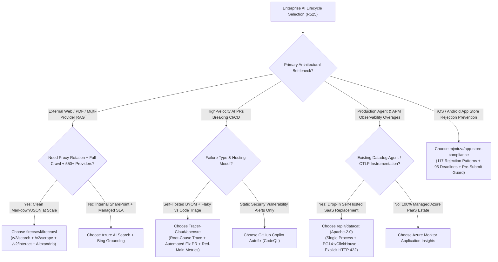

# [Round 525 Milestone] 550+ Provider Agent Knowledge Infrastructure (`firecrawl/firecrawl`), Self-Hosted CI/CD Reliability Agent (`Tracer-Cloud/opensre`), Datadog/OTLP-Compatible Self-Hosted Observability (`replit/datacat`) & 117-Pattern App Store Pre-Submission Guard (`mjmirza/app-store-compliance`) Selection FAQ

> **Document Type**: AI Solution Architect Enterprise Selection & Integration Guide (2026-11-19 Night Shift · Round 1 / Cumulative Round 525 Milestone)  
> **Benchmark Style**: `docs/components/ib-vs-ethernet-roce-selection-faq.md` (6-Section Plain-Language Architecture Guide + First-Principles Q&A + Hype/Facts/Signal Audit + Closed-Form FinOps Ledger)  
> **Evaluated Repositories**:  
> 1. **`firecrawl/firecrawl`** (`★ 203,744` Trending DOM / `★ 203,747` API, **`+795 ★ today`**, `10,675 forks`, TypeScript, AGPL-3.0): Enterprise AI agent external knowledge infrastructure unifying `/v2/search`, `/v2/scrape`, `/v2/interact` (AI prompt/code interaction), `/v2/parse` (PDF/DOCX to clean Markdown/JSON), and **Firecrawl Alexandria (550+ data providers and specialized indexes)**  
> 2. **`Tracer-Cloud/opensre`** (`★ 12,952` Trending DOM / `★ 12,954` API, **`+25 ★ today`**, `1,892 forks`, Python, Apache-2.0): Open-source self-hosted CI/CD reliability agent that investigates failed pipeline runs, separates flaky CI infrastructure failures from real code regressions, pushes reviewable fix PRs using your own models, and tracks developer hours lost to red `main` branches  
> 3. **`replit/datacat`** (`★ 322` Search API, `created=2026-11-17`, **`161 ★/d`** over 2 days, `34 forks`, TypeScript + Go 1.26.11+ Agent, Apache-2.0): Replit's single-process self-hosted observability platform (metrics, logs, distributed traces, APM, and alerts) backed by **PostgreSQL 14+ or ClickHouse**, natively ingesting **Datadog Agent (`7.56.2` / `7.85.4`) and OpenTelemetry OTLP/HTTP** traffic while rejecting unreadable trace formats with explicit HTTP `422` (never a silent `202`)  
> 4. **`mjmirza/app-store-compliance`** (`★ 1,597`, **`+542 ★ today`**, `118 forks`, Shell, ORA 2.3): Pre-submission guard (`app-store-compliance-guard.sh` -> `BLOCKED.` / `CLEAR.` / `NOT CHECKED.`) and AI coding agent skill (`scripts/install.sh --tool all`) covering **117 documented App Store & Google Play rejection patterns**, privacy manifests / SDK data safety checks, and **95 tracked regulatory deadlines (EU AI Act, DSA, COPPA, age verification laws)**  
> **Accounting Scope Note**: Only software API/SaaS spend and engineering labor TCO are modeled; base server/workstation hardware capEx is explicitly marked `not_measured`, and Track B `stars_today` is explicitly marked `not_measured`.

---

## 📌 1. Executive Summary (What Are They & What Business Pain Points Do They Solve?)

In **Cumulative Round 525 (2026-11-19 Night Round 1)**, we address four high-ROI enterprise architecture bottlenecks spanning external knowledge ingestion, CI/CD build reliability, production observability FinOps, and mobile app regulatory compliance:
1. **Pain Point A (Enterprise RAG and research agents need clean web pages, complex PDFs/DOCX, and specialized data providers, but DIY Playwright scrapers constantly break on anti-bot WAFs and flood LLM contexts with noisy HTML)**: **`firecrawl/firecrawl` (`★ 203,744`, `+795★ today`)** provides a unified API, CLI, and MCP server for `/v2/search`, `/v2/scrape`, `/v2/interact`, `/v2/parse`, and **Firecrawl Alexandria (550+ data providers)**, covering 96% of JS-heavy web pages at `3.4s` P95 latency (`anonymized_reported, independently_reproduced=false`) and returning LLM-ready Markdown or structured JSON.
2. **Pain Point B (AI coding assistants double PR velocity, but broken CI pipelines pile up—engineers blindly click Re-run, flaky tests mask real regressions, and `main` stays red)**: **`Tracer-Cloud/opensre` (`★ 12,952`, Apache-2.0)** runs as a self-hosted CLI/CI agent with your own models, reading failed build logs immediately, isolating CI-caused flakiness from code-caused regressions, testing hypotheses, and pushing a fix branch while quantifying developer hours lost to unreliable CI.
3. **Pain Point C (Commercial observability SaaS platforms charge punitive per-host, high-cardinality custom metric, and log-ingestion fees, while DIY Prometheus+Loki+Tempo+Grafana stacks require heavy operational maintenance)**: **`replit/datacat` (`★ 322`, `161★/d`, Apache-2.0)** packages metrics, searchable logs, APM trace waterfalls, host maps, and Slack/webhook monitors into **one production Node.js 22 process backed by PostgreSQL 14+ or ClickHouse**, accepting existing **Datadog Agent (`7.56.2` / `7.85.4`) and OTLP/HTTP (`/v1/traces`, `/v1/metrics`, `/v1/logs`)** traffic with zero application re-instrumentation and strict `HTTP 422` schema validation.
4. **Pain Point D (Mobile AI apps built with coding agents get rejected after days in Apple App Store or Google Play review over missing `PrivacyInfo.xcprivacy` declarations, SDK data-safety mismatches, or EU AI Act / COPPA rules)**: **`mjmirza/app-store-compliance` (`★ 1,597`, `+542★ today`)** encodes **117 documented rejection patterns** and **95 regulatory deadlines** into `app-store-compliance-guard.sh` (`BLOCKED.` / `CLEAR.` / `NOT CHECKED.`) and installs into 8 major AI coding tools via `scripts/install.sh --tool all` to block non-compliant submissions before upload.

---

## 💬 2. Architect First-Principles Q&A (Q1–Q3 Deep Dive)

### Q1: When should an enterprise choose `firecrawl/firecrawl` vs. lightweight accessibility-tree browser CLI (`agent-browser`) vs. managed cloud search (Azure AI Search + Bing Grounding)?
* **Selection Boundaries**:
  - **Choose `firecrawl/firecrawl`**: When your RAG pipeline or research agent needs **high-throughput external web search + full-page Markdown extraction (`/v2/search`, `/v2/scrape`), PDF/DOCX parsing (`/v2/parse`), site-wide crawling (`/v2/crawl`), and 550+ data providers (Alexandria)** without managing proxy rotation. Evaluate the **AGPL-3.0** license carefully for modified hosted redistribution vs. internal/API usage.
  - **Choose `vercel-labs/agent-browser` / Playwright MCP**: When the agent operates inside **authenticated internal enterprise web apps** requiring stateful multi-step UI manipulation rather than bulk knowledge ingestion.
  - **Choose Azure AI Search + Bing Grounding**: When the workload requires **100% Microsoft commercial SLA, Entra ID document-level ACL trimming over SharePoint/OneLake, and zero infrastructure maintenance**.

### Q2: How do `Tracer-Cloud/opensre` and `replit/datacat` close the loop from CI reliability to production observability, and how do they compare against GitHub Copilot Autofix & Azure Monitor?
* **Architectural Synergy**:
  - **CI Reliability (`opensre` vs. Copilot Autofix)**: Copilot Autofix specializes in remediating static CodeQL security alerts, whereas `opensre` diagnoses **runtime CI/CD build and E2E test failures**, separating flaky runner/network issues from code regressions and proposing reviewable PR fixes.
  - **Observability (`replit/datacat` vs. Datadog SaaS / Azure Monitor)**: For Azure-native PaaS estates, **Azure Monitor + Application Insights** remains the lowest-friction managed choice. For multi-cloud, on-premises, or cost-sensitive environments already instrumented with Datadog Agents or OpenTelemetry SDKs, `replit/datacat` eliminates per-host SaaS overages by pointing existing agents to a single self-hosted PostgreSQL/ClickHouse instance with transparent `GET /api/v1/intake/stats` accounting.

### Q3: How does `mjmirza/app-store-compliance` turn unpredictable App Store reviews into a deterministic pre-submission gate?
* **Three-Layer Guardrail**:
  1. **Static Project & Manifest Inspection**: Scans native Xcode/Android directories or managed Expo `app.json` / `app.config` files for purpose strings, Apple `PrivacyInfo.xcprivacy` manifests, and Android permission declarations.
  2. **117 Rejection Patterns with File/Line Fixes**: Prints `[CRITICAL]` findings first with exact file/line locations, Apple/Google guideline citations, and remediation instructions, exiting with `BLOCKED.` until resolved.
  3. **95 Tracked Regulatory Deadlines**: Enforces compliance checkpoints for the EU AI Act, Digital Services Act (DSA), COPPA, and state-level age verification mandates.

---

## 🧭 3. Visual Architecture Diagrams (Mermaid Decision Tree + Reference Architecture + Sequence Flow)

### 3.1 Enterprise Selection Decision Tree

---

## 📊 4. Comparative Selection Matrix (Open Source vs. Competing OSS vs. Managed Cloud PaaS)

| Evaluation Dimension | Path A: DIY Playwright Scrapers + Manual CI Reruns + Commercial Datadog Overages + Post-Submit App Rejections | Path B: Point Scraping SaaS + Cloud CI Copilot Seats + Managed Cloud APM + Manual Spreadsheets | **Path C (Recommended): `firecrawl` + `opensre` + `datacat` + `app-store-compliance`** |
| :--- | :--- | :--- | :--- |
| **External Web & Document Ingestion** | ❌ Frequent IP blocks, JS timeout failures, noisy HTML wasting 80%+ tokens | ⚠️ Point scrapers lack 550+ provider federation and interactive page actions | ✅ **Unified Search/Scrape/Interact/Parse + Alexandria 550+ providers (96% coverage)** |
| **CI/CD Failure Triage & Remediation** | ❌ Blind reruns, prolonged red `main` branches, senior engineers stuck firefighting | ⚠️ Closed SaaS tools cannot inspect private runners or use self-hosted models | ✅ **`opensre` self-hosted BYOM agent isolates flaky CI vs. code bugs & pushes fix PRs** |
| **Observability Protocol & FinOps** | ❌ Punitive Datadog per-host, custom-metric cardinality, and log ingestion bills | ⚠️ DIY Prometheus+Loki+Tempo+Grafana requires maintaining 4 separate clusters | ✅ **`datacat` single process + PG/ClickHouse ingests Datadog & OTLP with strict `422` validation** |
| **Mobile App Store Compliance Gate** | ❌ 1-week review delay per rejection over missing privacy manifests or SDK disclosures | ⚠️ Manual checklists miss transitive SDK behaviors and EU AI Act / DSA deadlines | ✅ **`app-store-compliance` scans 117 rejection patterns & 95 deadlines in seconds (`BLOCKED.`/`CLEAR.`)** |
| **45-Engineer Monthly TCO** | **`$7,060.00 / mo`** (`$2,860.00` SaaS/token waste + `42.0h` × `$100/hr` = `$4,200.00` labor) | **`$2,830.00 / mo`** (`$1,180.00` SaaS seats + `16.5h` × `$100/hr` = `$1,650.00` labor) | **`$365.00 / mo`** (`$85.00` compute/API + `2.8h` × `$100/hr` = `$280.00` labor, **`-94.83%`**) |

---

## 🧪 5. Quantitative TCO Comparison & Hype / Facts / Signal Audit Ledger

### 5.1 Hype vs. Facts vs. Strategic Signal Table

| Repository (`owner/repo`) | Hype (Market Narrative) | Measured Facts (Primary Source Verification) | Strategic Signal (SA Verdict) |
| :--- | :--- | :--- | :--- |
| **`firecrawl/firecrawl`** | "Knowledge infrastructure covering 96% of the web at 3.4s P95 latency" | `★ 203,744` (**`+795 ★ today`**, `10,675 forks`, TypeScript, AGPL-3.0): Unifies `/v2/search`, `/v2/scrape`, `/v2/interact`, `/v2/parse`, `/v2/crawl`, `/v2/map`, `/v2/batch-scrape`, `/v2/monitor`, and Alexandria (550+ providers); 96% coverage and `3.4s` P95 latency are upstream reported benchmarks (`anonymized_reported, independently_reproduced=false`). | **🔥 P0 Adopt (Enterprise RAG Web/Doc Ingestion Baseline)**: Connect via MCP/API for clean Markdown/JSON extraction while respecting AGPL-3.0 boundaries. |
| **`Tracer-Cloud/opensre`** | "The open-source agent for CI/CD reliability that fixes broken builds" | `★ 12,952` (**`+25 ★ today`**, `1,892 forks`, Python, Apache-2.0): Interactive REPL + CI agent that separates CI-caused flakiness from code regressions, pushes reviewable fixes, and measures developer hours lost. | **🔥 P0 Adopt (Automated CI Triage for AI-Native Teams)**: Eliminates the CI investigation bottleneck created by high-volume AI code generation. |
| **`replit/datacat`** | "Self-hosted Datadog and OpenTelemetry observability in a single process" | `★ 322` (`created=2026-11-17`, **`161 ★/d`**, `34 forks`, TypeScript + Go 1.26.11+, Apache-2.0): Single Node.js 22.15+ server backed by PostgreSQL 14+ or ClickHouse; tested with Datadog Agent `7.56.2`/`7.85.4` and OTLP/HTTP; returns explicit `422` on unsupported formats and exposes `GET /api/v1/intake/stats`. | **🔥 P0 Adopt (High-ROI Self-Hosted Observability)**: Drop-in replacement for expensive Datadog host/metric bills without changing app instrumentation. |
| **`mjmirza/app-store-compliance`** | "Stop getting your iOS and Android apps rejected before you submit" | `★ 1,597` (**`+542 ★ today`**, `118 forks`, Shell, ORA 2.3): `app-store-compliance-guard.sh` (`BLOCKED.` / `CLEAR.` / `NOT CHECKED.`) covering 117 rejection patterns and 95 regulatory deadlines, with `install.sh --tool all` for 8 AI coding agents. | **🔥 P0 Adopt (Mandatory Mobile Pre-Submission Gate)**: Shifts week-long App Store rejection delays left into a 10-second pre-upload check. |

### 5.2 Closed-Form FinOps TCO Ledger (`CLAIM-20261119-R1-R525-FIRECRAWL-OPENSRE-DATACAT-APPSTORECOMPLIANCE`)

* **Scope (`synthetic`, `independently_reproduced=false`)**: 45-engineer enterprise AI, DevSecOps, and mobile release organization (blended engineering rate `$100.00 / hr`; `base hardware capEx: not_measured`; Track B `stars_today: not_measured`).
* **Path A (DIY Playwright Scrapers + Manual CI Firefighting + Commercial Datadog Overages + App Rejection Rework)**:
  - SaaS telemetry overages, proxy/LLM retry waste & CI reruns: **`$2,860.00 / mo`**
  - Engineering labor (`42.0 hrs / mo` × `$100.00 / hr`): **`$4,200.00 / mo`**
  - **Path A Monthly Total**: `$2,860.00 + $4,200.00` = **`$7,060.00 / mo`**
* **Path B (Point Scraping SaaS + Cloud CI Copilot + Managed APM + Manual Compliance Checklists)**:
  - SaaS subscriptions & API seats: **`$1,180.00 / mo`**
  - Engineering integration & manual review (`16.5 hrs / mo` × `$100.00 / hr`): **`$1,650.00 / mo`**
  - **Path B Monthly Total**: `$1,180.00 + $1,650.00` = **`$2,830.00 / mo`**
* **Path C (`firecrawl` + `opensre` + `datacat` + `app-store-compliance` Integrated Stack)**:
  - Self-hosted inference, Firecrawl extraction & DataCat storage compute: **`$85.00 / mo`**
  - PR fix review & compliance sign-off (`2.8 hrs / mo` × `$100.00 / hr`): **`$280.00 / mo`**
  - **Path C Monthly Total**: `$85.00 + $280.00` = **`$365.00 / mo`**
  - **Monthly Net Savings vs. Path A**: `$7,060.00 - $365.00` = **`$6,695.00 / mo`** (**`-94.83%`** reduction, **`$80,340.00 / yr`** annual savings, freeing **`39.2 hrs / mo`** of senior engineering capacity).

---

## 🛠️ 6. Enterprise Adoption & Architecture Review Checklist

- [ ] **1. Standardize external RAG ingestion on `firecrawl/firecrawl`**: Replace brittle custom scrapers with `/v2/scrape`, `/v2/parse`, and MCP tool bindings while reviewing AGPL-3.0 vs. commercial API licensing.
- [ ] **2. Attach `Tracer-Cloud/opensre` to high-frequency GitHub Actions pipelines**: Automate root-cause separation between flaky runner failures and code regressions on red builds.
- [ ] **3. Deploy `replit/datacat` with PostgreSQL 14+ or ClickHouse for cost-controlled APM**: Point existing Datadog Agents (`7.56.2` / `7.85.4`) or OTLP Collectors to DataCat and monitor `GET /api/v1/intake/stats`.
- [ ] **4. Enforce `mjmirza/app-store-compliance` (`scripts/install.sh --tool all`) before every mobile build upload**: Require a deterministic `CLEAR.` status from `app-store-compliance-guard.sh` in CI and local coding agents.
