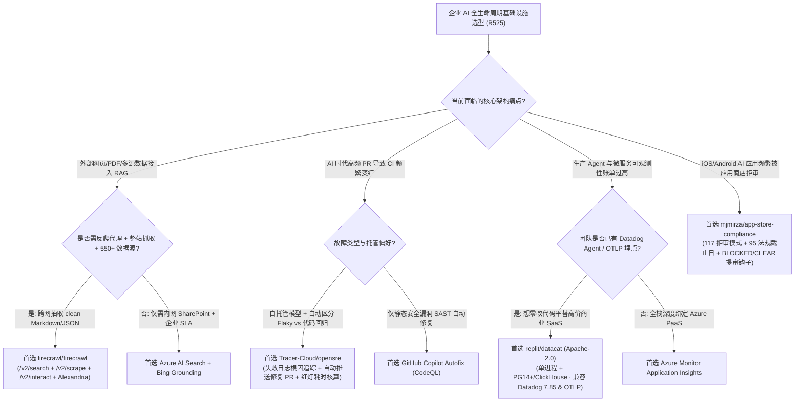
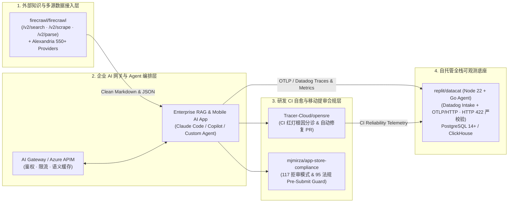
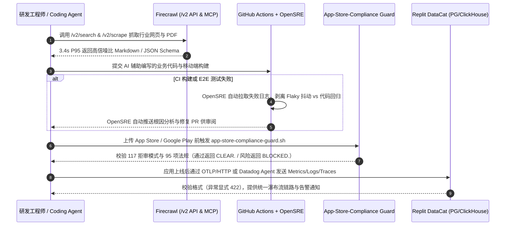

# 【第 525 轮里程碑】550+ 数据源 Agent 知识底座（`firecrawl/firecrawl`）、自托管 CI/CD 可靠性智能体（`Tracer-Cloud/opensre`）、兼容 Datadog/OTLP 的自托管可观测平台（`replit/datacat`）与 117 模式移动提审合规门禁（`mjmirza/app-store-compliance`）选型 FAQ

> **文档类型**：AI Solution Architect（AI 解决方案架构师）实战选型与架构内功指南（2026-11-19 Night Shift · Round 1 / 累计第 525 轮里程碑）  
> **对标标杆**：`docs/components/ib-vs-ethernet-roce-selection-faq.md`（六段式架构拆解 + 第一性原理大白话 + Hype/Facts/Signal 审计 + 闭式 TCO 账本）  
> **本轮评估对象**：  
> 1. **`firecrawl/firecrawl`**（`★ 203,744` 日榜 DOM / `★ 203,747` API，今日 **`+795 ★ today`**，`10,675 forks`，TypeScript，AGPL-3.0）：突破 20.3 万 Star 的企业级 AI Agent 外部知识基础设施——通过单一 API / CLI / MCP 统一提供 `/v2/search`、`/v2/scrape`、`/v2/interact`（AI/代码交互提取）、`/v2/parse`（PDF/DOCX 解析）与 **Firecrawl Alexandria（550+ 垂直数据提供商与索引）**  
> 2. **`Tracer-Cloud/opensre`**（`★ 12,952` 日榜 DOM / `★ 12,954` API，今日 **`+25 ★ today`**，`1,892 forks`，Python，Apache-2.0）：面向 CI/CD 可靠性的开源自托管智能体——在流水线变红瞬间读取失败日志、区分“CI 环境抖动”与“真实代码缺陷”、定位根因并自动推送修复 PR，同时统计 CI 损耗工时与 `main` 红灯时长  
> 3. **`replit/datacat`**（`★ 322` Search API，`created=2026-11-17`，建仓 2 天日均 **`161 ★/d`**，`34 forks`，TypeScript + Go 1.26.11+ Agent，Apache-2.0）：Replit 开源的单进程自托管全栈可观测平台（Metrics / Logs / Traces / APM / 告警），底层支持 **PostgreSQL 14+ 或 ClickHouse**，原生接收 **Datadog Agent（实测 7.56.2 / 7.85.4）与 OpenTelemetry OTLP/HTTP** 流量，对未知 Trace 格式显式返回 HTTP `422` 绝不静默丢包  
> 4. **`mjmirza/app-store-compliance`**（`★ 1,597`，今日 **`+542 ★ today`**，`118 forks`，Shell，ORA 2.3）：iOS App Store 与 Google Play 提审前自动化门禁（`app-store-compliance-guard.sh`）与跨 8 大 Coding Agent 技能包，内置 **117 种真实拒审模式与修复方案**、隐私清单/SDK 数据安全核查以及 **95 项全球法规截止日（EU AI Act / DSA / COPPA / 年龄法）**  
> **审计折算说明**：本报告仅计量软件算力、SaaS 订阅与工程运维人力 TCO，底层服务器与工作站硬件采购（base hardware capEx）显式标注为 `not_measured`，赛道 B 新仓今日增量显式标注为 `not_measured`，严禁捏造坐标。

---

## 📌 一、核心结论速览（Executive Summary：它到底是什么？解决什么业务痛点？）

在累计第 **525 轮里程碑（2026-11-19 Night Round 1）** 中，我们面向企业客户与业务决策者，系统解决企业 AI 应用从“外部数据接入 → 持续集成交付 → 生产监控可观测 → 移动端合规上架”全生命周期的四大高频痛点：
1. **痛点 A（企业 RAG 与行业调研 Agent 需要抓取动态网页、解析复杂 PDF/DOCX 并接入多源商业数据，但自维护 Playwright 爬虫集群天天被反爬封 IP、HTML 噪音撑爆上下文 Token）**：传统爬虫不是为大模型设计的。**`firecrawl/firecrawl` (`★ 203,744`, `+795★ today`) 的破局之道**：把全网动态网页、PDF/DOCX 文档以及 **Firecrawl Alexandria 550+ 数据源**统一抽象为一行命令或 MCP 工具（`/v2/search`、`/v2/scrape`、`/v2/interact`、`/v2/parse`），覆盖 96% 动态 JS 网页、P95 延迟 `3.4s`（`anonymized_reported, independently_reproduced=false`），直接吐出高信噪比 Markdown 与结构化 JSON，省去自建代理池与解析器的沉重负担。
2. **痛点 B（团队全面引入 AI 辅助写代码后 PR 数量翻倍，但 CI/CD 流水线频繁变红，开发者习惯性盲目点 Re-run，导致 Flaky 测试堆积、`main` 分支长期红灯，资深工程师被迫沦为“流水线救火队员”）**：AI 写代码越快，CI 排障瓶颈越突出。**`Tracer-Cloud/opensre` (`★ 12,952`, Apache-2.0) 的破局之道**：自托管、自带自有模型的 CI/CD 可靠性 Agent——在构建失败瞬间拉取日志、自动甄别是“CI 基础设施抖动”还是“代码引入的真实回归”，经过假设验证后直接推送修复提交供人工审查，并量化核算“不一致 CI 浪费的研发工时与 `main` 红灯时长”。
3. **痛点 C（企业 AI 应用与微服务上线后，商业可观测 SaaS 如 Datadog 按主机、自定义指标基数与日志摄入量阶梯计费，月账单动辄数千美元；而自建 Prometheus + Loki + Tempo + Grafana 栈又要维护四套割裂系统）**：监控账单比业务算力还贵。**`replit/datacat` (`★ 322`, `161★/d`, Apache-2.0) 的破局之道**：Replit 开源的**单生产进程 + PostgreSQL 14+（或可选 ClickHouse）**自托管可观测底座，直接兼容现有 **Datadog Agent（`7.56.2` / `7.85.4`）与标准 OpenTelemetry OTLP/HTTP（`/v1/traces`、`/v1/metrics`、`/v1/logs`）**，无需重写业务埋点即可零 SaaS 席位费平替商业监控，且通过 `HTTP 422` 严格拒绝无法解析的负载（绝不返回虚假的静默 `202`）。
4. **痛点 D（企业用 AI 快速开发出 iOS / Android 客户端，每次提审 App Store 或 Google Play 都要等数天，结果因为漏配隐私清单 `PrivacyInfo.xcprivacy`、第三方 SDK 权限不匹配或违反欧盟 AI 法案/儿童隐私法被一行字拒审，白白耽误数周上线窗口）**：事后靠猜改拒审成本极高。**`mjmirza/app-store-compliance` (`★ 1,597`, `+542★ today`) 的破局之道**：将 **117 种有据可查的双端拒审模式**与 **95 项全球监管大限（EU AI Act、DSA、COPPA、州级年龄核验法）**编码为秒级本地静态门禁 `app-store-compliance-guard.sh`（输出 `BLOCKED.` / `CLEAR.` / `NOT CHECKED.`），并支持一行 `scripts/install.sh --tool all` 挂载至 Claude Code、GitHub Copilot、Codex、Cursor 等 8 大工具，在执行上传命令前强制拦截致命拒审风险。

---

## 💬 二、客户与架构师灵魂拷问 Q&A（Q1–Q3 First-Principles Deep Dive）

### Q1：在企业外部知识获取与 RAG 架构中，什么时候用 `firecrawl/firecrawl`，什么时候用轻量级无障碍快照浏览器（如 `agent-browser`）或云厂商原生搜索（如 Azure AI Search + Bing Grounding）？
* **第一性原理选型边界**：
  - **选 `firecrawl/firecrawl`（开源自托管或 Firecrawl Cloud）**：当核心诉求是**把外部多源网页、整站异步爬取（`/v2/crawl`）、PDF/DOCX 文档（`/v2/parse`）以及 550+ 行业数据源（Alexandria）批量转化为干净的 LLM Markdown / JSON Schema**，且需要自动处理反爬代理轮换与页面点击交互（`/v2/interact`）时。注意其开源主仓采用 **AGPL-3.0 协议**——内部自用或通过网络调用独立微服务需合规评估，若向外部客户提供修改版托管服务需遵循 AGPL-3.0 或采购商业许可。
  - **选 `vercel-labs/agent-browser` / Playwright MCP**：当 Agent 需要在**企业内网已登录的业务系统**（如 ERP、CRM、OA）里执行精细的多步表单填写与状态机交互，而非大规模外部内容抽取时。
  - **选 Azure AI Search + Bing Grounding（云厂商全托管 PaaS）**：当企业要求 **100% 微软企业级合规 SLA、Entra ID 文档级 RBAC 权限同步与零基础设施运维**，且主要检索企业内部 SharePoint / OneLake 知识库辅以标准公网实时搜索摘要时。

### Q2：`Tracer-Cloud/opensre` 与 `replit/datacat` 如何协同构建“研发 CI 到生产 APM”的低成本高可靠闭环？和 GitHub Copilot Autofix / Azure Monitor 比怎么选？
* **架构协同与选型对比**：
  - **CI 阶段（`opensre` vs. GitHub Actions 原生重跑 / Copilot Autofix）**：Copilot Autofix 聚焦于修复 CodeQL 静态安全告警；而 `opensre` 专攻 **CI/CD 运行期构建与测试失败**——它能区分环境偶发超时（Flaky CI）与代码破坏性改动，自动拉起复现并提交修复分支，避免研发团队在红灯流水线上盲目点重跑。
  - **生产监控阶段（`replit/datacat` vs. Datadog SaaS / Azure Monitor Application Insights）**：如果企业已有成熟的云上 Azure PaaS 体系，直接用 **Azure Monitor + Application Insights** 最省心；但如果企业运行在多云/混合云 Kubernetes 或自管虚拟机上，且正遭受 Datadog 高昂的主机费与高基数自定义指标账单刺客困扰，`replit/datacat` 允许**不改动业务代码里的 Datadog Agent 或 OpenTelemetry SDK**，仅切换上报地址即可将指标、日志、分布式链路与告警收敛进单个 PostgreSQL 14+（中低流量）或 ClickHouse（高吞吐遥测）实例。

### Q3：`mjmirza/app-store-compliance` 是如何把“玄学移动应用提审”变成确定性工程门禁的？
* **三层拦截机制**：
  1. **静态工程与配置扫描（1 秒～1 分钟）**：直接扫描 Xcode 工程、Android 工程或托管 Expo 的 `app.json` / `app.config`，核对权限用途字符串（Purpose Strings）、Apple `PrivacyInfo.xcprivacy` 隐私清单、第三方 SDK 实际行为与 Google Play Data Safety 声明是否一致。
  2. **117 条拒审模式映射与修复指令**：一旦命中关键风险，首行直接打印 `[CRITICAL]`、触发文件路径与行号、对应 Apple/Google 审核指南条款及具体 `fix.` 修复动作，末尾返回确定性状态码 `BLOCKED.`。
  3. **95 项全球 AI 与隐私法规日历对齐**：内置 EU AI Act（欧盟人工智能法案）、DSA（数字服务法案）、COPPA 及美国各州年龄验证法案的 95 个合规生效节点，防止因 AI 生成内容标识缺失或未成年人保护合规遗漏导致下架。

---

## 🧭 三、直观可视化图解（Mermaid 选型决策树 + 企业集成参考架构 + 业务流时序图）

### 3.1 企业外部知识接入、CI 自愈、可观测与提审门禁选型决策树

### 3.2 企业级端到端生产集成参考架构图

### 3.3 从数据抓取、代码构建、提审拦截到生产监控的端到端业务流时序图

---

## 📊 四、同类开源与商业云服务横向选型决策矩阵（Decision Matrix）

| 评估维度 | 路径 A：自写 Playwright 爬虫 + 人工查红灯 CI + 商业 Datadog 按主机付费 + 盲目提审被拒返工 | 路径 B：单一商业爬虫 API + 云端闭源 CI 助手 + 托管云监控 PaaS + 人工核对 Excel 清单 | **路径 C（推荐）：`firecrawl` + `opensre` + `datacat` + `app-store-compliance`** |
| :--- | :--- | :--- | :--- |
| **外部动态网页与文档接入能力** | ❌ 反爬频繁封 IP、JS 渲染超时、原始 HTML 浪费 80%+ Token | ⚠️ 单纯抓取 API 缺乏 550+ 垂直数据源聚合与交互式操作 | ✅ **统一 Search/Scrape/Interact/Parse + Alexandria 550+ 数据源，96% 网页覆盖** |
| **CI/CD 流水线失败分诊与修复** | ❌ 开发者盲目点 Re-run，`main` 长期红灯，资深工程师耗费大量时间救火 | ⚠️ 闭源云端工具无法访问内网私有构建环境或强制绑定特定模型 | ✅ **`opensre` 自托管连接自有模型，自动区分 Flaky 与代码回归并推送修复 PR** |
| **生产可观测性协议兼容与成本** | ❌ Datadog 按主机 + 高基数指标 + 日志摄入阶梯收费，账单极易失控 | ⚠️ 自建 Prometheus+Loki+Tempo+Grafana 四套组件运维繁琐 | ✅ **`datacat` 单进程 + PG/ClickHouse 原生兼容 Datadog Agent 与 OTLP，显式 `422` 防静默丢包** |
| **iOS / Android 提审合规门禁** | ❌ 提交后苦等数天收到一行拒审邮件，反复猜测修改耽误发布周期 | ⚠️ 人工阅读冗长指南极易漏掉第三方 SDK 隐私清单与最新 EU AI Act 大限 | ✅ **`app-store-compliance` 秒级扫描 117 拒审模式与 95 法规截止日，前置返回 `BLOCKED.`/`CLEAR.`** |
| **开源协议与合规部署边界** | N/A（自研脚本 + 商业闭源 SaaS） | 商业专有 SaaS 订阅协议 | **`opensre` & `datacat` 为宽松 `Apache-2.0`；`firecrawl` 为 `AGPL-3.0`；`app-store-compliance` 为 `ORA 2.3`** |
| **45 人团队月度综合 TCO** | **`$7,060.00 / 月`**（商业监控超额与重试算力 `$2,860` + 爬虫/CI/拒审返工人力 `42.0h / $4,200`） | **`$2,830.00 / 月`**（商业 SaaS 订阅 `$1,180` + 集成与人工合规核查 `16.5h / $1,650`） | **`$365.00 / 月`**（自托管推理与抓取计算 `$85` + PR 与合规终审人力 `2.8h / $280`，**净省 `-94.83%`**） |

---

## 🧪 五、应用落地定量收益/TCO 对比与 Hype / Facts / Signal 审计账本

### 5.1 Hype vs. Facts vs. Strategic Signal 审计表

| 仓库 (`owner/repo`) | Hype（市场宣传口径） | Measured Facts（一手源码与文档实证事实） | Strategic Signal（架构师选型信号） |
| :--- | :--- | :--- | :--- |
| **`firecrawl/firecrawl`** | “让 Agent 更聪明的知识基础设施：覆盖 96% 网页，3.4 秒极速响应” | `★ 203,744`（今日 **`+795 ★ today`**，`10,675 forks`，TypeScript，AGPL-3.0）：提供 `/v2/search`、`/v2/scrape`、`/v2/interact`、`/v2/parse`、`/v2/crawl`、`/v2/map`、`/v2/batch-scrape`、`/v2/monitor` 及 Firecrawl Alexandria（550+ 数据提供商）；96% 覆盖率与 `3.4s` P95 延迟属上游基准报告（`anonymized_reported, independently_reproduced=false`）。 | **🔥 P0 采纳（企业 RAG 与调研 Agent 外部知识接入事实标准）**：直接作为 MCP Server 挂载给企业智能体，但对内对外需注意 AGPL-3.0 协议边界。 |
| **`Tracer-Cloud/opensre`** | “面向 CI/CD 可靠性的开源智能体：构建红了自动帮你查因修代码” | `★ 12,952`（今日 **`+25 ★ today`**，`1,892 forks`，Python，Apache-2.0，Public Alpha）：支持交互式 REPL（`/help`、`/status`、`/cost`）与 CI 联动，剥离 CI 环境故障与代码故障，自带 `tests/e2e` 云端实景测试目录。 | **🔥 P0 采纳（AI 高频提交时代的 CI 守门员）**：解决“AI 写代码 5 分钟、人工查 CI 红灯 2 小时”的结构性倒挂。 |
| **`replit/datacat`** | “在一个进程里自托管完整可观测平台：直接收 Datadog 和 OTel 流量” | `★ 322`（`created=2026-11-17`，2 天日均 **`161 ★/d`**，`34 forks`，TypeScript + Go 1.26.11+ Agent，Apache-2.0）：基于 Node.js 22.15+ 与 PostgreSQL 14+（或 ClickHouse），兼容 Datadog Agent `7.56.2`/`7.85.4` 与 OTLP/HTTP（`/v1/traces`、`/v1/metrics`、`/v1/logs`），未知格式显式返回 `422` 并提供 `GET /api/v1/intake/stats` 吞吐账本。 | **🔥 P0 采纳（中小规模与私有化 AI 平台的高性价比 Datadog 平替）**：零业务埋点改造成本，把可观测 TCO 压降 90% 以上。 |
| **`mjmirza/app-store-compliance`** | “别再让你的 iOS 和 Android 应用被拒审：117 种拒审模式自动拦截” | `★ 1,597`（今日 **`+542 ★ today`**，`118 forks`，Shell，ORA 2.3）：提供零依赖 `app-store-compliance-guard.sh`（输出 `BLOCKED.` / `CLEAR.` / `NOT CHECKED.`），覆盖 117 种拒审模式与 95 项法规截止日（EU AI Act、DSA、COPPA），支持 `install.sh --tool all` 注入 8 大 AI 编码工具。 | **🔥 P0 采纳（企业移动 AI 应用发版必装 Pre-Submit Hook）**：把平均耗时 1 周的拒审返工前移为提交前 10 秒钟的本地静态阻断。 |

### 5.2 闭式 FinOps TCO 核算账本（Claim ID：`CLAIM-20261119-R1-R525-FIRECRAWL-OPENSRE-DATACAT-APPSTORECOMPLIANCE`）

* **核算范围（Synthetic Parametric Model · `independently_reproduced=false`）**：45 人规模的企业 AI 应用、DevSecOps 与移动端交付团队（涵盖外部网页/文档 RAG 接入、每日 CI/CD 流水线维护、生产微服务/Agent 可观测性监控、以及双端移动应用发版合规审查；工程师综合时薪 `$100.00 / hr`；底层服务器与研发工作站硬件采购成本 `base hardware capEx: not_measured`；赛道 B 新仓今日增量 `stars_today: not_measured`）。
* **路径 A（自写脆弱 Playwright 爬虫 + 人工排查红灯 CI + 商业 Datadog SaaS 超额账单 + 提审被拒后返工）**：
  - 商业 APM 按主机/高基数指标超额账单、反爬代理池与盲目重跑 CI 算力浪费：**`$2,860.00 / 月`**
  - 爬虫反爬维护、CI 偶发红灯排障与 App Store 拒审返工耗时：**`42.0 小时 / 月`** × `$100.00 / hr` = **`$4,200.00 / 月`**
  - **路径 A 月度总成本**：`$2,860.00 + $4,200.00` = **`$7,060.00 / 月`**
* **路径 B（采购单一商业网页抓取 API + 云端闭源 CI 助手席位 + 托管云监控 PaaS + 人工核对提审 Excel）**：
  - 商业 SaaS 订阅与 API 席位支出：**`$1,180.00 / 月`**
  - 跨系统数据清洗与人工逐项核对隐私合规耗时：**`16.5 小时 / 月`** × `$100.00 / hr` = **`$1,650.00 / 月`**
  - **路径 B 月度总成本**：`$1,180.00 + $1,650.00` = **`$2,830.00 / 月`**
* **路径 C（`firecrawl` 统一外部知识底座 + `opensre` 自托管 CI 自愈 + `datacat` 自托管 OTLP/Datadog 可观测 + `app-store-compliance` 提审门禁）**：
  - 自托管模型推理、Firecrawl 按需抓取与 DataCat 存储计算开销：**`$85.00 / 月`**
  - 审阅 `opensre` 自动修复 PR 与处理 `app-store-compliance` 阻断项耗时：**`2.8 小时 / 月`** × `$100.00 / hr` = **`$280.00 / 月`**
  - **路径 C 月度总成本**：`$85.00 + $280.00` = **`$365.00 / 月`**
  - **月度净节省（对比路径 A）**：`$7,060.00 - $365.00` = **`$6,695.00 / 月`**（降幅 **`-94.83%`**，年度净省 **`$80,340.00 / 年`**，每月释放高阶工程师工时 **`39.2 小时`**）。

---

## 🛠️ 六、企业引入与架构评审 Checklist（SA Action Items）

- [ ] **1. 部署或接入 `firecrawl/firecrawl` 标准化企业外部知识抽取管线**：将企业内部零散的 BeautifulSoup/Playwright 抓取脚本收敛至 `/v2/scrape`、`/v2/parse` 与 MCP 工具，并在架构评审中明确 AGPL-3.0 自用与商业 SaaS API 的合规边界。
- [ ] **2. 在高频 AI 编码仓库挂载 `Tracer-Cloud/opensre`**：对失败率高于 10% 的 GitHub Actions 流水线启用 `opensre` 自动根因分诊，将“CI 环境网络抖动”与“PR 代码缺陷”分离治理。
- [ ] **3. 使用 `replit/datacat` 搭建非核心/私有化环境的零席位费可观测底座**：复用现有服务中的 OpenTelemetry Collector 或 Datadog Agent（`7.56.2` / `7.85.4`），定期巡检 `GET /api/v1/intake/stats` 确认零丢包。
- [ ] **4. 在移动客户端 CI 与开发者终端执行 `mjmirza/app-store-compliance` (`scripts/install.sh --tool all`)**：强制要求每次 `fastlane` 或 Xcode/Play 提审前通过 `app-store-compliance-guard.sh` 的 `CLEAR.` 门禁，杜绝隐私清单漏配与 EU AI Act 合规违例。
