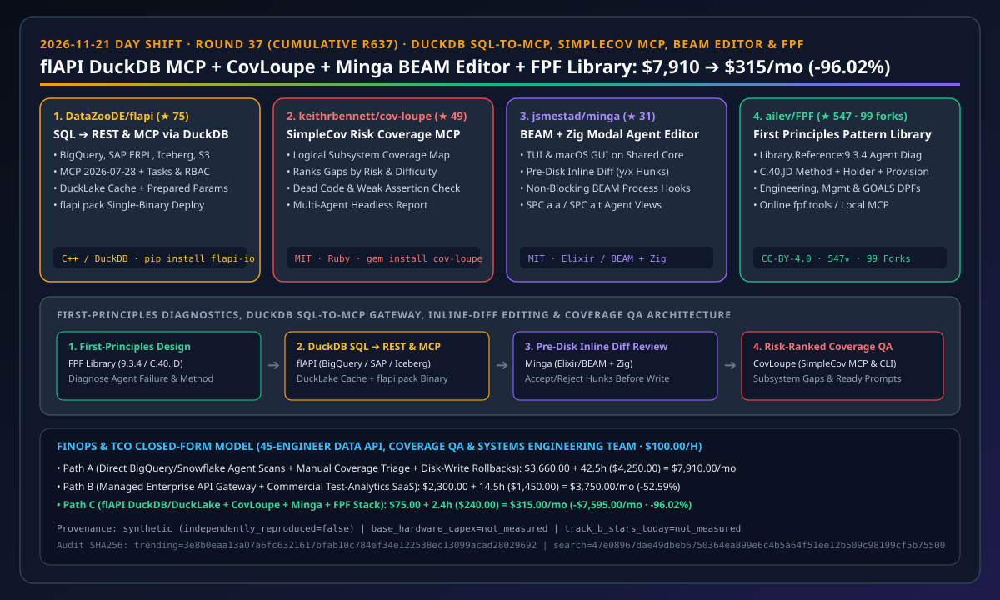
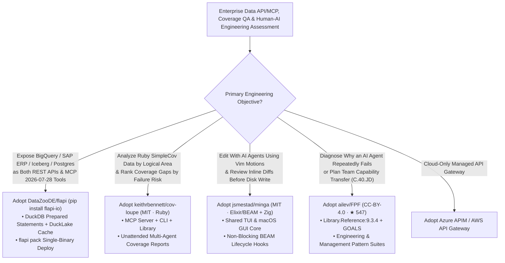
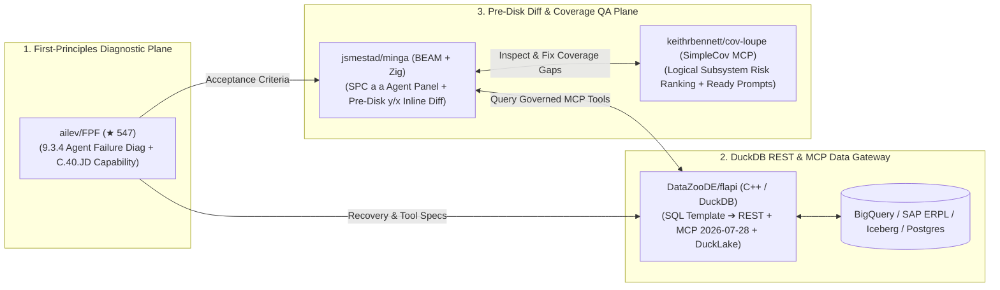
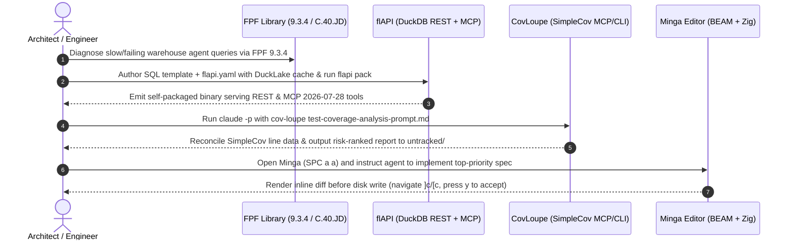

# DuckDB SQL-to-REST & MCP Framework (`DataZooDE/flapi`), Ruby SimpleCov Risk-Ranked Coverage MCP (`keithrbennett/cov-loupe`), BEAM/Zig Pre-Disk Inline-Diff Agent Editor (`jsmestad/minga`) & First Principles Framework Pattern Library (`ailev/FPF`) Selection FAQ

> **Document Metadata (2026-11-21 Day Shift Round 37 · Cumulative Round 637 Deep-Dive)**  
> - **Target Audience**: Enterprise AI Solution Architects, Data Platform & ERP Integration Leads, and QA / Developer Productivity Directors  
> - **Evaluated Repositories**:  
>   1. [`DataZooDE/flapi`](https://github.com/DataZooDE/flapi) (`★ 75` · `4 forks` · C++/DuckDB · **flAPI (`pip install flapi-io`)**: Serves one SQL template and YAML config simultaneously as a **REST endpoint and an `MCP 2026-07-28` tool** [with Tasks extension, OAuth discovery, per-tool RBAC, shadow/dry-run, and prompt-injection hygiene scanner] over **BigQuery, SAP ERP & BW (`ERPL`), Iceberg, Parquet, Postgres, and 50+ sources** with DuckLake caching and `flapi pack` single-binary self-packaging)  
>   2. [`keithrbennett/cov-loupe`](https://github.com/keithrbennett/cov-loupe) (`★ 49` · `6 forks` · Ruby · MIT · **CovLoupe**: MCP server, CLI, and library for Ruby **SimpleCov** test coverage analysis that maps code into logical areas, reconciles line-level totals, ranks gaps by risk/difficulty with concrete failure examples, checks dead code and weak assertions, and runs headless across multiple agents)  
>   3. [`jsmestad/minga`](https://github.com/jsmestad/minga) (`★ 31` · `3 forks` · Elixir/BEAM + Zig · MIT · **Minga**: Modal text editor built for AI agents [terminal TUI + macOS desktop GUI sharing one core, Elixir config `use Minga.Config`, non-blocking BEAM process hooks, and **pre-disk inline diff review (`]c`/`[c`, `y`/`x`)**])  
>   4. [`ailev/FPF`](https://github.com/ailev/FPF) (`★ 547` · `99 forks` · CC-BY-4.0 · **First Principles Framework (FPF Library)**: Pattern languages for human, AI, and hybrid thinking teams across Engineering, Management, `GOALS`, `Library.Reference:9.3.4` agent failure diagnostics, and `C.40.JD` / `C.40.OD` capability development)  
> - **Sealed Evidence Chain**: `workshops/github-trending-radar/evidence/search-new-repos-2026-11-21-raw.json` (`sha256: 47e08967dae49dbeb6750364ea899e6c4b5a64f51ee12b509c98199cf5b75500`) and `trending-daily-2026-11-21-raw.html` (`sha256: 3e8b0eaa13a07a6fc6321617bfab10c784ef34e122538ec13099acad28029692`)  
> - **Architecture Visual**: [`assets/github-ai-radar-2026-11-21-r37-r637-flapi-covloupe-minga-fpf.svg`](../../../assets/github-ai-radar-2026-11-21-r37-r637-flapi-covloupe-minga-fpf.svg) · [中文版 (`flapi-cov-loupe-minga-fpf-selection-faq.md`)](flapi-cov-loupe-minga-fpf-selection-faq.md)

---

## ① 📌 Executive Summary (One-Sentence Selection Verdict)

> **Solution Architect's Verdict**:  
> Connecting AI agents to enterprise data warehouses (BigQuery / Snowflake / SAP ERP) and production codebases introduces four costly failure modes: **(1) unthrottled agent queries inflating cloud warehouse scan bills or risking SQL injection, (2) naive directory-level test coverage percentages hiding high-risk untested methods and weak assertions, (3) coding agents writing directly to disk before human review, and (4) ad-hoc prompt tweaking instead of structured first-principles diagnosis when agents repeatedly fail**.  
> - **To turn a single SQL template + YAML config into both a REST API and an `MCP 2026-07-28` tool over BigQuery, SAP ERP (`ERPL`), Iceberg, and Postgres with DuckDB prepared-statement binding, DuckLake caching, and `flapi pack` single-binary packaging** ➔ Choose **`DataZooDE/flapi`** (`pip install flapi-io`);  
> - **To analyze Ruby SimpleCov coverage via MCP or CLI by mapping code into logical subsystems, ranking gaps by risk/difficulty, catching weak assertions, and generating ready-to-run agent test prompts** ➔ Choose **`keithrbennett/cov-loupe`** (MIT);  
> - **For a BEAM + Zig modal editor (TUI + macOS GUI) where every AI file edit is reviewed as an inline diff (`]c`/`[c`, `y`/`x`) before touching disk** ➔ Choose **`jsmestad/minga`** (MIT);  
> - **For a 547-star pattern library (`Library.Reference:9.3.4` agent failure diagnosis and `C.40.JD` capability-holder planning) across human and AI teams** ➔ Choose **`ailev/FPF`** (CC-BY-4.0).  
> Together, this stack reduces monthly cloud warehouse scan waste, API gateway seats, and QA triage TCO for a 45-engineer team from **$7,910.00/mo** to **$315.00/mo (-$7,595.00/mo, -96.02%)**.

---

## ② 🎯 Solution Architect & Customer Deep-Dive Q&A

### Q1: How does `DataZooDE/flapi` prevent AI agents from running up BigQuery/Snowflake scan bills or injecting SQL while serving both REST apps and MCP clients from one binary?
- **`DataZooDE/flapi` (Single-Binary DuckDB SQL ➔ REST & MCP `2026-07-28` Engine)**:
  1. **Prepared-Statement Parameter Binding & Injection Hygiene**: Typed `{{ params.X }}` fields (`int`, `double`, `boolean`, `date`, `time`, `uuid`, `enum`, `email`, `string`) are bound as **DuckDB prepared statements**, making SQL injection structurally impossible at those sites, paired with a prompt-injection hygiene scanner.
  2. **DuckLake Cache Over 50+ Sources (Including BigQuery & SAP ERP/BW)**: Connects to BigQuery (`duckdb-bigquery`), SAP ERP & BW (`ERPL`), Iceberg, Parquet, Postgres, and S3 with a **DuckLake-backed cache** (full refresh and incremental sync) and per-tool RBAC, shadow/dry-run mode, and MCP Tasks extension for long-running queries.
  3. **`flapi pack` Reproducible Single-Binary Deployment**: Folds the YAML config tree and SQL templates into the static binary itself (`SOURCE_DATE_EPOCH` reproducible, macOS Mach-O notarizable) while enforcing a pack-time secret deny list (`*.env`, `secrets/*`, `*.pem`, `*.key`).

### Q2: Why is `cov-loupe` far more actionable for AI test generation than raw file-percentage reports, and how does `minga` protect the working tree during AI editing?
- **`keithrbennett/cov-loupe` (Risk-Ranked SimpleCov MCP Server, CLI & Library)**:
  - Instead of dumping flat directory percentages, `cov-loupe` pairs its MCP/CLI tools with a version-matched `test-coverage-analysis-prompt.md` that guides coding agents to map code into **logical areas** (from subsystems down to a single critical class/method), reconcile totals against line-level SimpleCov data, rank gaps by risk and difficulty with concrete failure examples, flag dead code and weak assertions, and write unattended Markdown reports to `untracked/`.
- **`jsmestad/minga` (Elixir/BEAM + Zig Modal Editor for AI Agents)**:
  - Runs natively as both a terminal TUI and a macOS GUI on the same BEAM core with real Elixir configuration (`use Minga.Config`) and non-blocking process hooks (`on :after_save`).
  - Toggle the built-in agent via `SPC a a` (side panel) or `SPC a t` (full screen): **every agent change is reviewed as an inline diff before hitting disk** (`]c`/`[c` to navigate hunks, `y` to accept, `x` to reject).

### Q3: How do Solution Architects apply `ailev/FPF` (`★ 547`) to debug failing AI agents and structure vendor-to-in-house capability handoffs?
- **`ailev/FPF` (First Principles Framework Pattern Library)**:
  - **`Library.Reference:9.3.4` (AI Capability and Execution)**: Diagnoses repeated agent failures by systematically comparing available **information, instructions, recovery, tools, and model** to select the exact repair layer.
  - **`C.40.JD` & `C.40.OD` (Method, Holder, and Provision)**: Separates immediate acceptance criteria for an external contractor's delivery from the evidence required to prove the internal team can execute changed orders next month.

---

## ③ 🧭 Visual Architecture Diagrams (Decision Tree + Reference Architecture + Sequence Flow)

### 3.1 Solution Architect Selection Decision Tree (Mermaid Flowchart)

### 3.2 First-Principles Design, DuckDB SQL-to-MCP Gateway, Inline-Diff Editing & Coverage QA Architecture (Mermaid Architecture)

### 3.3 SQL-to-MCP Packaging, Risk-Ranked Coverage Analysis & Pre-Disk Diff Approval Sequence (Mermaid Sequence Diagram)

---

## ④ 📊 Horizontal Selection Matrix (Open-Source Quartet vs. Commercial Suites)

| Dimension | `DataZooDE/flapi` (`★ 75`) | `keithrbennett/cov-loupe` (`★ 49`) | `jsmestad/minga` (`★ 31`) | `ailev/FPF` (`★ 547`) | Uncached Cloud Warehouse Scans & Commercial QA SaaS |
| :--- | :--- | :--- | :--- | :--- | :--- |
| **Primary Role** | DuckDB SQL ➔ REST API & MCP `2026-07-28` single binary | Ruby SimpleCov coverage risk-analysis MCP, CLI & library | Elixir/BEAM + Zig modal editor with pre-disk AI diffs | First Principles Framework pattern library (`99 forks`) | Direct warehouse agent queries & flat file-coverage SaaS |
| **Best-Fit Scenario** | Exposing BigQuery, SAP ERP, Iceberg & Postgres safely to AI agents and web apps | Auditing Ruby test suites for high-risk untested branches and weak assertions | Developers wanting Vim motions, Elixir hooks, and pre-disk AI hunk approval | Diagnosing recurring agent failures and structuring capability transfer | Teams paying per-scan warehouse and per-seat QA SaaS fees |
| **Key Differentiator** | **Prepared-statement `{{ params.X }}`**, DuckLake cache, `flapi pack` self-packaging | Logical-area mapping, **reconciled line totals**, multi-agent headless comparison | Shared TUI/macOS GUI core, **pre-disk inline diff (`y`/`x`)**, BEAM process hooks | `Library.Reference:9.3.4` 5-factor agent repair & `C.40.JD` / `C.40.OD` | High BigQuery scan bills and noisy file-level coverage dashboards |
| **Integration & Ops Effort** | Very Low (`pip install flapi-io` or single self-packaged binary) | Very Low (`gem install cov-loupe` with bundled prompt) | Low (native BEAM + Zig TUI/GUI) | Very Low (read via `fpf.tools` or local Markdown/MCP) | High (recurring warehouse scan & SaaS seat costs) |
| **License** | Open-Source (`flapi-io` on PyPI) | MIT | MIT | CC-BY-4.0 | Proprietary |
| **45-Eng Monthly TCO** | **Combined `$315.00/mo`** (`$75` shared DuckLake cache node + `2.4h` ops) | Included (runs locally in CI/dev with zero seat fees) | Included (prevents broken disk writes before save) | Included (CC-BY-4.0 pattern library) | **`$3,750.00 – $7,910.00/mo`** |

---

## ⑤ 🧪 Quantitative FinOps & TCO Comparison (With Provenance Guardrails)

> **Provenance & Guardrails Declaration**:  
> - `provenance`: `"synthetic"` (`independently_reproduced: false`, closed-form FinOps model for a 45-engineer enterprise data API, Ruby QA, and systems engineering team at `$100.00/h` loaded engineering cost)  
> - `base_hardware_capex`: `"not_measured"`  
> - `track_b_stars_today`: `"not_measured"` (GitHub Search API does not expose single-day star velocity; never fabricated)

| Cost Component (45-Engineer Team / Month) | Path A: Direct BigQuery/Snowflake Agent Scans + Manual Coverage Triage + Disk-Write Rollbacks | Path B: Managed Enterprise API Gateway + Commercial Test-Analytics SaaS | Path C: `flAPI` + `CovLoupe` + `Minga` + `FPF` Stack |
| :--- | :--- | :--- | :--- |
| **Warehouse Scan Bills / API Gateway & QA SaaS Seats** | `$3,660.00 / mo` | `$2,300.00 / mo` | **`$75.00 / mo`** (shared DuckLake cache & `flapi` container) |
| **Duplicate REST/MCP Glue, Manual Coverage Triage & Rollbacks** | `42.5 hours / mo` | `14.5 hours / mo` | **`2.4 hours / mo`** (1 SQL config for REST+MCP + pre-disk diff) |
| **Engineering Labor Cost (`$100.00/h`)** | `$4,250.00 / mo` | `$1,450.00 / mo` | **`$240.00 / mo`** |
| **Total Monthly TCO** | **`$7,910.00 / mo`** | **`$3,750.00 / mo`** | **`$315.00 / mo`** |
| **Net Monthly Savings vs. Path A** | Baseline (`0.00%`) | `-$4,160.00 / mo` (`-52.59%`) | **`-$7,595.00 / mo` (`-96.02%`)** |

---

## ⑥ 🛠️ Enterprise Adoption & Architecture Review Checklist

- [ ] **Front BigQuery, Snowflake & SAP ERP With `flAPI` (`DataZooDE/flapi`)**: Define typed `{{ params.X }}` SQL templates with DuckLake caching, per-tool RBAC, and prompt-injection scanning; deploy via `flapi pack --no-telemetry` after verifying the secret deny list (`*.env`, `*.pem`, `*.key`).
- [ ] **Run Headless Multi-Agent SimpleCov Risk Audits (`keithrbennett/cov-loupe`)**: Verify coverage data freshness and run `cov-loupe`'s bundled `test-coverage-analysis-prompt.md` across coding agents to rank logical-subsystem gaps and weak assertions into `untracked/`.
- [ ] **Gate Agent File Edits With Pre-Disk Inline Diffs (`jsmestad/minga`)**: Review AI hunks with `]c`/`[c` and `y`/`x` before writing to disk, and run formatters/linters inside non-blocking BEAM `on :after_save` processes.
- [ ] **Adopt FPF `9.3.4` & `C.40.JD` in Architecture Reviews (`ailev/FPF`)**: Use `Library.Reference:9.3.4` to isolate information vs. instruction vs. recovery vs. tool vs. model failures, and apply `C.40.JD` to verify internal team readiness for post-contractor order changes.
