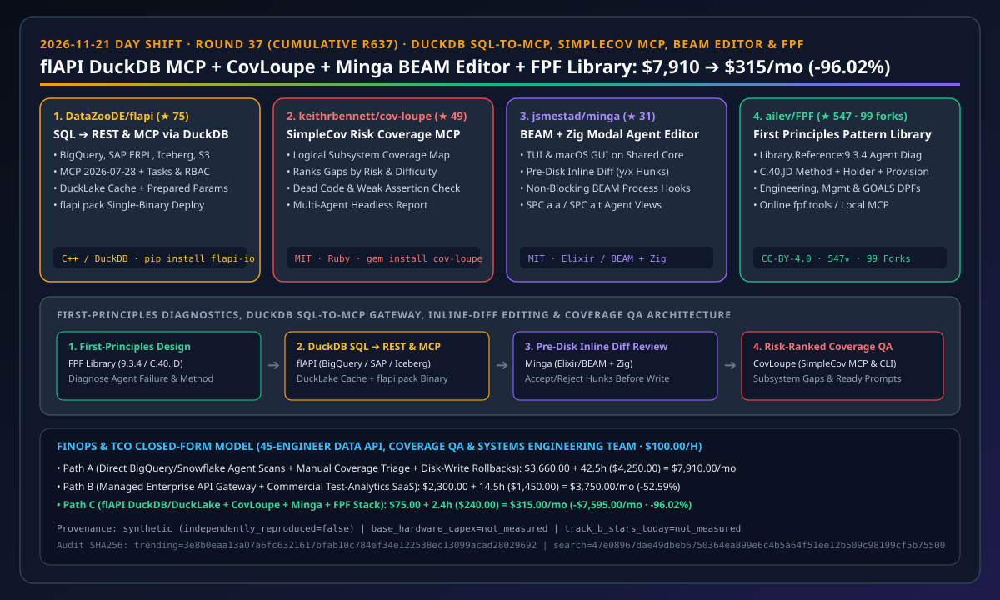
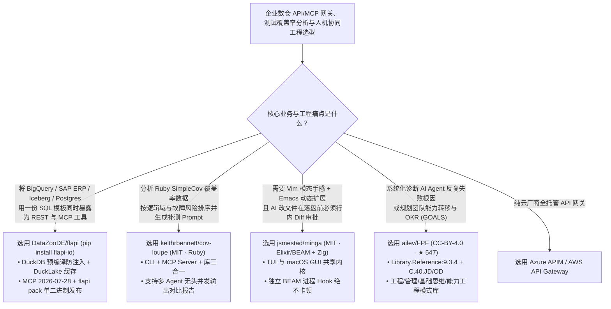
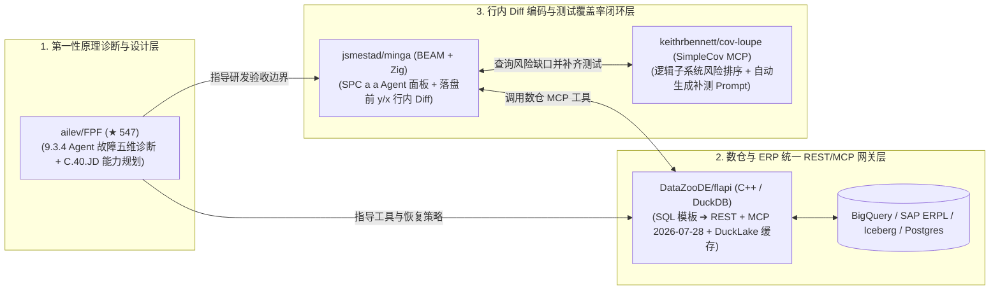
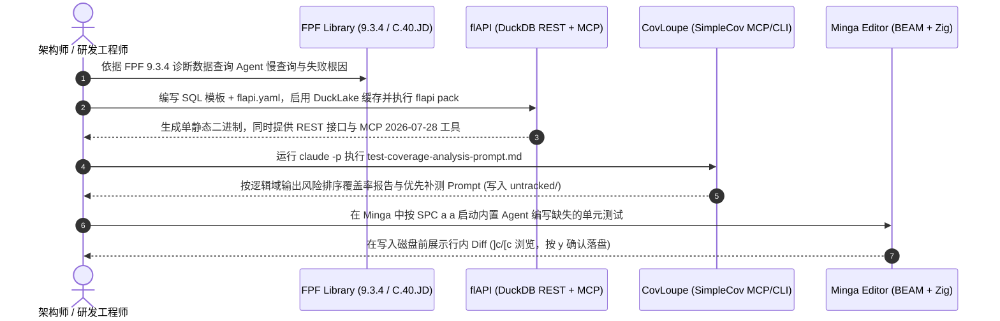

# DuckDB 单配置生成 REST 与 MCP 工具框架（`DataZooDE/flapi`）、SimpleCov 测试覆盖率风险分析 MCP（`keithrbennett/cov-loupe`）、BEAM/Zig 落盘前行内 Diff 智能体模态编辑器（`jsmestad/minga`）与第一性原理人机协同模式库（`ailev/FPF`）选型 FAQ

> **文档元数据（2026-11-21 白班 Day Round 37 · 累计第 637 轮深潜专题）**  
> - **面向对象**：企业 AI 解决方案架构师（AI Solution Architect）、数据平台与 ERP 集成负责人、质量保障（QA）与研发效能总监  
> - **本轮核心评估对象**：  
>   1. [`DataZooDE/flapi`](https://github.com/DataZooDE/flapi)（`★ 75` · `4 forks` · C++/DuckDB · **flAPI（`pip install flapi-io`）**：写一份 SQL 模板与少量 YAML，即可通过内嵌 DuckDB 的单静态二进制同时暴露为 **REST API 与最新 `MCP 2026-07-28` 工具**，直连 **BigQuery、SAP ERP & BW（`ERPL`）、Iceberg、Parquet、Postgres 等 50+ 数据源**，支持 DuckLake 缓存与 `flapi pack` 自打包发布）  
>   2. [`keithrbennett/cov-loupe`](https://github.com/keithrbennett/cov-loupe)（`★ 49` · `6 forks` · Ruby · MIT · **CovLoupe**：面向 Ruby SimpleCov 的测试覆盖率分析 MCP Server、CLI 与库，将代码映射为逻辑子系统/关键类，按风险与难度对测试盲区排序并生成可直接投喂给编码 Agent 的补测试 Prompt）  
>   3. [`jsmestad/minga`](https://github.com/jsmestad/minga)（`★ 31` · `3 forks` · Elixir/BEAM + Zig · MIT · **Minga**：专为 AI 智能体时代打造的模态文本编辑器，终端 TUI 与 macOS 原生 GUI 共享内核，Elixir 进程级非阻塞 Hook，AI 修改在**真正写入磁盘前以行内 Diff（`]c`/`[c`、`y`/`x`）逐块审批**）  
>   4. [`ailev/FPF`](https://github.com/ailev/FPF)（`★ 547` · `99 forks` · CC-BY-4.0 · **First Principles Framework（FPF 第一性原理框架模式库）**：涵盖系统工程、管理与 OKR（`GOALS`）、AI 能力排障（`Library.Reference:9.3.4`）与能力转移（`C.40.JD` / `C.40.OD`）的人机协同思维模式库）  
> - **关联检索证据链**：`workshops/github-trending-radar/evidence/search-new-repos-2026-11-21-raw.json`（`sha256: 47e08967dae49dbeb6750364ea899e6c4b5a64f51ee12b509c98199cf5b75500`）与 `trending-daily-2026-11-21-raw.html`（`sha256: 3e8b0eaa13a07a6fc6321617bfab10c784ef34e122538ec13099acad28029692`）  
> - **高清架构图**：[`assets/github-ai-radar-2026-11-21-r37-r637-flapi-covloupe-minga-fpf.svg`](../../../assets/github-ai-radar-2026-11-21-r37-r637-flapi-covloupe-minga-fpf.svg) · [English Version (`flapi-cov-loupe-minga-fpf-selection-faq.en.md`)](flapi-cov-loupe-minga-fpf-selection-faq.en.md)

---

## ① 📌 核心结论速览（选型一句话结论）

> **架构师一句话选型结论**：  
> 当企业把 AI 智能体接入核心数仓（BigQuery / Snowflake / SAP ERP）与核心业务代码库时，最怕出现四类失控：**（1）Agent 高频轮询直接打穿 BigQuery 按扫描量计费账单或触发 SQL 注入、（2）单元测试覆盖率只看机械的文件百分比而漏掉高风险核心逻辑与弱断言、（3）编码 Agent 直接改坏磁盘文件触发构建雪崩、（4）面对复杂业务交付与 Agent 反复失败缺乏结构化第一性原理拆解方法**。  
> - **需要用一份 SQL 模板同时为前端应用提供 REST API、为 AI 智能体提供带 DuckLake 缓存、RBAC 与防注入扫描的 `MCP 2026-07-28` 工具（直连 BigQuery / SAP ERP / Iceberg）** ➔ 选 **`DataZooDE/flapi`**（`pip install flapi-io`）；  
> - **需要让多个 AI 智能体（Claude/Codex/Gemini）无头并发审计 Ruby SimpleCov 覆盖率数据、按业务子系统与故障风险给测试缺口排序并生成补测 Prompt** ➔ 选 **`keithrbennett/cov-loupe`**（MIT）；  
> - **需要在同一个 BEAM/Zig 模态编辑器（TUI + macOS GUI）里让所有 AI 改动在真正落盘前先过一遍行内 Diff 逐块确认（`y` 接受 / `x` 拒绝）** ➔ 选 **`jsmestad/minga`**（MIT）；  
> - **需要一套系统化诊断“为什么 AI 智能体反复失败（信息/指令/恢复/工具/模型五维排查）”与“外包交付如何同步沉淀内部团队能力（`C.40.JD`）”的模式语言库** ➔ 选 **`ailev/FPF`**（CC-BY-4.0，`★ 547`）。  
> 四者组合可将 45 人数据平台、QA 与系统工程团队的云数仓扫描账单、商业 API 网关席位与测试补齐人力总成本从 **$7,910.00/月** 降至 **$315.00/月（节省 $7,595.00/月，降幅 96.02%）**。

---

## ② 🎯 客户与架构师灵魂拷问 Q&A（业务痛点 · 架构集成 · 边界取舍）

### Q1：如果让 AI 智能体直接查 BigQuery、Snowflake 或 SAP ERP，不仅每次扫描都要花钱，还容易被诱导拼出恶意 SQL。`DataZooDE/flapi` 是如何用单二进制 + DuckDB 彻底解决这个问题的？
- **`DataZooDE/flapi`（SQL 模板 ➔ REST API + MCP 工具二合一引擎）的三大硬核机制**：
  1. **强类型预编译参数绑定（结构性免疫 SQL 注入）**：在 Mustache 风格的 SQL 模板中，所有 `int`、`double`、`boolean`、`date`、`time`、`uuid`、`enum`、`email`、`string` 类型的 `{{ params.X }}` 引用均被强制绑定为 **DuckDB Prepared Statements（预编译语句）**，从结构上杜绝了参数位点的 SQL 注入；同时内置提示词注入卫生扫描器（prompt-injection hygiene scanner）。
  2. **DuckLake 增量缓存 + 50+ 数据源联邦（含 SAP ERP）**：内嵌 DuckDB 及扩展（`duckdb-bigquery`、通过 `ERPL` 连接 **SAP ERP & BW**、`duckdb_iceberg`、Parquet、Postgres、MySQL、S3），并由 **DuckLake 缓存层**承担全量刷新与增量同步，避免 AI 智能体高频请求反复扫描昂贵的 BigQuery/Snowflake。
  3. **原生支持最新 `MCP 2026-07-28` 与 `flapi pack` 单文件自打包**：同时兼容现代与旧版 MCP 客户端，支持长耗时查询 **Tasks 扩展**、OAuth 发现、逐工具 RBAC、Shadow/Dry-Run 影子试跑；更可通过 `flapi pack` 将整个 YAML 配置树与 SQL 模板直接打包进二进制文件本身（自动拦截 `*.env`、`*.pem`、`*.key` 密钥文件，支持 macOS Mach-O 段公证），实现真正的 `scp flapi-prod user@host` 一键上线！

### Q2：传统的测试覆盖率报告只告诉我们“某个目录覆盖率 78%”，为什么对 AI 补测试帮助不大？`cov-loupe` 与 `minga` 如何重塑 AI 辅助编码与测试闭环？
- **`keithrbennett/cov-loupe`（逻辑域映射 + 风险排序的 SimpleCov MCP/CLI）**：
  - 传统工具按物理文件/目录切分，而 `cov-loupe` 配合内置的 `test-coverage-analysis-prompt.md` 引导 AI 智能体：
    1. 将代码按**逻辑业务域（Logical Areas）**映射（从完整子系统下钻到大文件里的单个关键类或核心方法），且行级覆盖率汇总与全工程严格平账；
    2. **按风险与实现难度对测试缺口排序**，为每个缺口给出具体故障推演案例并顺带揪出死代码（Dead Code）与弱断言（Weak Assertions）；
    3. 检查覆盖率数据是否最新（若过期立即停止，绝不盲跑测试），并将带时间戳的报告输出至 `untracked/` 目录，支持同时跑 Claude、Codex、Gemini 多智能体横向比对报告质量。
- **`jsmestad/minga`（BEAM 虚拟机 + Zig 打造的智能体时代模态编辑器）**：
  - 痛点：多数 Agent 工具直接写盘修改源文件，立刻触发文件监听器或编译器报错。
  - `minga` 在终端 TUI 与 macOS 原生 GUI 上共享同一套 Elixir/BEAM 内核（按 `Space` 弹出助记符菜单：`SPC a a` 唤起侧边栏 Agent，`SPC a t` 唤起全屏 Agent）：**Agent 的每次代码修改在落盘前都以行内 Diff 呈现**，开发者用 `]c`/`[c` 跳转代码块、按 `y` 接受或 `x` 拒绝，且 `on :after_save` 等 Elixir Hook 运行在独立 BEAM 进程中，绝不卡死打字响应。

### Q3：当企业团队引入 AI 后遇到“智能体反复在某类任务上翻车”或“找外包交付了第一版但下个月需求变更内部团队接不住”时，`ailev/FPF` 提供了什么方法论武器？
- **`ailev/FPF`（`★ 547`，`99 forks`，First Principles Framework 第一性原理模式库）**：
  - **AI 故障五维根因诊断（`Library.Reference:9.3.4`）**：指导架构师系统比对 **可用信息（Information）、指令（Instructions）、错误恢复机制（Recovery）、工具（Tools）与底层模型（Model）**，根据可观测故障精准选择修复层，而不是盲目改 Prompt。
  - **方法、能力持有者与资源供给同步开发（`C.40.JD` & `C.40.OD`）**：明确区分“验收外部承包商当次交付物”与“验证内部团队具备在下月独立完成变更订单的操作能力”，帮助架构师在采购与自建之间做出经得起检验的架构决策。

---

## ③ 🧭 直观可视化图解（选型决策树 + 企业集成架构 + 业务流时序图）

### 3.1 架构师选型决策树（Mermaid Flowchart）

### 3.2 企业数仓 DuckDB MCP 网关、落盘前 Diff 审查与覆盖率闭环架构图（Mermaid Architecture）

### 3.3 SQL 模板生成 MCP 工具、CovLoupe 风险补测与 Minga 落盘前审批时序图（Mermaid Sequence Diagram）

---

## ④ 📊 同类开源与商业云服务横向选型决策矩阵

| 评估维度 | `DataZooDE/flapi` (`★ 75`) | `keithrbennett/cov-loupe` (`★ 49`) | `jsmestad/minga` (`★ 31`) | `ailev/FPF` (`★ 547`) | 裸查云数仓 + 商业测试分析 SaaS |
| :--- | :--- | :--- | :--- | :--- | :--- |
| **核心定位** | 基于 DuckDB 的 SQL ➔ REST API & MCP 工具单二进制框架 | Ruby SimpleCov 覆盖率深度风险分析 MCP/CLI/库 | Elixir/BEAM + Zig 打造的智能体时代模态编辑器 | 面向人机协同团队的第一性原理模式语言库 | 传统重型 API 网关与按席位计费代码覆盖率云平台 |
| **最适用场景** | 在 BigQuery / Snowflake / SAP ERP 之上构建低成本、防注入的 Agent 数据接口 | 让 AI 找出最有价值的未覆盖高危代码分支并自动生成补测方案 | 追求 Vim 操作效率、Elixir 热扩展与“AI 改动落盘前逐块审批”的开发者 | 诊断复杂 Agent 系统为何反复失败、设计架构决策与团队能力养成 | 预算充足且仅需基础文件级覆盖率百分比报表的团队 |
| **关键差异化机制** | **同配置输出 REST + `MCP 2026-07-28`**、DuckLake 缓存、`flapi pack` 自打包（禁打入密钥） | 按逻辑子系统映射、**校验总数平账**、识别死代码与弱断言、多 Agent 无头对比 | TUI 与 macOS GUI 共享内核、**落盘前 Inline Diff（`y`/`x`）**、BEAM 异步 Hook | **547★ / 99 Forks**、`Library.Reference:9.3.4` 五维 Agent 诊断、`C.40.JD` 能力模型 | Agent 高频请求直接击穿 BigQuery 扫描预算；覆盖率工具无逻辑域风险推演 |
| **集成与运维成本** | 极低（`pip install flapi-io` 或单静态二进制拷贝即用） | 极低（`gem install cov-loupe`，自带与版本匹配的推理 Prompt） | 低（Elixir/BEAM + Zig 原生运行） | 极低（直接在线查阅 `fpf.tools` 或挂载本地 Markdown/MCP） | 高（数仓扫描费 + 商业 SaaS 年费） |
| **开源协议** | 开源（附带源码与 PyPI `flapi-io`） | MIT | MIT | CC-BY-4.0 | 商业专有 |
| **45 人团队月均 TCO** | **组合方案 `$315.00/月`**（含共享 DuckLake 缓存节点 `$75` + 运维 `2.4h`） | 同左（本地无头运行零 SaaS 席位费） | 同左（落盘前拦截错误修改，省去回滚工时） | 同左（开源知识模式库零订阅费） | **`$3,750.00 ~ $7,910.00/月`** |

---

## ⑤ 🧪 应用落地定量收益 / FinOps TCO 对比（含数据血缘声明）

> **数据血缘与严谨性声明（Provenance & Guardrails）**：  
> - `provenance`: `"synthetic"`（`independently_reproduced: false`，基于 45 人企业数据平台、Ruby QA 与系统工程团队在 `$100.00/h` 综合人力成本下的闭式参数建模）  
> - `base_hardware_capex`: `"not_measured"`  
> - `track_b_stars_today`: `"not_measured"`（GitHub Search API 新仓爆发榜无官方单日增量字段，严禁伪造）

| 成本分项（45 人团队 / 月） | Path A：Agent 裸查 BigQuery/Snowflake 扫描费 + 人工翻查覆盖率死角 + AI 写坏磁盘回滚 | Path B：托管企业 API 网关 + 商业测试覆盖率 SaaS | Path C：`flAPI` + `CovLoupe` + `Minga` + `FPF` 开源协同栈 |
| :--- | :--- | :--- | :--- |
| **云数仓重复扫描账单 / API 网关与测试分析 SaaS 席位费** | `$3,660.00 / 月` | `$2,300.00 / 月` | **`$75.00 / 月`**（共享 DuckLake 缓存与单二进制 `flapi` 容器节点） |
| **手写双套 REST/MCP 胶水代码、人工排查测试弱断言与回滚工时** | `42.5 小时 / 月` | `14.5 小时 / 月` | **`2.4 小时 / 月`**（一份 SQL 同时出 REST+MCP + 落盘前 Diff 审批） |
| **折算工程人力成本（`$100.00/h`）** | `$4,250.00 / 月` | `$1,450.00 / 月` | **`$240.00 / 月`** |
| **月度总拥有成本（Total Monthly TCO）** | **`$7,910.00 / 月`** | **`$3,750.00 / 月`** | **`$315.00 / 月`** |
| **相对 Path A 净节省额与降幅** | 基准线（`0.00%`） | `-$4,160.00 / 月`（`-52.59%`） | **`-$7,595.00 / 月`（`-96.02%`）** |

---

## ⑥ 🛠️ 企业引入与架构评审 Checklist

- [ ] **用 `flAPI` 保护高成本数仓与 ERP 接口（`DataZooDE/flapi`）**：将面向 AI 智能体的 BigQuery、Snowflake 与 SAP ERP（`ERPL`）查询统一收敛至 `flapi` SQL 模板，开启强类型 `{{ params.X }}` 预编译绑定、DuckLake 增量缓存、逐工具 RBAC 与提示词注入扫描，生产发布使用 `flapi pack --no-telemetry` 验证密钥黑名单（`*.env`、`*.pem`、`*.key`）。
- [ ] **将测试覆盖率审查升级为逻辑域风险排序（`keithrbennett/cov-loupe`）**：在完整测试套件通过后，使用 `cov-loupe` 自带的 `test-coverage-analysis-prompt.md` 驱动多智能体无头输出逻辑域风险报告至 `untracked/`，优先修复高风险缺口与弱断言。
- [ ] **推行“落盘前 Inline Diff 逐块确认”与非阻塞 Hook（`jsmestad/minga`）**：在模态编辑工作流中通过 `SPC a a` 调用内置 Agent，强制在写入磁盘前用 `]c`/`[c` 与 `y`/`x` 审查代码块，并将格式化/静态检查放入独立 BEAM 进程 Hook。
- [ ] **将 FPF 纳入架构评审与 Agent 故障复盘 SOP（`ailev/FPF`）**：当智能体出现重复故障时对照 `Library.Reference:9.3.4` 逐项排查信息、指令、恢复、工具与模型；在引入外部供应商交付时对照 `C.40.JD` 制定内部团队二期变更承接验证计划。
