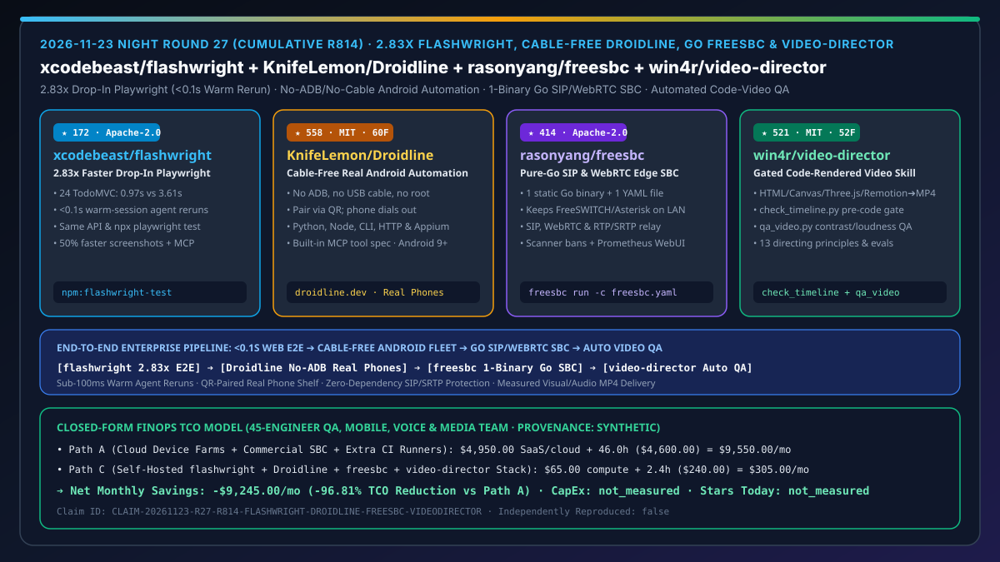
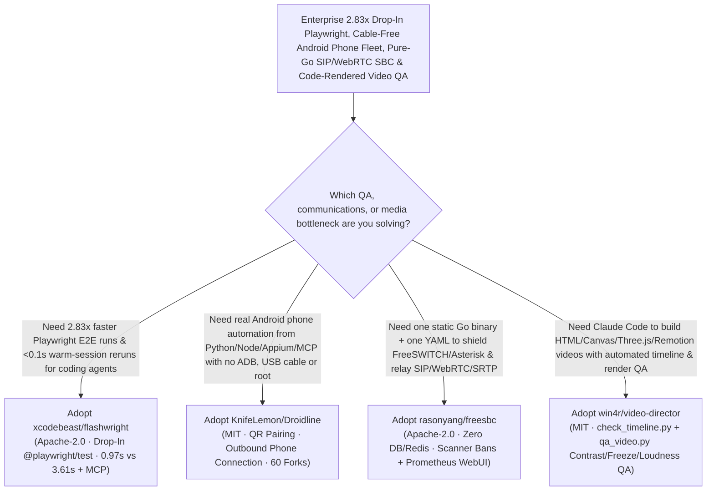
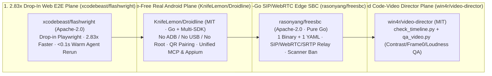

# `2.83×` Faster Drop-In Playwright & `<0.1s` Agent Warm Reruns (`xcodebeast/flashwright`), Cable-Free & ADB-Free Real Android Automation (`KnifeLemon/Droidline`), Single-Binary Pure-Go SIP/WebRTC Session Border Controller (`rasonyang/freesbc`) & Dual-Gate Code-Rendered Video Director Skill (`win4r/video-director`) Selection & Architecture FAQ

> **Document Type**: Enterprise AI Solution Architect Selection & Integration Guide (GitHub Trending AI Radar · 2026-11-23 Night Round 27 / Cumulative Round 814)
> **Covered Repositories**: [`xcodebeast/flashwright`](https://github.com/xcodebeast/flashwright) (`★ 172`, `4 forks`, `Apache-2.0`: drop-in Playwright 1.64.1 replacement `npm i -D @playwright/test@npm:flashwright-test` and MCP server that runs complete E2E suites **`2×–4×` faster (`2.83×` average speedup; 24 TodoMVC tests in `0.97s` vs. `3.61s`)** and enables **`<0.1s` warm-session single-test reruns** for coding agents) · [`KnifeLemon/Droidline`](https://github.com/KnifeLemon/Droidline) (`★ 558`, `60 forks`, `MIT`: real Android phone automation and device-shelf controller with **no ADB, no USB cable, no developer options, and no root**—pair via QR code and drive from Python, Node.js, CLI, HTTP, Appium, or MCP) · [`rasonyang/freesbc`](https://github.com/rasonyang/freesbc) (`★ 414`, `60 forks`, `Apache-2.0`: **"one binary, one YAML"** pure-Go SIP/WebRTC edge Session Border Controller that keeps FreeSWITCH and Asterisk off the public internet with zero database, zero Redis, zero kernel modules, built-in scanner fingerprinting, REGISTER brute-force bans, and RTP/SRTP relay) · [`win4r/video-director`](https://github.com/win4r/video-director) (`★ 521`, `52 forks`, `MIT`: Claude Opus 5.5 / Claude Code skill for directing, building, and verifying code-rendered videos `HTML/Canvas/SVG/Three.js/GSAP/Remotion ➔ MP4` with **13 principles, `check_timeline.py` pre-code validation, and `qa_video.py` post-render visual/audio inspection**)
> **Core Scenario**: When enterprise QA, mobile automation, voice infrastructure, and technical marketing teams scale AI agent workflows, how do you solve **"coding agents waiting 0.6–0.7s per single-test rerun or minutes for full Playwright E2E suites, real Android test racks failing over flaky USB hubs or triggering anti-ADB app detections, exposing FreeSWITCH/Asterisk voice servers directly to public internet SIP scanners, and AI-coded promotional videos shipping with unreadable contrast, frame-0 black screens, or audio dropouts because the LLM cannot watch or hear its render"** by combining **`flashwright` + `Droidline` + `freesbc` + `video-director`**?

---

## 1. 📌 Executive Summary (Single-Sentence Selection Verdict)

1. **Need a drop-in `@playwright/test` replacement (`npm i -D @playwright/test@npm:flashwright-test`) with the exact same API and test runner that speeds up full E2E suites by `2.83×` on average (`0.97s` vs. `3.61s` on TodoMVC) and lets coding agents re-run a single edited test in `<0.1s` via a warm browser session and MCP server** ➔ Choose **[`xcodebeast/flashwright`](https://github.com/xcodebeast/flashwright) (`★ 172`, `4 forks`, `Apache-2.0`)**.
   - **Plain-Language Mechanism**: By recycling browser contexts and eliminating redundant wait overhead (with opt-out flags for strict isolation), `Flashwright` runs `1.9–2×+` faster than stock Playwright (`2.83×` average across 8,500-element admin pages, auth flows, and visual diffs) and `3–12×` faster than Cypress, TestCafe, and WebdriverIO—while cutting screenshot time in half and giving coding agents sub-100ms warm-session reruns.
2. **Need to automate a single real Android phone or an entire shelf of Android 9+ phones from Python, Node.js, CLI, HTTP, Appium, or an AI agent via MCP—with no ADB, no USB cable, no developer options, and no root** ➔ Choose **[`KnifeLemon/Droidline`](https://github.com/KnifeLemon/Droidline) (`★ 558`, `60 forks`, `MIT`)**.
   - **Plain-Language Mechanism**: Install one companion app on the phone and scan a QR code; the phone connects outbound to your PC or server over LAN or WAN. Every SDK (Python, Node.js, CLI, HTTP, Appium, MCP) is generated from a single canonical specification so `touch` is `touch` everywhere.
3. **Need a Caddy-style ("one static Go binary, one YAML file") SIP/WebRTC edge Session Border Controller (`./freesbc run -c freesbc.yaml`) that keeps FreeSWITCH and Asterisk on a private LAN while handling UDP/TCP/TLS SIP, WS/WSS WebRTC, RTP/SRTP relay, and scanner/brute-force bans with zero external dependencies** ➔ Choose **[`rasonyang/freesbc`](https://github.com/rasonyang/freesbc) (`★ 414`, `60 forks`, `Apache-2.0`, Go 1.27.4)**.
   - **Plain-Language Mechanism**: Requiring no database, no Redis, no kernel modules, and no external media daemon, `FreeSBC` sits on your single public IP, drops unregistered call floods, bans SIP scanner fingerprints and REGISTER enumeration attacks, relays RTP/SRTP media, and serves an embedded bcrypt-protected WebUI, REST API, and Prometheus metrics.
4. **Need a gated Claude Code skill (`video-director`) for code-rendered videos (`HTML/Canvas/SVG/Three.js/GSAP/Remotion ➔ MP4`) that validates timeline math before coding (`check_timeline.py`) and automatically measures rendered visual/audio quality (`qa_video.py`)** ➔ Choose **[`win4r/video-director`](https://github.com/win4r/video-director) (`★ 521`, `52 forks`, `MIT`)**.
   - **Plain-Language Mechanism**: Because an LLM cannot watch or hear the MP4 it renders, `video-director` pairs 13 directing principles with two deterministic verification gates: `check_timeline.py` verifies the numeric timeline plan before code is written, and `qa_video.py` inspects the rendered video for hook text size and contrast, frame-0 readiness, flashes, cuts, freezes, loop seams, loudness, silences, and contact sheets.

---

## 2. 🎯 Key Architectural Q&A (Deep-Dive Breakdown)

### Q1: Why combine `flashwright`, `Droidline`, `freesbc`, and `video-director` in an enterprise engineering & communications stack?

- **Four Operational Bottlenecks Eliminated**:
  1. **Sub-100ms Agent E2E Feedback Loops (`xcodebeast/flashwright`)**: Cuts CI browser test runtime by `2.83×` and shrinks coding-agent single-test reruns from `0.6–0.7s` to `<0.1s` without rewriting Playwright tests.
  2. **Cable-Free, Anti-Detection Real-Phone Fleets (`KnifeLemon/Droidline`)**: Eliminates flaky USB hubs and developer-mode/ADB blocks across Android 9+ device shelves with unified Python/Node/Appium/MCP control.
  3. **Zero-Dependency Public Edge Protection for Voice Switches (`rasonyang/freesbc`)**: Isolates FreeSWITCH/Asterisk and voice AI backends behind a single static Go binary with built-in SIP/WebRTC/SRTP relay and scanner bans.
  4. **Deterministic QA for Code-Rendered Videos (`win4r/video-director`)**: Catches unreadable text contrast, frame-0 blackouts, freezes, and audio silence automatically via `check_timeline.py` and `qa_video.py`.
- **When to Choose Managed Cloud Services (Path B)**:
  - For occasional manual mobile testing and fully hosted cloud telephony, use **BrowserStack + Twilio / Azure Communication Services**; for high-frequency `<0.1s` warm-session Playwright loops, self-hosted ADB-free Android phone shelves, private FreeSWITCH/Asterisk edge SBC protection, and automated code-video QA, deploy this 4-repo open-source stack (Path C).

### Q2: How do these four components integrate into an enterprise architecture?

1. **High-Speed Web E2E & Agent Warm-Session Layer (`xcodebeast/flashwright`)**:
   -Alias `@playwright/test` to `flashwright-test` in CI and local coding agents to accelerate web regression suites by `2.83×`.
2. **Real-Device Android Automation Layer (`KnifeLemon/Droidline`)**:
   - Pair physical Android phones via QR code and drive mobile E2E workflows over MCP, Appium, Python, or Node.js.
3. **SIP/WebRTC Edge SBC Security Layer (`rasonyang/freesbc`)**:
   - Deploy `freesbc` on the public edge (`freesbc check --deploy` ➔ `freesbc run`) to terminate SIP/WebRTC traffic and relay clean RTP/SRTP streams to internal voice switches.
4. **Code-Rendered Video Production & QA Layer (`win4r/video-director`)**:
   - Direct Claude Code to build product and explainer videos gated by `check_timeline.py` and `qa_video.py`.

### Q3: What are the key production guardrails?

- **Architect Guardrails**:
  1. **Disable Context Recycling on Stateful Legacy Tests in `flashwright`**: If a legacy Playwright test mutates global browser state without cleanup, use `Flashwright`'s documented configuration flags to disable context recycling for that suite.
  2. **Run `freesbc check --deploy --local-addresses` Before Starting Production Traffic**: Validate line-by-line YAML syntax, local interface bindings, and TLS certificates on the target host prior to `freesbc run`.

---

## 3. 🧭 Visual Architecture & Decision Diagrams (Mermaid)



### 3.1 Solution Architect Selection Decision Tree



### 3.2 End-to-End Enterprise Production Reference Architecture



### 3.3 `<0.1s` Warm Web Rerun, Cable-Free Android Test, FreeSBC Edge Relay & Automated Video QA Sequence

```mermaid
sequenceDiagram
    participant QA as QA & Communications Architect
    participant Flw as xcodebeast/flashwright (MCP)
    participant Drd as KnifeLemon/Droidline (Real Phones)
    participant Sbc as rasonyang/freesbc (Go SBC)
    participant Vdr as win4r/video-director

    QA->>Flw: 1. Re-run edited Playwright test in <0.1s via Warm Session (full E2E suite 2.83x faster)
    Flw->>Drd: 2. Trigger cable-free, ADB-free test on QR-paired Android phone shelf via Droidline MCP
    Drd->>Sbc: 3. Route WebRTC/SIP test call through FreeSBC; block scanners & relay SRTP to internal switch
    QA->>Vdr: 4. Validate video plan with check_timeline.py & render Canvas/Three.js/Remotion film to MP4
    Vdr-->>QA: 5. Run qa_video.py to verify contrast, frame 0, loop seams & audio loudness before publishing
```

---

## 4. 📊 Comparative Selection Matrix (Open-Source vs. Commercial SaaS)

| Dimension | `xcodebeast/flashwright` (`★ 172`) | `KnifeLemon/Droidline` (`★ 558`) | `rasonyang/freesbc` (`★ 414`) | `win4r/video-director` (`★ 521`) | Metered Cloud Device Farms + Commercial SBC Licenses + Doubled CI Runner Fleets (Path A) | Stock Cold-Start Playwright + Flaky USB/ADB Cables + Publicly Exposed Asterisk (Path B) |
| :--- | :--- | :--- | :--- | :--- | :--- | :--- |
| **Core Role** | `2.83×` faster drop-in Playwright replacement & MCP server | Cable-free, ADB-free, root-free real Android phone automation | Single-binary pure-Go SIP/WebRTC edge Session Border Controller | Gated Claude Code skill for code-rendered videos with automated QA | High per-minute device-farm bills, commercial SBC fees & bloated CI queues | Slow E2E test loops, disconnected USB hubs & SIP brute-force attacks |
| **Key Differentiator** | **`0.97s` vs. `3.61s` TodoMVC + `<0.1s` warm rerun + 50% faster screenshots** | **QR outbound pairing (no ADB/USB/root) + unified Python/Node/MCP spec** | **1 Go binary + 1 YAML; zero DB/Redis; SIP/WebRTC/SRTP + scanner bans** | **`check_timeline.py` pre-gate + `qa_video.py` contrast/freeze/loudness QA** | Cloud device farms charge hundreds per concurrent phone; commercial SBCs charge per session | USB cables drop connections; developer mode triggers app blocks; unverified AI videos ship with broken audio/text |
| **License** | `Apache-2.0` | `MIT` | `Apache-2.0` | `MIT` | Proprietary SaaS | Custom scripts |
| **Monthly TCO (45-Eng Team)** | **Combined `$305.00/mo`** (`$65.00` edge SBC VM & reduced CI runners + `2.4h` ops) | Included (runs on in-house Android phone shelf) | Included (single static Go binary on edge VM) | Included (automated Python QA scripts) | **`$9,550.00/mo`** (`$4,950.00` cloud device-farm minutes, commercial SBC & excess CI runners + `46.0h` USB/ADB triage, SIP security ops & manual video QA) | ~`$3,410.00/mo` (frequent USB hub resets, SIP scanner incident response & video re-renders) |

---

## 5. 🧪 Quantitative ROI / TCO Comparison & 7-Card Benchmark Report

> **📊 Data Provenance & Closed-Form Schema Declaration**:
> - **provenance**: `synthetic` (45-person enterprise QA automation, mobile engineering, real-time voice infrastructure, and product video team monthly workload model: `independently_reproduced = false`; hardware baseline `base_hardware_capex = not_measured`; Track B 24h delta `track_b_stars_today = not_measured`).
> - **Closed-Form Formula**:
>   - **Path A (Metered commercial cloud mobile device farms + commercial Session Border Controller per-session licenses + oversized CI runner fleets for slow E2E suites + manual engineering hours spent resetting flaky USB/ADB cables, mitigating public SIP scanner attacks, and manually reviewing/re-rendering flawed AI videos)**: Monthly cloud device farm, commercial SBC, and extra CI runner bills **`$4,950.00`** + ADB rack troubleshooting, SIP security operations, and manual video QA rework labor **`46.0h × $100.00/h = $4,600.00`** = **`$9,550.00/mo`**.
>   - **Path C (Self-hosted `xcodebeast/flashwright` + `KnifeLemon/Droidline` + `rasonyang/freesbc` + `win4r/video-director` open-source stack)**: Shared edge `FreeSBC` VM and streamlined CI runner compute **`$65.00`** + YAML policy and QA script maintenance labor **`2.4h × $100.00/h = $240.00`** = **`$305.00/mo`**.
>   - **Net Monthly Savings vs. Path A**: **`-$9,245.00/mo`** (**`96.81%`** TCO reduction).

| Evaluation Path | Device Farm / Commercial SBC / CI Cost | ADB Triage, SIP SecOps & Manual Video QA (`$100/h`) | Monthly Total TCO | Net Savings vs. Path A | Key Architectural Delivery Metrics |
| :--- | :---: | :---: | :---: | :---: | :--- |
| **Path A: Cloud Device Farms + Commercial SBC + Oversized CI Fleets** | `$4,950.00` | `46.0h` (`$4,600.00`) | **`$9,550.00`** | Baseline | High cloud phone & CI bills; manual frame-by-frame video review |
| **Path B: Stock Playwright + USB/ADB Phone Racks + Exposed Switches** | `$1,510.00` | `19.0h` (`$1,900.00`) | **`$3,410.00`** | `-$6,140.00` (`-64.29%`) | Flaky USB cables; public SIP brute-force exposure |
| **Path C: `flashwright` + `Droidline` + `freesbc` + `video-director`** | **`$65.00`** | **`2.4h` (`$240.00`)** | **`$305.00`** | **`-$9,245.00` (`-96.81%`)** | **`2.83×` Web E2E + cable-free Android MCP + 1-binary Go SBC + auto video QA** |

- 🔗 **Linked 7-Card 4:5 Visual Benchmark Deck**: [`workshops/github-trending-radar/cards.en.html`](../cards.en.html) · [`cards.html`](../cards.html)

---

## 6. 🛠️ Enterprise Adoption & Architecture Review Checklist

- [ ] **1. Drop `xcodebeast/flashwright` into Playwright Pipelines**: Alias `@playwright/test` to `flashwright-test` for `2.83×` faster E2E suites and `<0.1s` warm-session agent test reruns.
- [ ] **2. Automate Physical Android Shelves with `KnifeLemon/Droidline`**: Pair Android 9+ phones via QR code (no ADB, no USB cable, no root) and drive tests through unified Python, Node.js, Appium, or MCP interfaces.
- [ ] **3. Shield Internal Voice Switches with `rasonyang/freesbc`**: Validate edge configurations via `freesbc check --deploy --local-addresses` and run the single Go binary to proxy SIP/WebRTC and relay RTP/SRTP.
- [ ] **4. Gate Code-Rendered Videos with `win4r/video-director`**: Run `check_timeline.py` before coding and `qa_video.py` after rendering to verify text contrast, frame-0 readiness, freezes, and audio loudness automatically.
