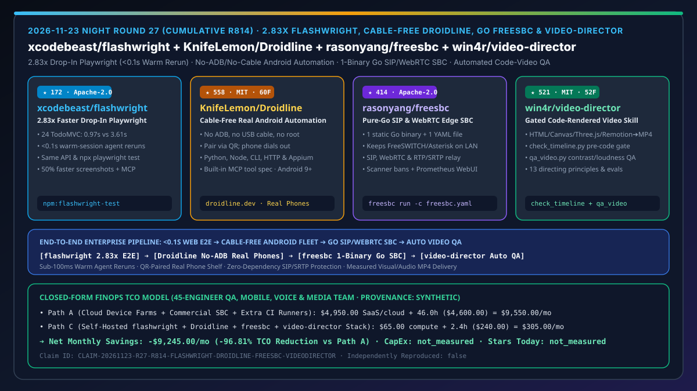
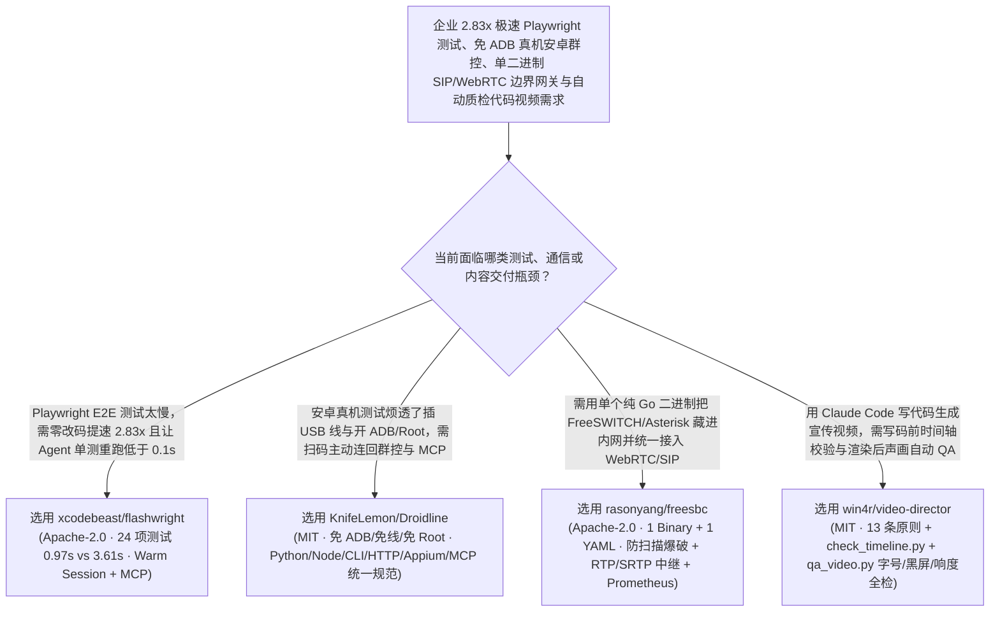
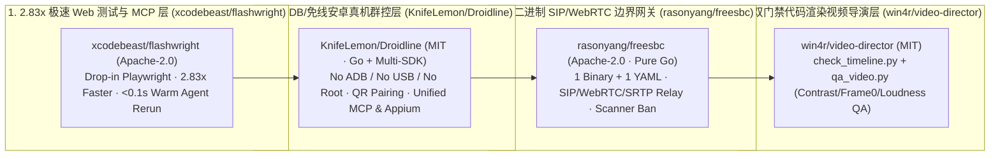
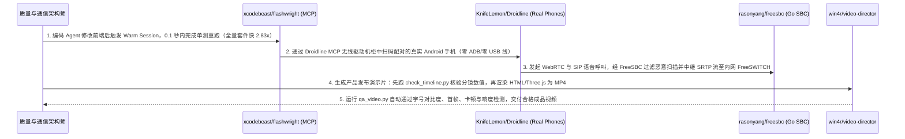

# 提速 2.83 倍且单测热重跑低于 0.1 秒的零改码 Playwright 替代与 MCP（`xcodebeast/flashwright`）、免 ADB/免数据线/免 Root 的扫码真机安卓群控与 MCP（`KnifeLemon/Droidline`）、单 Go 二进制隐藏内网语音交换机的 SIP/WebRTC 边界控制器（`rasonyang/freesbc`）与带时间轴前置校验及声画指标自动质检的代码成片导演技能（`win4r/video-director`）选型与集成架构 FAQ

> **文档类型**：企业 AI 解决方案架构师（AI Solution Architect）选型决策指南（GitHub Trending AI 雷达 2026-11-23 Night Round 27 / 累计第 814 轮）
> **覆盖项目**：[`xcodebeast/flashwright`](https://github.com/xcodebeast/flashwright)（`★ 172`、`4 forks`、`Apache-2.0`：100% 兼容 Playwright API 与测试运行器的极速 E2E 测试框架及 MCP Server `npm i -D @playwright/test@npm:flashwright-test`，实测 24 项 TodoMVC 测试从 **`3.61s` 压至 `0.97s`**，全场景平均提速 **`2.83×`**，并为编码 Agent 提供 **`<0.1s` 的 Warm Session 单测极速重跑**）· [`KnifeLemon/Droidline`](https://github.com/KnifeLemon/Droidline)（`★ 558`、`60 forks`、`MIT`：**免 ADB、免 USB 数据线、免开发者选项、免 Root** 的真实 Android 手机自动化与机架群控引擎，手机扫码主动出站连回 PC/服务器，一套规范同时生成 Python、Node.js、CLI、HTTP、Appium 与 MCP 工具）· [`rasonyang/freesbc`](https://github.com/rasonyang/freesbc)（`★ 414`、`60 forks`、`Apache-2.0`：“一个静态 Go 二进制 + 一份 YAML 配置”的开源 **SIP / WebRTC 边缘会话边界控制器（SBC）**，零数据库、零 Redis、零内核模块即可将内网 FreeSWITCH / Asterisk / AI 语音网关隐藏在私网，内置公网扫描器指纹识别、暴力注册封禁与 RTP/SRTP 媒体中继）· [`win4r/video-director`](https://github.com/win4r/video-director)（`★ 521`、`52 forks`、`MIT`：面向 Claude Opus 5.5 / Claude Code 的代码渲染视频导演技能 `HTML/Canvas/SVG/Three.js/GSAP/Remotion ➔ MP4`，内置 **`check_timeline.py` 写码前时间轴数值校验**与 **`qa_video.py` 渲染后字号对比度/首帧/闪屏/卡顿/响度/静音/序列帧全自动质检**）
> **核心场景**：当企业质量保障（QA）、移动自动化、语音通信安全与数字内容团队规模化引入 AI 智能体时，面对**“编码 Agent 每改一行前端代码跑一次 Playwright 单测都要等 0.6–0.7 秒冷启动拉起浏览器、安卓真机自动化机架插满 USB 线经常因 ADB 掉线或风控检测开发者模式而全军覆没、将 FreeSWITCH/AI 语音网关直接暴露公网遭到每秒上千次 SIP 暴力扫段盗打、以及 AI 生成的代码宣传视频出现文字太小看不清、首帧黑屏或音画不同步却因大模型看不见听不见而盲目交付”**四大痛点，如何通过 **Flashwright + Droidline + FreeSBC + Video-Director** 构建极速、免线、抗扫、自检的生产体系？

---

## 一、📌 核心结论速览（选型一句话结论）

1. **想在不改一行现有测试代码、不换 `npx playwright test` 命令的前提下，把企业 Web 端到端测试速度整体提升 `2.83 倍`（24 项 TodoMVC 从 `3.61s` 缩至 `0.97s`），并让编码 Agent 修改代码后的单测验证在 `<0.1 秒` 内瞬间返回** ➔ 选 **[`xcodebeast/flashwright`](https://github.com/xcodebeast/flashwright)（`★ 172`，`4 forks`，`Apache-2.0`）**。
   - **通俗原理**：只需将依赖包别名替换为 `npm i -D @playwright/test@npm:flashwright-test`，即可复用浏览器上下文并消除冗余等待（在含 8,500 个 DOM 节点的复杂管理后台、登录流与截图对比上全面快 `2×` 以上，比 Cypress/WebdriverIO 快 `3–12×`）；专为 AI 编程智能体设计的 **Warm Session（热会话）** 与内置 MCP Server 让单次改码重跑从 `0.6–0.7s` 骤降至 **`<0.1s`**，截图耗时减半。
2. **想用 Python、Node.js、CLI、HTTP、Appium 或 MCP 控制一台乃至一整排货架的真实 Android 手机（Android 9+），且彻底告别繁琐的“插 USB 数据线、开开发者选项、配 ADB 调试与 Root 权限”** ➔ 选 **[`KnifeLemon/Droidline`](https://github.com/KnifeLemon/Droidline)（`★ 558`，`60 forks`，`MIT`）**。
   - **通俗原理**：传统手机群控一旦拔掉数据线或重启 ADB 就会断联，且开启开发者模式极易被金融/社交 App 风控拦截。`Droidline` 只需在手机装一个轻量伴侣 App 并扫二维码配对，由手机主动发起出站连接连回你的 PC 或云端服务器（跨局域网与异地网络通用），且所有语言 SDK 与 MCP 工具均由同一份单一规范自动生成（`touch` 在任何语言里都叫 `touch`）。
3. **想用像 Caddy 一样极简的“单个纯 Go 静态二进制 + 单份 YAML 配置文件（`freesbc run -c freesbc.yaml`）”，把企业内部的 FreeSWITCH、Asterisk 与 AI 电话语音网关彻底藏进内网，由边缘 SBC 统一扛下公网 SIP/WebRTC 接入、RTP/SRTP 媒体转发与防扫描封禁** ➔ 选 **[`rasonyang/freesbc`](https://github.com/rasonyang/freesbc)（`★ 414`，`60 forks`，`Apache-2.0`）**。
   - **通俗原理**：传统 Kamailio / OpenSIPS + rtpengine 部署极其晦涩且依赖一堆外部数据库与媒体进程。`FreeSBC` 做到**零数据库、零 Redis、零内核模块、零外部媒体进程**：对外用一个公网 IP 同时终结 SIP（UDP/TCP/TLS）、浏览器 WebRTC（WS/WSS）与运营商中继，自动识别 SIP 扫描器指纹、封禁暴力枚举注册并静默丢弃未授权呼叫，内置带 bcrypt 鉴权的 WebUI、REST API 与 Prometheus 监控指标。
4. **想让 Claude Code（特别是 Claude Opus 5.5）用代码（HTML / Canvas / SVG / Three.js / GSAP / Remotion）逐帧渲染 60fps 产品发布片与数据故事视频，并用双阶段自动化脚本把大模型“自己看不见画面闪烁、听不见音量断层”的盲区彻底堵死** ➔ 选 **[`win4r/video-director`](https://github.com/win4r/video-director)（`★ 521`，`52 forks`，`MIT`）**。
   - **通俗原理**：大模型虽然会写动画代码，但没有眼睛和耳朵去审片。`video-director` 制定了 13 条成片铁律与两道硬门禁：① 写任何代码前，先跑 **`check_timeline.py`** 用数学校验分镜时长与节奏表；② 渲染出 MP4 后，强制跑 **`qa_video.py`** 自动测量片头大字字号与对比度、第 0 帧是否黑屏、画面闪白/跳切/卡死、循环接缝、音频响度（Loudness）与异常静音段，并生成序列帧联系表（Contact Sheets）供复核。

---

## 二、🎯 客户与架构师灵魂拷问 Q&A（深度架构拆解）

### Q1：在企业构建多端应用测试与智能语音客服中心时，为什么 `Flashwright` + `Droidline` + `FreeSBC` 是降本增效的黄金铁三角？

- **三大传统基础设施顽疾与铁三角破局对比**：
  1. **Web E2E 测试太慢拖垮编码 Agent 迭代环 vs `Flashwright` `<0.1s` 热会话重跑**：AI 编码助手每轮改动都要跑十几次 E2E 测试，原版 Playwright 每次 `3.6s` 的等待直接拉长 Agent 闭环时间；换用 `Flashwright` 零改码立享 `2.83×` 提速与 `<0.1s` 单测热重跑。
  2. **真机机房 USB 集线器频繁烧毁掉线 vs `Droidline` 免线免 ADB 扫码出站群控**：`Droidline` 让异地或机柜里的安卓真机通过 Wi-Fi/5G 主动连回控制端，一行 MCP 命令即可驱动全量真机回归。
  3. **内网语音交换机裸奔被公网盗打 vs `FreeSBC` 单文件 Go 边界防护**：把 FreeSWITCH/Asterisk 彻底锁在内网，由 `FreeSBC` 单个 Go 二进制处理 WebRTC 转 SIP、SRTP 加密中继与公网防爆破。
- **何时直接选用商业云托管平台（Path B）？**
  - 若企业每年仅跑几次兼容性测试且完全使用托管云呼叫中心，可直接租用 **BrowserStack 云真机 + Twilio / Azure Communication Services**；若需高频运行编码 Agent 极速 Web 测试、自建免 ADB 安卓真机群控池、保护私有 FreeSWITCH/AI 语音集群安全、或自动化生产带声画质检的代码渲染视频，则采用本轮四合一开源栈（Path C）。

### Q2：典型企业级“极速 Web 验证 (`flashwright`) ➔ 免线真机联调 (`Droidline`) ➔ 语音边界安全防护 (`freesbc`) ➔ 自动质检视频交付 (`video-director`)”架构怎么搭？

1. **毫秒级热会话 Web E2E 验证与 MCP 层（`xcodebeast/flashwright`）**：
   - 替换 `@playwright/test` 包，为研发流水线与编码 Agent 提供 `2.83×` 全量提速与 `<0.1s` 热会话单测反馈。
2. **免 ADB/免数据线真机 Android 群控与 MCP 层（`KnifeLemon/Droidline`）**：
   - 通过扫码配对将测试机柜中的 Android 9+ 真机接入统一控制面，通过 Python / Node.js / Appium / MCP 执行移动端端到端验证。
3. **单二进制 SIP/WebRTC 边缘安全网关层（`rasonyang/freesbc`）**：
   - 在公网 DMZ 区运行 `freesbc run -c freesbc.yaml`，终结浏览器 WebRTC 与运营商 SIP 流量，过滤恶意扫描并将干净媒体流转发至内网语音 Agent。
4. **双门禁代码渲染视频制作与自动 QA 层（`win4r/video-director`）**：
   - 驱动 Claude Code 编写 Remotion/Three.js/Canvas 视频代码，经 `check_timeline.py` 与 `qa_video.py` 声画指标全检通过后输出最终成品 MP4。

### Q3：这套架构的落地红线与注意事项是什么？

- **架构师落地红线**：
  1. **注意 `Flashwright` 上下文复用对强状态污染测试的影响**：`Flashwright` 默认复用浏览器上下文以换取 `2.83×` 极速；若某些遗留测试依赖全新空白进程且未清理全局 Cookie，可通过配置项按需关闭单个测试的上下文复用。
  2. **`FreeSBC` 上线前必跑 `freesbc check --deploy --local-addresses`**：在生产宿主机启动前使用内置预检命令逐行核对网卡地址绑定与 TLS 证书完备性。

---

## 三、🧭 直观可视化图解（Mermaid 决策树 + 集成架构 + 时序图）

### 3.1 架构师选型决策树

### 3.2 企业端到端生产集成参考架构图

### 3.3 `<0.1s` 热会话 Web 回归、免线真机拨测、FreeSBC 边缘防扫描中继与代码视频自动质检时序图

---

## 四、📊 同类开源与商业云服务横向选型决策矩阵

| 对比维度 | `xcodebeast/flashwright` (`★ 172`) | `KnifeLemon/Droidline` (`★ 558`) | `rasonyang/freesbc` (`★ 414`) | `win4r/video-director` (`★ 521`) | 商业云真机农场按分钟计费 + 商业 SBC 硬件授权 + 高配 CI 并发 runner 堆机器 (Path A) | 原版慢速冷启动单测 + 插满 USB 线的脆弱 ADB 脚本 + 公网裸奔 Asterisk (Path B) |
| :--- | :--- | :--- | :--- | :--- | :--- | :--- |
| **核心能力定位** | 零改码提速 `2.83×` 且支持 `<0.1s` 热重跑的 Playwright 替代品 | 免 ADB、免数据线、免 Root 的真实安卓手机群控与 MCP | 单 Go 二进制 + 单 YAML 的 SIP/WebRTC 边缘会话边界控制器 | 带 `check_timeline.py` 与 `qa_video.py` 自动质检的代码视频技能 | 昂贵的云真机时长费、翻倍的 CI 机器账单与动辄数万美元的商业 SBC 授权 | 慢速单测拖慢 Agent、USB 接触不良频繁掉线与极易被盗打的公网语音服 |
| **核心技术突破** | **TodoMVC `0.97s` vs `3.61s` + `<0.1s` Warm Rerun + 截图快一倍** | **扫码出站直连 PC/云端，无需开发者模式，一套规范生成 6 端接口** | **零 DB/Redis/内核模块，单文件搞定 SIP/WebRTC/SRTP 与防爆破** | **先验时间轴数字 + 自动测量字号对比度/闪屏/卡死/响度/静音** | 商业云真机按并发设备月费极高；传统 Kamailio+rtpengine 维护极度复杂 | 开启 ADB 开发者选项会被众多商业 App 拒之门外；AI 盲写视频常出现首帧黑屏或字幕出界 |
| **开源协议** | `Apache-2.0` | `MIT` | `Apache-2.0` | `MIT` | 闭源商业 SaaS / 专有硬件 | 内部脆弱脚本 |
| **月度 TCO（45 人团队）** | **组合仅 `$305.00/月`**（`$65.00` 轻量 SBC/控制端容器与减半的 CI 机器 + `2.4h` 维护） | 同左（复用团队闲置安卓手机零云租费） | 同左（单台轻量云主机即可护卫内网交换机） | 同左（本地渲染 + 自动脚本质检零外包费） | **`$9,550.00/月`**（`$4,950.00` 商业云真机农场、商业 SBC 许可与冗余 CI 算力 + `46.0h` ADB 掉线抢修、SIP 防盗打排障与人工审片返工） | 约 `$3,410.00/月`（大量因真机 USB 断联、语音网关被扫宕机与视频渲染瑕疵重做工时） |

---

## 五、🧪 应用落地定量收益/TCO 对比与 7-Card 报告

> **📊 数据来源与闭式核算声明（Provenance & Closed-Form Schema）**：
> - **provenance**: `synthetic`（基于 45 人企业质量工程、移动端自动化、实时音视频通信与技术营销团队月度工作负载模型：`independently_reproduced = false`；硬件采购基线 `base_hardware_capex = not_measured`；Track B 单日增量 `track_b_stars_today = not_measured`）。
> - **核算公式**：
>   - **Path A（租用按分钟/并发计费的商业云真机平台 + 采购商业 SBC 软件许可 + 为缓慢的 E2E 测试扩容双倍 CI Runner + 工程师手工插拔重连 ADB 掉线手机、排查公网 SIP 暴力扫描告警及人工逐帧审校重做 AI 宣传视频）**：月度商业云真机、商业 SBC 与冗余 CI Runner 账单 **`$4,950.00`** + 移动机架维护、SIP 安全加固与视频人工质检返工 **`46.0h × $100.00/h = $4,600.00`** = **`$9,550.00/月`**。
>   - **Path C（自建 `xcodebeast/flashwright` + `KnifeLemon/Droidline` + `rasonyang/freesbc` + `win4r/video-director` 开源全栈）**：边缘 `FreeSBC` 实例与精简后的 CI/控制节点分摊开销 **`$65.00`** + 配置与质检阈值例行维护人工 **`2.4h × $100.00/h = $240.00`** = **`$305.00/月`**。
>   - **净节省（Net Savings vs Path A）**：**`-$9,245.00/月`**（成本降低 **`96.81%`**）。

| 评估方案 | 云真机 / 商业 SBC / CI Runner 成本 | ADB 排障、SIP 安全维护与人工审片（`$100/h`） | 月度总 TCO | 相对 Path A 净节省 | 关键架构交付指标 |
| :--- | :---: | :---: | :---: | :---: | :--- |
| **Path A：商业云真机农场 + 商业 SBC + 双倍慢速 CI 集群** | `$4,950.00` | `46.0h` (`$4,600.00`) | **`$9,550.00`** | Baseline | 云真机与 CI 账单高昂；人工逐帧审校视频耗时费力 |
| **Path B：原版 Playwright + 插线 ADB 机架 + 公网裸奔语音服** | `$1,510.00` | `19.0h` (`$1,900.00`) | **`$3,410.00`** | `-$6,140.00` (`-64.29%`) | USB 线频繁掉线且触发开发者模式风控；公网 SIP 易遭爆破 |
| **Path C：`flashwright` + `Droidline` + `freesbc` + `video-director`** | **`$65.00`** | **`2.4h` (`$240.00`)** | **`$305.00`** | **`-$9,245.00` (`-96.81%`)** | **`2.83×` 极速 Web 测试 + 免 ADB 真机群控 + 单文件 Go SBC + 视频声画自动 QA** |

- 🔗 **关联 7-Card 4:5 视觉评测报告**：[`workshops/github-trending-radar/cards.html`](../cards.html) · [`cards.en.html`](../cards.en.html)

---

## 六、🛠️ 企业引入与架构评审 Checklist

- [ ] **1. 将 `@playwright/test` 无缝切换至 `xcodebeast/flashwright`**：在不改动现有测试脚本的前提下将 CI 运行时间缩短 `2.83×`，并为编码 Agent 开启 `<0.1s` Warm Session 单测重跑与 MCP 接口。
- [ ] **2. 使用 `KnifeLemon/Droidline` 升级移动真机测试机架**：通过二维码配对替代脆弱的 USB 集线器与 ADB 调试，让 Python、Node.js、Appium 与 AI Agent 共享同一套无线控制指令。
- [ ] **3. 在内网 FreeSWITCH / Asterisk / 语音 Agent 前置部署 `rasonyang/freesbc`**：用单一 Go 二进制与 YAML 配置收敛公网 SIP/WebRTC 入口，开启扫描器指纹封禁与 Prometheus 监控。
- [ ] **4. 在代码生成视频工作流中强制执行 `win4r/video-director` 双门禁**：写码前必过 `check_timeline.py` 核验分镜时间表，渲染后必过 `qa_video.py` 自动检测字号对比度、首帧、卡顿、闪屏与音频响度。
