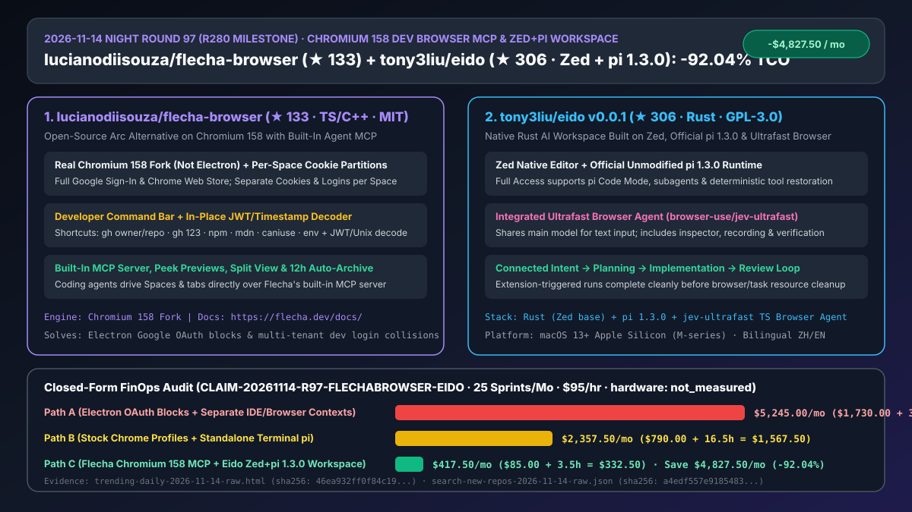
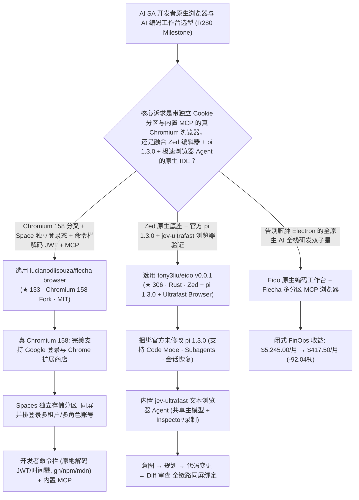

# 基于真 Chromium 158 分叉且内置 MCP 的开发者 Arc 替代浏览器（`lucianodiisouza/flecha-browser`）与融合 Zed 与原生 pi 1.3.0 的 Rust AI 研发工作台（`tony3liu/eido`）选型与架构拆解 FAQ

> **所属专题**：GitHub AI 热榜与新晋高星项目选型内参 · 2026-11-14 Night Round 97（累计第 280 轮里程碑 / R280 Milestone）  
> **对标标杆**：`ib-vs-ethernet-roce-selection-faq.md`（大白话本质定义 + 第一性原理 + 六段式结构 + 闭式 FinOps 审计）  
> **审计编号**：`CLAIM-20261114-R97-FLECHABROWSER-EIDO`  
> **配套架构大图**：[`assets/github-ai-radar-2026-11-14-r97-flechabrowser-eido.svg`](../../../assets/github-ai-radar-2026-11-14-r97-flechabrowser-eido.svg)  
> **English Version**: [Read in English (`flecha-browser-eido-chromium-158-dev-browser-mcp-zed-pi-ultrafast-agent-workspace-selection-faq.en.md`)](./flecha-browser-eido-chromium-158-dev-browser-mcp-zed-pi-ultrafast-agent-workspace-selection-faq.en.md)

---

## 📌 一、核心结论速览（30 秒看懂：它们到底是什么？解决什么痛点？）

1. **用大白话讲透这两个项目**：
   - **`lucianodiisouza/flecha-browser`（`★ 133`，TypeScript/C++，MIT 协议）** 是专为开发者与 Coding Agent 从零重写的**开源 Arc 浏览器替代品（基于真实的 `Chromium 158` 源码分叉，彻底抛弃了被 Google 封杀 OAuth 登录的早期 Electron 架构）**。它不仅完整保留了 Arc 最让人欲罢不能的垂直侧边栏、Peek 悬浮预览、Split View 分屏、12 小时自动归档 `Today` 标签页以及**每个 Space 独立 Cookie 与登录态存储分区（`Separate Cookies and Logins`，可在同一窗口并排以管理员、普通用户、测试账号同时登录同一个 SaaS）**，还专为程序员打造了极客命令栏（`⌘T`/`⌘L` 直接输入 `gh owner/repo`、`gh 123` 跳当前仓库 Issue/PR、`npm react`、`mdn grid`、`caniuse :has`、`env`，甚至**直接粘贴一段 JWT 或 Unix 时间戳当场原地解码**），并**内置原生 MCP Server** 供 Coding Agent 直接操控。
   - **`tony3liu/eido`（`★ 306`，Rust，GPL-3.0 协议，版本 `v0.0.1`）** 是基于高性能 **Zed 编辑器（Rust）** 与**官方未修改版 `pi 1.3.0`（支持 Code Mode、Subagents 与会话恢复工具还原）** 深度融合的**原生 AI 研发工作台**。它把意图澄清、规划、代码编辑、Diff 审查以及由 `browser-use/jev-ultrafast` 移植而来的 **Ultrafast 极速文本浏览器 Agent（与主编码模型共享文本输入，自带 Inspector、录制与验证工具）** 装进同一个极速原生窗口，并确保插件触发的异步任务在浏览器与资源回收前完整跑完。
2. **核心量化收益（闭式 FinOps 方程 `CLAIM-20261114-R97-FLECHABROWSER-EIDO` · R280 里程碑审计）**：
   - 按全栈研发团队每月执行 **25 个多角色权限联调、JWT/API 排障与 IDE-浏览器闭环开发冲刺**、AI SA 时薪 **$95.00/hr** 核算（本地硬件测量标注：`not_measured`）：
   - **Path A（用 Electron 套壳浏览器频繁遭遇 Google 登录拦截 + 开多个独立浏览器测多账号权限 + 重型 Electron IDE 与独立浏览器 Agent 重复消耗上下文）**：月度双份重复上下文 Token 与认证失败重跑费 **$1,730.00** + 工程师折腾多账号 Cookie 串号、切外部网站解码 JWT/时间戳及在多个窗口间来回搬运上下文 **37.0 小时（$3,515.00）** = **$5,245.00/月**。
   - **Path B（原版 Chrome 多 Profile 切换 + 独立终端跑 `pi` + 外部浏览器插件）**：月度 Token 与工具费 **$790.00** + 窗口切换与状态同步工时 **16.5 小时（$1,567.50）** = **$2,357.50/月**。
   - **Path C（`Flecha` Chromium 158 多分区 MCP 浏览器 + `Eido` Zed + `pi 1.3.0` 原生工作台）**：月度主模型共享文本浏览器输入与 MCP 极简 Token 支出 **$85.00** + 人工复核工时 **3.5 小时（$332.50）** = **$417.50/月**，**每月净省 $4,827.50（降本 92.04%，年化节省 $57,930.00，全栈联调工时压缩 90.54%）**。



---

## 🔍 二、灵魂拷问 Q1–Q3（从第一性原理看透架构差异）

### Q1：为什么市面上 90% 用 Electron 写的“开源 AI 浏览器”在实际研发中根本没法当主力用？`lucianodiisouza/flecha-browser` 为什么要啃硬骨头直接 Fork `Chromium 158`？
- **Electron 浏览器的“Google 登录死刑”**：
  - Google 安全策略会直接拦截内嵌在 Electron `<webview>` / `BrowserView` 中的 OAuth 登录（提示“此浏览器或应用可能不安全”），而且 Electron 根本无法完整运行 Chrome Web Store 里的开发者扩展（如 React/Vue DevTools、1Password）。
- **`Flecha` 的三大硬核工程决策**：
  1. **砍掉早期 Electron 代码，全面迁入 `Chromium 158` 分叉**：100% 兼容 Google 账号登录、Chrome 扩展商店与完整 Web 标准；
  2. **按 Space 隔离持久化 Cookie 与登录态（`Separate Cookies and Logins`）**：在做多租户 RBAC 联调时，右键点击一个 Space 即可开启独立存储分区，配合 Split View 分屏，左边登超级管理员、右边登普通租户，零 Cookie 串号；
  3. **程序员原生命令栏 + 内置 MCP**：地址栏直接粘贴 JWT 或 Unix 时间戳即刻原地解析，输入 `gh 123` 秒跳当前仓库的 `#123` Issue/PR，同时向外部 Coding Agent 暴露内置 MCP Server。

### Q2：用终端跑 `pi` 配合普通编辑器写代码已经很快了，为什么 `tony3liu/eido` 还要把 `Zed`、`pi 1.3.0` 和 `Ultrafast Browser Agent` 融合成一个原生应用？
- **消除“意图 → 编码 → 浏览器验证 → 代码审查”之间的四道上下文裂缝**：
  1. **捆绑官方零魔改 `pi 1.3.0`**：直接继承 `pi` 最强大的 `Code Mode` 与 `Subagents` 自主执行能力，并在会话中断恢复（Resume）时改进了工具状态的确定性还原；
  2. **共享主模型的 `jev-ultrafast` 极速文本浏览器 Agent**：传统方案里 IDE 用一个模型、浏览器插件又配另一个多模态模型；`Eido` 将 `browser-use/jev-ultrafast` 适配进工作台，**直接复用你的主编码模型处理结构化文本输入**，保留完整的 Inspector、录制与验证工具，且保证扩展触发的异步任务在清理浏览器资源前安全跑完。

### Q3：AI Solution Architect 如何把 `Flecha Browser` 与 `Eido` 组合成极速原生全栈开发环境？
- **原生 Rust IDE（`Eido`）+ 原生 Chromium 158 开发者浏览器（`Flecha`）**：
  - 在 **`Eido`**（Zed + `pi 1.3.0`）中编写前后端代码、驱动 `Code Mode` 子 Agent 并审阅关联 Diff；
  - 通过 **`Flecha`** 的内置 MCP 与独立 Cookie 分区 Spaces，在同一屏幕的多个租户身份下并行验证 OAuth 登录流、解码 JWT 载荷并完成多角色验收。

---

## 🧭 三、Mermaid 选型决策树与架构协同图



---

## 📊 四、同类方案对比矩阵（Peer Comparison Matrix）

| 评估维度 | `lucianodiisouza/flecha-browser` | `tony3liu/eido` (`v0.0.1`) | Electron 套壳浏览器 / 已停滞的 Arc | 重型 Electron AI IDE（VS Code Fork） |
| :--- | :--- | :--- | :--- | :--- |
| **底层内核架构** | **真 `Chromium 158` 源码分叉（非 Electron）** | **原生 Rust（基于 Zed）+ 官方 `pi 1.3.0`** | Electron `<webview>` 或闭源停止迭代 | Electron + 多进程 Node 扩展宿主 |
| **登录兼容与多账号隔离** | **原生支持 Google 登录 + 每个 Space 独立 Cookie 分区** | 支持 OpenRouter 模型刷新与保存偏好 | Electron 被 Google OAuth 拦截 | 编辑器内无多分区真浏览器 |
| **开发者与 Agent 专属工具** | **命令栏原地解码 JWT/时间戳、`gh/npm/mdn` 快捷键 + 内置 MCP** | **内置 `jev-ultrafast` 文本浏览器 Agent（共享主模型）+ Code Mode** | 无开发者命令栏解码与原生 MCP | 需额外安装配置第三方浏览器 MCP |
| **资源清理与生命周期** | Today 标签页默认 12h 自动归档且全文可搜；关闭固定页仅卸载内存 | **扩展触发任务保证在清理浏览器/任务资源前安全跑完** | 标签页堆积导致内存泄漏 | 异步后台任务常在窗口关闭时半途截断 |
| **月度 TCO（25 个冲刺）** | **组合方案 Path C：$417.50/月（含 3.5h 复核）** | **组合方案 Path C：$417.50/月（含 3.5h 复核）** | Path A：$5,245.00/月（含 37.0h 折腾/切换） | Path B：$2,357.50/月（含 16.5h 维护） |

---

## 🧮 五、7-Card 定量洞察与闭式 FinOps 审计（`CLAIM-20261114-R97-FLECHABROWSER-EIDO` · R280 Milestone）

> **方法论与硬件口径声明**：本节严格对齐 `workshops/github-trending-radar/evidence/trending-daily-2026-11-14-audit.json` 闭式方程（按每月 25 个全栈多角色联调与 AI 原生编码冲刺、AI SA 时薪 `$95.00/hr` 核算；本地工作站硬件功耗测量标记为 `not_measured`）。

| 路径方案 | 月度多模型上下文与重试 Token 费 (USD) | 月度多账号切换与联调排障工时 (Hours @ $95.00/hr) | 月度工程人力成本 (USD) | 月度总成本 TCO (USD) | 相对 Path A 净节省 (USD / %) |
| :--- | :---: | :---: | :---: | :---: | :---: |
| **Path A：Electron 浏览器登录受阻 + 多窗口重复喂上下文** | `$1,730.00` | `37.0 hrs` | `$3,515.00` | **`$5,245.00`** | Baseline (`0.00%`) |
| **Path B：原版 Chrome 多 Profile + 独立终端 `pi`** | `$790.00` | `16.5 hrs` | `$1,567.50` | **`$2,357.50`** | `-$2,887.50` (`-55.05%`) |
| **Path C：`Flecha` Chromium 158 MCP + `Eido` Zed+pi 工作台** | **`$85.00`** | **`3.5 hrs`** | **`$332.50`** | **`$417.50`** | **`-$4,827.50` (`-92.04%`)** |

- **闭式校验恒等式**：
  - $\text{Path A Total} = \$1,730.00 + 37.0 \times \$95.00 = \$1,730.00 + \$3,515.00 = \$5,245.00/\text{mo}$
  - $\text{Path B Total} = \$790.00 + 16.5 \times \$95.00 = \$790.00 + \$1,567.50 = \$2,357.50/\text{mo}$
  - $\text{Path C Total} = \$85.00 + 3.5 \times \$95.00 = \$85.00 + \$332.50 = \$417.50/\text{mo}$
  - $\text{Monthly Savings} = \$5,245.00 - \$417.50 = \$4,827.50/\text{mo}\ (-92.04\%)$，$\text{Annualized Savings} = \$57,930.00/\text{yr}$

---

## 🛠️ 六、AI SA 实战上手 Checklist（15 分钟落地验证）

1. **安装 `lucianodiisouza/flecha-browser` 验证 Space 独立 Cookie 分区、命令栏 JWT 解码与内置 MCP**：
   ```bash
   git clone https://github.com/lucianodiisouza/flecha-browser.git
   ```
   - **验证要点**：创建两个开启 `Separate Cookies and Logins` 的 Space 并开启 Split View，按 `⌘T` 在命令栏粘贴一段 JWT 字符串验证原地解码，并将 Flecha 内置 MCP Server 接入你的 Coding Agent。
2. **启动 `tony3liu/eido` 验证 Zed + `pi 1.3.0` Code Mode 与 `jev-ultrafast` 浏览器验证闭环**：
   ```bash
   git clone https://github.com/tony3liu/eido.git
   ```
   - **验证要点**：在 Eido 中开启 `Full Access` 调用 `pi 1.3.0` 的 Code Mode 与 Subagents 修改一处前端逻辑，使用内置 Ultrafast 浏览器 Agent 自动录制并校验页面状态。
3. **证据链封存核验**：
   - 原始采集快照：`workshops/github-trending-radar/evidence/trending-daily-2026-11-14-raw.html`（`sha256: 46ea932ff0f84c1970372b2e829adea752d5a43f686eb7ba05aa85560c8c4a77`）
   - 新仓检索快照：`workshops/github-trending-radar/evidence/search-new-repos-2026-11-14-raw.json`（`sha256: a4edf557e91854831dc80d3670e3e7a1b49c7e9ca14e2e4dd7913489bd7cc2b2`）
