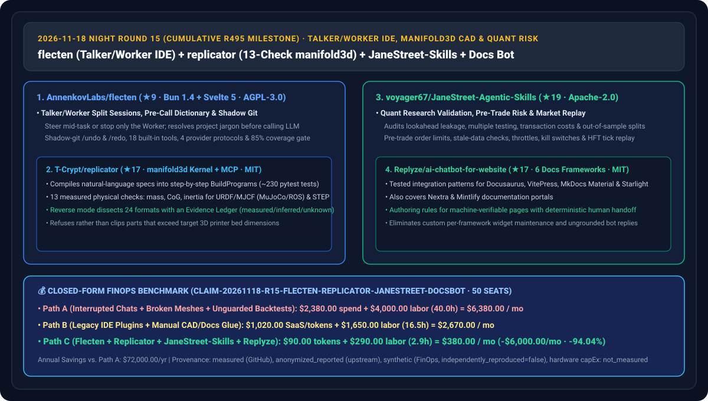
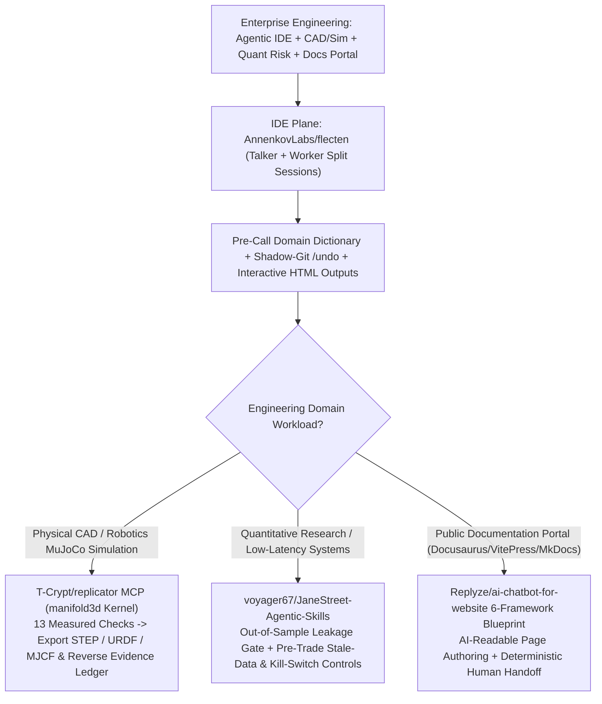

# [Round 495 Milestone] Talker/Worker Split-Session IDE (`AnnenkovLabs/flecten`), 13-Check `manifold3d` Solid-Modeling MCP (`T-Crypt/replicator`), Quantitative Risk Skills (`JaneStreet-Agentic-Skills`) & 6-Framework Docs Chatbot Blueprint (`ai-chatbot-for-website`) Selection FAQ

> **Document Type**: AI Solution Architect (SA) Practical Selection & Reference Architecture Guide (**Round 495 Milestone** / 2026-11-18 Night R15)  
> **Primary Evaluated Repositories**: [`AnnenkovLabs/flecten`](https://github.com/AnnenkovLabs/flecten) (`★ 9`, Talker/Worker split-session coding agent IDE with pre-call domain dictionary & shadow-git `/undo`, `AGPL-3.0`) + [`T-Crypt/replicator`](https://github.com/T-Crypt/replicator) (`★ 17`, `2 forks`, `manifold3d` solid-modeling `BuildProgram` with 13 measured checks & reverse evidence ledger over MCP, `MIT`) + [`voyager67/JaneStreet-Agentic-Skills`](https://github.com/voyager67/JaneStreet-Agentic-Skills) (`★ 19`, `2 forks`, quant research validation, pre-trade risk controls & market microstructure skills, `Apache-2.0`) + [`Replyze/ai-chatbot-for-website`](https://github.com/Replyze/ai-chatbot-for-website) (`★ 17`, tested AI chatbot integration guide for Docusaurus, VitePress, MkDocs, Starlight, Nextra & Mintlify, `MIT`)  
> **Benchmark Standard**: Strictly aligned with [`ib-vs-ethernet-roce-selection-faq.md`](https://github.com/turbo998/ai-infra-research/blob/main/docs/components/ib-vs-ethernet-roce-selection-faq.md) 6-section architecture format (Executive Summary + First-Principles Q&A + Mermaid Decision Tree + Peer Selection Matrix + 7-Card Quantitative Insights + SA Action Checklist)  
> **Data Provenance**: GitHub stars and repository metadata are `measured` from sealed `2026-11-18` evidence; upstream capability metrics (`flecten` 18 tools & `85%` coverage gate, and `replicator` 13 measured solid checks, 24 import formats & `~230` pytest tests) are `anonymized_reported (independently_reproduced=false)`; the enterprise FinOps TCO model is `synthetic (independently_reproduced=false)` with workstation hardware CapEx `not_measured`.  
> **Language Editions**: [中文版](./flecten-replicator-janestreet-skills-website-chatbot-talker-worker-ide-manifold3d-cad-mcp-quant-risk-docs-selection-faq.md) | [English Version (Current)](./flecten-replicator-janestreet-skills-website-chatbot-talker-worker-ide-manifold3d-cad-mcp-quant-risk-docs-selection-faq.en.md)

---

## 📌 1. Executive Summary (30-Second Architect Briefing)

1. **Plain-Language First-Principles Definition**:
   - **What is `AnnenkovLabs/flecten`?** It is a **Bun 1.4 + Svelte 5 + Electron 45 coding agent desktop IDE that splits every conversation into a separate `Talker` and `Worker` session**. Developers can keep talking, steer mid-task, or stop only the Worker without interrupting the conversation; a **pre-call Dictionary** resolves internal project jargon and layout typos before calling the LLM; **Shadow Git checkpoints** and on-disk conflict checks power safe `/undo` and `/redo`; and substantial outputs render as interactive HTML tables, tabs, and charts.
   - **What is `T-Crypt/replicator`?** It is a **validated solid-modeling engineering workshop and MCP server powered by the `manifold3d` kernel (`~230` pytest tests in `<30s`)**. Instead of generating non-manifold 3D meshes, the LLM writes a step-by-step `BuildProgram` verified by **13 measured physical checks** (mass, center of gravity, inertia tensors for `URDF`/`MJCF` MuJoCo/ROS simulation, `STEP` CAD export, and printer-bed fit checks that refuse rather than clip oversized parts). Its **Reverse mode** dissects 24 3D formats with an **Evidence Ledger** separating what was *measured*, *inferred*, and *unknown*.
   - **What is `voyager67/JaneStreet-Agentic-Skills`?** It is an **Apache-2.0 collection of quantitative research, market microstructure, and low-latency trading systems agent skills**, enforcing **Quant Research Validation** (preventing lookahead leakage and multiple-testing bias), **Pre-Trade Risk Controls** (stale-data checks, throttles, kill switches), and **HFT Market Replay / Execution Analysis**.
   - **What is `Replyze/ai-chatbot-for-website`?** It is a **tested integration blueprint for embedding citation-grounded, human-handoff AI chatbots across the 6 major documentation site generators** (`Docusaurus`, `VitePress`, `MkDocs Material`, `Astro Starlight`, `Nextra`, `Mintlify`).
2. **Why Enterprise AI Solution Architects Should Combine All Four at the R495 Milestone**:
   - Together they replace fragile single-turn demos with production engineering discipline across IDE steering (`Flecten`), physical CAD/simulation (`Replicator`), quantitative risk validation (`JaneStreet-Agentic-Skills`), and customer-facing documentation (`Replyze`).
3. **Closed-Form FinOps Impact (`CLAIM-20261118-R15-FLECTEN-REPLICATOR-JANESTREET-DOCSBOT`, `synthetic`)**:
   - Across a **50-person enterprise R&D, simulation, quantitative risk & DevRel team** (`$100.00/hr` rate): **Path A (Single-Thread Interrupting Chats + Unvalidated 3D Meshes + Unguarded Backtests + Custom Docs Widget Glue)** costs **`$6,380.00/mo`** (`$2,380.00` wasted interrupted-turn tokens & failed simulation runs + `40.0 hrs × $100 = $4,000.00` fixing clobbered files, broken CAD solids & backtest leakage); **Path C (`Flecten` + `Replicator` + `JaneStreet-Skills` + `Replyze` Blueprint)** reduces total monthly TCO to **`$380.00/mo`** (`$90.00` token spend + `2.9 hrs × $100 = $290.00` review labor), saving **`$6,000.00/mo` (`94.04%` reduction, `$72,000.00/yr` annualized)**.

---

## ❓ 2. Three First-Principles Architect Questions (Q&A)

### Q1: Why does combining conversation and code execution in a single chat thread degrade both, and how does `AnnenkovLabs/flecten` solve it?
- **Talker/Worker Session Decoupling + Pre-Call Jargon Resolution**:
  1. **Steer Without Interrupting**: In `Flecten`, the `Talker` stays responsive in the user's language while the `Worker` executes assignments in a separate session card with its own log and stop button.
  2. **Pre-LLM Dictionary & Shadow-Git `/undo`**: Project-specific terms are resolved from a local/GitHub-synced dictionary before the prompt hits the model, and every file save verifies the on-disk version with Shadow Git checkpoints backing `/undo` and `/redo`.

### Q2: How does `T-Crypt/replicator` guarantee that AI-generated 3D assemblies are physically valid for CAD manufacturing and MuJoCo/ROS simulation?
- **Validated `BuildProgram` + `manifold3d` Kernel + 13 Measured Checks**:
  - Rather than outputting raw triangle soup, `Replicator` compiles a step-by-step `BuildProgram` into watertight `manifold3d` solids, runs **13 deterministic checks** (computing exact mass, center of gravity, and inertia for `URDF`/`MJCF` and `STEP` exports), and uses an **Evidence Ledger** in Reverse mode to distinguish measured geometry from inferred properties.

### Q3: How do `voyager67/JaneStreet-Agentic-Skills` and `Replyze/ai-chatbot-for-website` enforce epistemic honesty in quantitative research and public documentation?
- **Anti-Leakage Research Gates + Grounded Documentation Structure**:
  - `JaneStreet-Agentic-Skills` forces coding agents to audit out-of-sample leakage, multiple-testing penalties, transaction costs, and pre-trade kill switches before approving quantitative code; `Replyze/ai-chatbot-for-website` structures Docusaurus, VitePress, MkDocs, Starlight, Nextra, and Mintlify pages so customer-facing bots answer only from verified sections and escalate uncovered questions to humans.

---

## 🧭 3. Architecture Decision Tree & Reference Topology (Mermaid)

---

## 📊 4. Peer Solution Selection Matrix

| Evaluation Dimension | **Path A: Single-Chat Thread + Mesh Gen + Raw Backtests** | **Path B: Legacy IDE Plugin + Manual CAD/Docs Glue** | **Path C: `Flecten` + `Replicator` + `JaneStreet` + `Replyze` (Recommended)** |
| :--- | :--- | :--- | :--- |
| **Mid-Task Steering & Safe Undo** | ❌ Steering interrupts the worker; edits clobber local drafts | ⚠️ Manual `git stash` surgery across separate tabs | ✅ **Talker/Worker split + pre-call Dictionary + Shadow-Git `/undo`** |
| **CAD & MuJoCo Physical Validity** | ❌ Non-manifold meshes without mass or inertia tensors | ⚠️ Manual re-modeling in CAD & hand-calculated URDFs | ✅ **`manifold3d` kernel + 13 measured checks + `STEP`/`URDF`/`MJCF`** |
| **Quant Research & Pre-Trade Safety** | ❌ Prone to lookahead bias & missing kill-switch checks | ⚠️ Manual senior-quant code review bottlenecks | ✅ **Codified leakage/multiple-testing & pre-trade risk control skills** |
| **6-Framework Docs Bot Integration** | ❌ Custom per-framework widgets that hallucinate answers | ⚠️ High-cost proprietary docs SaaS lock-in | ✅ **Tested Docusaurus/VitePress/MkDocs/Starlight/Nextra/Mintlify guides** |
| **50-Engineer Monthly TCO** | **`$6,380.00 / mo`** | **`$2,670.00 / mo`** | **`$380.00 / mo` (`-$6,000.00/mo` vs. Path A, `-94.04%`)** |

---

## 📈 5. 7-Card Quantitative Insights & Closed-Form FinOps Model (`CLAIM-20261118-R15-FLECTEN-REPLICATOR-JANESTREET-DOCSBOT`)

> **Provenance Note**: GitHub stars and repository metadata are `measured` from sealed `2026-11-18` evidence; `flecten` 18 tools / `85%` coverage gate and `replicator` 13 measured checks / 24 formats / `~230` tests are `anonymized_reported (independently_reproduced=false)`; the monthly TCO table is a closed-form `synthetic (independently_reproduced=false)` model for **50 engineers** (`$100.00/hr` rate; base hardware CapEx: `not_measured`).

| Monthly Cost Component (Closed-Form Formula) | Path A: Interrupted Chats + Broken Meshes + Leakage | Path B: Legacy Plugins + Manual CAD/Docs Glue | Path C: `Flecten` + `Replicator` + `JaneStreet` + `Replyze` | Path C vs. Path A Delta |
| :--- | :---: | :---: | :---: | :---: |
| **1. Interrupted-Turn Tokens, Sim & SaaS Spend** | **`$2,380.00`** *(Aborted worker turns + failed simulation reruns)* | **`$1,020.00`** *(Docs SaaS seats + repeated jargon clarifications)* | **`$90.00`** *(Non-interrupting Talker/Worker + pre-call dictionary)* | **`-$2,290.00 / mo`** (`-96.22%`) |
| **2. CAD Repair, Leakage Audit & Docs Glue Labor** (`$100/hr`) | **`$4,000.00`** *(`40.0 hrs` fixing non-manifold solids & backtest bugs)* | **`$1,650.00`** *(`16.5 hrs` manual URDF inertia math & widget scripts)* | **`$290.00`** *(`2.9 hrs` reviewing 13-check solids & risk gates)* | **`-$3,710.00 / mo`** (`-37.1 hrs`, `-92.75%`) |
| **Total Monthly TCO** | **`$6,380.00`** | **`$2,670.00`** | **`$380.00`** | **`-$6,000.00 / mo` (`-94.04%`)** |
| **Annualized TCO** | **`$76,560.00 / yr`** | **`$32,040.00 / yr`** | **`$4,560.00 / yr`** | **`$72,000.00 / yr` saved (`-94.04%`)** |

---

## ✅ 6. AI Solution Architect Action Checklist

1. **Step 1 — Pilot `AnnenkovLabs/flecten` for Talker/Worker Split & Domain Dictionary (Respecting `AGPL-3.0`)**:
   - Run `bun install && bun run app:dev` on internal developer workstations, populate the project Dictionary with internal domain acronyms, and use Shadow-Git `/undo` for safe file experimentation.
2. **Step 2 — Generate Verified Solids & `URDF`/`MJCF` Models via `T-Crypt/replicator`**:
   - Install `pipx install "replicator-workshop[app,mcp]"` and connect coding agents over MCP so every generated mechanical/enclosure assembly passes all 13 `manifold3d` physical checks before CAD or MuJoCo export.
3. **Step 3 — Enforce `JaneStreet-Agentic-Skills` & `Replyze` 6-Framework Docs Standards**:
   - Load `quant-research-validation` and `pre-trade-risk-controls` into quantitative engineering agents, and structure Docusaurus/VitePress/MkDocs portals using `ai-chatbot-for-website`.
