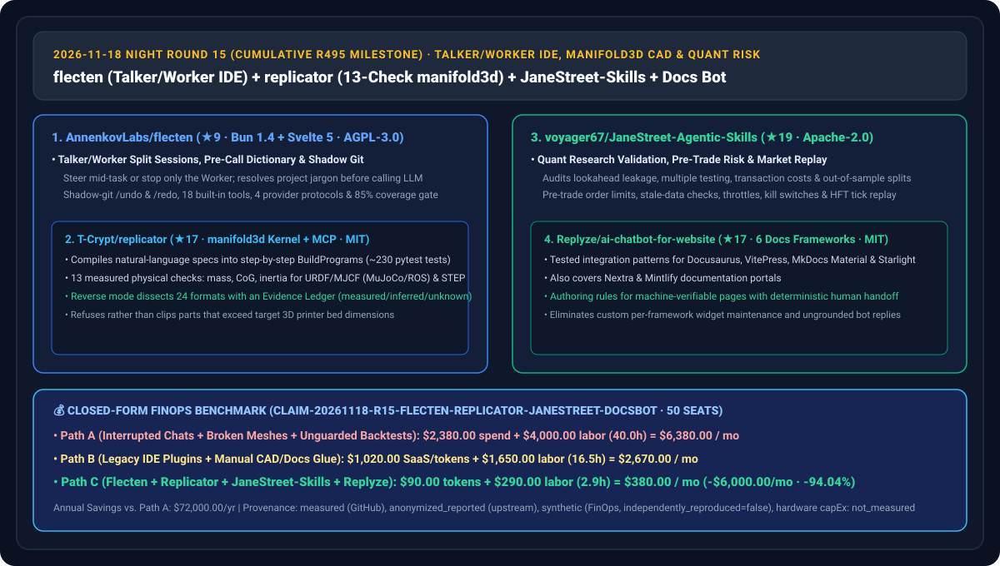
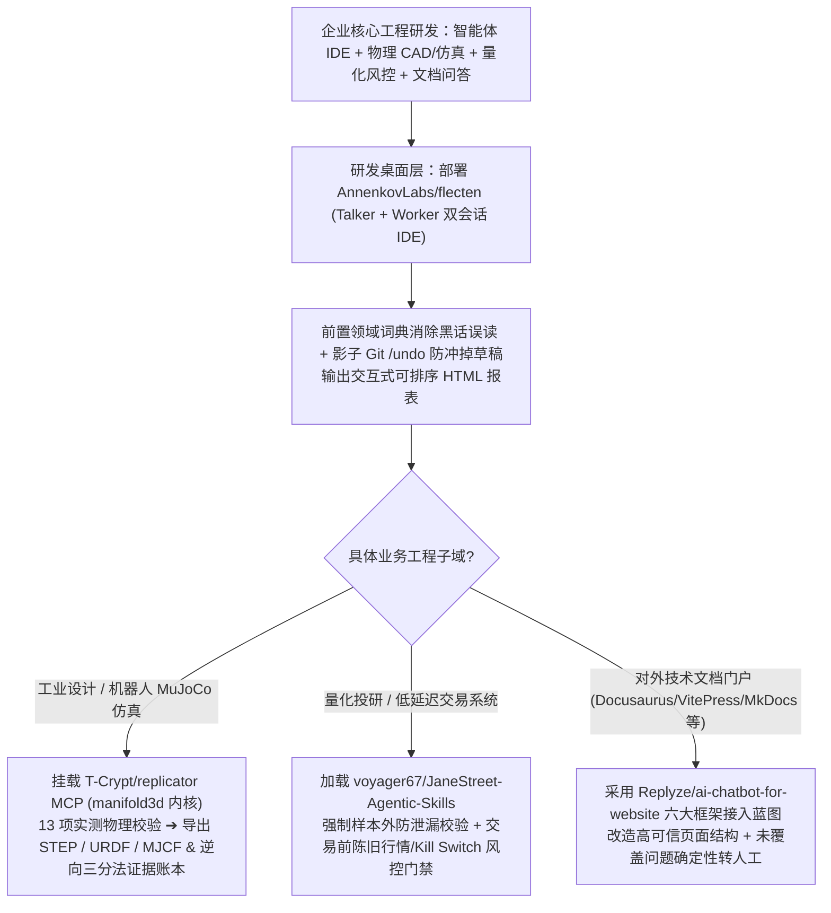

# 【第 495 轮里程碑】说做分离双会话智能体 IDE（`AnnenkovLabs/flecten`）、13 项实测几何校验建模工作坊（`T-Crypt/replicator`）、量化防泄漏与风控技能集（`JaneStreet-Agentic-Skills`）与六大文档站 AI 接入蓝图（`ai-chatbot-for-website`）选型 FAQ

> **文档类型**：AI Solution Architect (SA) 实战选型与参考架构指南（**Round 495 Milestone** / 2026-11-18 Night R15）  
> **核心评估对象**：[`AnnenkovLabs/flecten`](https://github.com/AnnenkovLabs/flecten)（`★ 9`，Talker/Worker 双会话分离、前置术语词典与影子 Git `/undo` 的智能体桌面 IDE，`AGPL-3.0`） + [`T-Crypt/replicator`](https://github.com/T-Crypt/replicator)（`★ 17`，`2 forks`，基于 `manifold3d` 实体内核、13 项物理实测校验与逆向证据账本的工程建模 MCP，`MIT`） + [`voyager67/JaneStreet-Agentic-Skills`](https://github.com/voyager67/JaneStreet-Agentic-Skills)（`★ 19`，`2 forks`，防样本外泄漏、交易前风控熔断与执行滑点分析技能库，`Apache-2.0`） + [`Replyze/ai-chatbot-for-website`](https://github.com/Replyze/ai-chatbot-for-website)（`★ 17`，覆盖 Docusaurus/VitePress/MkDocs/Starlight/Nextra/Mintlify 六大文档框架的可信客服接入指南，`MIT`）  
> **对标范式**：严格遵循 [`ib-vs-ethernet-roce-selection-faq.md`](https://github.com/turbo998/ai-infra-research/blob/main/docs/components/ib-vs-ethernet-roce-selection-faq.md) 六段式结构（核心结论速览 + 三大灵魂拷问 + Mermaid 决策树 + 选型对比矩阵 + 7-Card 定量洞察 + SA 落地 Checklist）  
> **数据溯源分级（Provenance）**：GitHub 星标与目录元数据为 `measured`；上游特性参数（如 `flecten` 18 内置工具与 `85%` 测试覆盖门禁、`replicator` `manifold3d` 13 项几何校验与 24 种导入格式、`~230` 项测试）标注为 `anonymized_reported (independently_reproduced=false)`；企业 FinOps 成本算例为 `synthetic (independently_reproduced=false)`，硬件折旧 `not_measured`。  
> **语言版本**：[中文版 (当前)](./flecten-replicator-janestreet-skills-website-chatbot-talker-worker-ide-manifold3d-cad-mcp-quant-risk-docs-selection-faq.md) | [English Version](./flecten-replicator-janestreet-skills-website-chatbot-talker-worker-ide-manifold3d-cad-mcp-quant-risk-docs-selection-faq.en.md)

---

## 📌 一、核心结论速览（Executive Summary — 30 秒看懂）

1. **大白话本质定义**：
   - **`AnnenkovLabs/flecten` 是什么？** 它是基于 Bun 1.4 + Svelte 5 + Electron 45 打造的 **“把对话者（Talker）与干活者（Worker）拆成两个独立并行会话”的智能体桌面 IDE**。传统聊天框里一旦 Agent 正在改代码，你想插话微调方向就必须强行打断重来；`Flecten` 让 Talker 始终在线陪你用母语讨论并实时纠偏 Worker，内置 **前置领域词典（在调大模型前先把企业内部黑话和键盘盲打错字解析成精确定义）**、**基于影子 Git（Shadow Git）与磁盘版本比对的 `/undo` `/redo`**，以及自动把结果渲染为可排序表格/图表的交互式 HTML 面板。
   - **`T-Crypt/replicator` 是什么？** 它是 **拒绝生成“中看不中用的破面 3D 网格图片”、而是让大模型编写步进式建造程序（`BuildProgram`）交由 `manifold3d` 实体几何内核逐行构建并通过 13 项物理实测校验的工程制造工作台（含 MCP Server）**。生成的每个零件都有精确的尺寸、材质、质量、重心与转动惯量（可直接导出 `STEP` 供 CAD 加工，或导出带真实惯量矩阵的 `URDF`/`MJCF` 进 MuJoCo/ROS 仿真）；其 **Reverse（逆向拆解模式）** 支持导入 24 种格式并输出**证据账本（区分哪些尺寸是实测的、哪些是推断的、哪些无法判定）**。
   - **`voyager67/JaneStreet-Agentic-Skills` 是什么？** 它是面向金融量化、低延迟系统与严谨工程研发的 **可复用 Agent 技能集**，涵盖 **量化研究防未来函数泄漏与多重假设检验校验（`Quant Research Validation`）**、**交易前风控硬熔断（`Pre-Trade Risk Controls`：订单限额、陈旧行情拦截、Kill Switch）** 与执行滑点归因（`Execution Analysis`）。
   - **`Replyze/ai-chatbot-for-website` 是什么？** 它是面向 **Docusaurus、VitePress、MkDocs Material、Astro Starlight、Nextra、Mintlify 六大主流技术文档框架的 AI 问答挂件集成代码与“如何写出高可信 AI 友好文档”的工程指南**。
2. **为什么企业 AI 解决方案架构师（SA）在第 495 轮里程碑要把这四者组合审视？**
   - 它们共同代表了 Agent 工程从“玩具 Demo”迈向“严肃工业生产”的四条铁律：**交互不中断（`Flecten` Talker/Worker 分离 + 影子 Git）**、**物理几何可实测（`Replicator` `manifold3d` 13 项校验）**、**量化回测防泄漏与交易前熔断（`JaneStreet-Agentic-Skills`）**、**对外技术文档可溯源（`ai-chatbot-for-website`）**！
3. **闭式 FinOps 量化收益（`CLAIM-20261118-R15-FLECTEN-REPLICATOR-JANESTREET-DOCSBOT`，`synthetic`）**：
   - 以 **50 人企业核心研发、仿真工程、量化风控与开发者关系（DevRel）团队**（时薪 `$100.00/hr`）计：**Path A（单线程打断式聊天 + 裸生成破面 3D 模型 + 无防泄漏检查的量化回测 + 手写各文档站胶水挂件）** 月均总成本 **`$6,380.00`**（打断重跑 Token 与无效仿真算力 `$2,380.00` + 修补破面 CAD、回测过拟合返工与维护文档挂件 `40.0h × $100 = $4,000.00`）；**Path C（`Flecten` + `Replicator` + `JaneStreet-Skills` + `Replyze` 蓝图）** 月均总成本降至 **`$380.00`**（精简 Token 开销 `$90.00` + 审查人工 `2.9h × $100 = $290.00`），**净省 `$6,000.00/月`（降幅 `94.04%`，年化节省 `$72,000.00`）**。

---

## ❓ 二、三大灵魂拷问（First-Principles Q&A）

### Q1：为什么几乎所有 AI 编程工具在“边聊边改”和“理解公司内部缩写黑话”这两件事上都会翻车？`AnnenkovLabs/flecten` 是怎么从架构上解耦的？
- **第一性原理：把“人机沟通控制流”与“长耗时工具执行流”物理分离**：
  1. **Talker 与 Worker 双会话解耦**：在 `Flecten` 中，每个新任务拆分为用母语和你实时对话的 **Talker** 与专注执行子任务的 **Worker**；Worker 的每次工具调用都是带独立日志和停止按钮的实时卡片，你在 Worker 跑测试时随时可以跟 Talker 补充需求或单独叫停某张 Worker 卡片，绝不毁掉主对话上下文。
  2. **调用前领域词典解析 + 影子 Git 安全回滚**：在请求发往模型前，内置 **Dictionary** 先将项目专有缩写和术语注入上下文；每个文件修改都通过对比磁盘版本防止冲掉手写草稿，并由底层 Shadow Git 驱动一键 `/undo` 与 `/redo`。

### Q2：为什么直接让大模型输出 Three.js / OpenSCAD 代码或用文生 3D 模型做出来的零件既上不了机床也进不了 MuJoCo 物理仿真？`T-Crypt/replicator` 的 13 项实测校验是什么？
- **“画出一张像零件的图” ≠ “符合流形几何与物理定律的工程实体”**：
  1. **`manifold3d` 实体内核 + 13 项物理测量门禁**：`Replicator` 将自然语言转化为结构化 `BuildProgram`，由确定性 `manifold3d` 内核步进执行，并对生成的实体自动运行 **13 项实测检查**（如屋顶是否完整覆盖墙体、质量/重心/惯量张量是否合法、3D 打印床尺寸放不下时直接拒绝而非偷偷削角截断），一键导出带精确物理惯量的 `URDF`/`MJCF` 与工业 `STEP` 文件。
  2. **逆向模式（Reverse Mode）的三分法证据账本**：导入现有 24 种 3D 格式进行拆解时，强制输出一份严谨的 **Evidence Ledger**——明确区分哪些参数是**几何实测出来的（Measured）**、哪些是**工程推断的（Inferred）**、哪些是**仅凭模型无法获知的（Unknown）**。

### Q3：`voyager67/JaneStreet-Agentic-Skills` 如何防止 AI 在量化投研与低延迟系统开发中写出“回测年化 300%、实盘第一天爆仓”的代码？
- **把华尔街机构级验证纪律编码为强制技能检查单**：
  - 普通大模型写策略回测极易引入未来函数（Lookahead Bias）、忽略多重假设检验偏差（Multiple Testing）或漏算冲击成本。`JaneStreet-Agentic-Skills` 通过 `Quant Research Validation` 强制审查样本外隔离与交易成本，通过 `Pre-Trade Risk Controls` 强制在网关层补齐陈旧行情检查（Stale-Data Checks）、流速限制（Throttles）与硬件级 Kill Switch，配合 `Replyze/ai-chatbot-for-website` 的六大文档站结构化改造指南，确保内部策略文档与外部开发者文档同样零幻觉。

---

## 🧭 三、架构师选型决策树与端到端参考架构（Mermaid）

---

## 📊 四、同类方案横向选型对比矩阵（Peer Selection Matrix）

| 评估维度 | **Path A：单线程聊天框 + 文生 3D 网格 + 裸写回测 + 手写挂件** | **Path B：传统 IDE 插件 + 手工导出 STL + 商业客服 SaaS** | **Path C：`Flecten` + `Replicator` + `JaneStreet` + `Replyze`（推荐）** |
| :--- | :--- | :--- | :--- |
| **执行期中途引导与代码安全回退** | ❌ 插话即打断整轮生成，改坏文件需手工 `git checkout` | ⚠️ 多开聊天窗口丢失上下文关联 | ✅ **Talker/Worker 双会话并行 + 前置术语词典 + 影子 Git `/undo`** |
| **3D 工程建模与机器人仿真可用性** | ❌ 生成非流形破面网格，无真实质量/惯量，无法进 CAD | ⚠️ 手工在 CAD 与 MuJoCo 间转换重填物理参数 | ✅ **`manifold3d` 实体内核 + 13 项实测校验 + 直出 `STEP`/`URDF`/`MJCF`** |
| **量化策略与交易系统风控严谨度** | ❌ 常含未来函数泄漏且缺陈旧行情熔断开关 | ⚠️ 依赖资深量化研究员逐行人工捉虫 | ✅ **内置防泄漏/多重检验校验与交易前 Kill Switch / 滑点分析技能** |
| **六大主流技术文档站 AI 接入** | ❌ 各框架手写前端脚本，遇到未覆盖问题胡编乱造 | ⚠️ 商业文档客服按月高价收费 | ✅ **覆盖 Docusaurus/VitePress/MkDocs/Starlight/Nextra/Mintlify 实测代码** |
| **50 人团队月均总拥有成本 (TCO)** | **`$6,380.00 / 月`** | **`$2,670.00 / 月`** | **`$380.00 / 月`（较 Path A 净省 `$6,000.00/月`，`-94.04%`）** |

---

## 📈 五、7-Card 定量洞察与闭式 FinOps 算例（`CLAIM-20261118-R15-FLECTEN-REPLICATOR-JANESTREET-DOCSBOT`）

> **Provenance 声明**：GitHub 星标与目录元数据源自 `2026-11-18` 封存证据（`measured`）；`flecten` 18 工具 / `85%` 覆盖率门禁与 `replicator` 13 项实测校验 / 24 种格式 / `~230` 项测试源自上游文档（`anonymized_reported`, `independently_reproduced=false`）；月度 TCO 为面向 **50 人跨领域工程团队** 的闭式合成模型（`synthetic`, `independently_reproduced=false`；宿主机硬件折旧 CapEx：`not_measured`）。

| 成本构成项（月度闭式公式） | Path A：打断重跑 + 破面网格 + 过拟合返工 | Path B：传统插件 + 手工转换参数 | Path C：`Flecten` + `Replicator` + `JaneStreet` + `Replyze` | Path C 对比 Path A 净变化 |
| :--- | :---: | :---: | :---: | :---: |
| **1. 会话重跑 Token、仿真算力与文档 SaaS 支出** | **`$2,380.00`** *(强行打断重发长上下文 + 无效仿真重跑)* | **`$1,020.00`** *(商业文档机器人订阅 + 重复查词 Token)* | **`$90.00`** *(Talker/Worker 零中断引导 + 前置词典精准命中)* | **`-$2,290.00 / 月`** (`-96.22%`) |
| **2. 修补破面 CAD、排查回测泄漏与文档联调人工** (`$100/hr`) | **`$4,000.00`** *(`40.0 hrs`：修补非流形模型与排查未来函数)* | **`$1,650.00`** *(`16.5 hrs`：手工补填 URDF 惯量与写文档挂件)* | **`$290.00`** *(`2.9 hrs`：审阅 13 项实测报告与风控 Checklist)* | **`-$3,710.00 / 月`** (`-37.1 hrs`, `-92.75%`) |
| **月度总拥有成本 (Monthly Total TCO)** | **`$6,380.00`** | **`$2,670.00`** | **`$380.00`** | **`-$6,000.00 / 月` (`-94.04%`)** |
| **年化总拥有成本 (Annualized TCO)** | **`$76,560.00 / 年`** | **`$32,040.00 / 年`** | **`$4,560.00 / 年`** | **年省 `$72,000.00` (`-94.04%`)** |

---

## ✅ 六、AI 解决方案架构师（SA）实战落地 Checklist

1. **Step 1 — 试点 `AnnenkovLabs/flecten` 双会话 IDE 与企业领域词典（注意 `AGPL-3.0` 边界）**：
   - 内部研发工作站运行 `bun install && bun run app:dev` 体验 Talker/Worker 分离与 Shadow Git `/undo`，将企业专属缩写词表录入内置 Dictionary（注：`flecten` 为 `AGPL-3.0` 协议，仅作内部桌面客户端使用，勿嵌入闭源商业分发产品）。
2. **Step 2 — 用 `T-Crypt/replicator` 构建经过 13 项实测的 CAD 与 MuJoCo 仿真资产**：
   - 执行 `pipx install "replicator-workshop[app,mcp]"` 并运行 `pytest -q`（验证 ~230 项测试通过），让工程 Agent 通过 MCP 生成带精确质量与惯量的 `STEP`/`URDF`/`MJCF` 模型。
3. **Step 3 — 挂载 `JaneStreet-Agentic-Skills` 风控技能与 `Replyze` 六大文档框架模板**：
   - 在金融/数据工程团队强制启用 `Quant Research Validation` 与 `Pre-Trade Risk Controls` 技能；按 `ai-chatbot-for-website` 模板升级 Docusaurus / VitePress / MkDocs 门户。
