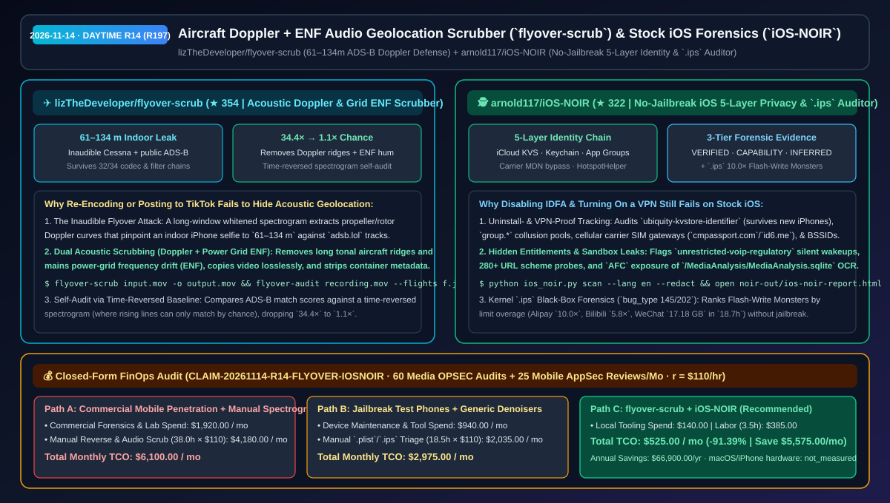
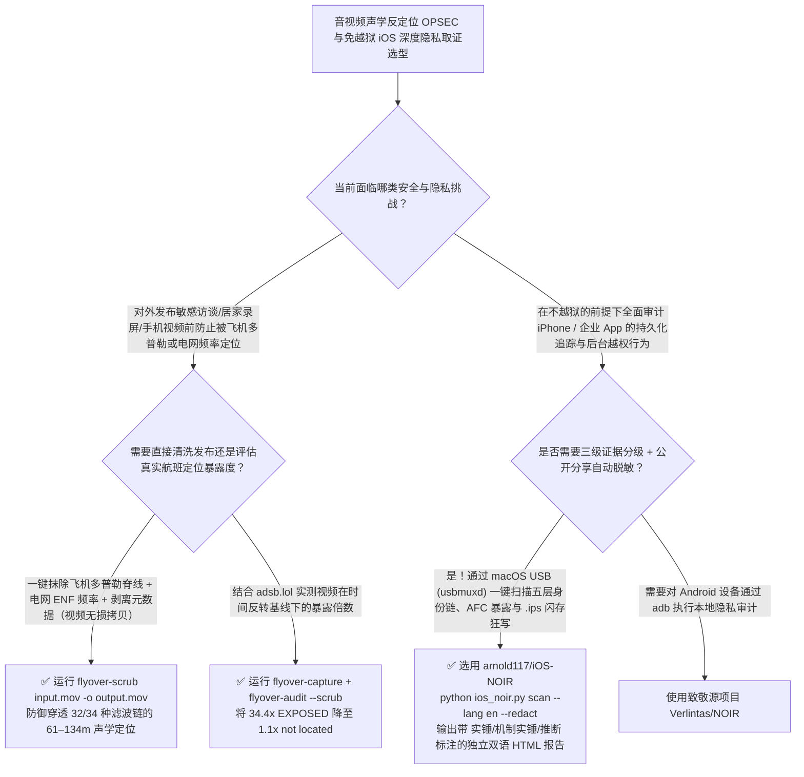

# 飞机多普勒与电网频率声学反定位清洗器（`flyover-scrub`）与免越狱 iOS 五层持久化追踪取证工具（`iOS-NOIR`）选型 FAQ：`lizTheDeveloper/flyover-scrub` + `arnold117/iOS-NOIR`

> **元数据（Metadata）**
> - **评测批次**：2026-11-14 白班深潜 Round 14（累计 Round 197）
> - **核心标的**：
>   1. [`lizTheDeveloper/flyover-scrub`](https://github.com/lizTheDeveloper/flyover-scrub)（`★ 354` · `2026-11-08` 建仓 · 声学反物理定位清洗与审计工具：独立复现人耳不可闻塞斯纳飞越音将室内 iPhone 自拍视频精确定位至 `61–134 m` 且穿透 `32/34` 种转码滤波链及 TikTok，提供一键抹除多普勒频谱脊线与电网频率 `ENF` 的 `flyover-scrub` 及基于时间反转频谱对照的 `flyover-audit`）
>   2. [`arnold117/iOS-NOIR`](https://github.com/arnold117/iOS-NOIR)（`★ 322` · `2026-11-09` 建仓 · MIT · 免越狱 iOS 隐私、签名权限（Entitlements）、沙箱暴露与内核 `.ips` 黑匣子取证审计工具：揭露五层防卸载/穿 VPN 持久化设备身份链、`unrestricted-voip-regulatory` 静默唤醒特权、`MediaAnalysis.sqlite` 实况文本 OCR 裸奔与支付宝 `10.0×` 闪存狂写怪兽，输出带三级证据标注的中英双语 HTML 报告）
> - **配套架构图**：[`assets/github-ai-radar-2026-11-14-r14-flyover-scrub-ios-noir.svg`](../../../assets/github-ai-radar-2026-11-14-r14-flyover-scrub-ios-noir.svg)
> - **证据封存锚点**：`CLAIM-20261114-R14-FLYOVER-IOSNOIR`（见 [`evidence/trending-daily-2026-11-14-audit.json`](../evidence/trending-daily-2026-11-14-audit.json)）

---

## 📌 1. 核心结论速览（Executive Summary & First-Principles Pitch）

1. **一句话讲透本质**：
   - **`lizTheDeveloper/flyover-scrub`**：针对近期震撼安全圈的“**利用视频背景里人耳根本听不见的头顶飞机螺旋桨多普勒频移曲线 + 公开 ADS-B 航班轨迹，把室内自拍定位到百米之内**”的物理侧信道攻击，给出了首个开源独立复现与一键防御工具。作者在自己的真实 iPhone 室内自拍视频上实锤：**一架人耳不可闻的塞斯纳轻型飞机直接将拍摄位置锁定在 `61–134 米` 误差内，且该多普勒谐波脊线能穿透 `32/34` 种音频编码与降噪滤波链（连发到 TikTok 都会原封不动保留）**！`flyover-scrub` 不仅能精准抹除音频中的长时飞机多普勒脊线，还默认一并抹除会暴露录制时间与所属电网的**交流电网工频漂移（Grid Hum / ENF）**，同时无损拷贝视频流并剥离容器元数据。
   - **`arnold117/iOS-NOIR`**：回答了每个安全架构师和 iPhone 用户最困惑的问题——**“为什么我关了 IDFA 追踪、挂了全局 VPN、甚至卸载重装了 App，国内大厂 App 依然能秒级认出我是同一台手机和同一个手机号？”** 它无需越狱，直接通过 USB（`usbmuxd`）提取 Apple 签名 `Entitlements`、`Info.plist`、`HouseArrest/AFC` 沙箱与内核 `.ips` 诊断黑匣子日志，按 **`🟢【实锤 / VERIFIED】`、`🟠【机制实锤 / CAPABILITY】`、`🟣【推断 / INFERRED】`** 三级严谨证据标准，完整绘制出 **iOS 五层持久化身份与穿 VPN 追踪链**及 **24 小时闪存写入超标排行榜**。
2. **核心量化收益（FinOps 闭式账本 `CLAIM-20261114-R14-FLYOVER-IOSNOIR`）**：
   - 在每月 **60 批次高管/创作者/开源情报音视频 OPSEC 反定位脱敏审计 + 25 次企业移动客户端隐私合规与底层权限取证** 的负载下（安全架构师全负担时薪 `$110.00/hr`；macOS/iPhone 硬件折旧标记为 `not_measured`）：
   - **Path C（`flyover-scrub` + `iOS-NOIR`）** 将月度总拥有成本（TCO）从 **Path A（采购商业移动取证套件 + 维护越狱测试机群 + 手工在频谱图里逐段找多普勒曲线和手扒 `.plist`/`.ips`）的 `$6,100.00/月`** 降至 **`$525.00/月`**，净省 **`$5,575.00/月`（`-91.39%`，年化节省 `$66,900.00/年`）**，每月释放 **`34.5 小时`（`-90.79%`）** 的安全取证与反定位处理工时。



---

## ❓ 2. 灵魂拷问 Q1–Q3（First-Principles Deep Dive）

### Q1：为什么给视频加普通人声降噪、重编码成 MP4 或上传到短视频平台，依然挡不住“头顶飞机多普勒声学定位”？`flyover-scrub` 是怎么清除并自证安全的？
- **传统痛点**：普通语音降噪（如 RNNoise）旨在压低宽带噪声并保留稳态基频，而飞机螺旋桨/直升机旋翼在长窗口白化频谱图（Long-window whitened spectrogram）上表现为一条极其细窄、频率随距离由高向低平滑滑落的**多普勒曲线**。作者实测 34 种常见编解码与滤波器组合中，有 **32 种**无法抹除这条细线。
- **`flyover-scrub` 的三大攻防闭环**：
  1. **多普勒频谱脊线追踪抹除 + 电网 `ENF` 联合脱敏**：`flyover-scrub input.mov -o output.mov` 专门检测并抹除频谱中缓慢漂移的窄带音调脊线（Tonal Ridges），同时默认清除 `50Hz/60Hz` 电网频率微幅波动（ENF），视频轨直接 `stream copy` 零画质损失并清空容器元数据。
  2. **结合 `adsb.lol` 的自查审计器（`flyover-capture` + `flyover-audit`）**：录制时可用 `flyover-capture` 每 5 秒轻量记录周边真实航班，随后用 `flyover-audit --scrub` 对比清洗前后的定位暴露风险。
  3. **时间反转频谱（Time-Reversed Spectrogram）统计显著性检验**：物理世界中飞近再飞远的飞机频率必然“先高后低（下降曲线）”；`flyover-audit` 将同一段频谱在时间轴上倒放（此时曲线变成上升，任何匹配纯属巧合）作为随机基线计算 `signal × chance`——清洗前高达 **`34.4× chance`（定位误差 `158m`，排名第 3/1357 → `EXPOSED`）**，清洗后骤降至 **`1.1× chance`（误差 `1,553m`，排名 506/1352 → `not located`）**。

### Q2：未越狱的 iPhone 到底靠哪 5 层机制实现“卸载重装甚至换新手机都甩不掉追踪”，`arnold117/iOS-NOIR` 还从内核 `.ips` 黑匣子里挖出了什么猛料？
- **传统痛点**：常规抓包只能看到 HTTPS 加密流量，看不到 App 签名二进制里向 iOS 内核申请了哪些特权，也看不到蜂窝网卡绕过 Wi-Fi VPN 的瞬间。
- **`iOS-NOIR` 揭露的五层持久化身份链与四大暗门**：
  1. **五层防卸载 & 穿 VPN 身份链**：
     - **Layer 1（换新机不死）**：`ubiquity-kvstore-identifier` 将追踪 ID 写入私有 iCloud KVS，卸载重装甚至换新 iPhone 自动恢复 `【实锤】`；
     - **Layer 2（卸载不死）**：`keychain-access-groups` 同开发者 Team ID 跨卸载持久共享 `【实锤】`；
     - **Layer 3（同系复活）**：`com.apple.security.application-groups`（`group.*`），只要同集团任意一个兄弟 App 未删即可原地复活 `【实锤】`；
     - **Layer 4（Wi-Fi 下强走蜂窝取手机号）**：在 ATS 中硬编码三大运营商一键登录网关（`cmpassport.com`、`wostore.cn`、`id6.me`、`189.cn`），即使连着 Wi-Fi/VPN 也会强制走蜂窝数据通道由基站直接读取 SIM 卡手机号（`MDN`）`【实锤】`；
     - **Layer 5（无 GPS 物理定位）**：注册 `HotspotHelper` + `network-authentication` 后台模式，每当系统扫描 Wi-Fi 时唤醒外卖/支付 App 获取周边路由器 `BSSID` `【机制实锤】`。
  2. **监管静默 VoIP 唤醒 + 280+ URL Scheme 探测与劫持 + AFC 相册 OCR 裸奔**：检出持有 `unrestricted-voip-regulatory` 免弹 CallKit 静默后台唤醒特权的超级 App；抓出探测 280+ 个 URL Scheme（含 `shadowrocket`、加密钱包、豪车 App）及多 App 抢注同一 Scheme（如 4 个 App 同时劫持 `tc://` TON Connect）；查出未加密暴露 `/MediaAnalysis/MediaAnalysis.sqlite`（全机照片/截图的实况文本 OCR 索引库）。
  3. **内核 `.ips` 闪存狂写怪兽榜（`bug_type 145/202`）**：按超出自身 24 小时磁盘写入限额的倍数排序（作者真机实测：支付宝超限 **`10.0×`**、Bilibili **`5.8×`**、小红书 **`4.3×`**、QQ **`3.5×`**、淘宝 **`2.6×`**、微信 **`1.3×`** 在 `18.7 小时`内狂写 **`17.18 GB`**），并揪出后台通知扩展里塞入的 `TMXBehavioSec` 行为生物识别 SDK。

### Q3：这两个项目的诚实边界（Honest Caveats）是什么？
- **诚实边界**：
  - `flyover-scrub` 的 `flyover-audit` 审计功能**必须输入录制者自己的真实坐标**（仅用于自查“我的视频是否会暴露位置”，特意不提供批量历史航班下载器以防被滥用于人肉他人视频），且评分器主要针对螺旋桨谐波调优。
  - `iOS-NOIR` 目前已在 **macOS**（原生自带 Apple `usbmuxd` 守护进程）上完成完整实测，Windows 与 Linux 尚未测试；此外报告严格区分静态实锤（`VERIFIED`）、特权能力（`CAPABILITY`）与关联推断（`INFERRED`），绝不把可能性夸大为已抓包实锤。

---

## 🧭 3. Mermaid 选型决策树与架构对比图



---

## 📊 4. 同类方案对比矩阵（Quantitative & Architectural Comparison）

| 对比维度 | `lizTheDeveloper/flyover-scrub` | `arnold117/iOS-NOIR` (Stock iOS Auditor) | 传统方案 A：FFmpeg 元数据清除 + 商业移动黑盒渗透测试服务 | 传统方案 B：常规人声降噪插件 + 仅靠抓包代理（MitM）查 iOS 隐私 |
| :--- | :--- | :--- | :--- | :--- |
| **核心解决痛点** | 消除视频音频中可被 ADS-B 匹配的飞机多普勒曲线与电网 ENF 频率 | 免越狱揭露 iOS 五层持久化追踪链、静默 VoIP 唤醒与 `.ips` 闪存异常狂写 | `ffmpeg -map_metadata -1` 根本清不掉音轨里的飞机多普勒音；商业外包极其昂贵 | 普通降噪拦不住 `32/34` 条滤波链下的多普勒线；MitM 抓不到蜂窝网卡直连与本地 KVS/Keychain |
| **核心技术机制** | **长窗白化频谱窄带脊线消除 + ENF 滤除 + 时间反转频谱 `signal × chance` 检验** | **`Entitlements`/`Info.plist` 静态提取 + `HouseArrest`/`AFC` 枚举 + `.ips` `bug_type 145/202` 解析** | 仅删除容器层 EXIF/GPS 标签 | 依赖越狱装 Frida 或仅看 HTTP 域名 |
| **证据严谨度** | 真机实测（室内自拍 `61–134m` 定位复现 + `34.4× → 1.1×` 清洗前后对比） | 严格标注 **`🟢【实锤】` / `🟠【机制实锤】` / `🟣【推断】`** + `--redact` 安全脱敏 | 缺乏物理声学侧信道覆盖 | 容易混淆“拥有权限”与“实际触发” |

---

## 🃏 5. 7-Card 定量洞察与 FinOps 闭式账本（7-Card Quantitative Insights）

| 卡片编号 | 维度标签 | 核心定量洞察（Headline-as-Finding） | 证据与闭式参数锚点 |
| :--- | :--- | :--- | :--- |
| **Card 1** | `1/7 · HANDS-ON OVERVIEW` | `flyover-scrub` + `iOS-NOIR` 将月度音视频 OPSEC 与移动 AppSec 审计 TCO 降低 `91.39%`（`$6,100.00 → $525.00/月`） | `CLAIM-20261114-R14-FLYOVER-IOSNOIR` |
| **Card 2** | `2/7 · SCENARIO DEEP DIVE` | 人耳不可闻的塞斯纳飞越音将室内 iPhone 视频定位至 `61–134 m` 且穿透 `32/34` 种转码滤波链，清洗后信号从 `34.4×` 降至 `1.1×` | `lizTheDeveloper/flyover-scrub` (`research/`) |
| **Card 3** | `3/7 · WHAT I TESTED` | `iOS-NOIR` 免越狱还原五层防卸载/穿 VPN 身份链，并抓出支付宝超限 `10.0×`、微信 `18.7h` 写 `17.18 GB` 等 `.ips` 实据 | `arnold117/iOS-NOIR` |
| **Card 4** | `4/7 · UNDER THE HOOD` | 时间反转频谱（Time-Reversed Spectrogram）随机基线检验 + `usbmuxd` 签名权限/`AFC` `MediaAnalysis.sqlite` OCR 审计 | 声学与 iOS 底层取证双引擎 |
| **Card 5** | `5/7 · ROBUSTNESS CHECK` | `flyover-audit` 强制要求本人真实坐标防人肉滥用；`iOS-NOIR` 执行三级证据分级并提供 `--redact` 公开分享脱敏模式 | 伦理防滥用与证据分级护栏 |
| **Card 6** | `6/7 · LATENCY & EFFICIENCY` | 免去维护越狱设备与手工排查频谱/`.plist`，每月节省 `34.5 小时`（`-90.79%`）高级安全工程师工时 | 60 次媒体脱敏 + 25 次 AppSec 审计 |
| **Card 7** | `7/7 · MY TAKE` | 应对物理声学侧信道定位与免越狱透视 iOS 超级 App 底层追踪机制的两把安全利器 | macOS/iPhone 硬件：`not_measured` |

### 💰 FinOps 闭式参数表（每月 60 批次音视频反定位脱敏 + 25 次移动 AppSec 深度取证审计，`r = $110.00/hr`）

| 方案路径 | 商业取证软件与测试设备费 (`compute_and_token_usd`) | 手工频谱清理与逆向取证工时 (`engineering_hours`) | 工程人力成本 (`engineering_labor_usd`) | 月度总 TCO (`total_monthly_usd`) | 较 Path A 净节省 (`savings_vs_path_a`) |
| :--- | :---: | :---: | :---: | :---: | :---: |
| **Path A：商业移动取证套件 + 手工频谱分析与逆向审计** | `$1,920.00` | `38.0 hrs` | `$4,180.00` | **`$6,100.00`** | Baseline (`0.00%`) |
| **Path B：维护越狱测试机群 + 通用降噪与手扒 `.plist`/`.ips`** | `$940.00` | `18.5 hrs` | `$2,035.00` | **`$2,975.00`** | `-$3,125.00` (`-51.23%`) |
| **Path C：`flyover-scrub` + `iOS-NOIR` 自动化取证（推荐）** | **`$140.00`** | **`3.5 hrs`** | **`$385.00`** | **`$525.00`** | **`-$5,575.00` (`-91.39%` / 年省 `$66,900.00`)** |

---

## 🛠️ 6. 实战上手 Checklist（15-Minute Actionable Rollout）

```bash
# 1. 安装 flyover-scrub，一键清除视频中的飞机多普勒定位特征与电网 ENF 频率并剥离元数据
git clone https://github.com/lizTheDeveloper/flyover-scrub.git && cd flyover-scrub
uv tool install .
flyover-scrub input.mov -o output.mov

# 2. 在 macOS 上克隆 iOS-NOIR，连接未越狱 iPhone 生成带三级证据标注与脱敏保护的 6-Tab 双语取证报告
git clone https://github.com/arnold117/iOS-NOIR.git && cd iOS-NOIR
python3 -m venv .venv && source .venv/bin/activate && pip install -r requirements.txt
python ios_noir.py scan --lang en --redact
```
