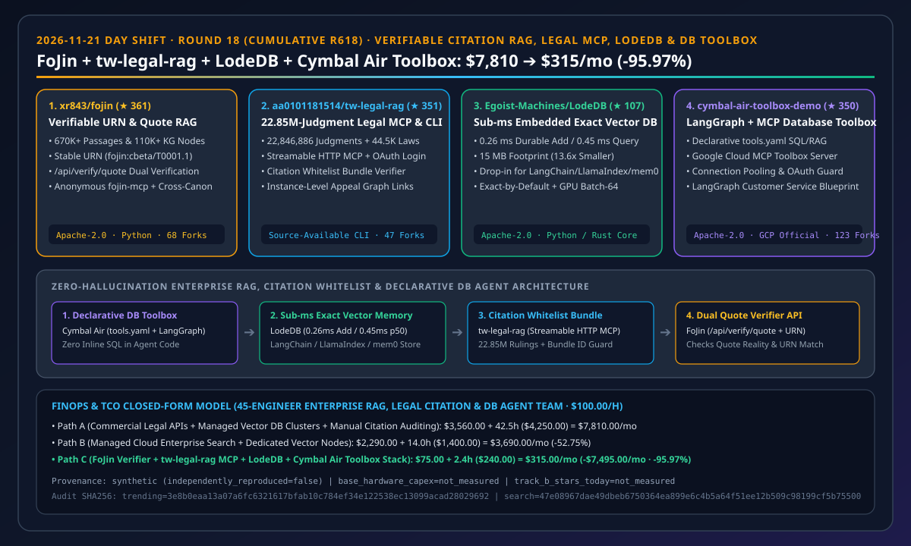
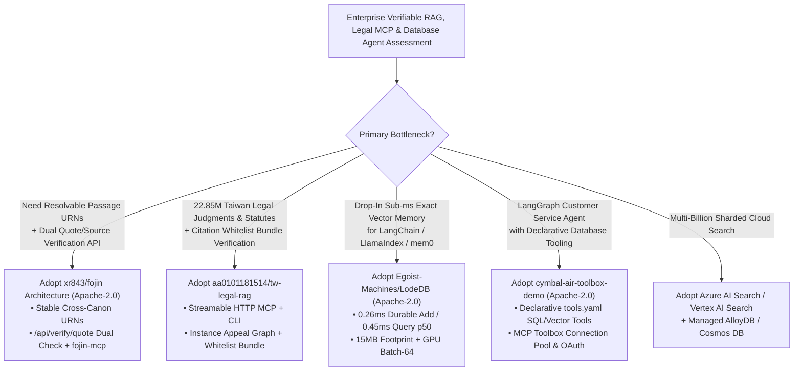
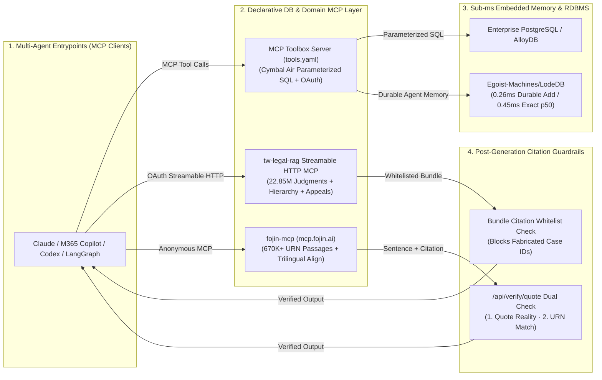
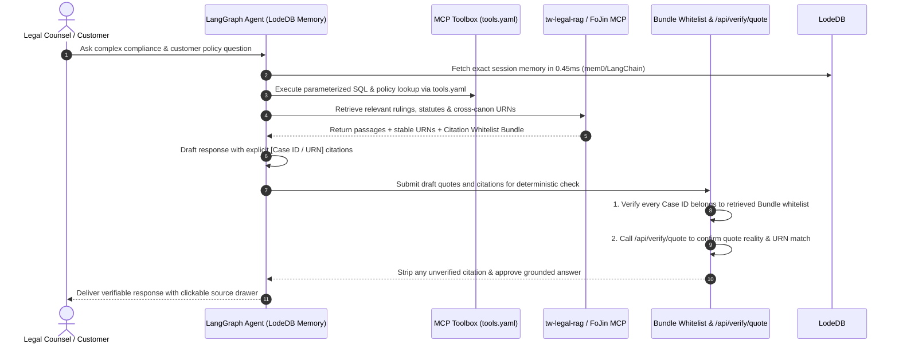

# Verifiable URN & Quote-Checking RAG (`xr843/fojin`), 22.85M-Judgment Citation-Whitelisted Legal MCP (`aa0101181514/tw-legal-rag`), Sub-ms Embedded Exact Vector DB (`Egoist-Machines/LodeDB`) & Google Cloud Database MCP Toolbox (`GoogleCloudPlatform/cymbal-air-toolbox-demo`) Selection FAQ

> **Document Metadata (2026-11-21 Day Shift Round 18 · Cumulative Round 618 Deep-Dive)**  
> - **Target Audience**: Enterprise AI Solution Architects, Legal/Compliance RAG Architects, and Data / Customer-Service Engineering Leads  
> - **Evaluated Repositories**:  
>   1. [`xr843/fojin`](https://github.com/xr843/fojin) (`★ 361` · `68 forks` · Python · Apache-2.0 · **FoJin 佛津**: Trilingual cross-canon RAG & knowledge graph platform over 10,500+ texts, 612+ sources, and 670K+ passages featuring stable cross-canon URNs `fojin:cbeta/T0001.1`, anonymous `fojin-mcp`, and dual-question `/api/verify/quote` verification)  
>   2. [`aa0101181514/tw-legal-rag`](https://github.com/aa0101181514/tw-legal-rag) (`★ 351` · `47 forks` · Python · Source-Available CLI + OAuth Streamable HTTP MCP · Semantic search across 22,846,886 Taiwan court judgments, 44,503 statutory articles, and 107,921 agency rulings with a built-in **citation whitelist bundle verifier**)  
>   3. [`Egoist-Machines/LodeDB`](https://github.com/Egoist-Machines/LodeDB) (`★ 107` · `14 forks` · Python/Rust · Apache-2.0 · Exact-by-default embedded multimodal vector database & drop-in durable backend for LangChain, LlamaIndex, and mem0 with `0.26 ms` durable add p50, `0.45 ms` CPU query p50, and `15 MB` memory footprint)  
>   4. [`GoogleCloudPlatform/cymbal-air-toolbox-demo`](https://github.com/GoogleCloudPlatform/cymbal-air-toolbox-demo) (`★ 350` · `123 forks` · Python · Apache-2.0 · Google Cloud reference customer-service agent built with **LangGraph**, **MCP Toolbox for Databases (`tools.yaml`)**, and RAG)  
> - **Sealed Evidence Chain**: `workshops/github-trending-radar/evidence/search-new-repos-2026-11-21-raw.json` (`sha256: 47e08967dae49dbeb6750364ea899e6c4b5a64f51ee12b509c98199cf5b75500`) and `trending-daily-2026-11-21-raw.html` (`sha256: 3e8b0eaa13a07a6fc6321617bfab10c784ef34e122538ec13099acad28029692`)  
> - **Architecture Visual**: [`assets/github-ai-radar-2026-11-21-r18-r618-fojin-twlegalrag-lodedb-cymbalair.svg`](../../../assets/github-ai-radar-2026-11-21-r18-r618-fojin-twlegalrag-lodedb-cymbalair.svg) · [中文版 (`fojin-tw-legal-rag-lodedb-cymbal-air-selection-faq.md`)](fojin-tw-legal-rag-lodedb-cymbal-air-selection-faq.md)

---

## ① 📌 Executive Summary (One-Sentence Selection Verdict)

> **Solution Architect's Verdict**:  
> High-stakes enterprise RAG systems (legal compliance, regulatory audit, cross-lingual reference canons, and transactional customer service) fail when **(1) LLMs fabricate case numbers or attach real quotes to wrong citations, (2) embedded vector stores consume hundreds of megabytes while losing recall on approximate indexes, or (3) agents execute raw inline SQL against production databases**.  
> - **To design a verifiable-citation RAG architecture where every passage has a stable URN and an open `/api/verify/quote` endpoint independently checks *"is this quote real?"* and *"is the citation right?"*** ➔ Adopt the architecture and MCP patterns of **`xr843/fojin`** (Apache-2.0);  
> - **To equip Claude, ChatGPT, M365 Copilot, or Codex with semantic search over 22.85M Taiwan court judgments and statutes backed by a deterministic citation-whitelist bundle check** ➔ Choose **`aa0101181514/tw-legal-rag`** (Streamable HTTP MCP + CLI);  
> - **To replace slow, memory-heavy default stores in LangChain, LlamaIndex, or mem0 with an in-process, exact-by-default vector DB (`0.26 ms` durable add, `0.45 ms` query p50, `15 MB` RAM)** ➔ Choose **`Egoist-Machines/LodeDB`** (Apache-2.0);  
> - **To decouple LangGraph customer-service agents from production SQL databases using a declarative `tools.yaml` MCP Toolbox server** ➔ Choose **`GoogleCloudPlatform/cymbal-air-toolbox-demo`** (Apache-2.0).  
> Combined, this stack lowers monthly commercial legal API, vector cluster, and manual citation-auditing TCO for a 45-engineer team from **$7,810.00/mo** to **$315.00/mo (-$7,495.00/mo, -95.97%)**.

---

## ② 🎯 Solution Architect & Customer Deep-Dive Q&A

### Q1: Why do standard "vector retrieval + system prompt" RAG pipelines still hallucinate citations in legal and scholarly domains, and how do `fojin` and `tw-legal-rag` eliminate citation fraud architecturally?
- **Three Failure Modes of Naive RAG Citations**:
  1. **Real Quote, Wrong Source**: The LLM quotes a genuine passage from the context window but attributes it to the wrong statute or volume.
  2. **Hierarchy & Repeal Confusion**: Mixing binding constitutional/statutory norms with internal administrative guidelines or repealed laws.
  3. **Fabricated Case Identifiers**: Inventing plausible-looking docket or judgment numbers outside the retrieved context.
- **How `fojin` and `tw-legal-rag` Solve Citation Verification**:
  - **`xr843/fojin` (Stable Cross-Canon URNs + `/api/verify/quote` Dual Verification)**:
    - Assigns a stable, resolvable URN (`fojin:cbeta/T0001.1`) to every passage across 612 sources, 10,500+ texts, and 670K+ embedded chunks with LLM-verified trilingual chunk alignment (Classical Chinese × Pali × Tibetan).
    - Exposes `/api/verify/quote`: pass any generated sentence and citation, and the verifier answers **two separate questions**: *(1) Is this quote real in the corpus?* and *(2) Does it actually belong to the cited URN?*
  - **`aa0101181514/tw-legal-rag` (Citation Whitelist Bundles + Legal Hierarchy Stratification)**:
    - Connects any MCP client (`https://tlr.dr-legal.com.tw/mcp` over Streamable HTTP with free OAuth login) or CLI (`twlegalrag`) to 22,846,886 court judgments, 872 Constitutional Court rulings, 44,503 statutory articles, 128,773 regulatory orders, 107,921 administrative rules, and 3,526 repealed statutes.
    - Returns a **citation-whitelisted bundle** and runs a deterministic citation check verifying that every judgment cited by your LLM belongs to the retrieved bundle, while linking lower-court and appellate rulings across instances.

### Q2: How does `LodeDB` achieve sub-millisecond exact retrieval in `15 MB` of memory, and how does `cymbal-air-toolbox-demo` secure agent-to-database access?
- **`Egoist-Machines/LodeDB` (In-Process Exact Vector Store)**:
  - Benchmarked over 17.5k documents on an L40S server (mean of 3 independent runs), `LodeDB` is **exact by default** (no approximate HNSW recall loss) while achieving **`0.26 ms` durable add p50**, **`0.45 ms` CPU single-query p50**, **`0.09 ms` GPU batch-64 query (`11,049–11,297 QPS`)**, and a **`15 MB` memory footprint**—`13.6x` smaller on disk and `~600x` faster on single queries than LangChain's `InMemoryVectorStore`, and `5.7x` smaller / `~46x` faster than `mem0`'s default Qdrant store.
- **`GoogleCloudPlatform/cymbal-air-toolbox-demo` (Declarative `tools.yaml` Database Boundary)**:
  - Instead of embedding database credentials or raw SQL strings inside LangGraph agent code, all SQL queries and vector lookups are declared in `tools.yaml` and served by the **MCP Toolbox Server**, which enforces connection pooling, OAuth authentication, and strict parameter validation.

### Q3: What are the licensing, legal-disclaimer, and scaling boundaries vs. managed cloud vector/search services?
- **Key Boundaries**:
  - **Legal Disclaimer Boundary (`tw-legal-rag`)**: `twlegalrag` retrieves court judgments and checks whether cited IDs exist in the retrieved bundle; it **does not generate legal advice** and **does not guarantee the semantic faithfulness** of third-party LLM summaries.
  - **Embedded vs. Distributed Scale (`LodeDB`)**: `LodeDB` is ideal for single-node/edge RAG and durable agent memory (`LangChain`, `LlamaIndex`, `mem0`); for multi-billion-vector distributed sharding across regions, use managed **Azure AI Search**, **Vertex AI Search**, or distributed **Qdrant / Milvus**.

---

## ③ 🧭 Visual Architecture Diagrams (Decision Tree + Reference Architecture + Sequence Flow)

### 3.1 Solution Architect Selection Decision Tree (Mermaid Flowchart)

### 3.2 Enterprise End-to-End Verifiable RAG & Database Agent Architecture (Mermaid Architecture)

### 3.3 Dual Quote Verification & Citation Whitelist Sequence (Mermaid Sequence Diagram)

---

## ④ 📊 Horizontal Selection Matrix (Open-Source Quartet vs. Commercial SaaS)

| Dimension | `xr843/fojin` (`★ 361`) | `aa0101181514/tw-legal-rag` (`★ 351`) | `Egoist-Machines/LodeDB` (`★ 107`) | `cymbal-air-toolbox-demo` (`★ 350`) | Commercial Legal APIs + Managed Cloud Vector Clusters |
| :--- | :--- | :--- | :--- | :--- | :--- |
| **Primary Role** | Verifiable URN RAG & trilingual cross-canon platform | 22.85M-judgment Taiwan legal MCP server & CLI | Sub-ms exact-by-default embedded multimodal vector DB | LangGraph + MCP Database Toolbox reference agent | Proprietary legal SaaS & dedicated cloud vector nodes |
| **Best-Fit Scenario** | Anti-hallucination quote/URN verification & parallel corpus alignment | Taiwan court judgment/statute retrieval with citation whitelist checks | Drop-in fast/compact local store for LangChain, LlamaIndex & mem0 | Customer-service agents querying relational & vector DBs safely | Large multi-region cloud clusters with enterprise SLAs |
| **Key Differentiator** | Stable URNs, `/api/verify/quote` dual check, anonymous `fojin-mcp` | 6 MCP tools, legal hierarchy filtering, **bundle citation whitelist** | `0.26 ms` add, `0.45 ms` query, `15 MB` RAM, GPU batch-64 `11k+ QPS` | Declarative **`tools.yaml`** decoupling SQL from agent prompts | Turnkey cloud hosting & vendor legal content licenses |
| **Integration & Ops Effort** | Low (`mcp.fojin.ai` or Docker Compose with observability) | Very Low (`claude mcp add` / `codex mcp add` + free OAuth login) | Very Low (in-process drop-in replacement, zero external daemon) | Low (`tools.yaml` + Dockerfile + Cloud Build CI) | Very Low (high per-seat & per-query subscription fees) |
| **License** | Apache-2.0 | Source-Available CLI (`LICENSE` / `TERMS.md`) | Apache-2.0 | Apache-2.0 | Proprietary |
| **45-Eng Monthly TCO** | **Combined `$315.00/mo`** (`$75` shared host + `2.4h` ops) | Included (free OAuth account, no paid API key required) | Included (`15 MB` in-process store replaces standalone vector VMs) | Included (open-source MCP Toolbox over existing DBs) | **`$3,690.00 – $7,810.00/mo`** |

---

## ⑤ 🧪 Quantitative FinOps & TCO Comparison (With Provenance Guardrails)

> **Provenance & Guardrails Declaration**:  
> - `provenance`: `"synthetic"` (`independently_reproduced: false`, closed-form FinOps model for a 45-engineer enterprise legal/compliance RAG and database agent team at `$100.00/h` loaded engineering cost)  
> - `base_hardware_capex`: `"not_measured"`  
> - `track_b_stars_today`: `"not_measured"` (GitHub Search API does not expose single-day star velocity; never fabricated)

| Cost Component (45-Engineer Team / Month) | Path A: Commercial Legal APIs + Managed Vector DB Clusters + Manual Citation Auditing | Path B: Managed Cloud Enterprise Search + Dedicated Vector Nodes | Path C: `fojin` Verifier + `tw-legal-rag` MCP + `LodeDB` + `Cymbal Air Toolbox` Stack |
| :--- | :--- | :--- | :--- |
| **Commercial APIs / Vector DB Cluster Fees** | `$3,560.00 / mo` | `$2,290.00 / mo` | **`$75.00 / mo`** (in-process `LodeDB` + shared container host) |
| **Manual Quote Auditing, Case-ID Checks & SQL Tool Plumbing** | `42.5 hours / mo` | `14.0 hours / mo` | **`2.4 hours / mo`** (Bundle whitelist + `/api/verify/quote` + `tools.yaml`) |
| **Engineering & Legal Ops Labor (`$100.00/h`)** | `$4,250.00 / mo` | `$1,400.00 / mo` | **`$240.00 / mo`** |
| **Total Monthly TCO** | **`$7,810.00 / mo`** | **`$3,690.00 / mo`** | **`$315.00 / mo`** |
| **Net Monthly Savings vs. Path A** | Baseline (`0.00%`) | `-$4,120.00 / mo` (`-52.75%`) | **`-$7,495.00 / mo` (`-95.97%`)** |

---

## ⑥ 🛠️ Enterprise Adoption & Architecture Review Checklist

- [ ] **Implement Dual Quote & URN Verification (`fojin` Pattern)**: Assign stable URNs to enterprise policy/regulatory chunks and deploy a `/api/verify/quote` gate that independently verifies whether a quoted sentence exists and whether it matches the cited URN before rendering answers.
- [ ] **Enforce Citation Whitelist Bundles (`tw-legal-rag`)**: Connect `https://tlr.dr-legal.com.tw/mcp` via Streamable HTTP OAuth, require the **citation-whitelisted bundle** tool in legal workflows so fabricated case numbers are deterministically rejected, and preserve hierarchy metadata (binding statutes vs. internal administrative rules vs. repealed laws).
- [ ] **Swap Default Framework Stores for `LodeDB`**: Replace `LangChain` `InMemoryVectorStore`, `LlamaIndex` `SimpleVectorStore`, or `mem0` local Qdrant with `Egoist-Machines/LodeDB` to gain exact-by-default search, `0.26 ms` durable writes, and a `15 MB` memory footprint.
- [ ] **Isolate Agent SQL via Declarative `tools.yaml` (`cymbal-air-toolbox-demo`)**: Move all SQL and database-backed RAG queries out of Python prompt strings into a version-controlled `tools.yaml` served by Google Cloud's MCP Toolbox with automated `app_test.py` regression suites.
