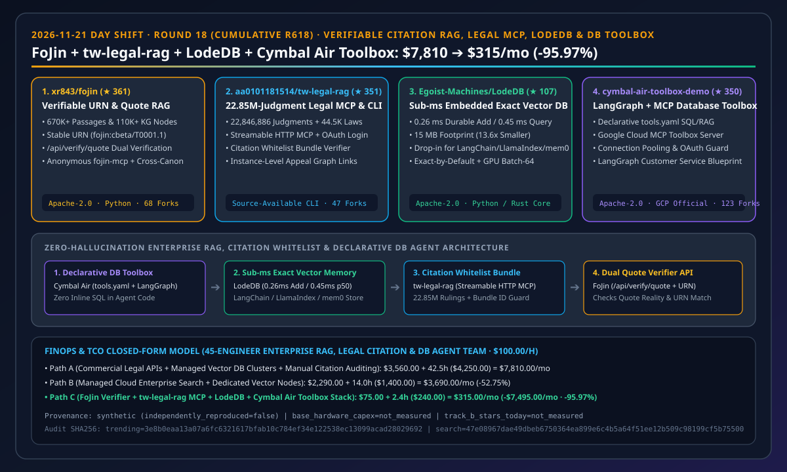
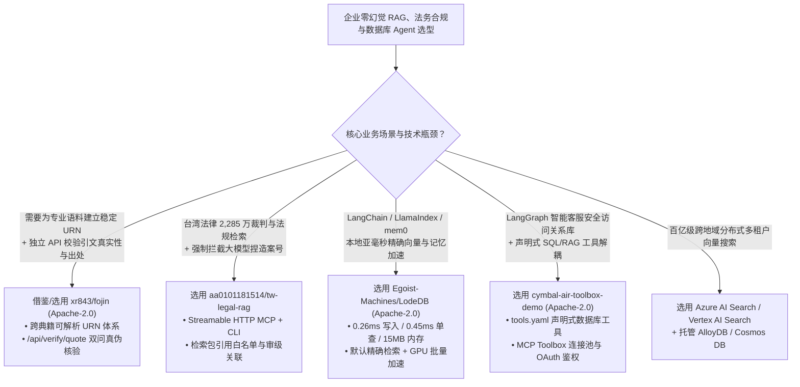
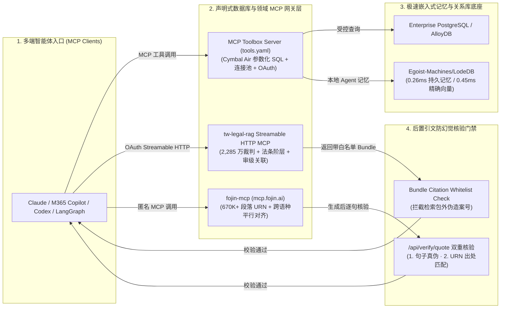
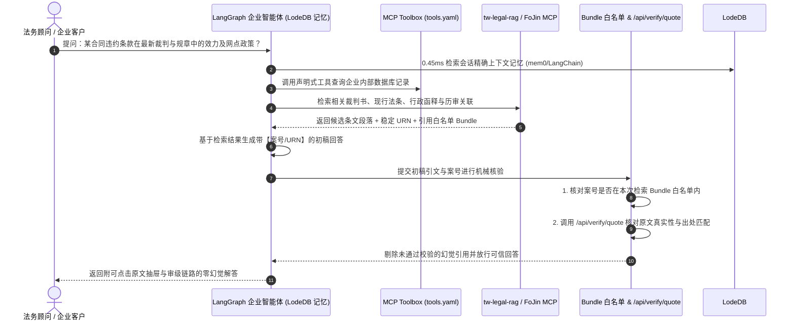

# 可验证引文与跨典籍知识库（`xr843/fojin`）、2,285 万笔裁判白名单查核法律 MCP（`aa0101181514/tw-legal-rag`）、亚毫秒嵌入式精确向量库（`Egoist-Machines/LodeDB`）与 Google Cloud 数据库 MCP 工具箱（`GoogleCloudPlatform/cymbal-air-toolbox-demo`）选型 FAQ

> **文档元数据（2026-11-21 白班 Day Round 18 · 累计第 618 轮深潜专题）**  
> - **面向对象**：企业 AI 解决方案架构师（AI Solution Architect）、法务/合规知识库架构师、数据与智能客服工程负责人  
> - **本轮核心评估对象**：  
>   1. [`xr843/fojin`](https://github.com/xr843/fojin)（`★ 361` · `68 forks` · Python · Apache-2.0 · **FoJin 佛津**：聚合 612+ 数据源、10,500+ 部典籍与 67 万+ 向量段落的三语跨藏对齐 RAG 平台，首创可解析 URN `fojin:cbeta/T0001.1`、免密钥 `fojin-mcp` 与双问引文真伪核验接口 `/api/verify/quote`）  
>   2. [`aa0101181514/tw-legal-rag`](https://github.com/aa0101181514/tw-legal-rag)（`★ 351` · `47 forks` · Python · 公开源码 CLI + OAuth Streamable HTTP MCP · 检索 2,285 万笔台湾裁判书、4.45 万条法律与 10.79 万笔行政函释，内置**附引用白名单 Bundle 查核器**严防大模型捏造案号）  
>   3. [`Egoist-Machines/LodeDB`](https://github.com/Egoist-Machines/LodeDB)（`★ 107` · `14 forks` · Python/Rust · Apache-2.0 · 默认精确检索（Exact-by-Default）的嵌入式多模态向量数据库，作为 LangChain / LlamaIndex / mem0 的零配置替代存储，实现 `0.26 ms` 持久化写入、`0.45 ms` 单查 p50 与 `15 MB` 极小内存占用）  
>   4. [`GoogleCloudPlatform/cymbal-air-toolbox-demo`](https://github.com/GoogleCloudPlatform/cymbal-air-toolbox-demo)（`★ 350` · `123 forks` · Python · Apache-2.0 · Google Cloud 官方基于 **LangGraph + MCP Toolbox for Databases (`tools.yaml`)** 的企业智能客服与数据库交互参考架构）  
> - **关联检索证据链**：`workshops/github-trending-radar/evidence/search-new-repos-2026-11-21-raw.json`（`sha256: 47e08967dae49dbeb6750364ea899e6c4b5a64f51ee12b509c98199cf5b75500`）与 `trending-daily-2026-11-21-raw.html`（`sha256: 3e8b0eaa13a07a6fc6321617bfab10c784ef34e122538ec13099acad28029692`）  
> - **高清架构图**：[`assets/github-ai-radar-2026-11-21-r18-r618-fojin-twlegalrag-lodedb-cymbalair.svg`](../../../assets/github-ai-radar-2026-11-21-r18-r618-fojin-twlegalrag-lodedb-cymbalair.svg) · [English Version (`fojin-tw-legal-rag-lodedb-cymbal-air-selection-faq.en.md`)](fojin-tw-legal-rag-lodedb-cymbal-air-selection-faq.en.md)

---

## ① 📌 核心结论速览（选型一句话结论）

> **架构师一句话选型结论**：  
> 企业严肃知识库（法务合规、金融监管、跨语种专业文献、航旅客服）落地的头号杀手是 **“引文幻觉（捏造法条/案号/原文）”、“嵌入式向量库内存膨胀与召回率打折”以及“智能体直连生产数据库引发的 SQL 注入与连接池耗尽”**。  
> - **需要设计“零幻觉引文验证 RAG 架构”（为每段原文分配稳定 URN，并提供独立 `/api/verify/quote` 接口分别校验“这句话是否存在”和“引文出处是否匹配”）** ➔ 直接复用 **`xr843/fojin`**（Apache-2.0）的 URN + 双问核验架构范式；  
> - **法务/律所/跨国合规团队需要在 Claude / M365 Copilot / Codex 中检索 2,285 万笔台湾裁判书与法规，并强制用“检索包引用白名单（Citation Whitelist Bundle）”拦截假案号** ➔ 选 **`aa0101181514/tw-legal-rag`**（Streamable HTTP MCP + CLI）；  
> - **需要在单机/边缘/本地 Agent（LangChain / LlamaIndex / mem0）中获得亚毫秒（`0.26 ms` 写入、`0.45 ms` 查询）、100% 精确召回且磁盘体积缩小 `5.7x~13.6x` 的进程内向量库** ➔ 选 **`Egoist-Machines/LodeDB`**（Apache-2.0）；  
> - **需要将企业关系型数据库（PostgreSQL / AlloyDB / Cloud SQL）的 SQL 查询与向量检索通过声明式 `tools.yaml` 安全暴露给 LangGraph 智能客服** ➔ 选 **`GoogleCloudPlatform/cymbal-air-toolbox-demo`**（Apache-2.0）。  
> 四者组合可将 45 人企业法务/合规 RAG 与智能客服团队的月度外部 API、向量集群与人工核查成本从 **$7,810.00/月** 降至 **$315.00/月（节省 $7,495.00/月，降幅 95.97%）**。

---

## ② 🎯 客户与架构师灵魂拷问 Q&A（业务痛点 · 架构集成 · 边界取舍）

### Q1：为什么传统的“向量检索 + Prompt 叮嘱不要编造”在法律、合规和严谨文献场景依然会频繁张冠李戴？`fojin` 和 `tw-legal-rag` 提供了什么架构级解法？
- **传统 RAG 的三大幻觉盲区**：
  1. **真话配假出处**：模型引用的句子确实在知识库里，但标注的《法条/卷号》却是错的。
  2. **跨文档/跨版本串味**：把已废止法规或一审被推翻的判决当成终审结论输出。
  3. **编造不存在的裁判字号**：大模型根据语感拼凑出看似合理的案号。
- **两大开源项目的工程级防幻觉设计**：
  - **`xr843/fojin`（稳定 URN + `/api/verify/quote` 双重独立核验）**：
    - 为 612 个数据源、10,500+ 部文献的 67 万+ 段落赋予全局可解析的跨语种 **URN**（如 `fojin:cbeta/T0001.1`），并利用 LLM 校验汉/巴利/藏三语段落级平行对齐。
    - 独创公开的 **`/api/verify/quote`** 验证端点：任何第三方大模型在生成回答后，可将“引文句子 + 所标出处”提交给该接口，接口将其拆解为两个独立布尔/置信度问题——**① 这句话在语料库里真实存在吗？② 它真的出自所声明的那个 URN 章节吗？** 从根源终结“真话假出处”。
  - **`aa0101181514/tw-legal-rag`（检索包引用白名单 `Bundle Whitelist` + 审级关联图谱）**：
    - 覆盖截至 `2026-11-21` 生产库的 **22,846,886 筆裁判书**、872 笔大法官解释/宪判字、44,503 条现行法律与 107,921 笔行政规则（明确区分有拘束力的法规范与仅供内部裁量的行政规则，以及 3,526 部已废止法规）。
    - 提供 **“附引用白名单的 Bundle”** 与内置引用查核器：CLI 与 MCP 自身不调用任何 LLM、不生成法律意见，而是将检索到的真实裁判字号生成严格白名单，在大模型输出后机械校验其引用的每一笔判决是否属于本次检索 Bundle，并支持顺着审级关联调阅历审结果。

### Q2：`LodeDB` 凭什么比 `sqlite-vec`、本地 `Qdrant`、`Chroma` 和 `LangChain` 默认存储快几百倍且省 10 倍磁盘？`cymbal-air-toolbox-demo` 又如何解决 Agent 查数据库的安全问题？
- **`Egoist-Machines/LodeDB` 的性能与内存突破（基于 L40S サーバー 17.5k 文档 3 次独立运行均值）**：
  - **对比框架默认存储**：相比 LangChain `InMemoryVectorStore` 磁盘占用缩小 **13.6 倍**（`15 MB` vs `199 MB`）、CPU 单次查询 p50 快 **~600 倍**（`0.45 ms` vs `272 ms`）、单条记忆持久化写入快 **~26,000 倍**（`0.26 ms` vs `6.9 s`）；相比 `mem0` 默认 Qdrant 内存占用缩小 **5.7 倍**、单查快 **~46 倍**（`0.59 ms` vs `27 ms`），GPU Batch-64 吞吐高达 **11,049 ~ 11,297 QPS**。
  - **对比主流嵌入式向量库**：在嵌入式存储横评中，`LodeDB`（持久化写入 `0.26 ms`、单查 `0.45 ms`、内存 `15 MB`）全面领先 `sqlite-vec`（`0.42 ms` / `26.8 ms` / `96 MB`）、`qdrant`（`0.48 ms` / `13.9 ms` / `81 MB`）、`lancedb`（`3.36 ms` / `10.6 ms` / `35 MB`）与 `chroma`（`5.92 ms` / `3.35 ms` / `144 MB`），且**默认精确检索（Exact-by-Default）**，不会因 HNSW 近似索引丢召回。
- **`GoogleCloudPlatform/cymbal-air-toolbox-demo` 的声明式数据库安全隔离**：
  - 严禁让 LangGraph 智能体直接拼写裸 SQL 或持有数据库账密；而是通过独立的 **MCP Toolbox Server** 加载声明式 **`tools.yaml`**，将“查航班、查登机口附近商铺（向量 RAG）、改签预订”封装为受控的参数化工具，由 Toolbox 统一负责连接池复用、OAuth 身份透传与只读/读写权限隔离。

### Q3：这四个项目在企业落地时有哪些边界与合规红线？何时直接用云厂商全托管方案？
- **合规与工程边界**：
  - **`tw-legal-rag` 免责与使用边界**：官方明确声明 `twlegalrag` 仅提供检索与引用白名单核验（校验所引判决是否在检索包内），**不提供法律咨询意见，也不担保第三方 LLM 对判决文意归纳的忠实度**；首次连接 `https://tlr.dr-legal.com.tw/mcp` 需通过 OAuth 登录免费注册的 Dr.Legal 账号（无需 API Key）。
  - **`LodeDB` 适用规模边界**：`LodeDB` 专为单机/进程内本地优先 RAG 与 Agent 持久记忆（百万级向量以内、极低延迟要求）打造；若企业需要跨数十台节点的百亿级分布式分片集群，仍应选用分布式 Milvus、Qdrant Cluster 或 Azure AI Search。
- **何时选云托管 PaaS**：如果团队全部生产数据已在 Google Cloud AlloyDB / Spanner 或 Azure Cosmos DB，且希望零代码托管企业搜索，可直接选用 **Google Cloud Vertex AI Agent Builder + MCP Toolbox** 或 **Azure AI Search + Foundry Agent Service**。

---

## ③ 🧭 直观可视化图解（选型决策树 + 企业集成架构 + 业务流时序图）

### 3.1 架构师选型决策树（Mermaid Flowchart）

### 3.2 企业端到端零幻觉 RAG 与数据库智能体架构图（Mermaid Architecture）

### 3.3 双重引文核验与白名单防幻觉时序图（Mermaid Sequence Diagram）

---

## ④ 📊 同类开源与商业云服务横向选型决策矩阵

| 评估维度 | `xr843/fojin` (`★ 361`) | `aa0101181514/tw-legal-rag` (`★ 351`) | `Egoist-Machines/LodeDB` (`★ 107`) | `cymbal-air-toolbox-demo` (`★ 350`) | 商业法律 SaaS + 云端托管向量库集群 |
| :--- | :--- | :--- | :--- | :--- | :--- |
| **核心定位** | 跨语种 URN 知识基础设施与双问引文验证平台 | 2,285 万台湾裁判与法规 Streamable HTTP MCP 及 CLI | 默认精确检索的亚毫秒嵌入式多模态向量数据库 | Google Cloud 官方 LangGraph + 数据库 MCP Toolbox 参考实现 | 商业闭源法律数据库 API 与全托管云向量引擎 |
| **最适用场景** | 多语种/多版本专业文献对齐、可点击引文抽屉与引文真伪 API 核验 | 台湾法务检索、审级关联追踪、接入 Claude/Copilot/Codex 防假案号 | 替换 LangChain / LlamaIndex / mem0 默认慢速高内存本地向量库 | 企业客服智能体安全访问生产关系库与混合 RAG | 预算充足且无需本地化定制的纯 SaaS 采购 |
| **关键差异化机制** | 可解析 `URN`、三语块级对齐、`/api/verify/quote` 双问核验、免密 `fojin-mcp` | 依法位阶（宪法/法律/命令/行政规则/废止）分层 + **引用白名单 Bundle** | `0.26 ms` 持久写入、`0.45 ms` 单查、`15 MB` 内存、GPU Batch-64 `11k+ QPS` | **`tools.yaml`** 声明式 SQL/向量工具、连接池与 OAuth 安全边界 | 免建库运维、商用 SLA |
| **集成与运维成本** | 低（直接调用 `mcp.fojin.ai` 或 Docker Compose 自建） | 极低（一行命令接入 Streamable HTTP MCP，OAuth 免费账号登录） | 极低（`pip install` 进程内直接替换 LangChain/LlamaIndex/mem0 存储） | 低（Dockerfile + Cloud Build + `tools.yaml` 标准模板） | 极低（按高昂年费席位与查询量计费） |
| **开源协议** | Apache-2.0 | 公开源码 CLI（详见仓库 `LICENSE` / `TERMS.md`） | Apache-2.0 | Apache-2.0 | 商业专有 |
| **45 人团队月均 TCO** | **组合方案 `$315.00/月`**（含自建推理与数据库节点 `$75` + 运维 `2.4h`） | 同左（MCP 检索免费使用，无需申请付费 API Key） | 同左（进程内 `15 MB` 运行，省去独立向量集群费用） | 同左（开源 Toolbox 二进制复用现有数据库） | **`$3,690.00 ~ $7,810.00/月`** |

---

## ⑤ 🧪 应用落地定量收益 / FinOps TCO 对比（含数据血缘声明）

> **数据血缘与严谨性声明（Provenance & Guardrails）**：  
> - `provenance`: `"synthetic"`（`independently_reproduced: false`，基于 45 人企业法务/合规 RAG 与数据库智能客服团队在 `$100.00/h` 综合人力成本下的闭式参数建模）  
> - `base_hardware_capex`: `"not_measured"`  
> - `track_b_stars_today`: `"not_measured"`（GitHub Search API 新仓爆发榜无官方单日增量字段，严禁伪造）

| 成本分项（45 人团队 / 月） | Path A：商业法律 API + 独立云向量集群 + 人工逐条核查幻觉引文 | Path B：托管企业搜索 PaaS + 专属云向量节点 | Path C：`fojin` 核验架构 + `tw-legal-rag` MCP + `LodeDB` + `Cymbal Air Toolbox` |
| :--- | :--- | :--- | :--- |
| **外部商业 API / 托管向量库集群月费** | `$3,560.00 / 月` | `$2,290.00 / 月` | **`$75.00 / 月`**（进程内 `LodeDB` + 共享容器主机） |
| **人工引文核对、假案号排查与 SQL 工具开发工时** | `42.5 小时 / 月` | `14.0 小时 / 月` | **`2.4 小时 / 月`**（Bundle 白名单 + `/api/verify/quote` + `tools.yaml`） |
| **折算工程与法务人力成本（`$100.00/h`）** | `$4,250.00 / 月` | `$1,400.00 / 月` | **`$240.00 / 月`** |
| **月度总拥有成本（Total Monthly TCO）** | **`$7,810.00 / 月`** | **`$3,690.00 / 月`** | **`$315.00 / 月`** |
| **相对 Path A 净节省额与降幅** | 基准线（`0.00%`） | `-$4,120.00 / 月`（`-52.75%`） | **`-$7,495.00 / 月`（`-95.97%`）** |

---

## ⑥ 🛠️ 企业引入与架构评审 Checklist

- [ ] **部署后置双问引文核验接口（`fojin` 范式）**：在企业合规/制度知识库中为每个文本块分配不可变 URN，并仿照 `fojin` 的 `/api/verify/quote` 实现独立后置校验服务，在回答返回前端前分别检验“引文原句是否存在”与“所标 URN 章节是否正确”。
- [ ] **强制开启检索包引用白名单校验（`tw-legal-rag`）**：在 Claude Code / Codex / M365 Copilot 中接入 `https://tlr.dr-legal.com.tw/mcp` 时，优先使用**附引用白名单的 Bundle 工具**，在工作流后处理阶段机械比对模型输出的所有裁判字号与法条，并注意区分拘束全国的“法规范”与仅供内部裁量的“行政规则”及“已废止法规”。
- [ ] **将本地 Agent 记忆与 RAG 切换至 `LodeDB`**：把 LangChain `InMemoryVectorStore`、LlamaIndex `SimpleVectorStore` 或 `mem0` 本地存储替换为 `Egoist-Machines/LodeDB`，直接获得默认精确检索（Exact-by-Default）、`0.26 ms` 持久化写入与 `15 MB` 极低内存占用。
- [ ] **用声明式 `tools.yaml` 隔离智能体与生产数据库（`cymbal-air-toolbox-demo`）**：参照 `GoogleCloudPlatform/cymbal-air-toolbox-demo`，将所有数据库查询与向量检索收敛到独立的 MCP Toolbox Server `tools.yaml` 配置中，配合 `fojin-eval-regression.sh` / `app_test.py` 在 CI 中执行端到端回归测试。
