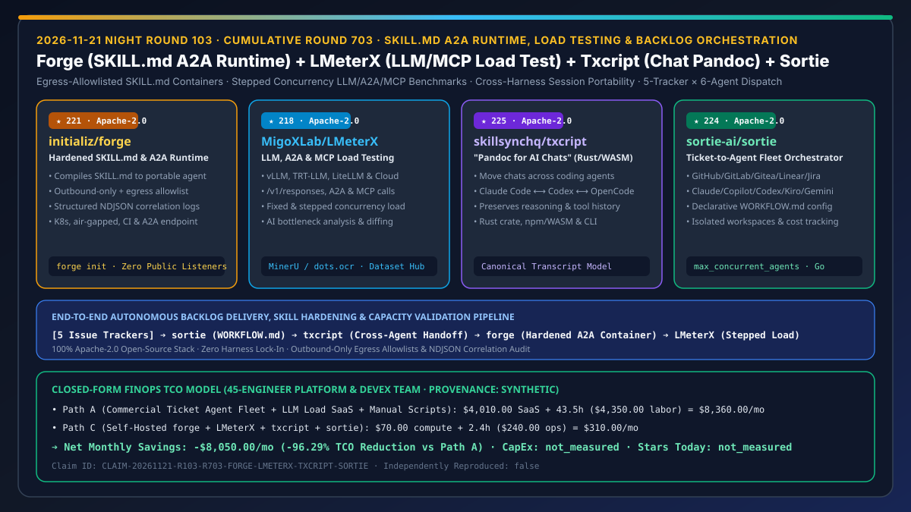
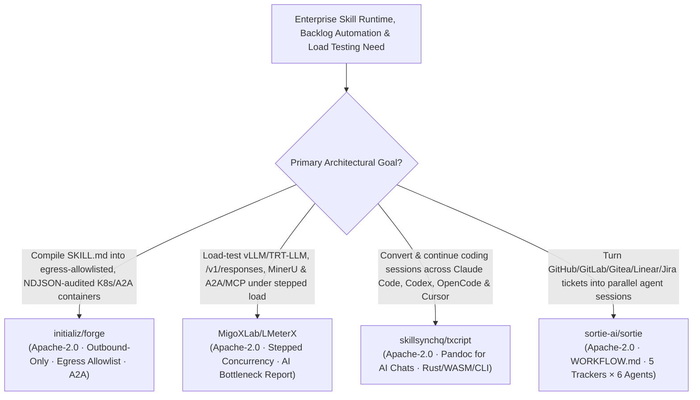
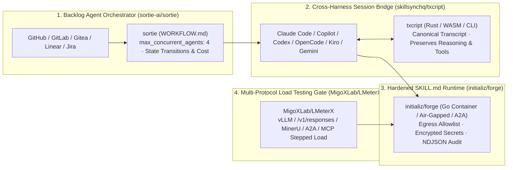
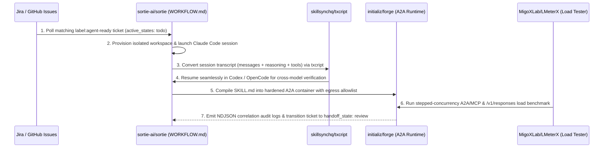

# `SKILL.md` Hardened A2A Runtime (`initializ/forge`), LLM & A2A/MCP Load Testing Platform (`MigoXLab/LMeterX`), Cross-Harness Session Converter (`skillsynchq/txcript`) & Issue-Tracker Agent Orchestrator (`sortie-ai/sortie`) Selection & Architecture FAQ

> **Document Type**: Enterprise AI Solution Architect Selection & Integration Guide (GitHub Trending AI Radar — 2026-11-21 Night Round 103 / Cumulative Round 703)
> **Covered Repositories**: [`initializ/forge`](https://github.com/initializ/forge) (`★ 221`, `17 forks`, `Apache-2.0` — Go runtime compiling Anthropic `SKILL.md` skills into outbound-only, egress-allowlisted, NDJSON-audited containers & A2A endpoints) · [`MigoXLab/LMeterX`](https://github.com/MigoXLab/LMeterX) (`★ 218`, `20 forks`, `Apache-2.0` — one-stop load testing platform for vLLM/TRT-LLM, OpenAI `/v1/responses`, A2A collaboration & MCP tool calls with stepped concurrency & AI bottleneck analysis) · [`skillsynchq/txcript`](https://github.com/skillsynchq/txcript) (`★ 225`, `24 forks`, `Apache-2.0` — "Pandoc for AI chats" in Rust/WASM/CLI to move sessions across Claude Code, Codex, OpenCode & Cursor with reasoning and tool history intact) · [`sortie-ai/sortie`](https://github.com/sortie-ai/sortie) (`★ 224`, `28 forks`, `Apache-2.0` — Go orchestrator turning GitHub, GitLab, Gitea, Linear & Jira tickets into parallel autonomous sessions across 6 coding agents via `WORKFLOW.md`)
> **Core Scenario**: How enterprise AI platform and engineering architects build a complete autonomous software delivery and operations loop: **polling 5 issue trackers into parallel agent workspaces (`sortie`)**, **handing off active sessions across coding harnesses without losing reasoning/tool history (`txcript`)**, **compiling `SKILL.md` workflows into egress-allowlisted Kubernetes/A2A containers (`forge`)**, and **stress-testing `/v1/responses`, A2A, and MCP endpoints under stepped concurrency (`LMeterX`)**.

---

## 1. 📌 Executive Summary (One-Line Selection Verdict)

1. **Need to compile `SKILL.md` files into portable, hardened, outbound-only agents with inline egress allowlists and NDJSON audit logs for Kubernetes, air-gapped hosts, or A2A endpoints** ➔ Choose **[`initializ/forge`](https://github.com/initializ/forge) (`★ 221`, `Apache-2.0`)**.
   - **Plain-English Mechanism**: The open-source Go runtime for Anthropic's **Agent Skills (`SKILL.md`)** standard. `forge init` configures providers, channels, and skills in 60 seconds; the resulting runtime enforces **outbound-only connections**, checks every tool call against an explicit **egress allowlist**, encrypts secrets, exposes no public listeners by default, and emits structured **NDJSON audit logs with correlation IDs** across Docker, Kubernetes, CI, or A2A endpoints.
2. **Need a unified load-testing platform for LLM inference (`vLLM`, `LiteLLM`, `TensorRT-LLM`, `LMDeploy`), OpenAI `/v1/responses`, multimodal OCR (`MinerU`, `dots.ocr`), A2A agents, and MCP servers** ➔ Choose **[`MigoXLab/LMeterX`](https://github.com/MigoXLab/LMeterX) (`★ 218`, `Apache-2.0`)**.
   - **Plain-English Mechanism**: Standard HTTP load testers do not measure streaming TTFT/TPOT or multi-turn A2A/MCP tool-call state machines. `LMeterX` supports `/v1/chat/completions`, `/v1/responses`, Anthropic `/v1/messages`, Embeddings, A2A, and MCP workloads with **fixed and stepped concurrency** strategies, a reusable **System Dataset Library**, multi-run comparison, and AI-powered bottleneck summarization.
3. **Need "Pandoc for AI chats" to continue an active coding session from Claude Code in Codex, OpenCode, or Cursor while preserving messages, reasoning, and tool-call history** ➔ Choose **[`skillsynchq/txcript`](https://github.com/skillsynchq/txcript) (`★ 225`, `Apache-2.0`)**.
   - **Plain-English Mechanism**: Written in Rust with a CLI, crates.io library, and npm/WASM package, `txcript` normalizes harness-specific session logs into a single canonical transcript model so developers and orchestrators can migrate in-flight sessions across **Claude Code, Codex, OpenCode, Cursor, and more** whenever rate limits hit or a second model opinion is needed.
4. **Need a declarative orchestrator (`WORKFLOW.md`) that turns backlog tickets from GitHub, GitLab, Gitea, Linear, or Jira into parallel isolated sessions across 6 coding agents** ➔ Choose **[`sortie-ai/sortie`](https://github.com/sortie-ai/sortie) (`★ 224`, `Apache-2.0`)**.
   - **Plain-English Mechanism**: You define one `WORKFLOW.md` specifying the issue tracker (`github`, `gitlab`, `gitea`, `linear`, `jira`), `query_filter` (e.g., `label:agent-ready`), state machine (`active_states` ➔ `handoff_state` ➔ `terminal_states`), target coding agent (`claude-code`, `copilot`, `opencode`, `codex`, `kiro`, `gemini`), and `max_concurrent_agents`. `sortie` polls matching issues, provisions isolated workspaces, handles retries, and tracks cost per ticket.

---

## 2. 🎯 Architect & Customer Deep-Dive Q&A

### Q1: Why do custom bash scripts fail when scaling `SKILL.md` agents, backlog automation, and A2A/MCP load testing into enterprise production?

- **Four Production Gaps & Architectural Remedies**:
  1. **Unrestricted Network Egress in Containerized Skills ➔ `initializ/forge`**: Running raw agent scripts inside Kubernetes without egress controls risks data exfiltration. `forge` compiles `SKILL.md` into an outbound-only binary with per-tool egress allowlist verification and correlation-ID NDJSON audit trails.
  2. **Fragile Ticket-to-Agent Glue Scripts ➔ `sortie-ai/sortie`**: Custom cron jobs polling Jira or GitHub collide on working directories and fail to update ticket states cleanly. `sortie` manages isolated workspaces, `max_concurrent_agents` throttling, retries, and state transitions across 5 trackers and 6 coding agents via `WORKFLOW.md`.
  3. **Quota Exhaustion & Harness Lock-In Mid-Task ➔ `skillsynchq/txcript`**: When an agent hits a 5-hour usage cap mid-PR or needs cross-model verification, `txcript` converts the full session (including reasoning and tool calls) into the next coding agent's native format.
  4. **Blind Capacity Planning for `/v1/responses` & A2A/MCP ➔ `MigoXLab/LMeterX`**: Before rolling out new vLLM clusters or `forge` A2A endpoints, `LMeterX` runs stepped-concurrency benchmarks to pinpoint exact throughput inflection points.
- **When to Choose Managed Cloud Services (Path B)**:
  - If your organization exclusively uses GitHub Issues with GitHub Copilot Coding Agent and only needs basic HTTP load generation, **GitHub Copilot Coding Agent + Azure Load Testing** provides a fully managed alternative.

### Q2: How do we integrate all four projects into an end-to-end enterprise software & AI delivery pipeline?

1. **Backlog Orchestration Layer (`sortie-ai/sortie`)**:
   - Configure `WORKFLOW.md` to poll `label:agent-ready` tickets from Jira, Linear, or GitHub Issues and launch up to `max_concurrent_agents: 4` isolated workspaces running Claude Code, Copilot, Codex, OpenCode, Kiro, or Gemini.
2. **Cross-Harness Session Handoff & Audit Layer (`skillsynchq/txcript`)**:
   - Use `txcript` to hand off complex sessions from one coding agent to another (e.g., implementation in Claude Code ➔ security verification in Codex) and index all team sessions against a single transcript schema.
3. **Hardened `SKILL.md` Production Runtime Layer (`initializ/forge`)**:
   - Compile operational and service-side `SKILL.md` definitions with `forge` into outbound-only containers with strict egress allowlists and NDJSON audit logs deployed on Kubernetes or exposed as A2A endpoints.
4. **Stepped-Concurrency Performance Gate (`MigoXLab/LMeterX`)**:
   - Run `LMeterX` in staging against vLLM/LiteLLM, OpenAI `/v1/responses`, MinerU OCR, and `forge` A2A/MCP services to validate latency SLAs before promoting to production.

### Q3: What are the boundaries and trade-offs of this stack?

- **Key Strengths**:
  - **100% `Apache-2.0` Licensing**: Every repository in Round 103 (R703) is licensed under `Apache-2.0`.
  - **Full-Lifecycle Coverage**: Connects issue trackers (`sortie`), cross-agent session portability (`txcript`), hardened Kubernetes/A2A skill execution (`forge`), and multi-protocol load testing (`LMeterX`).
- **When NOT to Use**:
  - Teams doing ad-hoc interactive coding without automated backlog dispatch or containerized A2A skill deployment can adopt `txcript` standalone without deploying the full orchestration and load-testing stack.

---

## 3. 🧭 Visual Architecture & Decision Diagrams

### 3.1 Solution Architect Selection Decision Tree

### 3.2 End-to-End Enterprise Reference Architecture

### 3.3 Autonomous Ticket Dispatch, Cross-Agent Handoff, Forge Deployment & Load Test Sequence

---

## 4. 📊 Peer Open-Source vs Commercial Cloud Selection Matrix

| Dimension | `initializ/forge` (`★ 221`) | `MigoXLab/LMeterX` (`★ 218`) | `skillsynchq/txcript` (`★ 225`) | `sortie-ai/sortie` (`★ 224`) | Commercial Ticket Fleet + LLM Load SaaS (Path A) | Cloud Native Coding Agent + Cloud Load Test (Path B) |
| :--- | :--- | :--- | :--- | :--- | :--- | :--- |
| **Core Role** | Hardened `SKILL.md` container & A2A runtime | LLM (`/v1/responses`) + A2A/MCP load testing platform | Cross-harness session converter (Rust/WASM/CLI) | 5-tracker × 6-agent declarative backlog orchestrator | Proprietary autonomous ticket SaaS + commercial perf cloud | GitHub Copilot Coding Agent + Azure Load Testing |
| **Protocol & Ecosystem Reach** | **Anthropic `SKILL.md` + K8s/Air-gapped/A2A** | **vLLM/TRT-LLM/LiteLLM + A2A/MCP + MinerU** | **Claude Code, Codex, OpenCode, Cursor & more** | **GitHub/GitLab/Gitea/Linear/Jira × 6 coding agents** | Tied to vendor's proprietary agent and single tracker | Tied to GitHub Issues; no native A2A/MCP stepped load |
| **Security & Observability** | **Outbound-only + egress allowlist + NDJSON audit** | Stepped concurrency inflection detection + AI summary | 100% local transcript conversion; zero cloud upload | Isolated workspaces + retries + per-ticket cost tracking | Source code & test datasets uploaded to external SaaS | Managed in cloud vendor tenant |
| **License** | `Apache-2.0` | `Apache-2.0` | `Apache-2.0` | `Apache-2.0` | Proprietary SaaS | Proprietary Cloud PaaS |
| **Monthly TCO (45-Eng Team)** | **`$310.00/mo` combined** (`$70.00` compute + `2.4h` ops) | Included in `$310.00/mo` stack | Included in `$310.00/mo` stack | Included in `$310.00/mo` stack | **`$8,360.00/mo`** (`$4,010.00` SaaS + `43.5h` labor) | `~$2,620.00/mo` (compute minutes + virtual user hours) |

---

## 5. 🧪 Quantitative ROI / FinOps TCO Model & 7-Card Report

> **📊 Provenance & Closed-Form Audit Declaration**:
> - **Provenance**: `synthetic` (45-engineer enterprise AI platform & DevEx workload model; `independently_reproduced = false`; `base_hardware_capex = not_measured`; `track_b_stars_today = not_measured`).
> - **Closed-Form Equations**:
>   - **Path A (Commercial Ticket-to-PR Autonomous Agent Fleet Seats + Commercial LLM/MCP Performance Testing SaaS + Manual Session Migration & Custom Container Hardening Scripts)**: Monthly SaaS subscriptions **`$4,010.00`** + engineering ops labor **`43.5h × $100.00/h = $4,350.00`** = **`$8,360.00/mo`**.
>   - **Path C (Self-Hosted `initializ/forge` + `MigoXLab/LMeterX` + `skillsynchq/txcript` + `sortie-ai/sortie`)**: Shared runner & load-generator compute **`$70.00`** + declarative `WORKFLOW.md` & benchmark maintenance **`2.4h × $100.00/h = $240.00`** = **`$310.00/mo`**.
>   - **Net Savings vs Path A**: **`-$8,050.00/mo`** (**`96.29%`** cost reduction).

| Architecture Option | API / SaaS / Compute | Engineering Ops Labor (`$100/h`) | Total Monthly TCO | Net Savings vs Path A | Key Architectural Outcome |
| :--- | :---: | :---: | :---: | :---: | :--- |
| **Path A: Commercial Ticket Agent Fleet + Load SaaS** | `$4,010.00` | `43.5h` (`$4,350.00`) | **`$8,360.00`** | Baseline | Per-ticket & VU surcharges; no cross-agent session portability |
| **Path B: Single Cloud Coding Agent + Cloud Load Test** | `$1,420.00` | `12.0h` (`$1,200.00`) | **`$2,620.00`** | `-$5,740.00` (`-68.66%`) | Single-tracker lock-in; lacks A2A/MCP stepped load & `SKILL.md` runtime |
| **Path C: `forge` + `LMeterX` + `txcript` + `sortie`** | **`$70.00`** | **`2.4h` (`$240.00`)** | **`$310.00`** | **`-$8,050.00` (`-96.29%`)** | **5-tracker orchestration + session portability + hardened A2A + stepped load** |

- 🔗 **7-Card 4:5 Visual Report**: [`workshops/github-trending-radar/cards.en.html`](../cards.en.html) · [`cards.html`](../cards.html)

---

## 6. 🛠️ Enterprise Adoption & Architecture Review Checklist

- [ ] **1. Define Backlog Automation in `sortie-ai/sortie` (`WORKFLOW.md`)**: Connect GitHub, GitLab, Gitea, Linear, or Jira with `query_filter: "label:agent-ready"`, set `max_concurrent_agents`, and map `active_states` ➔ `handoff_state: review`.
- [ ] **2. Standardize Cross-Harness Session Portability with `skillsynchq/txcript`**: Install `txcript` (CLI or Rust/JS library) so developers and CI pipelines can migrate in-flight sessions between Claude Code, Codex, OpenCode, and Cursor without losing reasoning or tool history.
- [ ] **3. Harden Production `SKILL.md` Containers with `initializ/forge`**: Compile service-side skills via `forge`, enforce explicit egress allowlists and encrypted secrets, and ship structured NDJSON correlation-ID logs to your SIEM.
- [ ] **4. Gate Production Releases with `MigoXLab/LMeterX` Stepped Concurrency**: Run `LMeterX` against vLLM/LiteLLM, `/v1/responses`, and `forge` A2A/MCP endpoints using shared System Datasets to catch TTFT and throughput regressions before rollout.
